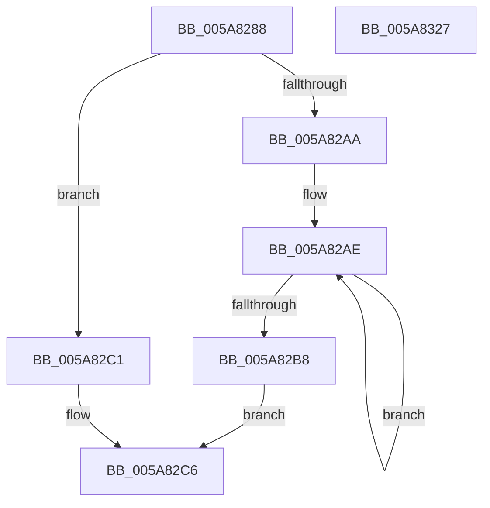

# McTemplateK0zdq_EtwWriteTransfer

- RVA: `0x005A8288`–`0x005A8328` (길이 `160` bytes)
- VA: `0x00000001405A8288`
- 실행 섹션: `.text`
- PDB 이름 있음: `예`; PDB Function 태그: `아니요`
- unwind 정보 RVA: `0x000886E8`
- 디코드: `40`개 명령, `160/160` bytes 표시
- 미해석 바이트: `0` (있으면 어셈블리에 `.byte`로 보존)

> 이 문서는 커널 이미지의 기계어와 PDB 기호를 분석해 생성했습니다. 4번과 5번은 함수 원형과 자료형을 바이너리 사용 방식에서 추정한 C 해석이며 원본 소스 복구 결과는 아닙니다.

## 1. Dependencies

- 직접 호출 지점: **2**; 고유 호출 대상: **2**
- 직접 호출자로 확인된 함수: **1**
- RIP 상대 이미지 참조: **3**

### Outgoing calls
- `0x005A830D` → [McGenEventWrite_EtwWriteTransfer](../42/McGenEventWrite_EtwWriteTransfer_function_00424FC8.md) (function, `0x00424FC8`)
- `0x005A8319` → [_security_check_cookie](../6A/_security_check_cookie_function_006AC640.md) (function, `0x006AC640`)

### Direct callers
- [sub_006F4704](../6F/Unknown_function_006F4704.md) at `0x006F4813`

### Static image references
- `0x005A8294` → RVA `0x00E0A740` (`.data`; read)
- `0x005A82C9` → RVA `0x006CB080` (` ?? ::FNODOBFM::`string'`; read)
- `0x005A82FD` → RVA `0x00E06DA0` (`.data`; read)

## 2. Other-region calls and transfers

- 다른 실행 섹션으로 향하는 call: **0**
- 별도 외부 분기/꼬리 이동을 확인하지 못했습니다.

## 3. Assembly (complete function range)

```asm
005A8288  40 55                           push rbp
005A828A  48 8B EC                        mov rbp, rsp
005A828D  48 81 EC 80 00 00 00            sub rsp, 0x80
005A8294  48 8B 05 A5 24 86 00            mov rax, qword ptr [rip + 0x8624a5]
005A829B  48 33 C4                        xor rax, rsp
005A829E  48 89 45 F0                     mov qword ptr [rbp - 0x10], rax
005A82A2  45 33 C0                        xor r8d, r8d
005A82A5  4D 85 C9                        test r9, r9
005A82A8  74 17                           je 0x1405a82c1
005A82AA  48 83 C8 FF                     or rax, 0xffffffffffffffff
005A82AE  48 FF C0                        inc rax
005A82B1  66 45 39 04 41                  cmp word ptr [r9 + rax*2], r8w
005A82B6  75 F6                           jne 0x1405a82ae
005A82B8  8D 04 45 02 00 00 00            lea eax, [rax*2 + 2]
005A82BF  EB 05                           jmp 0x1405a82c6
005A82C1  B8 0A 00 00 00                  mov eax, 0xa
005A82C6  89 45 C8                        mov dword ptr [rbp - 0x38], eax
005A82C9  48 8D 0D B0 2D 12 00            lea rcx, [rip + 0x122db0]
005A82D0  4D 85 C9                        test r9, r9
005A82D3  44 89 45 CC                     mov dword ptr [rbp - 0x34], r8d
005A82D7  48 8D 45 30                     lea rax, [rbp + 0x30]
005A82DB  4C 0F 44 C9                     cmove r9, rcx
005A82DF  48 89 45 D0                     mov qword ptr [rbp - 0x30], rax
005A82E3  48 8D 45 38                     lea rax, [rbp + 0x38]
005A82E7  4C 89 4D C0                     mov qword ptr [rbp - 0x40], r9
005A82EB  41 B9 04 00 00 00               mov r9d, 4
005A82F1  48 89 45 E0                     mov qword ptr [rbp - 0x20], rax
005A82F5  48 8D 45 B0                     lea rax, [rbp - 0x50]
005A82F9  4C 89 4D D8                     mov qword ptr [rbp - 0x28], r9
005A82FD  48 8D 0D 9C EA 85 00            lea rcx, [rip + 0x85ea9c]
005A8304  48 89 44 24 20                  mov qword ptr [rsp + 0x20], rax
005A8309  4C 89 4D E8                     mov qword ptr [rbp - 0x18], r9
005A830D  E8 B6 CC E7 FF                  call 0x140424fc8
005A8312  48 8B 4D F0                     mov rcx, qword ptr [rbp - 0x10]
005A8316  48 33 CC                        xor rcx, rsp
005A8319  E8 22 43 10 00                  call 0x1406ac640
005A831E  48 81 C4 80 00 00 00            add rsp, 0x80
005A8325  5D                              pop rbp
005A8326  C3                              ret
005A8327  CC                              int3
```

## 4. C-style interpretation (structured pseudocode)

```c
__int64 __fastcall McTemplateK0zdq_EtwWriteTransfer(__int64 a1, __int64 a2, int a3, __int64 a4, __int64 a5, __int64 a6)
{
    __int64 result;
    __int64 v_rsp;
    unsigned __int64 v_stack_m18;
    unsigned __int64 v_stack_m20;
    unsigned __int64 v_stack_m28;
    unsigned __int64 v_stack_m30;
    unsigned __int64 v_stack_m38;
    unsigned int v_stack_m3C;
    unsigned int v_stack_m40;
    unsigned __int64 v_stack_m48;
    unsigned __int64 v_stack_m58;
    unsigned __int64 v_stack_m68;

    v_rsp = (v_rsp) - (128);
    result = (*(unsigned __int64 *)(v_rip + 8791205)) ^ (v_rsp);
    v_stack_m18 = result;
    a3 = 0;
    if (a4 == 0) goto loc_005A82C1;
    result = (result) | (-1);
loc_005A82AE:
    result = (result) + 1;
    if ((*(unsigned __int16 *)(a4 + result * 2)) != 0) goto loc_005A82AE;
    goto loc_005A82C6;
loc_005A82C1:
loc_005A82C6:
    v_stack_m40 = 10;
    v_stack_m3C = 0;
    if (a4 == 0) { a4 = v_rip + 1191344; }
    v_stack_m38 = a5;
    v_stack_m48 = a4;
    v_stack_m28 = a6;
    v_stack_m30 = 4;
    v_stack_m68 = v_stack_m58;
    v_stack_m20 = 4;
    result = McGenEventWrite_EtwWriteTransfer(v_rip + 8776348, a2, a3, 4);
    a1 = (v_stack_m18) ^ (v_rsp);
    result = _security_check_cookie(a1, a2, a3, 4);
    v_rsp = (v_rsp) + (128);
    return result;
}
```

## 5. (Beta) C Style

```c
int64_t McTemplateK0zdq_EtwWriteTransfer(int64_t Arg1, int64_t Arg2, int32_t Arg3, int64_t Arg4, int64_t Arg5, int64_t Arg6)
{
    int64_t result;
    int64_t local_rsp;
    uint64_t v_stack_m18;
    uint64_t v_stack_m20;
    uint64_t v_stack_m28;
    uint64_t v_stack_m30;
    uint64_t v_stack_m38;
    uint32_t v_stack_m3C;
    uint32_t v_stack_m40;
    uint64_t v_stack_m48;
    uint64_t v_stack_m58;
    uint64_t v_stack_m68;

    local_rsp = (local_rsp) - (128);
    result = (*(uint64_t *)(v_rip + 0x8624A5)) ^ (local_rsp);
    v_stack_m18 = result;
    Arg3 = 0;
    if (Arg4 == 0) goto loc_005A82C1;
    result = (result) | (-1);
loc_005A82AE:
    result = (result) + 1;
    if ((*(uint16_t *)(Arg4 + result * 2)) != 0) goto loc_005A82AE;
    goto loc_005A82C6;
loc_005A82C1:
loc_005A82C6:
    v_stack_m40 = 10;
    v_stack_m3C = 0;
    if (Arg4 == 0) { Arg4 = v_rip + 1191344; }
    v_stack_m38 = Arg5;
    v_stack_m48 = Arg4;
    v_stack_m28 = Arg6;
    v_stack_m30 = 4;
    v_stack_m68 = v_stack_m58;
    v_stack_m20 = 4;
    result = McGenEventWrite_EtwWriteTransfer(v_rip + 8776348, Arg2, Arg3, 4);
    Arg1 = (v_stack_m18) ^ (local_rsp);
    result = _security_check_cookie(Arg1, Arg2, Arg3, 4);
    local_rsp = (local_rsp) + (128);
    return result;
}
```

## 6. Execution-region graph

[열기: 2D/3D 그래프와 함수 탐색 컨트롤 패널](../../../control-panel.html?section=text&rva=0x005A8288&view=graph)

- 2D 그래프는 위에서 아래로 흐르고, 3D 그래프는 빈 공간을 드래그해 회전합니다. Shift+드래그는 이동, 휠은 확대·축소, 함수 노드 선택은 대상 보고서 이동입니다.

### Static fallback


