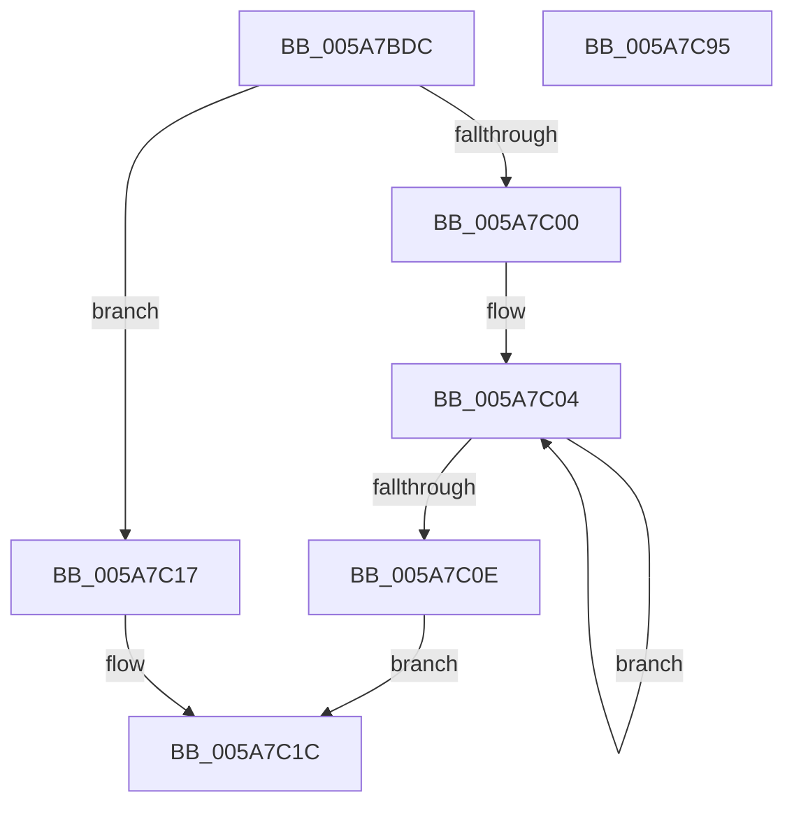

# McTemplateK0zjdd_EtwWriteTransfer

- RVA: `0x005A7BDC`–`0x005A7C96` (길이 `186` bytes)
- VA: `0x00000001405A7BDC`
- 실행 섹션: `.text`
- PDB 이름 있음: `예`; PDB Function 태그: `아니요`
- unwind 정보 RVA: `0x000BD7A0`
- 디코드: `43`개 명령, `186/186` bytes 표시
- 미해석 바이트: `0` (있으면 어셈블리에 `.byte`로 보존)

> 이 문서는 커널 이미지의 기계어와 PDB 기호를 분석해 생성했습니다. 4번과 5번은 함수 원형과 자료형을 바이너리 사용 방식에서 추정한 C 해석이며 원본 소스 복구 결과는 아닙니다.

## 1. Dependencies

- 직접 호출 지점: **2**; 고유 호출 대상: **2**
- 직접 호출자로 확인된 함수: **1**
- RIP 상대 이미지 참조: **3**

### Outgoing calls
- `0x005A7C7B` → [McGenEventWrite_EtwWriteTransfer](../42/McGenEventWrite_EtwWriteTransfer_function_00424FC8.md) (function, `0x00424FC8`)
- `0x005A7C87` → [_security_check_cookie](../6A/_security_check_cookie_function_006AC640.md) (function, `0x006AC640`)

### Direct callers
- [sub_00B1DC0E](../../page/B1/Unknown_function_00B1DC0E.md) at `0x00B1DD44`

### Static image references
- `0x005A7BEA` → RVA `0x00E0A740` (`.data`; read)
- `0x005A7C1F` → RVA `0x006CB080` (` ?? ::FNODOBFM::`string'`; read)
- `0x005A7C49` → RVA `0x00E06DA0` (`.data`; read)

## 2. Other-region calls and transfers

- 다른 실행 섹션으로 향하는 call: **0**
- 별도 외부 분기/꼬리 이동을 확인하지 못했습니다.

## 3. Assembly (complete function range)

```asm
005A7BDC  40 55                           push rbp
005A7BDE  48 8D 6C 24 C1                  lea rbp, [rsp - 0x3f]
005A7BE3  48 81 EC 90 00 00 00            sub rsp, 0x90
005A7BEA  48 8B 05 4F 2B 86 00            mov rax, qword ptr [rip + 0x862b4f]
005A7BF1  48 33 C4                        xor rax, rsp
005A7BF4  48 89 45 2F                     mov qword ptr [rbp + 0x2f], rax
005A7BF8  45 33 C0                        xor r8d, r8d
005A7BFB  4D 85 C9                        test r9, r9
005A7BFE  74 17                           je 0x1405a7c17
005A7C00  48 83 C8 FF                     or rax, 0xffffffffffffffff
005A7C04  48 FF C0                        inc rax
005A7C07  66 45 39 04 41                  cmp word ptr [r9 + rax*2], r8w
005A7C0C  75 F6                           jne 0x1405a7c04
005A7C0E  8D 04 45 02 00 00 00            lea eax, [rax*2 + 2]
005A7C15  EB 05                           jmp 0x1405a7c1c
005A7C17  B8 0A 00 00 00                  mov eax, 0xa
005A7C1C  89 45 F7                        mov dword ptr [rbp - 9], eax
005A7C1F  48 8D 0D 5A 34 12 00            lea rcx, [rip + 0x12345a]
005A7C26  48 8B 45 6F                     mov rax, qword ptr [rbp + 0x6f]
005A7C2A  4D 85 C9                        test r9, r9
005A7C2D  48 89 45 FF                     mov qword ptr [rbp - 1], rax
005A7C31  48 8D 45 77                     lea rax, [rbp + 0x77]
005A7C35  4C 0F 44 C9                     cmove r9, rcx
005A7C39  48 89 45 0F                     mov qword ptr [rbp + 0xf], rax
005A7C3D  48 8D 45 7F                     lea rax, [rbp + 0x7f]
005A7C41  4C 89 4D EF                     mov qword ptr [rbp - 0x11], r9
005A7C45  48 89 45 1F                     mov qword ptr [rbp + 0x1f], rax
005A7C49  48 8D 0D 50 F1 85 00            lea rcx, [rip + 0x85f150]
005A7C50  48 8D 45 DF                     lea rax, [rbp - 0x21]
005A7C54  44 89 45 FB                     mov dword ptr [rbp - 5], r8d
005A7C58  41 B9 05 00 00 00               mov r9d, 5
005A7C5E  48 89 44 24 20                  mov qword ptr [rsp + 0x20], rax
005A7C63  48 C7 45 07 10 00 00 00         mov qword ptr [rbp + 7], 0x10
005A7C6B  48 C7 45 17 04 00 00 00         mov qword ptr [rbp + 0x17], 4
005A7C73  48 C7 45 27 04 00 00 00         mov qword ptr [rbp + 0x27], 4
005A7C7B  E8 48 D3 E7 FF                  call 0x140424fc8
005A7C80  48 8B 4D 2F                     mov rcx, qword ptr [rbp + 0x2f]
005A7C84  48 33 CC                        xor rcx, rsp
005A7C87  E8 B4 49 10 00                  call 0x1406ac640
005A7C8C  48 81 C4 90 00 00 00            add rsp, 0x90
005A7C93  5D                              pop rbp
005A7C94  C3                              ret
005A7C95  CC                              int3
```

## 4. C-style interpretation (structured pseudocode)

```c
__int64 __fastcall McTemplateK0zjdd_EtwWriteTransfer(__int64 a1, __int64 a2, int a3, __int64 a4, __int64 a5, __int64 a6, __int64 a7)
{
    __int64 result;
    __int64 v_rsp;
    unsigned __int64 v_stack_m18;
    unsigned __int64 v_stack_m20;
    unsigned __int64 v_stack_m28;
    unsigned __int64 v_stack_m30;
    unsigned __int64 v_stack_m38;
    unsigned __int64 v_stack_m40;
    unsigned __int64 v_stack_m47;
    unsigned __int64 v_stack_m48;
    unsigned int v_stack_m4C;
    unsigned int v_stack_m50;
    unsigned __int64 v_stack_m58;
    unsigned __int64 v_stack_m68;
    unsigned __int64 v_stack_m78;

    v_rsp = (v_rsp) - (144);
    result = (*(unsigned __int64 *)(v_rip + 8792911)) ^ (v_rsp);
    v_stack_m18 = result;
    a3 = 0;
    if (a4 == 0) goto loc_005A7C17;
    result = (result) | (-1);
loc_005A7C04:
    result = (result) + 1;
    if ((*(unsigned __int16 *)(a4 + result * 2)) != 0) goto loc_005A7C04;
    goto loc_005A7C1C;
loc_005A7C17:
loc_005A7C1C:
    v_stack_m50 = 10;
    v_stack_m48 = a5;
    if (a4 == 0) { a4 = v_rip + 1193050; }
    v_stack_m38 = a6;
    v_stack_m58 = a4;
    v_stack_m28 = a7;
    v_stack_m4C = 0;
    v_stack_m78 = v_stack_m68;
    v_stack_m40 = 16;
    v_stack_m30 = 4;
    v_stack_m20 = 4;
    result = McGenEventWrite_EtwWriteTransfer(v_rip + 8778064, a2, a3, 5);
    a1 = (v_stack_m18) ^ (v_rsp);
    result = _security_check_cookie(a1, a2, a3, 5);
    v_rsp = (v_rsp) + (144);
    return result;
}
```

## 5. (Beta) C Style

```c
int64_t McTemplateK0zjdd_EtwWriteTransfer(int64_t Arg1, int64_t Arg2, int32_t Arg3, int64_t Arg4, int64_t Arg5, int64_t Arg6, int64_t Arg7)
{
    int64_t result;
    int64_t local_rsp;
    uint64_t v_stack_m18;
    uint64_t v_stack_m20;
    uint64_t v_stack_m28;
    uint64_t v_stack_m30;
    uint64_t v_stack_m38;
    uint64_t v_stack_m40;
    uint64_t v_stack_m47;
    uint64_t v_stack_m48;
    uint32_t v_stack_m4C;
    uint32_t v_stack_m50;
    uint64_t v_stack_m58;
    uint64_t v_stack_m68;
    uint64_t v_stack_m78;

    local_rsp = (local_rsp) - (144);
    result = (*(uint64_t *)(v_rip + 0x862B4F)) ^ (local_rsp);
    v_stack_m18 = result;
    Arg3 = 0;
    if (Arg4 == 0) goto loc_005A7C17;
    result = (result) | (-1);
loc_005A7C04:
    result = (result) + 1;
    if ((*(uint16_t *)(Arg4 + result * 2)) != 0) goto loc_005A7C04;
    goto loc_005A7C1C;
loc_005A7C17:
loc_005A7C1C:
    v_stack_m50 = 10;
    v_stack_m48 = Arg5;
    if (Arg4 == 0) { Arg4 = v_rip + 1193050; }
    v_stack_m38 = Arg6;
    v_stack_m58 = Arg4;
    v_stack_m28 = Arg7;
    v_stack_m4C = 0;
    v_stack_m78 = v_stack_m68;
    v_stack_m40 = 16;
    v_stack_m30 = 4;
    v_stack_m20 = 4;
    result = McGenEventWrite_EtwWriteTransfer(v_rip + 8778064, Arg2, Arg3, 5);
    Arg1 = (v_stack_m18) ^ (local_rsp);
    result = _security_check_cookie(Arg1, Arg2, Arg3, 5);
    local_rsp = (local_rsp) + (144);
    return result;
}
```

## 6. Execution-region graph

[열기: 2D/3D 그래프와 함수 탐색 컨트롤 패널](../../../control-panel.html?section=text&rva=0x005A7BDC&view=graph)

- 2D 그래프는 위에서 아래로 흐르고, 3D 그래프는 빈 공간을 드래그해 회전합니다. Shift+드래그는 이동, 휠은 확대·축소, 함수 노드 선택은 대상 보고서 이동입니다.

### Static fallback


