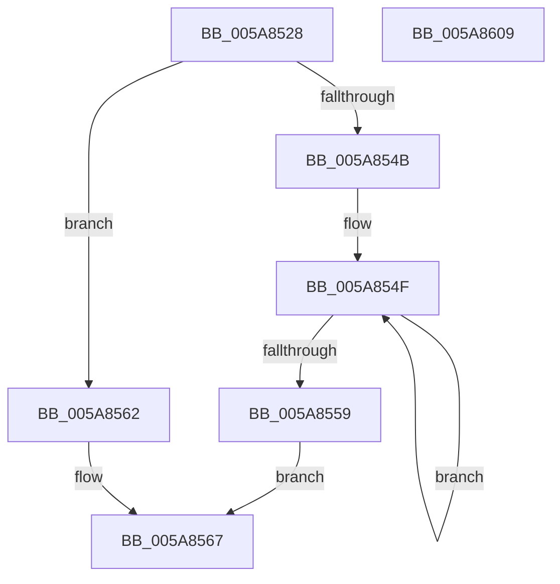

# McTemplateK0zjqdtd_EtwWriteTransfer

- RVA: `0x005A8528`–`0x005A860A` (길이 `226` bytes)
- VA: `0x00000001405A8528`
- 실행 섹션: `.text`
- PDB 이름 있음: `예`; PDB Function 태그: `아니요`
- unwind 정보 RVA: `0x00079278`
- 디코드: `51`개 명령, `226/226` bytes 표시
- 미해석 바이트: `0` (있으면 어셈블리에 `.byte`로 보존)

> 이 문서는 커널 이미지의 기계어와 PDB 기호를 분석해 생성했습니다. 4번과 5번은 함수 원형과 자료형을 바이너리 사용 방식에서 추정한 C 해석이며 원본 소스 복구 결과는 아닙니다.

## 1. Dependencies

- 직접 호출 지점: **2**; 고유 호출 대상: **2**
- 직접 호출자로 확인된 함수: **1**
- RIP 상대 이미지 참조: **4**

### Outgoing calls
- `0x005A85EF` → [McGenEventWrite_EtwWriteTransfer](../42/McGenEventWrite_EtwWriteTransfer_function_00424FC8.md) (function, `0x00424FC8`)
- `0x005A85FB` → [_security_check_cookie](../6A/_security_check_cookie_function_006AC640.md) (function, `0x006AC640`)

### Direct callers
- [sub_00B2624A](../../page/B2/Unknown_function_00B2624A.md) at `0x00B2627B`

### Static image references
- `0x005A8536` → RVA `0x00E0A740` (`.data`; read)
- `0x005A856A` → RVA `0x006CB080` (` ?? ::FNODOBFM::`string'`; read)
- `0x005A8594` → RVA `0x00E06DA0` (`.data`; read)
- `0x005A85A6` → RVA `0x00027150` (`.rdata`; read)

## 2. Other-region calls and transfers

- 다른 실행 섹션으로 향하는 call: **0**
- 별도 외부 분기/꼬리 이동을 확인하지 못했습니다.

## 3. Assembly (complete function range)

```asm
005A8528  40 55                           push rbp
005A852A  48 8D 6C 24 D1                  lea rbp, [rsp - 0x2f]
005A852F  48 81 EC B0 00 00 00            sub rsp, 0xb0
005A8536  48 8B 05 03 22 86 00            mov rax, qword ptr [rip + 0x862203]
005A853D  48 33 C4                        xor rax, rsp
005A8540  48 89 45 1F                     mov qword ptr [rbp + 0x1f], rax
005A8544  33 D2                           xor edx, edx
005A8546  4D 85 C9                        test r9, r9
005A8549  74 17                           je 0x1405a8562
005A854B  48 83 C8 FF                     or rax, 0xffffffffffffffff
005A854F  48 FF C0                        inc rax
005A8552  66 41 39 14 41                  cmp word ptr [r9 + rax*2], dx
005A8557  75 F6                           jne 0x1405a854f
005A8559  8D 04 45 02 00 00 00            lea eax, [rax*2 + 2]
005A8560  EB 05                           jmp 0x1405a8567
005A8562  B8 0A 00 00 00                  mov eax, 0xa
005A8567  89 45 C7                        mov dword ptr [rbp - 0x39], eax
005A856A  48 8D 0D 0F 2B 12 00            lea rcx, [rip + 0x122b0f]
005A8571  48 8B 45 5F                     mov rax, qword ptr [rbp + 0x5f]
005A8575  4D 85 C9                        test r9, r9
005A8578  48 89 45 CF                     mov qword ptr [rbp - 0x31], rax
005A857C  48 8D 45 67                     lea rax, [rbp + 0x67]
005A8580  48 89 45 DF                     mov qword ptr [rbp - 0x21], rax
005A8584  4C 0F 44 C9                     cmove r9, rcx
005A8588  48 8D 45 6F                     lea rax, [rbp + 0x6f]
005A858C  4C 89 4D BF                     mov qword ptr [rbp - 0x41], r9
005A8590  48 89 45 EF                     mov qword ptr [rbp - 0x11], rax
005A8594  48 8D 0D 05 E8 85 00            lea rcx, [rip + 0x85e805]
005A859B  48 8D 45 77                     lea rax, [rbp + 0x77]
005A859F  89 55 CB                        mov dword ptr [rbp - 0x35], edx
005A85A2  48 89 45 FF                     mov qword ptr [rbp - 1], rax
005A85A6  48 8D 15 A3 EB A7 FF            lea rdx, [rip - 0x58145d]
005A85AD  48 8D 45 7F                     lea rax, [rbp + 0x7f]
005A85B1  48 C7 45 D7 10 00 00 00         mov qword ptr [rbp - 0x29], 0x10
005A85B9  48 89 45 0F                     mov qword ptr [rbp + 0xf], rax
005A85BD  41 B9 07 00 00 00               mov r9d, 7
005A85C3  48 8D 45 AF                     lea rax, [rbp - 0x51]
005A85C7  48 C7 45 E7 04 00 00 00         mov qword ptr [rbp - 0x19], 4
005A85CF  45 33 C0                        xor r8d, r8d
005A85D2  48 89 44 24 20                  mov qword ptr [rsp + 0x20], rax
005A85D7  48 C7 45 F7 04 00 00 00         mov qword ptr [rbp - 9], 4
005A85DF  48 C7 45 07 04 00 00 00         mov qword ptr [rbp + 7], 4
005A85E7  48 C7 45 17 04 00 00 00         mov qword ptr [rbp + 0x17], 4
005A85EF  E8 D4 C9 E7 FF                  call 0x140424fc8
005A85F4  48 8B 4D 1F                     mov rcx, qword ptr [rbp + 0x1f]
005A85F8  48 33 CC                        xor rcx, rsp
005A85FB  E8 40 40 10 00                  call 0x1406ac640
005A8600  48 81 C4 B0 00 00 00            add rsp, 0xb0
005A8607  5D                              pop rbp
005A8608  C3                              ret
005A8609  CC                              int3
```

## 4. C-style interpretation (structured pseudocode)

```c
__int64 __fastcall McTemplateK0zjqdtd_EtwWriteTransfer(__int64 a1, int a2, int a3, __int64 a4, __int64 a5, __int64 a6, __int64 a7, __int64 a8, __int64 a9)
{
    __int64 result;
    __int64 v_rsp;
    unsigned __int64 v_stack_m18;
    unsigned __int64 v_stack_m20;
    unsigned __int64 v_stack_m28;
    unsigned __int64 v_stack_m30;
    unsigned __int64 v_stack_m37;
    unsigned __int64 v_stack_m38;
    unsigned __int64 v_stack_m40;
    unsigned __int64 v_stack_m48;
    unsigned __int64 v_stack_m50;
    unsigned __int64 v_stack_m58;
    unsigned __int64 v_stack_m60;
    unsigned __int64 v_stack_m68;
    unsigned int v_stack_m6C;
    unsigned int v_stack_m70;
    unsigned __int64 v_stack_m78;
    unsigned __int64 v_stack_m88;
    unsigned __int64 v_stack_m98;

    v_rsp = (v_rsp) - (176);
    result = (*(unsigned __int64 *)(v_rip + 8790531)) ^ (v_rsp);
    v_stack_m18 = result;
    a2 = 0;
    if (a4 == 0) goto loc_005A8562;
    result = (result) | (-1);
loc_005A854F:
    result = (result) + 1;
    if ((*(unsigned __int16 *)(a4 + result * 2)) != 0) goto loc_005A854F;
    goto loc_005A8567;
loc_005A8562:
loc_005A8567:
    v_stack_m70 = 10;
    v_stack_m68 = a5;
    v_stack_m58 = a6;
    if (a4 == 0) { a4 = v_rip + 1190671; }
    v_stack_m78 = a4;
    v_stack_m48 = a7;
    v_stack_m6C = 0;
    v_stack_m38 = a8;
    v_stack_m60 = 16;
    v_stack_m28 = a9;
    v_stack_m50 = 4;
    a3 = 0;
    v_stack_m98 = v_stack_m88;
    v_stack_m40 = 4;
    v_stack_m30 = 4;
    v_stack_m20 = 4;
    result = McGenEventWrite_EtwWriteTransfer(v_rip + 8775685, v_rip - 5772381, a3, 7);
    a1 = (v_stack_m18) ^ (v_rsp);
    result = _security_check_cookie(a1, v_rip - 5772381, a3, 7);
    v_rsp = (v_rsp) + (176);
    return result;
}
```

## 5. (Beta) C Style

```c
int64_t McTemplateK0zjqdtd_EtwWriteTransfer(int64_t Arg1, int32_t Arg2, int32_t Arg3, int64_t Arg4, int64_t Arg5, int64_t Arg6, int64_t Arg7, int64_t Arg8, int64_t Arg9)
{
    int64_t result;
    int64_t local_rsp;
    uint64_t v_stack_m18;
    uint64_t v_stack_m20;
    uint64_t v_stack_m28;
    uint64_t v_stack_m30;
    uint64_t v_stack_m37;
    uint64_t v_stack_m38;
    uint64_t v_stack_m40;
    uint64_t v_stack_m48;
    uint64_t v_stack_m50;
    uint64_t v_stack_m58;
    uint64_t v_stack_m60;
    uint64_t v_stack_m68;
    uint32_t v_stack_m6C;
    uint32_t v_stack_m70;
    uint64_t v_stack_m78;
    uint64_t v_stack_m88;
    uint64_t v_stack_m98;

    local_rsp = (local_rsp) - (176);
    result = (*(uint64_t *)(v_rip + 0x862203)) ^ (local_rsp);
    v_stack_m18 = result;
    Arg2 = 0;
    if (Arg4 == 0) goto loc_005A8562;
    result = (result) | (-1);
loc_005A854F:
    result = (result) + 1;
    if ((*(uint16_t *)(Arg4 + result * 2)) != 0) goto loc_005A854F;
    goto loc_005A8567;
loc_005A8562:
loc_005A8567:
    v_stack_m70 = 10;
    v_stack_m68 = Arg5;
    v_stack_m58 = Arg6;
    if (Arg4 == 0) { Arg4 = v_rip + 1190671; }
    v_stack_m78 = Arg4;
    v_stack_m48 = Arg7;
    v_stack_m6C = 0;
    v_stack_m38 = Arg8;
    v_stack_m60 = 16;
    v_stack_m28 = Arg9;
    v_stack_m50 = 4;
    Arg3 = 0;
    v_stack_m98 = v_stack_m88;
    v_stack_m40 = 4;
    v_stack_m30 = 4;
    v_stack_m20 = 4;
    result = McGenEventWrite_EtwWriteTransfer(v_rip + 8775685, v_rip - 5772381, Arg3, 7);
    Arg1 = (v_stack_m18) ^ (local_rsp);
    result = _security_check_cookie(Arg1, v_rip - 5772381, Arg3, 7);
    local_rsp = (local_rsp) + (176);
    return result;
}
```

## 6. Execution-region graph

[열기: 2D/3D 그래프와 함수 탐색 컨트롤 패널](../../../control-panel.html?section=text&rva=0x005A8528&view=graph)

- 2D 그래프는 위에서 아래로 흐르고, 3D 그래프는 빈 공간을 드래그해 회전합니다. Shift+드래그는 이동, 휠은 확대·축소, 함수 노드 선택은 대상 보고서 이동입니다.

### Static fallback


