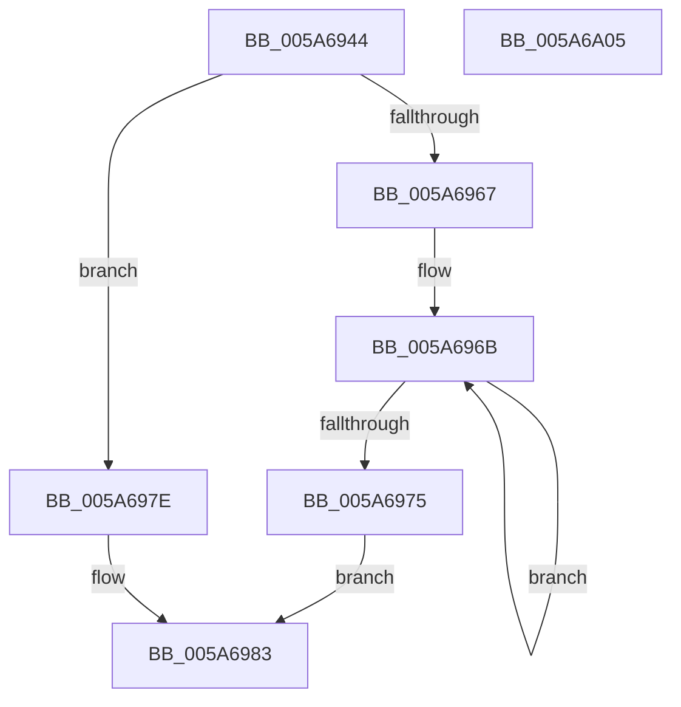

# McTemplateK0zqdi_EtwWriteTransfer

- RVA: `0x005A6944`–`0x005A6A06` (길이 `194` bytes)
- VA: `0x00000001405A6944`
- 실행 섹션: `.text`
- PDB 이름 있음: `예`; PDB Function 태그: `아니요`
- unwind 정보 RVA: `0x000BD7A0`
- 디코드: `45`개 명령, `194/194` bytes 표시
- 미해석 바이트: `0` (있으면 어셈블리에 `.byte`로 보존)

> 이 문서는 커널 이미지의 기계어와 PDB 기호를 분석해 생성했습니다. 4번과 5번은 함수 원형과 자료형을 바이너리 사용 방식에서 추정한 C 해석이며 원본 소스 복구 결과는 아닙니다.

## 1. Dependencies

- 직접 호출 지점: **2**; 고유 호출 대상: **2**
- 직접 호출자로 확인된 함수: **1**
- RIP 상대 이미지 참조: **4**

### Outgoing calls
- `0x005A69EB` → [McGenEventWrite_EtwWriteTransfer](../42/McGenEventWrite_EtwWriteTransfer_function_00424FC8.md) (function, `0x00424FC8`)
- `0x005A69F7` → [_security_check_cookie](../6A/_security_check_cookie_function_006AC640.md) (function, `0x006AC640`)

### Direct callers
- [PnpLogDeviceRequiresReboot](../../page/72/PnpLogDeviceRequiresReboot_function_0072C818.md) at `0x0072C8DF`

### Static image references
- `0x005A6952` → RVA `0x00E0A740` (`.data`; read)
- `0x005A6986` → RVA `0x006CB080` (` ?? ::FNODOBFM::`string'`; read)
- `0x005A69B3` → RVA `0x00026D00` (`.rdata`; read)
- `0x005A69CA` → RVA `0x00E06DA0` (`.data`; read)

## 2. Other-region calls and transfers

- 다른 실행 섹션으로 향하는 call: **0**
- 별도 외부 분기/꼬리 이동을 확인하지 못했습니다.

## 3. Assembly (complete function range)

```asm
005A6944  40 55                           push rbp
005A6946  48 8D 6C 24 C1                  lea rbp, [rsp - 0x3f]
005A694B  48 81 EC 90 00 00 00            sub rsp, 0x90
005A6952  48 8B 05 E7 3D 86 00            mov rax, qword ptr [rip + 0x863de7]
005A6959  48 33 C4                        xor rax, rsp
005A695C  48 89 45 2F                     mov qword ptr [rbp + 0x2f], rax
005A6960  33 D2                           xor edx, edx
005A6962  4D 85 C9                        test r9, r9
005A6965  74 17                           je 0x1405a697e
005A6967  48 83 C8 FF                     or rax, 0xffffffffffffffff
005A696B  48 FF C0                        inc rax
005A696E  66 41 39 14 41                  cmp word ptr [r9 + rax*2], dx
005A6973  75 F6                           jne 0x1405a696b
005A6975  8D 04 45 02 00 00 00            lea eax, [rax*2 + 2]
005A697C  EB 05                           jmp 0x1405a6983
005A697E  B8 0A 00 00 00                  mov eax, 0xa
005A6983  89 45 F7                        mov dword ptr [rbp - 9], eax
005A6986  48 8D 0D F3 46 12 00            lea rcx, [rip + 0x1246f3]
005A698D  4D 85 C9                        test r9, r9
005A6990  89 55 FB                        mov dword ptr [rbp - 5], edx
005A6993  48 8D 45 6F                     lea rax, [rbp + 0x6f]
005A6997  48 C7 45 07 04 00 00 00         mov qword ptr [rbp + 7], 4
005A699F  4C 0F 44 C9                     cmove r9, rcx
005A69A3  48 89 45 FF                     mov qword ptr [rbp - 1], rax
005A69A7  48 8D 45 77                     lea rax, [rbp + 0x77]
005A69AB  4C 89 4D EF                     mov qword ptr [rbp - 0x11], r9
005A69AF  48 89 45 0F                     mov qword ptr [rbp + 0xf], rax
005A69B3  48 8D 15 46 03 A8 FF            lea rdx, [rip - 0x57fcba]
005A69BA  48 8D 45 7F                     lea rax, [rbp + 0x7f]
005A69BE  48 C7 45 17 04 00 00 00         mov qword ptr [rbp + 0x17], 4
005A69C6  48 89 45 1F                     mov qword ptr [rbp + 0x1f], rax
005A69CA  48 8D 0D CF 03 86 00            lea rcx, [rip + 0x8603cf]
005A69D1  48 8D 45 DF                     lea rax, [rbp - 0x21]
005A69D5  48 C7 45 27 08 00 00 00         mov qword ptr [rbp + 0x27], 8
005A69DD  41 B9 05 00 00 00               mov r9d, 5
005A69E3  48 89 44 24 20                  mov qword ptr [rsp + 0x20], rax
005A69E8  45 33 C0                        xor r8d, r8d
005A69EB  E8 D8 E5 E7 FF                  call 0x140424fc8
005A69F0  48 8B 4D 2F                     mov rcx, qword ptr [rbp + 0x2f]
005A69F4  48 33 CC                        xor rcx, rsp
005A69F7  E8 44 5C 10 00                  call 0x1406ac640
005A69FC  48 81 C4 90 00 00 00            add rsp, 0x90
005A6A03  5D                              pop rbp
005A6A04  C3                              ret
005A6A05  CC                              int3
```

## 4. C-style interpretation (structured pseudocode)

```c
__int64 __fastcall McTemplateK0zqdi_EtwWriteTransfer(__int64 a1, int a2, int a3, __int64 a4, __int64 a5, __int64 a6, __int64 a7)
{
    __int64 result;
    __int64 v_rsp;
    unsigned __int64 v_stack_m18;
    unsigned __int64 v_stack_m20;
    unsigned __int64 v_stack_m28;
    unsigned __int64 v_stack_m30;
    unsigned __int64 v_stack_m38;
    unsigned __int64 v_stack_m40;
    unsigned __int64 v_stack_m47;
    unsigned __int64 v_stack_m48;
    unsigned int v_stack_m4C;
    unsigned int v_stack_m50;
    unsigned __int64 v_stack_m58;
    unsigned __int64 v_stack_m68;
    unsigned __int64 v_stack_m78;

    v_rsp = (v_rsp) - (144);
    result = (*(unsigned __int64 *)(v_rip + 8797671)) ^ (v_rsp);
    v_stack_m18 = result;
    a2 = 0;
    if (a4 == 0) goto loc_005A697E;
    result = (result) | (-1);
loc_005A696B:
    result = (result) + 1;
    if ((*(unsigned __int16 *)(a4 + result * 2)) != 0) goto loc_005A696B;
    goto loc_005A6983;
loc_005A697E:
loc_005A6983:
    v_stack_m50 = 10;
    v_stack_m4C = 0;
    v_stack_m40 = 4;
    if (a4 == 0) { a4 = v_rip + 1197811; }
    v_stack_m48 = a5;
    v_stack_m58 = a4;
    v_stack_m38 = a6;
    v_stack_m30 = 4;
    v_stack_m28 = a7;
    v_stack_m20 = 8;
    v_stack_m78 = v_stack_m68;
    a3 = 0;
    result = McGenEventWrite_EtwWriteTransfer(v_rip + 8782799, v_rip - 5766330, a3, 5);
    a1 = (v_stack_m18) ^ (v_rsp);
    result = _security_check_cookie(a1, v_rip - 5766330, a3, 5);
    v_rsp = (v_rsp) + (144);
    return result;
}
```

## 5. (Beta) C Style

```c
int64_t McTemplateK0zqdi_EtwWriteTransfer(int64_t Arg1, int32_t Arg2, int32_t Arg3, int64_t Arg4, int64_t Arg5, int64_t Arg6, int64_t Arg7)
{
    int64_t result;
    int64_t local_rsp;
    uint64_t v_stack_m18;
    uint64_t v_stack_m20;
    uint64_t v_stack_m28;
    uint64_t v_stack_m30;
    uint64_t v_stack_m38;
    uint64_t v_stack_m40;
    uint64_t v_stack_m47;
    uint64_t v_stack_m48;
    uint32_t v_stack_m4C;
    uint32_t v_stack_m50;
    uint64_t v_stack_m58;
    uint64_t v_stack_m68;
    uint64_t v_stack_m78;

    local_rsp = (local_rsp) - (144);
    result = (*(uint64_t *)(v_rip + 0x863DE7)) ^ (local_rsp);
    v_stack_m18 = result;
    Arg2 = 0;
    if (Arg4 == 0) goto loc_005A697E;
    result = (result) | (-1);
loc_005A696B:
    result = (result) + 1;
    if ((*(uint16_t *)(Arg4 + result * 2)) != 0) goto loc_005A696B;
    goto loc_005A6983;
loc_005A697E:
loc_005A6983:
    v_stack_m50 = 10;
    v_stack_m4C = 0;
    v_stack_m40 = 4;
    if (Arg4 == 0) { Arg4 = v_rip + 1197811; }
    v_stack_m48 = Arg5;
    v_stack_m58 = Arg4;
    v_stack_m38 = Arg6;
    v_stack_m30 = 4;
    v_stack_m28 = Arg7;
    v_stack_m20 = 8;
    v_stack_m78 = v_stack_m68;
    Arg3 = 0;
    result = McGenEventWrite_EtwWriteTransfer(v_rip + 8782799, v_rip - 5766330, Arg3, 5);
    Arg1 = (v_stack_m18) ^ (local_rsp);
    result = _security_check_cookie(Arg1, v_rip - 5766330, Arg3, 5);
    local_rsp = (local_rsp) + (144);
    return result;
}
```

## 6. Execution-region graph

[열기: 2D/3D 그래프와 함수 탐색 컨트롤 패널](../../../control-panel.html?section=text&rva=0x005A6944&view=graph)

- 2D 그래프는 위에서 아래로 흐르고, 3D 그래프는 빈 공간을 드래그해 회전합니다. Shift+드래그는 이동, 휠은 확대·축소, 함수 노드 선택은 대상 보고서 이동입니다.

### Static fallback


