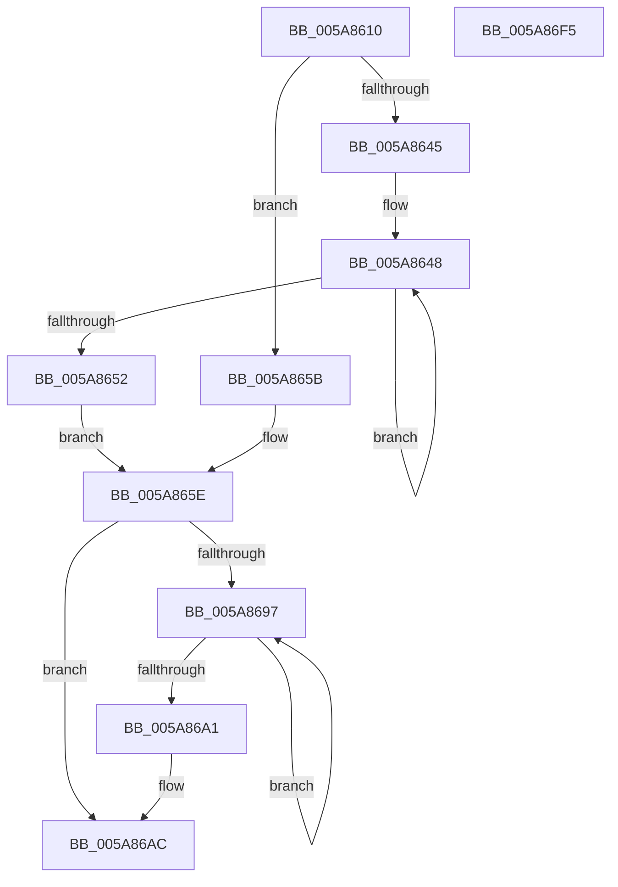

# McTemplateK0zqz_EtwWriteTransfer

- RVA: `0x005A8610`–`0x005A86F6` (길이 `230` bytes)
- VA: `0x00000001405A8610`
- 실행 섹션: `.text`
- PDB 이름 있음: `예`; PDB Function 태그: `아니요`
- unwind 정보 RVA: `0x00080C0C`
- 디코드: `53`개 명령, `230/230` bytes 표시
- 미해석 바이트: `0` (있으면 어셈블리에 `.byte`로 보존)

> 이 문서는 커널 이미지의 기계어와 PDB 기호를 분석해 생성했습니다. 4번과 5번은 함수 원형과 자료형을 바이너리 사용 방식에서 추정한 C 해석이며 원본 소스 복구 결과는 아닙니다.

## 1. Dependencies

- 직접 호출 지점: **2**; 고유 호출 대상: **2**
- 직접 호출자로 확인된 함수: **1**
- RIP 상대 이미지 참조: **4**

### Outgoing calls
- `0x005A86DA` → [McGenEventWrite_EtwWriteTransfer](../42/McGenEventWrite_EtwWriteTransfer_function_00424FC8.md) (function, `0x00424FC8`)
- `0x005A86E7` → [_security_check_cookie](../6A/_security_check_cookie_function_006AC640.md) (function, `0x006AC640`)

### Direct callers
- [PnpFinalizeVetoedRemove](../../page/A0/PnpFinalizeVetoedRemove_function_00A04968.md) at `0x00A04A28`

### Static image references
- `0x005A8619` → RVA `0x00E0A740` (`.data`; read)
- `0x005A8665` → RVA `0x006CB080` (` ?? ::FNODOBFM::`string'`; read)
- `0x005A86BF` → RVA `0x00026EF0` (`.rdata`; read)
- `0x005A86D3` → RVA `0x00E06DA0` (`.data`; read)

## 2. Other-region calls and transfers

- 다른 실행 섹션으로 향하는 call: **0**
- 별도 외부 분기/꼬리 이동을 확인하지 못했습니다.

## 3. Assembly (complete function range)

```asm
005A8610  40 53                           push rbx
005A8612  48 81 EC 80 00 00 00            sub rsp, 0x80
005A8619  48 8B 05 20 21 86 00            mov rax, qword ptr [rip + 0x862120]
005A8620  48 33 C4                        xor rax, rsp
005A8623  48 89 44 24 70                  mov qword ptr [rsp + 0x70], rax
005A8628  48 8B 94 24 B8 00 00 00         mov rdx, qword ptr [rsp + 0xb8]
005A8630  48 83 C8 FF                     or rax, 0xffffffffffffffff
005A8634  45 33 DB                        xor r11d, r11d
005A8637  4D 8B D0                        mov r10, r8
005A863A  41 B8 0A 00 00 00               mov r8d, 0xa
005A8640  4D 85 C9                        test r9, r9
005A8643  74 16                           je 0x1405a865b
005A8645  48 8B C8                        mov rcx, rax
005A8648  48 FF C1                        inc rcx
005A864B  66 45 39 1C 49                  cmp word ptr [r9 + rcx*2], r11w
005A8650  75 F6                           jne 0x1405a8648
005A8652  8D 0C 4D 02 00 00 00            lea ecx, [rcx*2 + 2]
005A8659  EB 03                           jmp 0x1405a865e
005A865B  41 8B C8                        mov ecx, r8d
005A865E  4D 85 C9                        test r9, r9
005A8661  89 4C 24 48                     mov dword ptr [rsp + 0x48], ecx
005A8665  48 8D 1D 14 2A 12 00            lea rbx, [rip + 0x122a14]
005A866C  44 89 5C 24 4C                  mov dword ptr [rsp + 0x4c], r11d
005A8671  4C 0F 44 CB                     cmove r9, rbx
005A8675  48 8D 8C 24 B0 00 00 00         lea rcx, [rsp + 0xb0]
005A867D  4C 89 4C 24 40                  mov qword ptr [rsp + 0x40], r9
005A8682  41 B9 04 00 00 00               mov r9d, 4
005A8688  4C 89 4C 24 58                  mov qword ptr [rsp + 0x58], r9
005A868D  48 89 4C 24 50                  mov qword ptr [rsp + 0x50], rcx
005A8692  48 85 D2                        test rdx, rdx
005A8695  74 15                           je 0x1405a86ac
005A8697  48 FF C0                        inc rax
005A869A  66 44 39 1C 42                  cmp word ptr [rdx + rax*2], r11w
005A869F  75 F6                           jne 0x1405a8697
005A86A1  44 8D 04 45 02 00 00 00         lea r8d, [rax*2 + 2]
005A86A9  48 85 D2                        test rdx, rdx
005A86AC  48 0F 44 D3                     cmove rdx, rbx
005A86B0  44 89 44 24 68                  mov dword ptr [rsp + 0x68], r8d
005A86B5  48 89 54 24 60                  mov qword ptr [rsp + 0x60], rdx
005A86BA  48 8D 44 24 30                  lea rax, [rsp + 0x30]
005A86BF  48 8D 15 2A E8 A7 FF            lea rdx, [rip - 0x5817d6]
005A86C6  44 89 5C 24 6C                  mov dword ptr [rsp + 0x6c], r11d
005A86CB  4D 8B C2                        mov r8, r10
005A86CE  48 89 44 24 20                  mov qword ptr [rsp + 0x20], rax
005A86D3  48 8D 0D C6 E6 85 00            lea rcx, [rip + 0x85e6c6]
005A86DA  E8 E9 C8 E7 FF                  call 0x140424fc8
005A86DF  48 8B 4C 24 70                  mov rcx, qword ptr [rsp + 0x70]
005A86E4  48 33 CC                        xor rcx, rsp
005A86E7  E8 54 3F 10 00                  call 0x1406ac640
005A86EC  48 81 C4 80 00 00 00            add rsp, 0x80
005A86F3  5B                              pop rbx
005A86F4  C3                              ret
005A86F5  CC                              int3
```

## 4. C-style interpretation (structured pseudocode)

```c
__int64 __fastcall McTemplateK0zqz_EtwWriteTransfer(__int64 a1, __int64 a2, __int64 a3, __int64 a4, __int64 a5, __int64 a6)
{
    __int64 result;
    __int64 v_r11;
    __int64 v_rsp;
    unsigned __int64 v_stack_m18;
    unsigned int v_stack_m1C;
    unsigned int v_stack_m20;
    unsigned __int64 v_stack_m28;
    unsigned __int64 v_stack_m30;
    unsigned __int64 v_stack_m38;
    unsigned int v_stack_m3C;
    unsigned int v_stack_m40;
    unsigned __int64 v_stack_m48;
    unsigned __int64 v_stack_m58;
    unsigned __int64 v_stack_m68;

    v_rsp = (v_rsp) - (128);
    result = (*(unsigned __int64 *)(v_rip + 8790304)) ^ (v_rsp);
    v_stack_m18 = result;
    result = (result) | (-1);
    v_r11 = 0;
    if (a4 == 0) goto loc_005A865B;
loc_005A8648:
    a1 = (result) + 1;
    if ((*(unsigned __int16 *)(a4 + a1 * 2)) != 0) goto loc_005A8648;
    goto loc_005A865E;
loc_005A865B:
loc_005A865E:
    v_stack_m40 = 10;
    v_stack_m3C = 0;
    if (a4 == 0) { a4 = v_rip + 1190420; }
    v_stack_m48 = a4;
    v_stack_m30 = 4;
    v_stack_m38 = a5;
    if (a6 == 0) goto loc_005A86AC;
loc_005A8697:
    result = (result) + 1;
    if ((*(unsigned __int16 *)(a6 + result * 2)) != 0) goto loc_005A8697;
loc_005A86AC:
    if (a6 == 0) { a6 = v_rip + 1190420; }
    v_stack_m20 = (unsigned int)(result * 2 + 2);
    v_stack_m28 = a6;
    v_stack_m1C = 0;
    v_stack_m68 = v_stack_m58;
    result = McGenEventWrite_EtwWriteTransfer(v_rip + 8775366, v_rip - 5773270, a3, 4);
    a1 = (v_stack_m18) ^ (v_rsp);
    result = _security_check_cookie(a1, v_rip - 5773270, a3, 4);
    v_rsp = (v_rsp) + (128);
    return result;
}
```

## 5. (Beta) C Style

```c
int64_t McTemplateK0zqz_EtwWriteTransfer(int64_t Arg1, int64_t Arg2, int64_t Arg3, int64_t Arg4, int64_t Arg5, int64_t Arg6)
{
    int64_t result;
    int64_t local_r11;
    int64_t local_rsp;
    uint64_t v_stack_m18;
    uint32_t v_stack_m1C;
    uint32_t v_stack_m20;
    uint64_t v_stack_m28;
    uint64_t v_stack_m30;
    uint64_t v_stack_m38;
    uint32_t v_stack_m3C;
    uint32_t v_stack_m40;
    uint64_t v_stack_m48;
    uint64_t v_stack_m58;
    uint64_t v_stack_m68;

    local_rsp = (local_rsp) - (128);
    result = (*(uint64_t *)(v_rip + 0x862120)) ^ (local_rsp);
    v_stack_m18 = result;
    result = (result) | (-1);
    local_r11 = 0;
    if (Arg4 == 0) goto loc_005A865B;
loc_005A8648:
    Arg1 = (result) + 1;
    if ((*(uint16_t *)(Arg4 + Arg1 * 2)) != 0) goto loc_005A8648;
    goto loc_005A865E;
loc_005A865B:
loc_005A865E:
    v_stack_m40 = 10;
    v_stack_m3C = 0;
    if (Arg4 == 0) { Arg4 = v_rip + 1190420; }
    v_stack_m48 = Arg4;
    v_stack_m30 = 4;
    v_stack_m38 = Arg5;
    if (Arg6 == 0) goto loc_005A86AC;
loc_005A8697:
    result = (result) + 1;
    if ((*(uint16_t *)(Arg6 + result * 2)) != 0) goto loc_005A8697;
loc_005A86AC:
    if (Arg6 == 0) { Arg6 = v_rip + 1190420; }
    v_stack_m20 = (uint32_t)(result * 2 + 2);
    v_stack_m28 = Arg6;
    v_stack_m1C = 0;
    v_stack_m68 = v_stack_m58;
    result = McGenEventWrite_EtwWriteTransfer(v_rip + 8775366, v_rip - 5773270, Arg3, 4);
    Arg1 = (v_stack_m18) ^ (local_rsp);
    result = _security_check_cookie(Arg1, v_rip - 5773270, Arg3, 4);
    local_rsp = (local_rsp) + (128);
    return result;
}
```

## 6. Execution-region graph

[열기: 2D/3D 그래프와 함수 탐색 컨트롤 패널](../../../control-panel.html?section=text&rva=0x005A8610&view=graph)

- 2D 그래프는 위에서 아래로 흐르고, 3D 그래프는 빈 공간을 드래그해 회전합니다. Shift+드래그는 이동, 휠은 확대·축소, 함수 노드 선택은 대상 보고서 이동입니다.

### Static fallback


