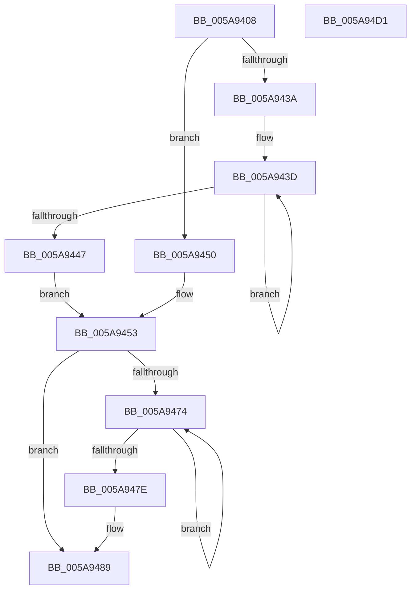

# McTemplateK0zz_EtwWriteTransfer

- RVA: `0x005A9408`–`0x005A94D2` (길이 `202` bytes)
- VA: `0x00000001405A9408`
- 실행 섹션: `.text`
- PDB 이름 있음: `예`; PDB Function 태그: `아니요`
- unwind 정보 RVA: `0x00087EC4`
- 디코드: `50`개 명령, `202/202` bytes 표시
- 미해석 바이트: `0` (있으면 어셈블리에 `.byte`로 보존)

> 이 문서는 커널 이미지의 기계어와 PDB 기호를 분석해 생성했습니다. 4번과 5번은 함수 원형과 자료형을 바이너리 사용 방식에서 추정한 C 해석이며 원본 소스 복구 결과는 아닙니다.

## 1. Dependencies

- 직접 호출 지점: **2**; 고유 호출 대상: **2**
- 직접 호출자로 확인된 함수: **12**
- RIP 상대 이미지 참조: **3**

### Outgoing calls
- `0x005A94B9` → [McGenEventWrite_EtwWriteTransfer](../42/McGenEventWrite_EtwWriteTransfer_function_00424FC8.md) (function, `0x00424FC8`)
- `0x005A94C6` → [_security_check_cookie](../6A/_security_check_cookie_function_006AC640.md) (function, `0x006AC640`)

### Direct callers
- [PiSwIrpCleanup](../../page/73/PiSwIrpCleanup_function_0073AC10.md) at `0x0073AC4D`
- [PiSwIrpSetAttributes](../../page/73/PiSwIrpSetAttributes_function_0073AF44.md) at `0x0073AF91`
- [PiSwIrpSetLifetime](../../page/73/PiSwIrpSetLifetime_function_0073B080.md) at `0x0073B0CD`
- [PiSwIrpStartCreateWorker](../../page/8D/PiSwIrpStartCreateWorker_function_008DB398.md) at `0x008DB85D`
- [PiSwIrpInterfacePropertySet](../../page/8F/PiSwIrpInterfacePropertySet_function_008F7900.md) at `0x008F7AE0`
- [PiSwIrpInterfaceSetState](../../page/94/PiSwIrpInterfaceSetState_function_0094DC24.md) at `0x0094DD8E`
- [PiSwProcessRemove](../../page/94/PiSwProcessRemove_function_0094E3B8.md) at `0x0094E680`
- [PiSwIrpPropertySet](../../page/94/PiSwIrpPropertySet_function_0094E97C.md) at `0x0094EB9C`
- [PiSwIrpInterfaceRegister](../../page/94/PiSwIrpInterfaceRegister_function_0094F01C.md) at `0x0094F3D0`
- [PiSwCloseDevice](../../page/AA/PiSwCloseDevice_function_00AAB6F4.md) at `0x00AAB768`
- [sub_00B1C4F6](../../page/B1/Unknown_function_00B1C4F6.md) at `0x00B1C55D`
- [sub_00B1C4F6](../../page/B1/Unknown_function_00B1C4F6.md) at `0x00B1C5ED`
- [sub_00B1C4F6](../../page/B1/Unknown_function_00B1C4F6.md) at `0x00B1C68C`
- [sub_00B4A56C](../../page/B4/Unknown_function_00B4A56C.md) at `0x00B4A589`

### Static image references
- `0x005A940E` → RVA `0x00E0A740` (`.data`; read)
- `0x005A945A` → RVA `0x006CB080` (` ?? ::FNODOBFM::`string'`; read)
- `0x005A94B2` → RVA `0x00E06DA0` (`.data`; read)

## 2. Other-region calls and transfers

- 다른 실행 섹션으로 향하는 call: **0**
- 별도 외부 분기/꼬리 이동을 확인하지 못했습니다.

## 3. Assembly (complete function range)

```asm
005A9408  40 53                           push rbx
005A940A  48 83 EC 70                     sub rsp, 0x70
005A940E  48 8B 05 2B 13 86 00            mov rax, qword ptr [rip + 0x86132b]
005A9415  48 33 C4                        xor rax, rsp
005A9418  48 89 44 24 60                  mov qword ptr [rsp + 0x60], rax
005A941D  48 83 C8 FF                     or rax, 0xffffffffffffffff
005A9421  45 33 DB                        xor r11d, r11d
005A9424  4C 8B D2                        mov r10, rdx
005A9427  48 8B 94 24 A0 00 00 00         mov rdx, qword ptr [rsp + 0xa0]
005A942F  41 B8 0A 00 00 00               mov r8d, 0xa
005A9435  4D 85 C9                        test r9, r9
005A9438  74 16                           je 0x1405a9450
005A943A  48 8B C8                        mov rcx, rax
005A943D  48 FF C1                        inc rcx
005A9440  66 45 39 1C 49                  cmp word ptr [r9 + rcx*2], r11w
005A9445  75 F6                           jne 0x1405a943d
005A9447  8D 0C 4D 02 00 00 00            lea ecx, [rcx*2 + 2]
005A944E  EB 03                           jmp 0x1405a9453
005A9450  41 8B C8                        mov ecx, r8d
005A9453  4D 85 C9                        test r9, r9
005A9456  89 4C 24 48                     mov dword ptr [rsp + 0x48], ecx
005A945A  48 8D 1D 1F 1C 12 00            lea rbx, [rip + 0x121c1f]
005A9461  44 89 5C 24 4C                  mov dword ptr [rsp + 0x4c], r11d
005A9466  4C 0F 44 CB                     cmove r9, rbx
005A946A  4C 89 4C 24 40                  mov qword ptr [rsp + 0x40], r9
005A946F  48 85 D2                        test rdx, rdx
005A9472  74 15                           je 0x1405a9489
005A9474  48 FF C0                        inc rax
005A9477  66 44 39 1C 42                  cmp word ptr [rdx + rax*2], r11w
005A947C  75 F6                           jne 0x1405a9474
005A947E  44 8D 04 45 02 00 00 00         lea r8d, [rax*2 + 2]
005A9486  48 85 D2                        test rdx, rdx
005A9489  48 0F 44 D3                     cmove rdx, rbx
005A948D  44 89 44 24 58                  mov dword ptr [rsp + 0x58], r8d
005A9492  48 89 54 24 50                  mov qword ptr [rsp + 0x50], rdx
005A9497  48 8D 44 24 30                  lea rax, [rsp + 0x30]
005A949C  49 8B D2                        mov rdx, r10
005A949F  44 89 5C 24 5C                  mov dword ptr [rsp + 0x5c], r11d
005A94A4  41 B9 03 00 00 00               mov r9d, 3
005A94AA  48 89 44 24 20                  mov qword ptr [rsp + 0x20], rax
005A94AF  45 33 C0                        xor r8d, r8d
005A94B2  48 8D 0D E7 D8 85 00            lea rcx, [rip + 0x85d8e7]
005A94B9  E8 0A BB E7 FF                  call 0x140424fc8
005A94BE  48 8B 4C 24 60                  mov rcx, qword ptr [rsp + 0x60]
005A94C3  48 33 CC                        xor rcx, rsp
005A94C6  E8 75 31 10 00                  call 0x1406ac640
005A94CB  48 83 C4 70                     add rsp, 0x70
005A94CF  5B                              pop rbx
005A94D0  C3                              ret
005A94D1  CC                              int3
```

## 4. C-style interpretation (structured pseudocode)

```c
__int64 __fastcall McTemplateK0zz_EtwWriteTransfer(__int64 a1, __int64 a2, __int64 a3, __int64 a4, __int64 a5)
{
    __int64 result;
    __int64 v_r11;
    __int64 v_rsp;
    unsigned __int64 v_stack_m18;
    unsigned int v_stack_m1C;
    unsigned int v_stack_m20;
    unsigned __int64 v_stack_m28;
    unsigned int v_stack_m2C;
    unsigned int v_stack_m30;
    unsigned __int64 v_stack_m38;
    unsigned __int64 v_stack_m48;
    unsigned __int64 v_stack_m58;

    v_rsp = (v_rsp) - (112);
    result = (*(unsigned __int64 *)(v_rip + 8786731)) ^ (v_rsp);
    v_stack_m18 = result;
    result = (result) | (-1);
    v_r11 = 0;
    if (a4 == 0) goto loc_005A9450;
loc_005A943D:
    a1 = (result) + 1;
    if ((*(unsigned __int16 *)(a4 + a1 * 2)) != 0) goto loc_005A943D;
    goto loc_005A9453;
loc_005A9450:
loc_005A9453:
    v_stack_m30 = 10;
    v_stack_m2C = 0;
    if (a4 == 0) { a4 = v_rip + 1186847; }
    v_stack_m38 = a4;
    if (a5 == 0) goto loc_005A9489;
loc_005A9474:
    result = (result) + 1;
    if ((*(unsigned __int16 *)(a5 + result * 2)) != 0) goto loc_005A9474;
loc_005A9489:
    if (a5 == 0) { a5 = v_rip + 1186847; }
    v_stack_m20 = (unsigned int)(result * 2 + 2);
    v_stack_m28 = a5;
    v_stack_m1C = 0;
    v_stack_m58 = v_stack_m48;
    a3 = 0;
    result = McGenEventWrite_EtwWriteTransfer(v_rip + 8771815, a2, a3, 3);
    a1 = (v_stack_m18) ^ (v_rsp);
    result = _security_check_cookie(a1, a2, a3, 3);
    v_rsp = (v_rsp) + (112);
    return result;
}
```

## 5. (Beta) C Style

```c
int64_t McTemplateK0zz_EtwWriteTransfer(int64_t Arg1, int64_t Arg2, int64_t Arg3, int64_t Arg4, int64_t Arg5)
{
    int64_t result;
    int64_t local_r11;
    int64_t local_rsp;
    uint64_t v_stack_m18;
    uint32_t v_stack_m1C;
    uint32_t v_stack_m20;
    uint64_t v_stack_m28;
    uint32_t v_stack_m2C;
    uint32_t v_stack_m30;
    uint64_t v_stack_m38;
    uint64_t v_stack_m48;
    uint64_t v_stack_m58;

    local_rsp = (local_rsp) - (112);
    result = (*(uint64_t *)(v_rip + 0x86132B)) ^ (local_rsp);
    v_stack_m18 = result;
    result = (result) | (-1);
    local_r11 = 0;
    if (Arg4 == 0) goto loc_005A9450;
loc_005A943D:
    Arg1 = (result) + 1;
    if ((*(uint16_t *)(Arg4 + Arg1 * 2)) != 0) goto loc_005A943D;
    goto loc_005A9453;
loc_005A9450:
loc_005A9453:
    v_stack_m30 = 10;
    v_stack_m2C = 0;
    if (Arg4 == 0) { Arg4 = v_rip + 1186847; }
    v_stack_m38 = Arg4;
    if (Arg5 == 0) goto loc_005A9489;
loc_005A9474:
    result = (result) + 1;
    if ((*(uint16_t *)(Arg5 + result * 2)) != 0) goto loc_005A9474;
loc_005A9489:
    if (Arg5 == 0) { Arg5 = v_rip + 1186847; }
    v_stack_m20 = (uint32_t)(result * 2 + 2);
    v_stack_m28 = Arg5;
    v_stack_m1C = 0;
    v_stack_m58 = v_stack_m48;
    Arg3 = 0;
    result = McGenEventWrite_EtwWriteTransfer(v_rip + 8771815, Arg2, Arg3, 3);
    Arg1 = (v_stack_m18) ^ (local_rsp);
    result = _security_check_cookie(Arg1, Arg2, Arg3, 3);
    local_rsp = (local_rsp) + (112);
    return result;
}
```

## 6. Execution-region graph

[열기: 2D/3D 그래프와 함수 탐색 컨트롤 패널](../../../control-panel.html?section=text&rva=0x005A9408&view=graph)

- 2D 그래프는 위에서 아래로 흐르고, 3D 그래프는 빈 공간을 드래그해 회전합니다. Shift+드래그는 이동, 휠은 확대·축소, 함수 노드 선택은 대상 보고서 이동입니다.

### Static fallback


