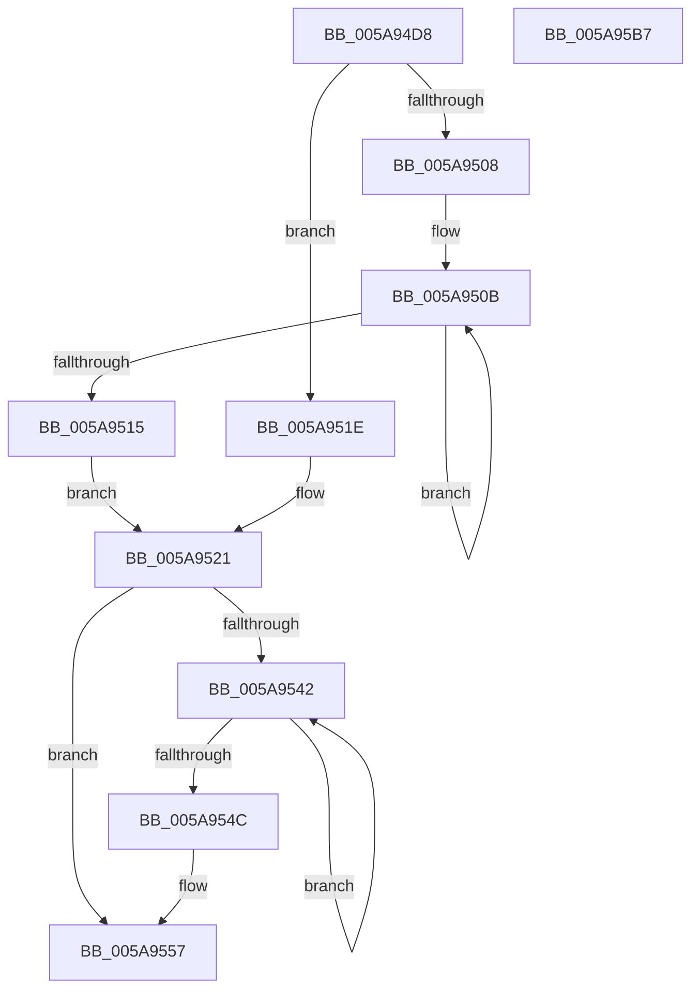

# McTemplateK0zzq_EtwWriteTransfer

- RVA: `0x005A94D8`–`0x005A95B8` (길이 `224` bytes)
- VA: `0x00000001405A94D8`
- 실행 섹션: `.text`
- PDB 이름 있음: `예`; PDB Function 태그: `아니요`
- unwind 정보 RVA: `0x000C6750`
- 디코드: `50`개 명령, `224/224` bytes 표시
- 미해석 바이트: `0` (있으면 어셈블리에 `.byte`로 보존)

> 이 문서는 커널 이미지의 기계어와 PDB 기호를 분석해 생성했습니다. 4번과 5번은 함수 원형과 자료형을 바이너리 사용 방식에서 추정한 C 해석이며 원본 소스 복구 결과는 아닙니다.

## 1. Dependencies

- 직접 호출 지점: **2**; 고유 호출 대상: **2**
- 직접 호출자로 확인된 함수: **1**
- RIP 상대 이미지 참조: **4**

### Outgoing calls
- `0x005A959D` → [McGenEventWrite_EtwWriteTransfer](../42/McGenEventWrite_EtwWriteTransfer_function_00424FC8.md) (function, `0x00424FC8`)
- `0x005A95AA` → [_security_check_cookie](../6A/_security_check_cookie_function_006AC640.md) (function, `0x006AC640`)

### Direct callers
- [PiSwGetChildPdo](../../page/AC/PiSwGetChildPdo_function_00AC3544.md) at `0x00AC36BB`

### Static image references
- `0x005A94DF` → RVA `0x00E0A740` (`.data`; read)
- `0x005A9528` → RVA `0x006CB080` (` ?? ::FNODOBFM::`string'`; read)
- `0x005A9572` → RVA `0x00026DA0` (`.rdata`; read)
- `0x005A9596` → RVA `0x00E06DA0` (`.data`; read)

## 2. Other-region calls and transfers

- 다른 실행 섹션으로 향하는 call: **0**
- 별도 외부 분기/꼬리 이동을 확인하지 못했습니다.

## 3. Assembly (complete function range)

```asm
005A94D8  48 81 EC 88 00 00 00            sub rsp, 0x88
005A94DF  48 8B 05 5A 12 86 00            mov rax, qword ptr [rip + 0x86125a]
005A94E6  48 33 C4                        xor rax, rsp
005A94E9  48 89 44 24 70                  mov qword ptr [rsp + 0x70], rax
005A94EE  48 8B 94 24 B0 00 00 00         mov rdx, qword ptr [rsp + 0xb0]
005A94F6  48 83 C8 FF                     or rax, 0xffffffffffffffff
005A94FA  45 33 D2                        xor r10d, r10d
005A94FD  41 B8 0A 00 00 00               mov r8d, 0xa
005A9503  4D 85 C9                        test r9, r9
005A9506  74 16                           je 0x1405a951e
005A9508  48 8B C8                        mov rcx, rax
005A950B  48 FF C1                        inc rcx
005A950E  66 45 39 14 49                  cmp word ptr [r9 + rcx*2], r10w
005A9513  75 F6                           jne 0x1405a950b
005A9515  8D 0C 4D 02 00 00 00            lea ecx, [rcx*2 + 2]
005A951C  EB 03                           jmp 0x1405a9521
005A951E  41 8B C8                        mov ecx, r8d
005A9521  4D 85 C9                        test r9, r9
005A9524  89 4C 24 48                     mov dword ptr [rsp + 0x48], ecx
005A9528  4C 8D 1D 51 1B 12 00            lea r11, [rip + 0x121b51]
005A952F  44 89 54 24 4C                  mov dword ptr [rsp + 0x4c], r10d
005A9534  4D 0F 44 CB                     cmove r9, r11
005A9538  4C 89 4C 24 40                  mov qword ptr [rsp + 0x40], r9
005A953D  48 85 D2                        test rdx, rdx
005A9540  74 15                           je 0x1405a9557
005A9542  48 FF C0                        inc rax
005A9545  66 44 39 14 42                  cmp word ptr [rdx + rax*2], r10w
005A954A  75 F6                           jne 0x1405a9542
005A954C  44 8D 04 45 02 00 00 00         lea r8d, [rax*2 + 2]
005A9554  48 85 D2                        test rdx, rdx
005A9557  49 0F 44 D3                     cmove rdx, r11
005A955B  44 89 44 24 58                  mov dword ptr [rsp + 0x58], r8d
005A9560  48 8D 84 24 B8 00 00 00         lea rax, [rsp + 0xb8]
005A9568  48 89 54 24 50                  mov qword ptr [rsp + 0x50], rdx
005A956D  48 89 44 24 60                  mov qword ptr [rsp + 0x60], rax
005A9572  48 8D 15 27 D8 A7 FF            lea rdx, [rip - 0x5827d9]
005A9579  48 8D 44 24 30                  lea rax, [rsp + 0x30]
005A957E  44 89 54 24 5C                  mov dword ptr [rsp + 0x5c], r10d
005A9583  41 B9 04 00 00 00               mov r9d, 4
005A9589  48 89 44 24 20                  mov qword ptr [rsp + 0x20], rax
005A958E  45 33 C0                        xor r8d, r8d
005A9591  4C 89 4C 24 68                  mov qword ptr [rsp + 0x68], r9
005A9596  48 8D 0D 03 D8 85 00            lea rcx, [rip + 0x85d803]
005A959D  E8 26 BA E7 FF                  call 0x140424fc8
005A95A2  48 8B 4C 24 70                  mov rcx, qword ptr [rsp + 0x70]
005A95A7  48 33 CC                        xor rcx, rsp
005A95AA  E8 91 30 10 00                  call 0x1406ac640
005A95AF  48 81 C4 88 00 00 00            add rsp, 0x88
005A95B6  C3                              ret
005A95B7  CC                              int3
```

## 4. C-style interpretation (structured pseudocode)

```c
__int64 __fastcall McTemplateK0zzq_EtwWriteTransfer(__int64 a1, __int64 a2, __int64 a3, __int64 a4, __int64 a5, __int64 a6)
{
    __int64 result;
    __int64 v_r10;
    __int64 v_rsp;
    unsigned __int64 v_stack_m18;
    unsigned __int64 v_stack_m20;
    unsigned __int64 v_stack_m28;
    unsigned int v_stack_m2C;
    unsigned int v_stack_m30;
    unsigned __int64 v_stack_m38;
    unsigned int v_stack_m3C;
    unsigned int v_stack_m40;
    unsigned __int64 v_stack_m48;
    unsigned __int64 v_stack_m58;
    unsigned __int64 v_stack_m68;

    v_rsp = (v_rsp) - (136);
    result = (*(unsigned __int64 *)(v_rip + 8786522)) ^ (v_rsp);
    v_stack_m18 = result;
    result = (result) | (-1);
    v_r10 = 0;
    if (a4 == 0) goto loc_005A951E;
loc_005A950B:
    a1 = (result) + 1;
    if ((*(unsigned __int16 *)(a4 + a1 * 2)) != 0) goto loc_005A950B;
    goto loc_005A9521;
loc_005A951E:
loc_005A9521:
    v_stack_m40 = 10;
    v_stack_m3C = 0;
    if (a4 == 0) { a4 = v_rip + 1186641; }
    v_stack_m48 = a4;
    if (a5 == 0) goto loc_005A9557;
loc_005A9542:
    result = (result) + 1;
    if ((*(unsigned __int16 *)(a5 + result * 2)) != 0) goto loc_005A9542;
loc_005A9557:
    if (a5 == 0) { a5 = v_rip + 1186641; }
    v_stack_m30 = (unsigned int)(result * 2 + 2);
    v_stack_m38 = a5;
    v_stack_m28 = a6;
    v_stack_m2C = 0;
    v_stack_m68 = v_stack_m58;
    a3 = 0;
    v_stack_m20 = 4;
    result = McGenEventWrite_EtwWriteTransfer(v_rip + 8771587, v_rip - 5777369, a3, 4);
    a1 = (v_stack_m18) ^ (v_rsp);
    result = _security_check_cookie(a1, v_rip - 5777369, a3, 4);
    v_rsp = (v_rsp) + (136);
    return result;
}
```

## 5. (Beta) C Style

```c
int64_t McTemplateK0zzq_EtwWriteTransfer(int64_t Arg1, int64_t Arg2, int64_t Arg3, int64_t Arg4, int64_t Arg5, int64_t Arg6)
{
    int64_t result;
    int64_t local_r10;
    int64_t local_rsp;
    uint64_t v_stack_m18;
    uint64_t v_stack_m20;
    uint64_t v_stack_m28;
    uint32_t v_stack_m2C;
    uint32_t v_stack_m30;
    uint64_t v_stack_m38;
    uint32_t v_stack_m3C;
    uint32_t v_stack_m40;
    uint64_t v_stack_m48;
    uint64_t v_stack_m58;
    uint64_t v_stack_m68;

    local_rsp = (local_rsp) - (136);
    result = (*(uint64_t *)(v_rip + 0x86125A)) ^ (local_rsp);
    v_stack_m18 = result;
    result = (result) | (-1);
    local_r10 = 0;
    if (Arg4 == 0) goto loc_005A951E;
loc_005A950B:
    Arg1 = (result) + 1;
    if ((*(uint16_t *)(Arg4 + Arg1 * 2)) != 0) goto loc_005A950B;
    goto loc_005A9521;
loc_005A951E:
loc_005A9521:
    v_stack_m40 = 10;
    v_stack_m3C = 0;
    if (Arg4 == 0) { Arg4 = v_rip + 1186641; }
    v_stack_m48 = Arg4;
    if (Arg5 == 0) goto loc_005A9557;
loc_005A9542:
    result = (result) + 1;
    if ((*(uint16_t *)(Arg5 + result * 2)) != 0) goto loc_005A9542;
loc_005A9557:
    if (Arg5 == 0) { Arg5 = v_rip + 1186641; }
    v_stack_m30 = (uint32_t)(result * 2 + 2);
    v_stack_m38 = Arg5;
    v_stack_m28 = Arg6;
    v_stack_m2C = 0;
    v_stack_m68 = v_stack_m58;
    Arg3 = 0;
    v_stack_m20 = 4;
    result = McGenEventWrite_EtwWriteTransfer(v_rip + 8771587, v_rip - 5777369, Arg3, 4);
    Arg1 = (v_stack_m18) ^ (local_rsp);
    result = _security_check_cookie(Arg1, v_rip - 5777369, Arg3, 4);
    local_rsp = (local_rsp) + (136);
    return result;
}
```

## 6. Execution-region graph

[열기: 2D/3D 그래프와 함수 탐색 컨트롤 패널](../../../control-panel.html?section=text&rva=0x005A94D8&view=graph)

- 2D 그래프는 위에서 아래로 흐르고, 3D 그래프는 빈 공간을 드래그해 회전합니다. Shift+드래그는 이동, 휠은 확대·축소, 함수 노드 선택은 대상 보고서 이동입니다.

### Static fallback


