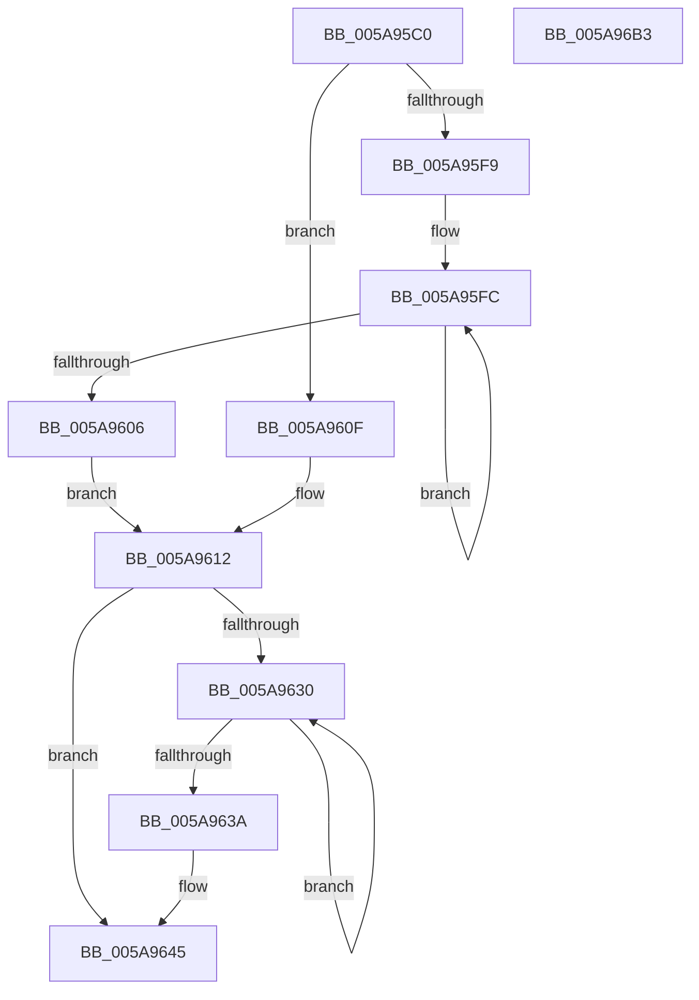

# McTemplateK0zzqq_EtwWriteTransfer

- RVA: `0x005A95C0`–`0x005A96B4` (길이 `244` bytes)
- VA: `0x00000001405A95C0`
- 실행 섹션: `.text`
- PDB 이름 있음: `예`; PDB Function 태그: `아니요`
- unwind 정보 RVA: `0x000BD124`
- 디코드: `59`개 명령, `244/244` bytes 표시
- 미해석 바이트: `0` (있으면 어셈블리에 `.byte`로 보존)

> 이 문서는 커널 이미지의 기계어와 PDB 기호를 분석해 생성했습니다. 4번과 5번은 함수 원형과 자료형을 바이너리 사용 방식에서 추정한 C 해석이며 원본 소스 복구 결과는 아닙니다.

## 1. Dependencies

- 직접 호출 지점: **2**; 고유 호출 대상: **2**
- 직접 호출자로 확인된 함수: **4**
- RIP 상대 이미지 참조: **3**

### Outgoing calls
- `0x005A9691` → [McGenEventWrite_EtwWriteTransfer](../42/McGenEventWrite_EtwWriteTransfer_function_00424FC8.md) (function, `0x00424FC8`)
- `0x005A969D` → [_security_check_cookie](../6A/_security_check_cookie_function_006AC640.md) (function, `0x006AC640`)

### Direct callers
- [PiSwIrpSetAttributes](../../page/73/PiSwIrpSetAttributes_function_0073AF44.md) at `0x0073B009`
- [PiSwIrpSetLifetime](../../page/73/PiSwIrpSetLifetime_function_0073B080.md) at `0x0073B13D`
- [PiSwIrpStartCreateWorker](../../page/8D/PiSwIrpStartCreateWorker_function_008DB398.md) at `0x008DB6A2`
- [PiSwIrpStartCreateWorker](../../page/8D/PiSwIrpStartCreateWorker_function_008DB398.md) at `0x008DB8BA`
- [PiSwGetChildPdo](../../page/AC/PiSwGetChildPdo_function_00AC3544.md) at `0x00AC3841`

### Static image references
- `0x005A95D2` → RVA `0x00E0A740` (`.data`; read)
- `0x005A9618` → RVA `0x006CB080` (` ?? ::FNODOBFM::`string'`; read)
- `0x005A9659` → RVA `0x00E06DA0` (`.data`; read)

## 2. Other-region calls and transfers

- 다른 실행 섹션으로 향하는 call: **0**
- 별도 외부 분기/꼬리 이동을 확인하지 못했습니다.

## 3. Assembly (complete function range)

```asm
005A95C0  48 89 5C 24 08                  mov qword ptr [rsp + 8], rbx
005A95C5  55                              push rbp
005A95C6  48 8D 6C 24 C1                  lea rbp, [rsp - 0x3f]
005A95CB  48 81 EC 90 00 00 00            sub rsp, 0x90
005A95D2  48 8B 05 67 11 86 00            mov rax, qword ptr [rip + 0x861167]
005A95D9  48 33 C4                        xor rax, rsp
005A95DC  48 89 45 2F                     mov qword ptr [rbp + 0x2f], rax
005A95E0  48 83 C8 FF                     or rax, 0xffffffffffffffff
005A95E4  45 33 DB                        xor r11d, r11d
005A95E7  4C 8B D2                        mov r10, rdx
005A95EA  48 8B 55 6F                     mov rdx, qword ptr [rbp + 0x6f]
005A95EE  41 B8 0A 00 00 00               mov r8d, 0xa
005A95F4  4D 85 C9                        test r9, r9
005A95F7  74 16                           je 0x1405a960f
005A95F9  48 8B C8                        mov rcx, rax
005A95FC  48 FF C1                        inc rcx
005A95FF  66 45 39 1C 49                  cmp word ptr [r9 + rcx*2], r11w
005A9604  75 F6                           jne 0x1405a95fc
005A9606  8D 0C 4D 02 00 00 00            lea ecx, [rcx*2 + 2]
005A960D  EB 03                           jmp 0x1405a9612
005A960F  41 8B C8                        mov ecx, r8d
005A9612  4D 85 C9                        test r9, r9
005A9615  89 4D F7                        mov dword ptr [rbp - 9], ecx
005A9618  48 8D 1D 61 1A 12 00            lea rbx, [rip + 0x121a61]
005A961F  44 89 5D FB                     mov dword ptr [rbp - 5], r11d
005A9623  4C 0F 44 CB                     cmove r9, rbx
005A9627  4C 89 4D EF                     mov qword ptr [rbp - 0x11], r9
005A962B  48 85 D2                        test rdx, rdx
005A962E  74 15                           je 0x1405a9645
005A9630  48 FF C0                        inc rax
005A9633  66 44 39 1C 42                  cmp word ptr [rdx + rax*2], r11w
005A9638  75 F6                           jne 0x1405a9630
005A963A  44 8D 04 45 02 00 00 00         lea r8d, [rax*2 + 2]
005A9642  48 85 D2                        test rdx, rdx
005A9645  48 0F 44 D3                     cmove rdx, rbx
005A9649  44 89 45 07                     mov dword ptr [rbp + 7], r8d
005A964D  48 8D 45 77                     lea rax, [rbp + 0x77]
005A9651  48 89 55 FF                     mov qword ptr [rbp - 1], rdx
005A9655  48 89 45 0F                     mov qword ptr [rbp + 0xf], rax
005A9659  48 8D 0D 40 D7 85 00            lea rcx, [rip + 0x85d740]
005A9660  48 8D 45 7F                     lea rax, [rbp + 0x7f]
005A9664  44 89 5D 0B                     mov dword ptr [rbp + 0xb], r11d
005A9668  48 89 45 1F                     mov qword ptr [rbp + 0x1f], rax
005A966C  41 B9 05 00 00 00               mov r9d, 5
005A9672  48 8D 45 DF                     lea rax, [rbp - 0x21]
005A9676  48 C7 45 17 04 00 00 00         mov qword ptr [rbp + 0x17], 4
005A967E  45 33 C0                        xor r8d, r8d
005A9681  48 89 44 24 20                  mov qword ptr [rsp + 0x20], rax
005A9686  49 8B D2                        mov rdx, r10
005A9689  48 C7 45 27 04 00 00 00         mov qword ptr [rbp + 0x27], 4
005A9691  E8 32 B9 E7 FF                  call 0x140424fc8
005A9696  48 8B 4D 2F                     mov rcx, qword ptr [rbp + 0x2f]
005A969A  48 33 CC                        xor rcx, rsp
005A969D  E8 9E 2F 10 00                  call 0x1406ac640
005A96A2  48 8B 9C 24 A0 00 00 00         mov rbx, qword ptr [rsp + 0xa0]
005A96AA  48 81 C4 90 00 00 00            add rsp, 0x90
005A96B1  5D                              pop rbp
005A96B2  C3                              ret
005A96B3  CC                              int3
```

## 4. C-style interpretation (structured pseudocode)

```c
__int64 __fastcall McTemplateK0zzqq_EtwWriteTransfer(__int64 a1, __int64 a2, __int64 a3, __int64 a4, __int64 a5, __int64 a6, __int64 a7)
{
    __int64 result;
    __int64 v_r11;
    __int64 v_rsp;
    unsigned __int64 v_stack_m18;
    unsigned __int64 v_stack_m20;
    unsigned __int64 v_stack_m28;
    unsigned __int64 v_stack_m30;
    unsigned __int64 v_stack_m38;
    unsigned int v_stack_m3C;
    unsigned int v_stack_m40;
    unsigned __int64 v_stack_m47;
    unsigned __int64 v_stack_m48;
    unsigned int v_stack_m4C;
    unsigned int v_stack_m50;
    unsigned __int64 v_stack_m58;
    unsigned __int64 v_stack_m68;
    unsigned __int64 v_stack_m78;
    unsigned __int64 v_stack_p8;

    v_stack_p8 = v_rbx;
    v_rsp = (v_rsp) - (144);
    result = (*(unsigned __int64 *)(v_rip + 8786279)) ^ (v_rsp);
    v_stack_m18 = result;
    result = (result) | (-1);
    v_r11 = 0;
    if (a4 == 0) goto loc_005A960F;
loc_005A95FC:
    a1 = (result) + 1;
    if ((*(unsigned __int16 *)(a4 + a1 * 2)) != 0) goto loc_005A95FC;
    goto loc_005A9612;
loc_005A960F:
loc_005A9612:
    v_stack_m50 = 10;
    v_stack_m4C = 0;
    if (a4 == 0) { a4 = v_rip + 1186401; }
    v_stack_m58 = a4;
    if (a5 == 0) goto loc_005A9645;
loc_005A9630:
    result = (result) + 1;
    if ((*(unsigned __int16 *)(a5 + result * 2)) != 0) goto loc_005A9630;
loc_005A9645:
    if (a5 == 0) { a5 = v_rip + 1186401; }
    v_stack_m40 = (unsigned int)(result * 2 + 2);
    v_stack_m48 = a5;
    v_stack_m38 = a6;
    v_stack_m3C = 0;
    v_stack_m28 = a7;
    v_stack_m30 = 4;
    a3 = 0;
    v_stack_m78 = v_stack_m68;
    v_stack_m20 = 4;
    result = McGenEventWrite_EtwWriteTransfer(v_rip + 8771392, a2, a3, 5);
    a1 = (v_stack_m18) ^ (v_rsp);
    result = _security_check_cookie(a1, a2, a3, 5);
    v_rsp = (v_rsp) + (144);
    return result;
}
```

## 5. (Beta) C Style

```c
int64_t McTemplateK0zzqq_EtwWriteTransfer(int64_t Arg1, int64_t Arg2, int64_t Arg3, int64_t Arg4, int64_t Arg5, int64_t Arg6, int64_t Arg7)
{
    int64_t result;
    int64_t local_r11;
    int64_t local_rsp;
    uint64_t v_stack_m18;
    uint64_t v_stack_m20;
    uint64_t v_stack_m28;
    uint64_t v_stack_m30;
    uint64_t v_stack_m38;
    uint32_t v_stack_m3C;
    uint32_t v_stack_m40;
    uint64_t v_stack_m47;
    uint64_t v_stack_m48;
    uint32_t v_stack_m4C;
    uint32_t v_stack_m50;
    uint64_t v_stack_m58;
    uint64_t v_stack_m68;
    uint64_t v_stack_m78;
    uint64_t v_stack_p8;

    v_stack_p8 = local_rbx;
    local_rsp = (local_rsp) - (144);
    result = (*(uint64_t *)(v_rip + 0x861167)) ^ (local_rsp);
    v_stack_m18 = result;
    result = (result) | (-1);
    local_r11 = 0;
    if (Arg4 == 0) goto loc_005A960F;
loc_005A95FC:
    Arg1 = (result) + 1;
    if ((*(uint16_t *)(Arg4 + Arg1 * 2)) != 0) goto loc_005A95FC;
    goto loc_005A9612;
loc_005A960F:
loc_005A9612:
    v_stack_m50 = 10;
    v_stack_m4C = 0;
    if (Arg4 == 0) { Arg4 = v_rip + 1186401; }
    v_stack_m58 = Arg4;
    if (Arg5 == 0) goto loc_005A9645;
loc_005A9630:
    result = (result) + 1;
    if ((*(uint16_t *)(Arg5 + result * 2)) != 0) goto loc_005A9630;
loc_005A9645:
    if (Arg5 == 0) { Arg5 = v_rip + 1186401; }
    v_stack_m40 = (uint32_t)(result * 2 + 2);
    v_stack_m48 = Arg5;
    v_stack_m38 = Arg6;
    v_stack_m3C = 0;
    v_stack_m28 = Arg7;
    v_stack_m30 = 4;
    Arg3 = 0;
    v_stack_m78 = v_stack_m68;
    v_stack_m20 = 4;
    result = McGenEventWrite_EtwWriteTransfer(v_rip + 8771392, Arg2, Arg3, 5);
    Arg1 = (v_stack_m18) ^ (local_rsp);
    result = _security_check_cookie(Arg1, Arg2, Arg3, 5);
    local_rsp = (local_rsp) + (144);
    return result;
}
```

## 6. Execution-region graph

[열기: 2D/3D 그래프와 함수 탐색 컨트롤 패널](../../../control-panel.html?section=text&rva=0x005A95C0&view=graph)

- 2D 그래프는 위에서 아래로 흐르고, 3D 그래프는 빈 공간을 드래그해 회전합니다. Shift+드래그는 이동, 휠은 확대·축소, 함수 노드 선택은 대상 보고서 이동입니다.

### Static fallback


