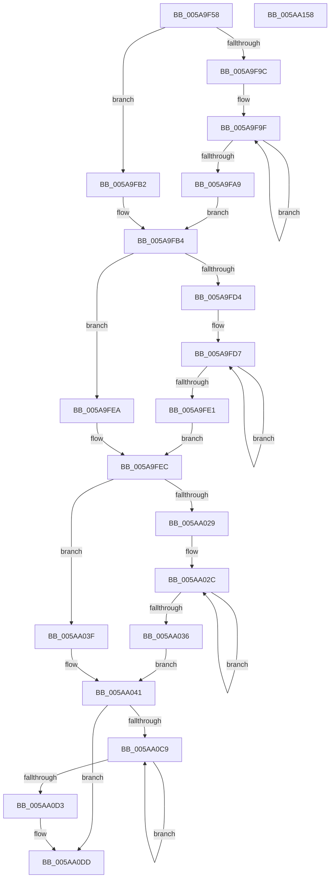

# McTemplateK0zzqqzttquqqzxt_EtwWriteTransfer

- RVA: `0x005A9F58`–`0x005AA159` (길이 `513` bytes)
- VA: `0x00000001405A9F58`
- 실행 섹션: `.text`
- PDB 이름 있음: `예`; PDB Function 태그: `아니요`
- unwind 정보 RVA: `0x000C6F60`
- 디코드: `115`개 명령, `513/513` bytes 표시
- 미해석 바이트: `0` (있으면 어셈블리에 `.byte`로 보존)

> 이 문서는 커널 이미지의 기계어와 PDB 기호를 분석해 생성했습니다. 4번과 5번은 함수 원형과 자료형을 바이너리 사용 방식에서 추정한 C 해석이며 원본 소스 복구 결과는 아닙니다.

## 1. Dependencies

- 직접 호출 지점: **2**; 고유 호출 대상: **2**
- 직접 호출자로 확인된 함수: **1**
- RIP 상대 이미지 참조: **4**

### Outgoing calls
- `0x005AA132` → [McGenEventWrite_EtwWriteTransfer](../42/McGenEventWrite_EtwWriteTransfer_function_00424FC8.md) (function, `0x00424FC8`)
- `0x005AA13E` → [_security_check_cookie](../6A/_security_check_cookie_function_006AC640.md) (function, `0x006AC640`)

### Direct callers
- [PnpTraceRebalanceResult](../../page/73/PnpTraceRebalanceResult_function_0073CD60.md) at `0x0073CF00`

### Static image references
- `0x005A9F6F` → RVA `0x00E0A740` (`.data`; read)
- `0x005A9FBB` → RVA `0x006CB080` (` ?? ::FNODOBFM::`string'`; read)
- `0x005AA0F3` → RVA `0x00027768` (`.rdata`; read)
- `0x005AA108` → RVA `0x00E06DA0` (`.data`; read)

## 2. Other-region calls and transfers

- 다른 실행 섹션으로 향하는 call: **0**
- 별도 외부 분기/꼬리 이동을 확인하지 못했습니다.

## 3. Assembly (complete function range)

```asm
005A9F58  48 89 5C 24 08                  mov qword ptr [rsp + 8], rbx
005A9F5D  48 89 7C 24 10                  mov qword ptr [rsp + 0x10], rdi
005A9F62  55                              push rbp
005A9F63  48 8D 6C 24 D0                  lea rbp, [rsp - 0x30]
005A9F68  48 81 EC 30 01 00 00            sub rsp, 0x130
005A9F6F  48 8B 05 CA 07 86 00            mov rax, qword ptr [rip + 0x8607ca]
005A9F76  48 33 C4                        xor rax, rsp
005A9F79  48 89 45 20                     mov qword ptr [rbp + 0x20], rax
005A9F7D  4C 8B 9D B0 00 00 00            mov r11, qword ptr [rbp + 0xb0]
005A9F84  48 83 C8 FF                     or rax, 0xffffffffffffffff
005A9F88  4C 8B 55 78                     mov r10, qword ptr [rbp + 0x78]
005A9F8C  33 DB                           xor ebx, ebx
005A9F8E  4C 8B 45 60                     mov r8, qword ptr [rbp + 0x60]
005A9F92  BA 0A 00 00 00                  mov edx, 0xa
005A9F97  4D 85 C9                        test r9, r9
005A9F9A  74 16                           je 0x1405a9fb2
005A9F9C  48 8B C8                        mov rcx, rax
005A9F9F  48 FF C1                        inc rcx
005A9FA2  66 41 39 1C 49                  cmp word ptr [r9 + rcx*2], bx
005A9FA7  75 F6                           jne 0x1405a9f9f
005A9FA9  8D 0C 4D 02 00 00 00            lea ecx, [rcx*2 + 2]
005A9FB0  EB 02                           jmp 0x1405a9fb4
005A9FB2  8B CA                           mov ecx, edx
005A9FB4  4D 85 C9                        test r9, r9
005A9FB7  89 4C 24 48                     mov dword ptr [rsp + 0x48], ecx
005A9FBB  48 8D 3D BE 10 12 00            lea rdi, [rip + 0x1210be]
005A9FC2  89 5C 24 4C                     mov dword ptr [rsp + 0x4c], ebx
005A9FC6  4C 0F 44 CF                     cmove r9, rdi
005A9FCA  4C 89 4C 24 40                  mov qword ptr [rsp + 0x40], r9
005A9FCF  4D 85 C0                        test r8, r8
005A9FD2  74 16                           je 0x1405a9fea
005A9FD4  48 8B C8                        mov rcx, rax
005A9FD7  48 FF C1                        inc rcx
005A9FDA  66 41 39 1C 48                  cmp word ptr [r8 + rcx*2], bx
005A9FDF  75 F6                           jne 0x1405a9fd7
005A9FE1  8D 0C 4D 02 00 00 00            lea ecx, [rcx*2 + 2]
005A9FE8  EB 02                           jmp 0x1405a9fec
005A9FEA  8B CA                           mov ecx, edx
005A9FEC  89 4C 24 58                     mov dword ptr [rsp + 0x58], ecx
005A9FF0  4D 85 C0                        test r8, r8
005A9FF3  48 8D 4D 68                     lea rcx, [rbp + 0x68]
005A9FF7  89 5C 24 5C                     mov dword ptr [rsp + 0x5c], ebx
005A9FFB  4C 0F 44 C7                     cmove r8, rdi
005A9FFF  48 89 4C 24 60                  mov qword ptr [rsp + 0x60], rcx
005AA004  4C 89 44 24 50                  mov qword ptr [rsp + 0x50], r8
005AA009  48 8D 4D 70                     lea rcx, [rbp + 0x70]
005AA00D  48 89 4C 24 70                  mov qword ptr [rsp + 0x70], rcx
005AA012  48 C7 44 24 68 04 00 00 00      mov qword ptr [rsp + 0x68], 4
005AA01B  48 C7 44 24 78 04 00 00 00      mov qword ptr [rsp + 0x78], 4
005AA024  4D 85 D2                        test r10, r10
005AA027  74 16                           je 0x1405aa03f
005AA029  48 8B C8                        mov rcx, rax
005AA02C  48 FF C1                        inc rcx
005AA02F  66 41 39 1C 4A                  cmp word ptr [r10 + rcx*2], bx
005AA034  75 F6                           jne 0x1405aa02c
005AA036  8D 0C 4D 02 00 00 00            lea ecx, [rcx*2 + 2]
005AA03D  EB 02                           jmp 0x1405aa041
005AA03F  8B CA                           mov ecx, edx
005AA041  89 4D 88                        mov dword ptr [rbp - 0x78], ecx
005AA044  4D 85 D2                        test r10, r10
005AA047  48 8D 8D 80 00 00 00            lea rcx, [rbp + 0x80]
005AA04E  89 5D 8C                        mov dword ptr [rbp - 0x74], ebx
005AA051  48 89 4D 90                     mov qword ptr [rbp - 0x70], rcx
005AA055  4C 0F 44 D7                     cmove r10, rdi
005AA059  4C 89 55 80                     mov qword ptr [rbp - 0x80], r10
005AA05D  48 8D 8D 88 00 00 00            lea rcx, [rbp + 0x88]
005AA064  48 89 4D A0                     mov qword ptr [rbp - 0x60], rcx
005AA068  48 8D 8D 90 00 00 00            lea rcx, [rbp + 0x90]
005AA06F  48 89 4D B0                     mov qword ptr [rbp - 0x50], rcx
005AA073  48 8D 8D 98 00 00 00            lea rcx, [rbp + 0x98]
005AA07A  48 89 4D C0                     mov qword ptr [rbp - 0x40], rcx
005AA07E  48 8D 8D A0 00 00 00            lea rcx, [rbp + 0xa0]
005AA085  48 89 4D D0                     mov qword ptr [rbp - 0x30], rcx
005AA089  48 8D 8D A8 00 00 00            lea rcx, [rbp + 0xa8]
005AA090  48 89 4D E0                     mov qword ptr [rbp - 0x20], rcx
005AA094  48 C7 45 98 04 00 00 00         mov qword ptr [rbp - 0x68], 4
005AA09C  48 C7 45 A8 04 00 00 00         mov qword ptr [rbp - 0x58], 4
005AA0A4  48 C7 45 B8 04 00 00 00         mov qword ptr [rbp - 0x48], 4
005AA0AC  48 C7 45 C8 01 00 00 00         mov qword ptr [rbp - 0x38], 1
005AA0B4  48 C7 45 D8 04 00 00 00         mov qword ptr [rbp - 0x28], 4
005AA0BC  48 C7 45 E8 04 00 00 00         mov qword ptr [rbp - 0x18], 4
005AA0C4  4D 85 DB                        test r11, r11
005AA0C7  74 14                           je 0x1405aa0dd
005AA0C9  48 FF C0                        inc rax
005AA0CC  66 41 39 1C 43                  cmp word ptr [r11 + rax*2], bx
005AA0D1  75 F6                           jne 0x1405aa0c9
005AA0D3  8D 14 45 02 00 00 00            lea edx, [rax*2 + 2]
005AA0DA  4D 85 DB                        test r11, r11
005AA0DD  4C 0F 44 DF                     cmove r11, rdi
005AA0E1  89 55 F8                        mov dword ptr [rbp - 8], edx
005AA0E4  48 8D 85 B8 00 00 00            lea rax, [rbp + 0xb8]
005AA0EB  4C 89 5D F0                     mov qword ptr [rbp - 0x10], r11
005AA0EF  48 89 45 00                     mov qword ptr [rbp], rax
005AA0F3  48 8D 15 6E D6 A7 FF            lea rdx, [rip - 0x582992]
005AA0FA  48 8D 85 C0 00 00 00            lea rax, [rbp + 0xc0]
005AA101  89 5D FC                        mov dword ptr [rbp - 4], ebx
005AA104  48 89 45 10                     mov qword ptr [rbp + 0x10], rax
005AA108  48 8D 0D 91 CC 85 00            lea rcx, [rip + 0x85cc91]
005AA10F  48 8D 44 24 30                  lea rax, [rsp + 0x30]
005AA114  48 C7 45 08 08 00 00 00         mov qword ptr [rbp + 8], 8
005AA11C  41 B9 0F 00 00 00               mov r9d, 0xf
005AA122  48 89 44 24 20                  mov qword ptr [rsp + 0x20], rax
005AA127  45 33 C0                        xor r8d, r8d
005AA12A  48 C7 45 18 04 00 00 00         mov qword ptr [rbp + 0x18], 4
005AA132  E8 91 AE E7 FF                  call 0x140424fc8
005AA137  48 8B 4D 20                     mov rcx, qword ptr [rbp + 0x20]
005AA13B  48 33 CC                        xor rcx, rsp
005AA13E  E8 FD 24 10 00                  call 0x1406ac640
005AA143  4C 8D 9C 24 30 01 00 00         lea r11, [rsp + 0x130]
005AA14B  49 8B 5B 10                     mov rbx, qword ptr [r11 + 0x10]
005AA14F  49 8B 7B 18                     mov rdi, qword ptr [r11 + 0x18]
005AA153  49 8B E3                        mov rsp, r11
005AA156  5D                              pop rbp
005AA157  C3                              ret
005AA158  CC                              int3
```

## 4. C-style interpretation (structured pseudocode)

```c
__int64 __fastcall McTemplateK0zzqqzttquqqzxt_EtwWriteTransfer(__int64 a1, __int64 a2, __int64 a3, __int64 a4, __int64 a5, __int64 a6, __int64 a7, __int64 a8, __int64 a9, __int64 a10, __int64 a11, __int64 a12, __int64 a13, __int64 a14, __int64 a15, __int64 a16, __int64 a17)
{
    __int64 result;
    __int64 v_rbx;
    __int64 v_rsp;
    unsigned __int64 v_stack_m108;
    unsigned __int64 v_stack_m118;
    unsigned __int64 v_stack_m18;
    unsigned __int64 v_stack_m20;
    unsigned __int64 v_stack_m28;
    unsigned __int64 v_stack_m30;
    unsigned __int64 v_stack_m38;
    unsigned int v_stack_m3C;
    unsigned int v_stack_m40;
    unsigned __int64 v_stack_m48;
    unsigned __int64 v_stack_m50;
    unsigned __int64 v_stack_m58;
    unsigned __int64 v_stack_m60;
    unsigned __int64 v_stack_m68;
    unsigned __int64 v_stack_m70;
    unsigned __int64 v_stack_m78;
    unsigned __int64 v_stack_m8;
    unsigned __int64 v_stack_m80;
    unsigned __int64 v_stack_m88;
    unsigned __int64 v_stack_m90;
    unsigned __int64 v_stack_m98;
    unsigned __int64 v_stack_mA0;
    unsigned __int64 v_stack_mA8;
    unsigned int v_stack_mAC;
    unsigned int v_stack_mB0;
    unsigned __int64 v_stack_mB8;
    unsigned __int64 v_stack_mC0;
    unsigned __int64 v_stack_mC8;
    unsigned __int64 v_stack_mD0;
    unsigned __int64 v_stack_mD8;
    unsigned int v_stack_mDC;
    unsigned int v_stack_mE0;
    unsigned __int64 v_stack_mE8;
    unsigned int v_stack_mEC;
    unsigned int v_stack_mF0;
    unsigned __int64 v_stack_mF8;
    unsigned __int64 v_stack_p10;
    unsigned __int64 v_stack_p8;

    v_stack_p8 = v_rbx;
    v_stack_p10 = v_rdi;
    v_rsp = (v_rsp) - (304);
    result = (*(unsigned __int64 *)(v_rip + 8783818)) ^ (v_rsp);
    v_stack_m18 = result;
    result = (result) | (-1);
    v_rbx = 0;
    if (a4 == 0) goto loc_005A9FB2;
loc_005A9F9F:
    a1 = (result) + 1;
    if ((*(unsigned __int16 *)(a4 + a1 * 2)) != 0) goto loc_005A9F9F;
    goto loc_005A9FB4;
loc_005A9FB2:
loc_005A9FB4:
    v_stack_mF0 = 10;
    v_stack_mEC = 0;
    if (a4 == 0) { a4 = v_rip + 1183934; }
    v_stack_mF8 = a4;
    if (a5 == 0) goto loc_005A9FEA;
loc_005A9FD7:
    a1 = (result) + 1;
    if ((*(unsigned __int16 *)(a5 + a1 * 2)) != 0) goto loc_005A9FD7;
    goto loc_005A9FEC;
loc_005A9FEA:
loc_005A9FEC:
    v_stack_mE0 = 10;
    v_stack_mDC = 0;
    if (a5 == 0) { a5 = v_rip + 1183934; }
    v_stack_mD8 = a6;
    v_stack_mE8 = a5;
    v_stack_mC8 = a7;
    v_stack_mD0 = 4;
    v_stack_mC0 = 4;
    if (a8 == 0) goto loc_005AA03F;
loc_005AA02C:
    a1 = (result) + 1;
    if ((*(unsigned __int16 *)(a8 + a1 * 2)) != 0) goto loc_005AA02C;
    goto loc_005AA041;
loc_005AA03F:
loc_005AA041:
    v_stack_mB0 = 10;
    v_stack_mAC = 0;
    v_stack_mA8 = a9;
    if (a8 == 0) { a8 = v_rip + 1183934; }
    v_stack_mB8 = a8;
    v_stack_m98 = a10;
    v_stack_m88 = a11;
    v_stack_m78 = a12;
    v_stack_m68 = a13;
    v_stack_m58 = a14;
    v_stack_mA0 = 4;
    v_stack_m90 = 4;
    v_stack_m80 = 4;
    v_stack_m70 = 1;
    v_stack_m60 = 4;
    v_stack_m50 = 4;
    if (a15 == 0) goto loc_005AA0DD;
loc_005AA0C9:
    result = (result) + 1;
    if ((*(unsigned __int16 *)(a15 + result * 2)) != 0) goto loc_005AA0C9;
loc_005AA0DD:
    if (a15 == 0) { a15 = v_rip + 1183934; }
    v_stack_m40 = (unsigned int)(result * 2 + 2);
    v_stack_m48 = a15;
    v_stack_m38 = a16;
    v_stack_m3C = 0;
    v_stack_m28 = a17;
    v_stack_m30 = 8;
    v_stack_m118 = v_stack_m108;
    a3 = 0;
    v_stack_m20 = 4;
    result = McGenEventWrite_EtwWriteTransfer(v_rip + 8768657, v_rip - 5777810, a3, 15);
    a1 = (v_stack_m18) ^ (v_rsp);
    result = _security_check_cookie(a1, v_rip - 5777810, a3, 15);
    return result;
}
```

## 5. (Beta) C Style

```c
int64_t McTemplateK0zzqqzttquqqzxt_EtwWriteTransfer(int64_t Arg1, int64_t Arg2, int64_t Arg3, int64_t Arg4, int64_t Arg5, int64_t Arg6, int64_t Arg7, int64_t Arg8, int64_t Arg9, int64_t Arg10, int64_t Arg11, int64_t Arg12, int64_t Arg13, int64_t Arg14, int64_t Arg15, int64_t Arg16, int64_t Arg17)
{
    int64_t result;
    int64_t local_rbx;
    int64_t local_rsp;
    uint64_t v_stack_m108;
    uint64_t v_stack_m118;
    uint64_t v_stack_m18;
    uint64_t v_stack_m20;
    uint64_t v_stack_m28;
    uint64_t v_stack_m30;
    uint64_t v_stack_m38;
    uint32_t v_stack_m3C;
    uint32_t v_stack_m40;
    uint64_t v_stack_m48;
    uint64_t v_stack_m50;
    uint64_t v_stack_m58;
    uint64_t v_stack_m60;
    uint64_t v_stack_m68;
    uint64_t v_stack_m70;
    uint64_t v_stack_m78;
    uint64_t v_stack_m8;
    uint64_t v_stack_m80;
    uint64_t v_stack_m88;
    uint64_t v_stack_m90;
    uint64_t v_stack_m98;
    uint64_t v_stack_mA0;
    uint64_t v_stack_mA8;
    uint32_t v_stack_mAC;
    uint32_t v_stack_mB0;
    uint64_t v_stack_mB8;
    uint64_t v_stack_mC0;
    uint64_t v_stack_mC8;
    uint64_t v_stack_mD0;
    uint64_t v_stack_mD8;
    uint32_t v_stack_mDC;
    uint32_t v_stack_mE0;
    uint64_t v_stack_mE8;
    uint32_t v_stack_mEC;
    uint32_t v_stack_mF0;
    uint64_t v_stack_mF8;
    uint64_t v_stack_p10;
    uint64_t v_stack_p8;

    v_stack_p8 = local_rbx;
    v_stack_p10 = local_rdi;
    local_rsp = (local_rsp) - (304);
    result = (*(uint64_t *)(v_rip + 0x8607CA)) ^ (local_rsp);
    v_stack_m18 = result;
    result = (result) | (-1);
    local_rbx = 0;
    if (Arg4 == 0) goto loc_005A9FB2;
loc_005A9F9F:
    Arg1 = (result) + 1;
    if ((*(uint16_t *)(Arg4 + Arg1 * 2)) != 0) goto loc_005A9F9F;
    goto loc_005A9FB4;
loc_005A9FB2:
loc_005A9FB4:
    v_stack_mF0 = 10;
    v_stack_mEC = 0;
    if (Arg4 == 0) { Arg4 = v_rip + 1183934; }
    v_stack_mF8 = Arg4;
    if (Arg5 == 0) goto loc_005A9FEA;
loc_005A9FD7:
    Arg1 = (result) + 1;
    if ((*(uint16_t *)(Arg5 + Arg1 * 2)) != 0) goto loc_005A9FD7;
    goto loc_005A9FEC;
loc_005A9FEA:
loc_005A9FEC:
    v_stack_mE0 = 10;
    v_stack_mDC = 0;
    if (Arg5 == 0) { Arg5 = v_rip + 1183934; }
    v_stack_mD8 = Arg6;
    v_stack_mE8 = Arg5;
    v_stack_mC8 = Arg7;
    v_stack_mD0 = 4;
    v_stack_mC0 = 4;
    if (Arg8 == 0) goto loc_005AA03F;
loc_005AA02C:
    Arg1 = (result) + 1;
    if ((*(uint16_t *)(Arg8 + Arg1 * 2)) != 0) goto loc_005AA02C;
    goto loc_005AA041;
loc_005AA03F:
loc_005AA041:
    v_stack_mB0 = 10;
    v_stack_mAC = 0;
    v_stack_mA8 = Arg9;
    if (Arg8 == 0) { Arg8 = v_rip + 1183934; }
    v_stack_mB8 = Arg8;
    v_stack_m98 = Arg10;
    v_stack_m88 = Arg11;
    v_stack_m78 = Arg12;
    v_stack_m68 = Arg13;
    v_stack_m58 = Arg14;
    v_stack_mA0 = 4;
    v_stack_m90 = 4;
    v_stack_m80 = 4;
    v_stack_m70 = 1;
    v_stack_m60 = 4;
    v_stack_m50 = 4;
    if (Arg15 == 0) goto loc_005AA0DD;
loc_005AA0C9:
    result = (result) + 1;
    if ((*(uint16_t *)(Arg15 + result * 2)) != 0) goto loc_005AA0C9;
loc_005AA0DD:
    if (Arg15 == 0) { Arg15 = v_rip + 1183934; }
    v_stack_m40 = (uint32_t)(result * 2 + 2);
    v_stack_m48 = Arg15;
    v_stack_m38 = Arg16;
    v_stack_m3C = 0;
    v_stack_m28 = Arg17;
    v_stack_m30 = 8;
    v_stack_m118 = v_stack_m108;
    Arg3 = 0;
    v_stack_m20 = 4;
    result = McGenEventWrite_EtwWriteTransfer(v_rip + 8768657, v_rip - 5777810, Arg3, 15);
    Arg1 = (v_stack_m18) ^ (local_rsp);
    result = _security_check_cookie(Arg1, v_rip - 5777810, Arg3, 15);
    return result;
}
```

## 6. Execution-region graph

[열기: 2D/3D 그래프와 함수 탐색 컨트롤 패널](../../../control-panel.html?section=text&rva=0x005A9F58&view=graph)

- 2D 그래프는 위에서 아래로 흐르고, 3D 그래프는 빈 공간을 드래그해 회전합니다. Shift+드래그는 이동, 휠은 확대·축소, 함수 노드 선택은 대상 보고서 이동입니다.

### Static fallback


