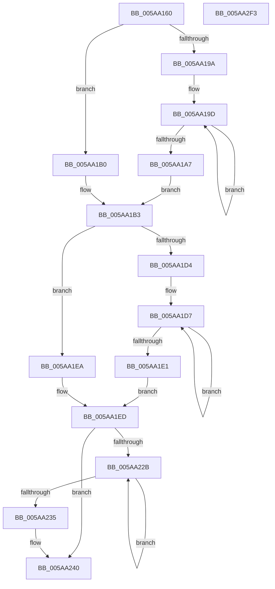

# McTemplateK0zzqqzttquxt_EtwWriteTransfer

- RVA: `0x005AA160`–`0x005AA2F4` (길이 `404` bytes)
- VA: `0x00000001405AA160`
- 실행 섹션: `.text`
- PDB 이름 있음: `예`; PDB Function 태그: `아니요`
- unwind 정보 RVA: `0x000C9068`
- 디코드: `91`개 명령, `404/404` bytes 표시
- 미해석 바이트: `0` (있으면 어셈블리에 `.byte`로 보존)

> 이 문서는 커널 이미지의 기계어와 PDB 기호를 분석해 생성했습니다. 4번과 5번은 함수 원형과 자료형을 바이너리 사용 방식에서 추정한 C 해석이며 원본 소스 복구 결과는 아닙니다.

## 1. Dependencies

- 직접 호출 지점: **2**; 고유 호출 대상: **2**
- 직접 호출자로 확인된 함수: **1**
- RIP 상대 이미지 참조: **4**

### Outgoing calls
- `0x005AA2D1` → [McGenEventWrite_EtwWriteTransfer](../42/McGenEventWrite_EtwWriteTransfer_function_00424FC8.md) (function, `0x00424FC8`)
- `0x005AA2DD` → [_security_check_cookie](../6A/_security_check_cookie_function_006AC640.md) (function, `0x006AC640`)

### Direct callers
- [PnpTraceRebalanceResult](../../page/73/PnpTraceRebalanceResult_function_0073CD60.md) at `0x0073CE76`

### Static image references
- `0x005AA172` → RVA `0x00E0A740` (`.data`; read)
- `0x005AA1BA` → RVA `0x006CB080` (` ?? ::FNODOBFM::`string'`; read)
- `0x005AA254` → RVA `0x00027040` (`.rdata`; read)
- `0x005AA267` → RVA `0x00E06DA0` (`.data`; read)

## 2. Other-region calls and transfers

- 다른 실행 섹션으로 향하는 call: **0**
- 별도 외부 분기/꼬리 이동을 확인하지 못했습니다.

## 3. Assembly (complete function range)

```asm
005AA160  48 89 5C 24 08                  mov qword ptr [rsp + 8], rbx
005AA165  55                              push rbp
005AA166  48 8D 6C 24 F9                  lea rbp, [rsp - 7]
005AA16B  48 81 EC 00 01 00 00            sub rsp, 0x100
005AA172  48 8B 05 C7 05 86 00            mov rax, qword ptr [rip + 0x8605c7]
005AA179  48 33 C4                        xor rax, rsp
005AA17C  48 89 45 F7                     mov qword ptr [rbp - 9], rax
005AA180  4C 8B 55 4F                     mov r10, qword ptr [rbp + 0x4f]
005AA184  48 83 C8 FF                     or rax, 0xffffffffffffffff
005AA188  48 8B 55 37                     mov rdx, qword ptr [rbp + 0x37]
005AA18C  45 33 DB                        xor r11d, r11d
005AA18F  41 B8 0A 00 00 00               mov r8d, 0xa
005AA195  4D 85 C9                        test r9, r9
005AA198  74 16                           je 0x1405aa1b0
005AA19A  48 8B C8                        mov rcx, rax
005AA19D  48 FF C1                        inc rcx
005AA1A0  66 45 39 1C 49                  cmp word ptr [r9 + rcx*2], r11w
005AA1A5  75 F6                           jne 0x1405aa19d
005AA1A7  8D 0C 4D 02 00 00 00            lea ecx, [rcx*2 + 2]
005AA1AE  EB 03                           jmp 0x1405aa1b3
005AA1B0  41 8B C8                        mov ecx, r8d
005AA1B3  4D 85 C9                        test r9, r9
005AA1B6  89 4C 24 48                     mov dword ptr [rsp + 0x48], ecx
005AA1BA  48 8D 1D BF 0E 12 00            lea rbx, [rip + 0x120ebf]
005AA1C1  44 89 5C 24 4C                  mov dword ptr [rsp + 0x4c], r11d
005AA1C6  4C 0F 44 CB                     cmove r9, rbx
005AA1CA  4C 89 4C 24 40                  mov qword ptr [rsp + 0x40], r9
005AA1CF  48 85 D2                        test rdx, rdx
005AA1D2  74 16                           je 0x1405aa1ea
005AA1D4  48 8B C8                        mov rcx, rax
005AA1D7  48 FF C1                        inc rcx
005AA1DA  66 44 39 1C 4A                  cmp word ptr [rdx + rcx*2], r11w
005AA1DF  75 F6                           jne 0x1405aa1d7
005AA1E1  8D 0C 4D 02 00 00 00            lea ecx, [rcx*2 + 2]
005AA1E8  EB 03                           jmp 0x1405aa1ed
005AA1EA  41 8B C8                        mov ecx, r8d
005AA1ED  89 4C 24 58                     mov dword ptr [rsp + 0x58], ecx
005AA1F1  48 85 D2                        test rdx, rdx
005AA1F4  48 8D 4D 3F                     lea rcx, [rbp + 0x3f]
005AA1F8  44 89 5C 24 5C                  mov dword ptr [rsp + 0x5c], r11d
005AA1FD  48 0F 44 D3                     cmove rdx, rbx
005AA201  48 89 4C 24 60                  mov qword ptr [rsp + 0x60], rcx
005AA206  48 89 54 24 50                  mov qword ptr [rsp + 0x50], rdx
005AA20B  48 8D 4D 47                     lea rcx, [rbp + 0x47]
005AA20F  48 89 4C 24 70                  mov qword ptr [rsp + 0x70], rcx
005AA214  48 C7 44 24 68 04 00 00 00      mov qword ptr [rsp + 0x68], 4
005AA21D  48 C7 44 24 78 04 00 00 00      mov qword ptr [rsp + 0x78], 4
005AA226  4D 85 D2                        test r10, r10
005AA229  74 15                           je 0x1405aa240
005AA22B  48 FF C0                        inc rax
005AA22E  66 45 39 1C 42                  cmp word ptr [r10 + rax*2], r11w
005AA233  75 F6                           jne 0x1405aa22b
005AA235  44 8D 04 45 02 00 00 00         lea r8d, [rax*2 + 2]
005AA23D  4D 85 D2                        test r10, r10
005AA240  4C 0F 44 D3                     cmove r10, rbx
005AA244  44 89 45 8F                     mov dword ptr [rbp - 0x71], r8d
005AA248  48 8D 45 57                     lea rax, [rbp + 0x57]
005AA24C  4C 89 55 87                     mov qword ptr [rbp - 0x79], r10
005AA250  48 89 45 97                     mov qword ptr [rbp - 0x69], rax
005AA254  48 8D 15 E5 CD A7 FF            lea rdx, [rip - 0x58321b]
005AA25B  48 8D 45 5F                     lea rax, [rbp + 0x5f]
005AA25F  44 89 5D 93                     mov dword ptr [rbp - 0x6d], r11d
005AA263  48 89 45 A7                     mov qword ptr [rbp - 0x59], rax
005AA267  48 8D 0D 32 CB 85 00            lea rcx, [rip + 0x85cb32]
005AA26E  48 8D 45 67                     lea rax, [rbp + 0x67]
005AA272  48 C7 45 9F 04 00 00 00         mov qword ptr [rbp - 0x61], 4
005AA27A  48 89 45 B7                     mov qword ptr [rbp - 0x49], rax
005AA27E  41 B9 0C 00 00 00               mov r9d, 0xc
005AA284  48 8D 45 6F                     lea rax, [rbp + 0x6f]
005AA288  48 C7 45 AF 04 00 00 00         mov qword ptr [rbp - 0x51], 4
005AA290  48 89 45 C7                     mov qword ptr [rbp - 0x39], rax
005AA294  45 33 C0                        xor r8d, r8d
005AA297  48 8D 45 77                     lea rax, [rbp + 0x77]
005AA29B  48 C7 45 BF 04 00 00 00         mov qword ptr [rbp - 0x41], 4
005AA2A3  48 89 45 D7                     mov qword ptr [rbp - 0x29], rax
005AA2A7  48 8D 45 7F                     lea rax, [rbp + 0x7f]
005AA2AB  48 89 45 E7                     mov qword ptr [rbp - 0x19], rax
005AA2AF  48 8D 44 24 30                  lea rax, [rsp + 0x30]
005AA2B4  48 89 44 24 20                  mov qword ptr [rsp + 0x20], rax
005AA2B9  48 C7 45 CF 01 00 00 00         mov qword ptr [rbp - 0x31], 1
005AA2C1  48 C7 45 DF 08 00 00 00         mov qword ptr [rbp - 0x21], 8
005AA2C9  48 C7 45 EF 04 00 00 00         mov qword ptr [rbp - 0x11], 4
005AA2D1  E8 F2 AC E7 FF                  call 0x140424fc8
005AA2D6  48 8B 4D F7                     mov rcx, qword ptr [rbp - 9]
005AA2DA  48 33 CC                        xor rcx, rsp
005AA2DD  E8 5E 23 10 00                  call 0x1406ac640
005AA2E2  48 8B 9C 24 10 01 00 00         mov rbx, qword ptr [rsp + 0x110]
005AA2EA  48 81 C4 00 01 00 00            add rsp, 0x100
005AA2F1  5D                              pop rbp
005AA2F2  C3                              ret
005AA2F3  CC                              int3
```

## 4. C-style interpretation (structured pseudocode)

```c
__int64 __fastcall McTemplateK0zzqqzttquxt_EtwWriteTransfer(__int64 a1, __int64 a2, __int64 a3, __int64 a4, __int64 a5, __int64 a6, __int64 a7, __int64 a8, __int64 a9, __int64 a10, __int64 a11, __int64 a12, __int64 a13, __int64 a14)
{
    __int64 result;
    __int64 v_r11;
    __int64 v_rsp;
    unsigned __int64 v_stack_m18;
    unsigned __int64 v_stack_m20;
    unsigned __int64 v_stack_m28;
    unsigned __int64 v_stack_m30;
    unsigned __int64 v_stack_m38;
    unsigned __int64 v_stack_m40;
    unsigned __int64 v_stack_m48;
    unsigned __int64 v_stack_m50;
    unsigned __int64 v_stack_m58;
    unsigned __int64 v_stack_m60;
    unsigned __int64 v_stack_m68;
    unsigned __int64 v_stack_m70;
    unsigned __int64 v_stack_m78;
    unsigned int v_stack_m7C;
    unsigned int v_stack_m80;
    unsigned __int64 v_stack_m88;
    unsigned __int64 v_stack_m90;
    unsigned __int64 v_stack_m98;
    unsigned __int64 v_stack_mA0;
    unsigned __int64 v_stack_mA8;
    unsigned int v_stack_mAC;
    unsigned int v_stack_mB0;
    unsigned __int64 v_stack_mB8;
    unsigned int v_stack_mBC;
    unsigned int v_stack_mC0;
    unsigned __int64 v_stack_mC8;
    unsigned __int64 v_stack_mD8;
    unsigned __int64 v_stack_mE8;
    unsigned __int64 v_stack_mF;
    unsigned __int64 v_stack_p8;

    v_stack_p8 = v_rbx;
    v_rsp = (v_rsp) - (256);
    result = (*(unsigned __int64 *)(v_rip + 8783303)) ^ (v_rsp);
    v_stack_m18 = result;
    result = (result) | (-1);
    v_r11 = 0;
    if (a4 == 0) goto loc_005AA1B0;
loc_005AA19D:
    a1 = (result) + 1;
    if ((*(unsigned __int16 *)(a4 + a1 * 2)) != 0) goto loc_005AA19D;
    goto loc_005AA1B3;
loc_005AA1B0:
loc_005AA1B3:
    v_stack_mC0 = 10;
    v_stack_mBC = 0;
    if (a4 == 0) { a4 = v_rip + 1183423; }
    v_stack_mC8 = a4;
    if (a5 == 0) goto loc_005AA1EA;
loc_005AA1D7:
    a1 = (result) + 1;
    if ((*(unsigned __int16 *)(a5 + a1 * 2)) != 0) goto loc_005AA1D7;
    goto loc_005AA1ED;
loc_005AA1EA:
loc_005AA1ED:
    v_stack_mB0 = 10;
    v_stack_mAC = 0;
    if (a5 == 0) { a5 = v_rip + 1183423; }
    v_stack_mA8 = a6;
    v_stack_mB8 = a5;
    v_stack_m98 = a7;
    v_stack_mA0 = 4;
    v_stack_m90 = 4;
    if (a8 == 0) goto loc_005AA240;
loc_005AA22B:
    result = (result) + 1;
    if ((*(unsigned __int16 *)(a8 + result * 2)) != 0) goto loc_005AA22B;
loc_005AA240:
    if (a8 == 0) { a8 = v_rip + 1183423; }
    v_stack_m80 = (unsigned int)(result * 2 + 2);
    v_stack_m88 = a8;
    v_stack_m78 = a9;
    v_stack_m7C = 0;
    v_stack_m68 = a10;
    v_stack_m70 = 4;
    v_stack_m58 = a11;
    v_stack_m60 = 4;
    v_stack_m48 = a12;
    a3 = 0;
    v_stack_m50 = 4;
    v_stack_m38 = a13;
    v_stack_m28 = a14;
    v_stack_mE8 = v_stack_mD8;
    v_stack_m40 = 1;
    v_stack_m30 = 8;
    v_stack_m20 = 4;
    result = McGenEventWrite_EtwWriteTransfer(v_rip + 8768306, v_rip - 5779995, a3, 12);
    a1 = (v_stack_m18) ^ (v_rsp);
    result = _security_check_cookie(a1, v_rip - 5779995, a3, 12);
    v_rsp = (v_rsp) + (256);
    return result;
}
```

## 5. (Beta) C Style

```c
int64_t McTemplateK0zzqqzttquxt_EtwWriteTransfer(int64_t Arg1, int64_t Arg2, int64_t Arg3, int64_t Arg4, int64_t Arg5, int64_t Arg6, int64_t Arg7, int64_t Arg8, int64_t Arg9, int64_t Arg10, int64_t Arg11, int64_t Arg12, int64_t Arg13, int64_t Arg14)
{
    int64_t result;
    int64_t local_r11;
    int64_t local_rsp;
    uint64_t v_stack_m18;
    uint64_t v_stack_m20;
    uint64_t v_stack_m28;
    uint64_t v_stack_m30;
    uint64_t v_stack_m38;
    uint64_t v_stack_m40;
    uint64_t v_stack_m48;
    uint64_t v_stack_m50;
    uint64_t v_stack_m58;
    uint64_t v_stack_m60;
    uint64_t v_stack_m68;
    uint64_t v_stack_m70;
    uint64_t v_stack_m78;
    uint32_t v_stack_m7C;
    uint32_t v_stack_m80;
    uint64_t v_stack_m88;
    uint64_t v_stack_m90;
    uint64_t v_stack_m98;
    uint64_t v_stack_mA0;
    uint64_t v_stack_mA8;
    uint32_t v_stack_mAC;
    uint32_t v_stack_mB0;
    uint64_t v_stack_mB8;
    uint32_t v_stack_mBC;
    uint32_t v_stack_mC0;
    uint64_t v_stack_mC8;
    uint64_t v_stack_mD8;
    uint64_t v_stack_mE8;
    uint64_t v_stack_mF;
    uint64_t v_stack_p8;

    v_stack_p8 = local_rbx;
    local_rsp = (local_rsp) - (256);
    result = (*(uint64_t *)(v_rip + 0x8605C7)) ^ (local_rsp);
    v_stack_m18 = result;
    result = (result) | (-1);
    local_r11 = 0;
    if (Arg4 == 0) goto loc_005AA1B0;
loc_005AA19D:
    Arg1 = (result) + 1;
    if ((*(uint16_t *)(Arg4 + Arg1 * 2)) != 0) goto loc_005AA19D;
    goto loc_005AA1B3;
loc_005AA1B0:
loc_005AA1B3:
    v_stack_mC0 = 10;
    v_stack_mBC = 0;
    if (Arg4 == 0) { Arg4 = v_rip + 1183423; }
    v_stack_mC8 = Arg4;
    if (Arg5 == 0) goto loc_005AA1EA;
loc_005AA1D7:
    Arg1 = (result) + 1;
    if ((*(uint16_t *)(Arg5 + Arg1 * 2)) != 0) goto loc_005AA1D7;
    goto loc_005AA1ED;
loc_005AA1EA:
loc_005AA1ED:
    v_stack_mB0 = 10;
    v_stack_mAC = 0;
    if (Arg5 == 0) { Arg5 = v_rip + 1183423; }
    v_stack_mA8 = Arg6;
    v_stack_mB8 = Arg5;
    v_stack_m98 = Arg7;
    v_stack_mA0 = 4;
    v_stack_m90 = 4;
    if (Arg8 == 0) goto loc_005AA240;
loc_005AA22B:
    result = (result) + 1;
    if ((*(uint16_t *)(Arg8 + result * 2)) != 0) goto loc_005AA22B;
loc_005AA240:
    if (Arg8 == 0) { Arg8 = v_rip + 1183423; }
    v_stack_m80 = (uint32_t)(result * 2 + 2);
    v_stack_m88 = Arg8;
    v_stack_m78 = Arg9;
    v_stack_m7C = 0;
    v_stack_m68 = Arg10;
    v_stack_m70 = 4;
    v_stack_m58 = Arg11;
    v_stack_m60 = 4;
    v_stack_m48 = Arg12;
    Arg3 = 0;
    v_stack_m50 = 4;
    v_stack_m38 = Arg13;
    v_stack_m28 = Arg14;
    v_stack_mE8 = v_stack_mD8;
    v_stack_m40 = 1;
    v_stack_m30 = 8;
    v_stack_m20 = 4;
    result = McGenEventWrite_EtwWriteTransfer(v_rip + 8768306, v_rip - 5779995, Arg3, 12);
    Arg1 = (v_stack_m18) ^ (local_rsp);
    result = _security_check_cookie(Arg1, v_rip - 5779995, Arg3, 12);
    local_rsp = (local_rsp) + (256);
    return result;
}
```

## 6. Execution-region graph

[열기: 2D/3D 그래프와 함수 탐색 컨트롤 패널](../../../control-panel.html?section=text&rva=0x005AA160&view=graph)

- 2D 그래프는 위에서 아래로 흐르고, 3D 그래프는 빈 공간을 드래그해 회전합니다. Shift+드래그는 이동, 휠은 확대·축소, 함수 노드 선택은 대상 보고서 이동입니다.

### Static fallback


