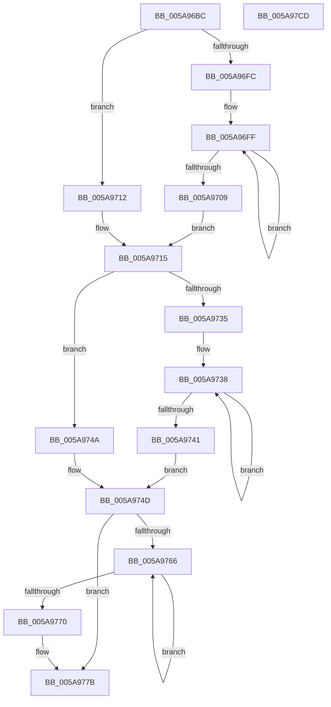

# McTemplateK0zzz_EtwWriteTransfer

- RVA: `0x005A96BC`–`0x005A97CE` (길이 `274` bytes)
- VA: `0x00000001405A96BC`
- 실행 섹션: `.text`
- PDB 이름 있음: `예`; PDB Function 태그: `아니요`
- unwind 정보 RVA: `0x0008AD68`
- 디코드: `67`개 명령, `274/274` bytes 표시
- 미해석 바이트: `0` (있으면 어셈블리에 `.byte`로 보존)

> 이 문서는 커널 이미지의 기계어와 PDB 기호를 분석해 생성했습니다. 4번과 5번은 함수 원형과 자료형을 바이너리 사용 방식에서 추정한 C 해석이며 원본 소스 복구 결과는 아닙니다.

## 1. Dependencies

- 직접 호출 지점: **2**; 고유 호출 대상: **2**
- 직접 호출자로 확인된 함수: **6**
- RIP 상대 이미지 참조: **3**

### Outgoing calls
- `0x005A97AA` → [McGenEventWrite_EtwWriteTransfer](../42/McGenEventWrite_EtwWriteTransfer_function_00424FC8.md) (function, `0x00424FC8`)
- `0x005A97B7` → [_security_check_cookie](../6A/_security_check_cookie_function_006AC640.md) (function, `0x006AC640`)

### Direct callers
- [PiSwStartCreate](../../page/73/PiSwStartCreate_function_0073B2CC.md) at `0x0073B328`
- [PiSwBusRelationAdd](../../page/8D/PiSwBusRelationAdd_function_008DA994.md) at `0x008DAAE9`
- [PiSwCompleteCreate](../../page/8D/PiSwCompleteCreate_function_008DAB90.md) at `0x008DAFBE`
- [PiSwStopDestroy](../../page/8F/PiSwStopDestroy_function_008FCA68.md) at `0x008FCB20`
- [PiSwBusRelationRemove](../../page/94/PiSwBusRelationRemove_function_0094D9C0.md) at `0x0094D9FE`
- [PiSwIrpInterfaceRegister](../../page/94/PiSwIrpInterfaceRegister_function_0094F01C.md) at `0x0094F465`

### Static image references
- `0x005A96C9` → RVA `0x00E0A740` (`.data`; read)
- `0x005A971C` → RVA `0x006CB080` (` ?? ::FNODOBFM::`string'`; read)
- `0x005A97A3` → RVA `0x00E06DA0` (`.data`; read)

## 2. Other-region calls and transfers

- 다른 실행 섹션으로 향하는 call: **0**
- 별도 외부 분기/꼬리 이동을 확인하지 못했습니다.

## 3. Assembly (complete function range)

```asm
005A96BC  48 89 5C 24 08                  mov qword ptr [rsp + 8], rbx
005A96C1  57                              push rdi
005A96C2  48 81 EC 80 00 00 00            sub rsp, 0x80
005A96C9  48 8B 05 70 10 86 00            mov rax, qword ptr [rip + 0x861070]
005A96D0  48 33 C4                        xor rax, rsp
005A96D3  48 89 44 24 70                  mov qword ptr [rsp + 0x70], rax
005A96D8  4C 8B 94 24 B8 00 00 00         mov r10, qword ptr [rsp + 0xb8]
005A96E0  48 83 C8 FF                     or rax, 0xffffffffffffffff
005A96E4  33 DB                           xor ebx, ebx
005A96E6  4C 8B DA                        mov r11, rdx
005A96E9  48 8B 94 24 B0 00 00 00         mov rdx, qword ptr [rsp + 0xb0]
005A96F1  41 B8 0A 00 00 00               mov r8d, 0xa
005A96F7  4D 85 C9                        test r9, r9
005A96FA  74 16                           je 0x1405a9712
005A96FC  48 8B C8                        mov rcx, rax
005A96FF  48 FF C1                        inc rcx
005A9702  66 41 39 1C 49                  cmp word ptr [r9 + rcx*2], bx
005A9707  75 F6                           jne 0x1405a96ff
005A9709  8D 0C 4D 02 00 00 00            lea ecx, [rcx*2 + 2]
005A9710  EB 03                           jmp 0x1405a9715
005A9712  41 8B C8                        mov ecx, r8d
005A9715  4D 85 C9                        test r9, r9
005A9718  89 4C 24 48                     mov dword ptr [rsp + 0x48], ecx
005A971C  48 8D 3D 5D 19 12 00            lea rdi, [rip + 0x12195d]
005A9723  89 5C 24 4C                     mov dword ptr [rsp + 0x4c], ebx
005A9727  4C 0F 44 CF                     cmove r9, rdi
005A972B  4C 89 4C 24 40                  mov qword ptr [rsp + 0x40], r9
005A9730  48 85 D2                        test rdx, rdx
005A9733  74 15                           je 0x1405a974a
005A9735  48 8B C8                        mov rcx, rax
005A9738  48 FF C1                        inc rcx
005A973B  66 39 1C 4A                     cmp word ptr [rdx + rcx*2], bx
005A973F  75 F7                           jne 0x1405a9738
005A9741  8D 0C 4D 02 00 00 00            lea ecx, [rcx*2 + 2]
005A9748  EB 03                           jmp 0x1405a974d
005A974A  41 8B C8                        mov ecx, r8d
005A974D  48 85 D2                        test rdx, rdx
005A9750  89 4C 24 58                     mov dword ptr [rsp + 0x58], ecx
005A9754  89 5C 24 5C                     mov dword ptr [rsp + 0x5c], ebx
005A9758  48 0F 44 D7                     cmove rdx, rdi
005A975C  48 89 54 24 50                  mov qword ptr [rsp + 0x50], rdx
005A9761  4D 85 D2                        test r10, r10
005A9764  74 15                           je 0x1405a977b
005A9766  48 FF C0                        inc rax
005A9769  66 41 39 1C 42                  cmp word ptr [r10 + rax*2], bx
005A976E  75 F6                           jne 0x1405a9766
005A9770  44 8D 04 45 02 00 00 00         lea r8d, [rax*2 + 2]
005A9778  4D 85 D2                        test r10, r10
005A977B  4C 0F 44 D7                     cmove r10, rdi
005A977F  44 89 44 24 68                  mov dword ptr [rsp + 0x68], r8d
005A9784  48 8D 44 24 30                  lea rax, [rsp + 0x30]
005A9789  4C 89 54 24 60                  mov qword ptr [rsp + 0x60], r10
005A978E  45 33 C0                        xor r8d, r8d
005A9791  48 89 44 24 20                  mov qword ptr [rsp + 0x20], rax
005A9796  41 B9 04 00 00 00               mov r9d, 4
005A979C  89 5C 24 6C                     mov dword ptr [rsp + 0x6c], ebx
005A97A0  49 8B D3                        mov rdx, r11
005A97A3  48 8D 0D F6 D5 85 00            lea rcx, [rip + 0x85d5f6]
005A97AA  E8 19 B8 E7 FF                  call 0x140424fc8
005A97AF  48 8B 4C 24 70                  mov rcx, qword ptr [rsp + 0x70]
005A97B4  48 33 CC                        xor rcx, rsp
005A97B7  E8 84 2E 10 00                  call 0x1406ac640
005A97BC  48 8B 9C 24 90 00 00 00         mov rbx, qword ptr [rsp + 0x90]
005A97C4  48 81 C4 80 00 00 00            add rsp, 0x80
005A97CB  5F                              pop rdi
005A97CC  C3                              ret
005A97CD  CC                              int3
```

## 4. C-style interpretation (structured pseudocode)

```c
__int64 __fastcall McTemplateK0zzz_EtwWriteTransfer(__int64 a1, __int64 a2, __int64 a3, __int64 a4, __int64 a5, __int64 a6)
{
    __int64 result;
    __int64 v_rbx;
    __int64 v_rsp;
    unsigned __int64 v_stack_m18;
    unsigned int v_stack_m1C;
    unsigned int v_stack_m20;
    unsigned __int64 v_stack_m28;
    unsigned int v_stack_m2C;
    unsigned int v_stack_m30;
    unsigned __int64 v_stack_m38;
    unsigned int v_stack_m3C;
    unsigned int v_stack_m40;
    unsigned __int64 v_stack_m48;
    unsigned __int64 v_stack_m58;
    unsigned __int64 v_stack_m68;
    unsigned __int64 v_stack_p8;

    v_stack_p8 = v_rbx;
    v_rsp = (v_rsp) - (128);
    result = (*(unsigned __int64 *)(v_rip + 8786032)) ^ (v_rsp);
    v_stack_m18 = result;
    result = (result) | (-1);
    v_rbx = 0;
    if (a4 == 0) goto loc_005A9712;
loc_005A96FF:
    a1 = (result) + 1;
    if ((*(unsigned __int16 *)(a4 + a1 * 2)) != 0) goto loc_005A96FF;
    goto loc_005A9715;
loc_005A9712:
loc_005A9715:
    v_stack_m40 = 10;
    v_stack_m3C = 0;
    if (a4 == 0) { a4 = v_rip + 1186141; }
    v_stack_m48 = a4;
    if (a5 == 0) goto loc_005A974A;
loc_005A9738:
    a1 = (result) + 1;
    if ((*(unsigned __int16 *)(a5 + a1 * 2)) != 0) goto loc_005A9738;
    goto loc_005A974D;
loc_005A974A:
loc_005A974D:
    v_stack_m30 = 10;
    v_stack_m2C = 0;
    if (a5 == 0) { a5 = v_rip + 1186141; }
    v_stack_m38 = a5;
    if (a6 == 0) goto loc_005A977B;
loc_005A9766:
    result = (result) + 1;
    if ((*(unsigned __int16 *)(a6 + result * 2)) != 0) goto loc_005A9766;
loc_005A977B:
    if (a6 == 0) { a6 = v_rip + 1186141; }
    v_stack_m20 = (unsigned int)(result * 2 + 2);
    v_stack_m28 = a6;
    a3 = 0;
    v_stack_m68 = v_stack_m58;
    v_stack_m1C = 0;
    result = McGenEventWrite_EtwWriteTransfer(v_rip + 8771062, a2, a3, 4);
    a1 = (v_stack_m18) ^ (v_rsp);
    result = _security_check_cookie(a1, a2, a3, 4);
    v_rsp = (v_rsp) + (128);
    return result;
}
```

## 5. (Beta) C Style

```c
int64_t McTemplateK0zzz_EtwWriteTransfer(int64_t Arg1, int64_t Arg2, int64_t Arg3, int64_t Arg4, int64_t Arg5, int64_t Arg6)
{
    int64_t result;
    int64_t local_rbx;
    int64_t local_rsp;
    uint64_t v_stack_m18;
    uint32_t v_stack_m1C;
    uint32_t v_stack_m20;
    uint64_t v_stack_m28;
    uint32_t v_stack_m2C;
    uint32_t v_stack_m30;
    uint64_t v_stack_m38;
    uint32_t v_stack_m3C;
    uint32_t v_stack_m40;
    uint64_t v_stack_m48;
    uint64_t v_stack_m58;
    uint64_t v_stack_m68;
    uint64_t v_stack_p8;

    v_stack_p8 = local_rbx;
    local_rsp = (local_rsp) - (128);
    result = (*(uint64_t *)(v_rip + 0x861070)) ^ (local_rsp);
    v_stack_m18 = result;
    result = (result) | (-1);
    local_rbx = 0;
    if (Arg4 == 0) goto loc_005A9712;
loc_005A96FF:
    Arg1 = (result) + 1;
    if ((*(uint16_t *)(Arg4 + Arg1 * 2)) != 0) goto loc_005A96FF;
    goto loc_005A9715;
loc_005A9712:
loc_005A9715:
    v_stack_m40 = 10;
    v_stack_m3C = 0;
    if (Arg4 == 0) { Arg4 = v_rip + 1186141; }
    v_stack_m48 = Arg4;
    if (Arg5 == 0) goto loc_005A974A;
loc_005A9738:
    Arg1 = (result) + 1;
    if ((*(uint16_t *)(Arg5 + Arg1 * 2)) != 0) goto loc_005A9738;
    goto loc_005A974D;
loc_005A974A:
loc_005A974D:
    v_stack_m30 = 10;
    v_stack_m2C = 0;
    if (Arg5 == 0) { Arg5 = v_rip + 1186141; }
    v_stack_m38 = Arg5;
    if (Arg6 == 0) goto loc_005A977B;
loc_005A9766:
    result = (result) + 1;
    if ((*(uint16_t *)(Arg6 + result * 2)) != 0) goto loc_005A9766;
loc_005A977B:
    if (Arg6 == 0) { Arg6 = v_rip + 1186141; }
    v_stack_m20 = (uint32_t)(result * 2 + 2);
    v_stack_m28 = Arg6;
    Arg3 = 0;
    v_stack_m68 = v_stack_m58;
    v_stack_m1C = 0;
    result = McGenEventWrite_EtwWriteTransfer(v_rip + 8771062, Arg2, Arg3, 4);
    Arg1 = (v_stack_m18) ^ (local_rsp);
    result = _security_check_cookie(Arg1, Arg2, Arg3, 4);
    local_rsp = (local_rsp) + (128);
    return result;
}
```

## 6. Execution-region graph

[열기: 2D/3D 그래프와 함수 탐색 컨트롤 패널](../../../control-panel.html?section=text&rva=0x005A96BC&view=graph)

- 2D 그래프는 위에서 아래로 흐르고, 3D 그래프는 빈 공간을 드래그해 회전합니다. Shift+드래그는 이동, 휠은 확대·축소, 함수 노드 선택은 대상 보고서 이동입니다.

### Static fallback


