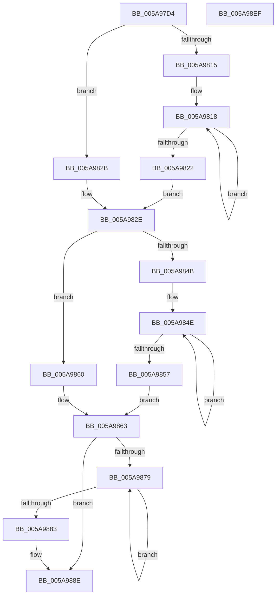

# McTemplateK0zzzd_EtwWriteTransfer

- RVA: `0x005A97D4`–`0x005A98F0` (길이 `284` bytes)
- VA: `0x00000001405A97D4`
- 실행 섹션: `.text`
- PDB 이름 있음: `예`; PDB Function 태그: `아니요`
- unwind 정보 RVA: `0x000C8F50`
- 디코드: `74`개 명령, `284/284` bytes 표시
- 미해석 바이트: `0` (있으면 어셈블리에 `.byte`로 보존)

> 이 문서는 커널 이미지의 기계어와 PDB 기호를 분석해 생성했습니다. 4번과 5번은 함수 원형과 자료형을 바이너리 사용 방식에서 추정한 C 해석이며 원본 소스 복구 결과는 아닙니다.

## 1. Dependencies

- 직접 호출 지점: **2**; 고유 호출 대상: **2**
- 직접 호출자로 확인된 함수: **6**
- RIP 상대 이미지 참조: **3**

### Outgoing calls
- `0x005A98C9` → [McGenEventWrite_EtwWriteTransfer](../42/McGenEventWrite_EtwWriteTransfer_function_00424FC8.md) (function, `0x00424FC8`)
- `0x005A98D5` → [_security_check_cookie](../6A/_security_check_cookie_function_006AC640.md) (function, `0x006AC640`)

### Direct callers
- [PiSwIrpCleanup](../../page/73/PiSwIrpCleanup_function_0073AC10.md) at `0x0073AD9E`
- [PiSwStartCreate](../../page/73/PiSwStartCreate_function_0073B2CC.md) at `0x0073B3F4`
- [PiSwBusRelationAdd](../../page/8D/PiSwBusRelationAdd_function_008DA994.md) at `0x008DAB39`
- [PiSwStopDestroy](../../page/8F/PiSwStopDestroy_function_008FCA68.md) at `0x008FCC01`
- [PiProcessDriverInstance](../../page/99/PiProcessDriverInstance_function_00998530.md) at `0x009987F5`
- [PiSwGetChildPdo](../../page/AC/PiSwGetChildPdo_function_00AC3544.md) at `0x00AC35AB`

### Static image references
- `0x005A97EB` → RVA `0x00E0A740` (`.data`; read)
- `0x005A9834` → RVA `0x006CB080` (` ?? ::FNODOBFM::`string'`; read)
- `0x005A98A2` → RVA `0x00E06DA0` (`.data`; read)

## 2. Other-region calls and transfers

- 다른 실행 섹션으로 향하는 call: **0**
- 별도 외부 분기/꼬리 이동을 확인하지 못했습니다.

## 3. Assembly (complete function range)

```asm
005A97D4  48 89 5C 24 08                  mov qword ptr [rsp + 8], rbx
005A97D9  48 89 7C 24 18                  mov qword ptr [rsp + 0x18], rdi
005A97DE  55                              push rbp
005A97DF  48 8D 6C 24 C1                  lea rbp, [rsp - 0x3f]
005A97E4  48 81 EC 90 00 00 00            sub rsp, 0x90
005A97EB  48 8B 05 4E 0F 86 00            mov rax, qword ptr [rip + 0x860f4e]
005A97F2  48 33 C4                        xor rax, rsp
005A97F5  48 89 45 2F                     mov qword ptr [rbp + 0x2f], rax
005A97F9  4C 8B 55 77                     mov r10, qword ptr [rbp + 0x77]
005A97FD  48 83 C8 FF                     or rax, 0xffffffffffffffff
005A9801  33 DB                           xor ebx, ebx
005A9803  4C 8B DA                        mov r11, rdx
005A9806  48 8B 55 6F                     mov rdx, qword ptr [rbp + 0x6f]
005A980A  41 B8 0A 00 00 00               mov r8d, 0xa
005A9810  4D 85 C9                        test r9, r9
005A9813  74 16                           je 0x1405a982b
005A9815  48 8B C8                        mov rcx, rax
005A9818  48 FF C1                        inc rcx
005A981B  66 41 39 1C 49                  cmp word ptr [r9 + rcx*2], bx
005A9820  75 F6                           jne 0x1405a9818
005A9822  8D 0C 4D 02 00 00 00            lea ecx, [rcx*2 + 2]
005A9829  EB 03                           jmp 0x1405a982e
005A982B  41 8B C8                        mov ecx, r8d
005A982E  4D 85 C9                        test r9, r9
005A9831  89 4D F7                        mov dword ptr [rbp - 9], ecx
005A9834  48 8D 3D 45 18 12 00            lea rdi, [rip + 0x121845]
005A983B  89 5D FB                        mov dword ptr [rbp - 5], ebx
005A983E  4C 0F 44 CF                     cmove r9, rdi
005A9842  4C 89 4D EF                     mov qword ptr [rbp - 0x11], r9
005A9846  48 85 D2                        test rdx, rdx
005A9849  74 15                           je 0x1405a9860
005A984B  48 8B C8                        mov rcx, rax
005A984E  48 FF C1                        inc rcx
005A9851  66 39 1C 4A                     cmp word ptr [rdx + rcx*2], bx
005A9855  75 F7                           jne 0x1405a984e
005A9857  8D 0C 4D 02 00 00 00            lea ecx, [rcx*2 + 2]
005A985E  EB 03                           jmp 0x1405a9863
005A9860  41 8B C8                        mov ecx, r8d
005A9863  48 85 D2                        test rdx, rdx
005A9866  89 4D 07                        mov dword ptr [rbp + 7], ecx
005A9869  89 5D 0B                        mov dword ptr [rbp + 0xb], ebx
005A986C  48 0F 44 D7                     cmove rdx, rdi
005A9870  48 89 55 FF                     mov qword ptr [rbp - 1], rdx
005A9874  4D 85 D2                        test r10, r10
005A9877  74 15                           je 0x1405a988e
005A9879  48 FF C0                        inc rax
005A987C  66 41 39 1C 42                  cmp word ptr [r10 + rax*2], bx
005A9881  75 F6                           jne 0x1405a9879
005A9883  44 8D 04 45 02 00 00 00         lea r8d, [rax*2 + 2]
005A988B  4D 85 D2                        test r10, r10
005A988E  4C 0F 44 D7                     cmove r10, rdi
005A9892  44 89 45 17                     mov dword ptr [rbp + 0x17], r8d
005A9896  48 8D 45 7F                     lea rax, [rbp + 0x7f]
005A989A  4C 89 55 0F                     mov qword ptr [rbp + 0xf], r10
005A989E  48 89 45 1F                     mov qword ptr [rbp + 0x1f], rax
005A98A2  48 8D 0D F7 D4 85 00            lea rcx, [rip + 0x85d4f7]
005A98A9  48 8D 45 DF                     lea rax, [rbp - 0x21]
005A98AD  89 5D 1B                        mov dword ptr [rbp + 0x1b], ebx
005A98B0  41 B9 05 00 00 00               mov r9d, 5
005A98B6  48 89 44 24 20                  mov qword ptr [rsp + 0x20], rax
005A98BB  45 33 C0                        xor r8d, r8d
005A98BE  48 C7 45 27 04 00 00 00         mov qword ptr [rbp + 0x27], 4
005A98C6  49 8B D3                        mov rdx, r11
005A98C9  E8 FA B6 E7 FF                  call 0x140424fc8
005A98CE  48 8B 4D 2F                     mov rcx, qword ptr [rbp + 0x2f]
005A98D2  48 33 CC                        xor rcx, rsp
005A98D5  E8 66 2D 10 00                  call 0x1406ac640
005A98DA  4C 8D 9C 24 90 00 00 00         lea r11, [rsp + 0x90]
005A98E2  49 8B 5B 10                     mov rbx, qword ptr [r11 + 0x10]
005A98E6  49 8B 7B 20                     mov rdi, qword ptr [r11 + 0x20]
005A98EA  49 8B E3                        mov rsp, r11
005A98ED  5D                              pop rbp
005A98EE  C3                              ret
005A98EF  CC                              int3
```

## 4. C-style interpretation (structured pseudocode)

```c
__int64 __fastcall McTemplateK0zzzd_EtwWriteTransfer(__int64 a1, __int64 a2, __int64 a3, __int64 a4, __int64 a5, __int64 a6, __int64 a7)
{
    __int64 result;
    __int64 v_rbx;
    __int64 v_rsp;
    unsigned __int64 v_stack_m18;
    unsigned __int64 v_stack_m20;
    unsigned __int64 v_stack_m28;
    unsigned int v_stack_m2C;
    unsigned int v_stack_m30;
    unsigned __int64 v_stack_m38;
    unsigned int v_stack_m3C;
    unsigned int v_stack_m40;
    unsigned __int64 v_stack_m47;
    unsigned __int64 v_stack_m48;
    unsigned int v_stack_m4C;
    unsigned int v_stack_m50;
    unsigned __int64 v_stack_m58;
    unsigned __int64 v_stack_m68;
    unsigned __int64 v_stack_m78;
    unsigned __int64 v_stack_m8;
    unsigned __int64 v_stack_p18;
    unsigned __int64 v_stack_p8;

    v_stack_p8 = v_rbx;
    v_stack_p18 = v_rdi;
    v_rsp = (v_rsp) - (144);
    result = (*(unsigned __int64 *)(v_rip + 8785742)) ^ (v_rsp);
    v_stack_m18 = result;
    result = (result) | (-1);
    v_rbx = 0;
    if (a4 == 0) goto loc_005A982B;
loc_005A9818:
    a1 = (result) + 1;
    if ((*(unsigned __int16 *)(a4 + a1 * 2)) != 0) goto loc_005A9818;
    goto loc_005A982E;
loc_005A982B:
loc_005A982E:
    v_stack_m50 = 10;
    v_stack_m4C = 0;
    if (a4 == 0) { a4 = v_rip + 1185861; }
    v_stack_m58 = a4;
    if (a5 == 0) goto loc_005A9860;
loc_005A984E:
    a1 = (result) + 1;
    if ((*(unsigned __int16 *)(a5 + a1 * 2)) != 0) goto loc_005A984E;
    goto loc_005A9863;
loc_005A9860:
loc_005A9863:
    v_stack_m40 = 10;
    v_stack_m3C = 0;
    if (a5 == 0) { a5 = v_rip + 1185861; }
    v_stack_m48 = a5;
    if (a6 == 0) goto loc_005A988E;
loc_005A9879:
    result = (result) + 1;
    if ((*(unsigned __int16 *)(a6 + result * 2)) != 0) goto loc_005A9879;
loc_005A988E:
    if (a6 == 0) { a6 = v_rip + 1185861; }
    v_stack_m30 = (unsigned int)(result * 2 + 2);
    v_stack_m38 = a6;
    v_stack_m28 = a7;
    v_stack_m2C = 0;
    v_stack_m78 = v_stack_m68;
    a3 = 0;
    v_stack_m20 = 4;
    result = McGenEventWrite_EtwWriteTransfer(v_rip + 8770807, a2, a3, 5);
    a1 = (v_stack_m18) ^ (v_rsp);
    result = _security_check_cookie(a1, a2, a3, 5);
    return result;
}
```

## 5. (Beta) C Style

```c
int64_t McTemplateK0zzzd_EtwWriteTransfer(int64_t Arg1, int64_t Arg2, int64_t Arg3, int64_t Arg4, int64_t Arg5, int64_t Arg6, int64_t Arg7)
{
    int64_t result;
    int64_t local_rbx;
    int64_t local_rsp;
    uint64_t v_stack_m18;
    uint64_t v_stack_m20;
    uint64_t v_stack_m28;
    uint32_t v_stack_m2C;
    uint32_t v_stack_m30;
    uint64_t v_stack_m38;
    uint32_t v_stack_m3C;
    uint32_t v_stack_m40;
    uint64_t v_stack_m47;
    uint64_t v_stack_m48;
    uint32_t v_stack_m4C;
    uint32_t v_stack_m50;
    uint64_t v_stack_m58;
    uint64_t v_stack_m68;
    uint64_t v_stack_m78;
    uint64_t v_stack_m8;
    uint64_t v_stack_p18;
    uint64_t v_stack_p8;

    v_stack_p8 = local_rbx;
    v_stack_p18 = local_rdi;
    local_rsp = (local_rsp) - (144);
    result = (*(uint64_t *)(v_rip + 0x860F4E)) ^ (local_rsp);
    v_stack_m18 = result;
    result = (result) | (-1);
    local_rbx = 0;
    if (Arg4 == 0) goto loc_005A982B;
loc_005A9818:
    Arg1 = (result) + 1;
    if ((*(uint16_t *)(Arg4 + Arg1 * 2)) != 0) goto loc_005A9818;
    goto loc_005A982E;
loc_005A982B:
loc_005A982E:
    v_stack_m50 = 10;
    v_stack_m4C = 0;
    if (Arg4 == 0) { Arg4 = v_rip + 1185861; }
    v_stack_m58 = Arg4;
    if (Arg5 == 0) goto loc_005A9860;
loc_005A984E:
    Arg1 = (result) + 1;
    if ((*(uint16_t *)(Arg5 + Arg1 * 2)) != 0) goto loc_005A984E;
    goto loc_005A9863;
loc_005A9860:
loc_005A9863:
    v_stack_m40 = 10;
    v_stack_m3C = 0;
    if (Arg5 == 0) { Arg5 = v_rip + 1185861; }
    v_stack_m48 = Arg5;
    if (Arg6 == 0) goto loc_005A988E;
loc_005A9879:
    result = (result) + 1;
    if ((*(uint16_t *)(Arg6 + result * 2)) != 0) goto loc_005A9879;
loc_005A988E:
    if (Arg6 == 0) { Arg6 = v_rip + 1185861; }
    v_stack_m30 = (uint32_t)(result * 2 + 2);
    v_stack_m38 = Arg6;
    v_stack_m28 = Arg7;
    v_stack_m2C = 0;
    v_stack_m78 = v_stack_m68;
    Arg3 = 0;
    v_stack_m20 = 4;
    result = McGenEventWrite_EtwWriteTransfer(v_rip + 8770807, Arg2, Arg3, 5);
    Arg1 = (v_stack_m18) ^ (local_rsp);
    result = _security_check_cookie(Arg1, Arg2, Arg3, 5);
    return result;
}
```

## 6. Execution-region graph

[열기: 2D/3D 그래프와 함수 탐색 컨트롤 패널](../../../control-panel.html?section=text&rva=0x005A97D4&view=graph)

- 2D 그래프는 위에서 아래로 흐르고, 3D 그래프는 빈 공간을 드래그해 회전합니다. Shift+드래그는 이동, 휠은 확대·축소, 함수 노드 선택은 대상 보고서 이동입니다.

### Static fallback


