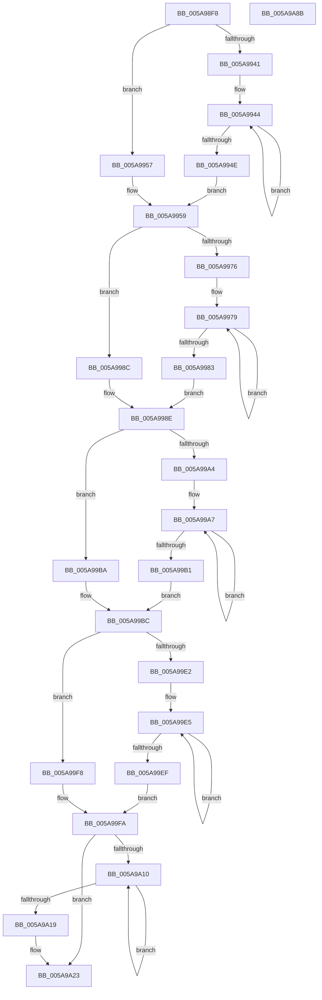

# McTemplateK0zzzdzzq_EtwWriteTransfer

- RVA: `0x005A98F8`–`0x005A9A8C` (길이 `404` bytes)
- VA: `0x00000001405A98F8`
- 실행 섹션: `.text`
- PDB 이름 있음: `예`; PDB Function 태그: `아니요`
- unwind 정보 RVA: `0x000C8F70`
- 디코드: `109`개 명령, `404/404` bytes 표시
- 미해석 바이트: `0` (있으면 어셈블리에 `.byte`로 보존)

> 이 문서는 커널 이미지의 기계어와 PDB 기호를 분석해 생성했습니다. 4번과 5번은 함수 원형과 자료형을 바이너리 사용 방식에서 추정한 C 해석이며 원본 소스 복구 결과는 아닙니다.

## 1. Dependencies

- 직접 호출 지점: **2**; 고유 호출 대상: **2**
- 직접 호출자로 확인된 함수: **1**
- RIP 상대 이미지 참조: **4**

### Outgoing calls
- `0x005A9A61` → [McGenEventWrite_EtwWriteTransfer](../42/McGenEventWrite_EtwWriteTransfer_function_00424FC8.md) (function, `0x00424FC8`)
- `0x005A9A6D` → [_security_check_cookie](../6A/_security_check_cookie_function_006AC640.md) (function, `0x006AC640`)

### Direct callers
- [PiSwIrpStartCreateWorker](../../page/8D/PiSwIrpStartCreateWorker_function_008DB398.md) at `0x008DB790`

### Static image references
- `0x005A9913` → RVA `0x00E0A740` (`.data`; read)
- `0x005A995F` → RVA `0x006CB080` (` ?? ::FNODOBFM::`string'`; read)
- `0x005A9A36` → RVA `0x00026E30` (`.rdata`; read)
- `0x005A9A5A` → RVA `0x00E06DA0` (`.data`; read)

## 2. Other-region calls and transfers

- 다른 실행 섹션으로 향하는 call: **0**
- 별도 외부 분기/꼬리 이동을 확인하지 못했습니다.

## 3. Assembly (complete function range)

```asm
005A98F8  48 8B C4                        mov rax, rsp
005A98FB  48 89 58 08                     mov qword ptr [rax + 8], rbx
005A98FF  48 89 70 10                     mov qword ptr [rax + 0x10], rsi
005A9903  48 89 78 18                     mov qword ptr [rax + 0x18], rdi
005A9907  55                              push rbp
005A9908  48 8D 68 D1                     lea rbp, [rax - 0x2f]
005A990C  48 81 EC C0 00 00 00            sub rsp, 0xc0
005A9913  48 8B 05 26 0E 86 00            mov rax, qword ptr [rip + 0x860e26]
005A991A  48 33 C4                        xor rax, rsp
005A991D  48 89 45 17                     mov qword ptr [rbp + 0x17], rax
005A9921  48 8B 5D 77                     mov rbx, qword ptr [rbp + 0x77]
005A9925  48 83 C8 FF                     or rax, 0xffffffffffffffff
005A9929  4C 8B 55 6F                     mov r10, qword ptr [rbp + 0x6f]
005A992D  33 FF                           xor edi, edi
005A992F  4C 8B 5D 5F                     mov r11, qword ptr [rbp + 0x5f]
005A9933  BA 0A 00 00 00                  mov edx, 0xa
005A9938  4C 8B 45 57                     mov r8, qword ptr [rbp + 0x57]
005A993C  4D 85 C9                        test r9, r9
005A993F  74 16                           je 0x1405a9957
005A9941  48 8B C8                        mov rcx, rax
005A9944  48 FF C1                        inc rcx
005A9947  66 41 39 3C 49                  cmp word ptr [r9 + rcx*2], di
005A994C  75 F6                           jne 0x1405a9944
005A994E  8D 0C 4D 02 00 00 00            lea ecx, [rcx*2 + 2]
005A9955  EB 02                           jmp 0x1405a9959
005A9957  8B CA                           mov ecx, edx
005A9959  4D 85 C9                        test r9, r9
005A995C  89 4D AF                        mov dword ptr [rbp - 0x51], ecx
005A995F  48 8D 35 1A 17 12 00            lea rsi, [rip + 0x12171a]
005A9966  89 7D B3                        mov dword ptr [rbp - 0x4d], edi
005A9969  4C 0F 44 CE                     cmove r9, rsi
005A996D  4C 89 4D A7                     mov qword ptr [rbp - 0x59], r9
005A9971  4D 85 C0                        test r8, r8
005A9974  74 16                           je 0x1405a998c
005A9976  48 8B C8                        mov rcx, rax
005A9979  48 FF C1                        inc rcx
005A997C  66 41 39 3C 48                  cmp word ptr [r8 + rcx*2], di
005A9981  75 F6                           jne 0x1405a9979
005A9983  8D 0C 4D 02 00 00 00            lea ecx, [rcx*2 + 2]
005A998A  EB 02                           jmp 0x1405a998e
005A998C  8B CA                           mov ecx, edx
005A998E  4D 85 C0                        test r8, r8
005A9991  89 4D BF                        mov dword ptr [rbp - 0x41], ecx
005A9994  89 7D C3                        mov dword ptr [rbp - 0x3d], edi
005A9997  4C 0F 44 C6                     cmove r8, rsi
005A999B  4C 89 45 B7                     mov qword ptr [rbp - 0x49], r8
005A999F  4D 85 DB                        test r11, r11
005A99A2  74 16                           je 0x1405a99ba
005A99A4  48 8B C8                        mov rcx, rax
005A99A7  48 FF C1                        inc rcx
005A99AA  66 41 39 3C 4B                  cmp word ptr [r11 + rcx*2], di
005A99AF  75 F6                           jne 0x1405a99a7
005A99B1  8D 0C 4D 02 00 00 00            lea ecx, [rcx*2 + 2]
005A99B8  EB 02                           jmp 0x1405a99bc
005A99BA  8B CA                           mov ecx, edx
005A99BC  4D 85 DB                        test r11, r11
005A99BF  89 4D CF                        mov dword ptr [rbp - 0x31], ecx
005A99C2  48 8D 4D 67                     lea rcx, [rbp + 0x67]
005A99C6  89 7D D3                        mov dword ptr [rbp - 0x2d], edi
005A99C9  4C 0F 44 DE                     cmove r11, rsi
005A99CD  48 89 4D D7                     mov qword ptr [rbp - 0x29], rcx
005A99D1  4C 89 5D C7                     mov qword ptr [rbp - 0x39], r11
005A99D5  48 C7 45 DF 04 00 00 00         mov qword ptr [rbp - 0x21], 4
005A99DD  4D 85 D2                        test r10, r10
005A99E0  74 16                           je 0x1405a99f8
005A99E2  48 8B C8                        mov rcx, rax
005A99E5  48 FF C1                        inc rcx
005A99E8  66 41 39 3C 4A                  cmp word ptr [r10 + rcx*2], di
005A99ED  75 F6                           jne 0x1405a99e5
005A99EF  8D 0C 4D 02 00 00 00            lea ecx, [rcx*2 + 2]
005A99F6  EB 02                           jmp 0x1405a99fa
005A99F8  8B CA                           mov ecx, edx
005A99FA  4D 85 D2                        test r10, r10
005A99FD  89 4D EF                        mov dword ptr [rbp - 0x11], ecx
005A9A00  89 7D F3                        mov dword ptr [rbp - 0xd], edi
005A9A03  4C 0F 44 D6                     cmove r10, rsi
005A9A07  4C 89 55 E7                     mov qword ptr [rbp - 0x19], r10
005A9A0B  48 85 DB                        test rbx, rbx
005A9A0E  74 13                           je 0x1405a9a23
005A9A10  48 FF C0                        inc rax
005A9A13  66 39 3C 43                     cmp word ptr [rbx + rax*2], di
005A9A17  75 F7                           jne 0x1405a9a10
005A9A19  8D 14 45 02 00 00 00            lea edx, [rax*2 + 2]
005A9A20  48 85 DB                        test rbx, rbx
005A9A23  48 0F 44 DE                     cmove rbx, rsi
005A9A27  89 55 FF                        mov dword ptr [rbp - 1], edx
005A9A2A  48 8D 45 7F                     lea rax, [rbp + 0x7f]
005A9A2E  48 89 5D F7                     mov qword ptr [rbp - 9], rbx
005A9A32  48 89 45 07                     mov qword ptr [rbp + 7], rax
005A9A36  48 8D 15 F3 D3 A7 FF            lea rdx, [rip - 0x582c0d]
005A9A3D  48 8D 45 97                     lea rax, [rbp - 0x69]
005A9A41  89 7D 03                        mov dword ptr [rbp + 3], edi
005A9A44  41 B9 08 00 00 00               mov r9d, 8
005A9A4A  48 89 44 24 20                  mov qword ptr [rsp + 0x20], rax
005A9A4F  45 33 C0                        xor r8d, r8d
005A9A52  48 C7 45 0F 04 00 00 00         mov qword ptr [rbp + 0xf], 4
005A9A5A  48 8D 0D 3F D3 85 00            lea rcx, [rip + 0x85d33f]
005A9A61  E8 62 B5 E7 FF                  call 0x140424fc8
005A9A66  48 8B 4D 17                     mov rcx, qword ptr [rbp + 0x17]
005A9A6A  48 33 CC                        xor rcx, rsp
005A9A6D  E8 CE 2B 10 00                  call 0x1406ac640
005A9A72  4C 8D 9C 24 C0 00 00 00         lea r11, [rsp + 0xc0]
005A9A7A  49 8B 5B 10                     mov rbx, qword ptr [r11 + 0x10]
005A9A7E  49 8B 73 18                     mov rsi, qword ptr [r11 + 0x18]
005A9A82  49 8B 7B 20                     mov rdi, qword ptr [r11 + 0x20]
005A9A86  49 8B E3                        mov rsp, r11
005A9A89  5D                              pop rbp
005A9A8A  C3                              ret
005A9A8B  CC                              int3
```

## 4. C-style interpretation (structured pseudocode)

```c
__int64 __fastcall McTemplateK0zzzdzzq_EtwWriteTransfer(__int64 a1, __int64 a2, __int64 a3, __int64 a4)
{
    __int64 result;
    __int64 v_r10;
    __int64 v_r11;
    __int64 v_rbx;
    __int64 v_rdi;
    __int64 v_rsp;
    unsigned __int64 v_stack_m8;
    unsigned __int64 v_stack_mA8;

    *(unsigned __int64 *)(v_rsp + 8) = v_rbx;
    *(unsigned __int64 *)(v_rsp + 16) = v_rsi;
    *(unsigned __int64 *)(v_rsp + 24) = v_rdi;
    v_rsp = (v_rsp) - (192);
    result = (*(unsigned __int64 *)(v_rip + 8785446)) ^ (v_rsp);
    *(unsigned __int64 *)(v_rsp - 47 + 23) = result;
    result = (result) | (-1);
    v_rdi = 0;
    if (a4 == 0) goto loc_005A9957;
loc_005A9944:
    a1 = (result) + 1;
    if ((*(unsigned __int16 *)(a4 + a1 * 2)) != 0) goto loc_005A9944;
    goto loc_005A9959;
loc_005A9957:
loc_005A9959:
    *(unsigned int *)(v_rsp - 47 - 81) = 10;
    *(unsigned int *)(v_rsp - 47 - 77) = 0;
    if (a4 == 0) { a4 = v_rip + 1185562; }
    *(unsigned __int64 *)(v_rsp - 47 - 89) = a4;
    if (*(unsigned __int64 *)(v_rsp - 47 + 87) == 0) goto loc_005A998C;
loc_005A9979:
    a1 = (result) + 1;
    if ((*(unsigned __int16 *)(*(unsigned __int64 *)(v_rsp - 47 + 87) + a1 * 2)) != 0) goto loc_005A9979;
    goto loc_005A998E;
loc_005A998C:
loc_005A998E:
    *(unsigned int *)(v_rsp - 47 - 65) = 10;
    *(unsigned int *)(v_rsp - 47 - 61) = 0;
    a3 = *(unsigned __int64 *)(v_rsp - 47 + 87);
    if (*(unsigned __int64 *)(v_rsp - 47 + 87) == 0) { a3 = v_rip + 1185562; }
    *(unsigned __int64 *)(v_rsp - 47 - 73) = a3;
    if (*(unsigned __int64 *)(v_rsp - 47 + 95) == 0) goto loc_005A99BA;
loc_005A99A7:
    a1 = (result) + 1;
    if ((*(unsigned __int16 *)(*(unsigned __int64 *)(v_rsp - 47 + 95) + a1 * 2)) != 0) goto loc_005A99A7;
    goto loc_005A99BC;
loc_005A99BA:
loc_005A99BC:
    *(unsigned int *)(v_rsp - 47 - 49) = 10;
    *(unsigned int *)(v_rsp - 47 - 45) = 0;
    v_r11 = *(unsigned __int64 *)(v_rsp - 47 + 95);
    if (*(unsigned __int64 *)(v_rsp - 47 + 95) == 0) { v_r11 = v_rip + 1185562; }
    *(unsigned __int64 *)(v_rsp - 47 - 41) = v_rsp - 47 + 103;
    *(unsigned __int64 *)(v_rsp - 47 - 57) = v_r11;
    *(unsigned __int64 *)(v_rsp - 47 - 33) = 4;
    if (*(unsigned __int64 *)(v_rsp - 47 + 111) == 0) goto loc_005A99F8;
loc_005A99E5:
    a1 = (result) + 1;
    if ((*(unsigned __int16 *)(*(unsigned __int64 *)(v_rsp - 47 + 111) + a1 * 2)) != 0) goto loc_005A99E5;
    goto loc_005A99FA;
loc_005A99F8:
loc_005A99FA:
    *(unsigned int *)(v_rsp - 47 - 17) = 10;
    *(unsigned int *)(v_rsp - 47 - 13) = 0;
    v_r10 = *(unsigned __int64 *)(v_rsp - 47 + 111);
    if (*(unsigned __int64 *)(v_rsp - 47 + 111) == 0) { v_r10 = v_rip + 1185562; }
    *(unsigned __int64 *)(v_rsp - 47 - 25) = v_r10;
    if (*(unsigned __int64 *)(v_rsp - 47 + 119) == 0) goto loc_005A9A23;
loc_005A9A10:
    result = (result) + 1;
    if ((*(unsigned __int16 *)(*(unsigned __int64 *)(v_rsp - 47 + 119) + result * 2)) != 0) goto loc_005A9A10;
loc_005A9A23:
    v_rbx = *(unsigned __int64 *)(v_rsp - 47 + 119);
    if (*(unsigned __int64 *)(v_rsp - 47 + 119) == 0) { v_rbx = v_rip + 1185562; }
    *(unsigned int *)(v_rsp - 47 - 1) = (unsigned int)(result * 2 + 2);
    *(unsigned __int64 *)(v_rsp - 47 - 9) = v_rbx;
    *(unsigned __int64 *)(v_rsp - 47 + 7) = v_rsp - 47 + 127;
    *(unsigned int *)(v_rsp - 47 + 3) = 0;
    v_stack_mA8 = v_rsp - 47 - 105;
    a3 = 0;
    *(unsigned __int64 *)(v_rsp - 47 + 15) = 4;
    result = McGenEventWrite_EtwWriteTransfer(v_rip + 8770367, v_rip - 5778445, a3, 8);
    a1 = (*(unsigned __int64 *)(v_rsp - 47 + 23)) ^ (v_rsp);
    result = _security_check_cookie(a1, v_rip - 5778445, a3, 8);
    return result;
}
```

## 5. (Beta) C Style

```c
int64_t McTemplateK0zzzdzzq_EtwWriteTransfer(int64_t Arg1, int64_t Arg2, int64_t Arg3, int64_t Arg4)
{
    int64_t result;
    int64_t local_r10;
    int64_t local_r11;
    int64_t local_rbx;
    int64_t local_rdi;
    int64_t local_rsp;
    uint64_t v_stack_m8;
    uint64_t v_stack_mA8;

    *(uint64_t *)(local_rsp + 0x8) = local_rbx;
    *(uint64_t *)(local_rsp + 0x10) = local_rsi;
    *(uint64_t *)(local_rsp + 0x18) = local_rdi;
    local_rsp = (local_rsp) - (192);
    result = (*(uint64_t *)(v_rip + 0x860E26)) ^ (local_rsp);
    *(uint64_t *)(local_rsp - 0x2F + 0x17) = result;
    result = (result) | (-1);
    local_rdi = 0;
    if (Arg4 == 0) goto loc_005A9957;
loc_005A9944:
    Arg1 = (result) + 1;
    if ((*(uint16_t *)(Arg4 + Arg1 * 2)) != 0) goto loc_005A9944;
    goto loc_005A9959;
loc_005A9957:
loc_005A9959:
    *(uint32_t *)(local_rsp - 0x2F - 0x51) = 10;
    *(uint32_t *)(local_rsp - 0x2F - 0x4D) = 0;
    if (Arg4 == 0) { Arg4 = v_rip + 1185562; }
    *(uint64_t *)(local_rsp - 0x2F - 0x59) = Arg4;
    if (*(uint64_t *)(local_rsp - 0x2F + 0x57) == 0) goto loc_005A998C;
loc_005A9979:
    Arg1 = (result) + 1;
    if ((*(uint16_t *)(*(uint64_t *)(local_rsp - 0x2F + 0x57) + Arg1 * 2)) != 0) goto loc_005A9979;
    goto loc_005A998E;
loc_005A998C:
loc_005A998E:
    *(uint32_t *)(local_rsp - 0x2F - 0x41) = 10;
    *(uint32_t *)(local_rsp - 0x2F - 0x3D) = 0;
    Arg3 = *(uint64_t *)(local_rsp - 0x2F + 0x57);
    if (*(uint64_t *)(local_rsp - 0x2F + 0x57) == 0) { Arg3 = v_rip + 1185562; }
    *(uint64_t *)(local_rsp - 0x2F - 0x49) = Arg3;
    if (*(uint64_t *)(local_rsp - 0x2F + 0x5F) == 0) goto loc_005A99BA;
loc_005A99A7:
    Arg1 = (result) + 1;
    if ((*(uint16_t *)(*(uint64_t *)(local_rsp - 0x2F + 0x5F) + Arg1 * 2)) != 0) goto loc_005A99A7;
    goto loc_005A99BC;
loc_005A99BA:
loc_005A99BC:
    *(uint32_t *)(local_rsp - 0x2F - 0x31) = 10;
    *(uint32_t *)(local_rsp - 0x2F - 0x2D) = 0;
    local_r11 = *(uint64_t *)(local_rsp - 0x2F + 0x5F);
    if (*(uint64_t *)(local_rsp - 0x2F + 0x5F) == 0) { local_r11 = v_rip + 1185562; }
    *(uint64_t *)(local_rsp - 0x2F - 0x29) = local_rsp - 47 + 103;
    *(uint64_t *)(local_rsp - 0x2F - 0x39) = local_r11;
    *(uint64_t *)(local_rsp - 0x2F - 0x21) = 4;
    if (*(uint64_t *)(local_rsp - 0x2F + 0x6F) == 0) goto loc_005A99F8;
loc_005A99E5:
    Arg1 = (result) + 1;
    if ((*(uint16_t *)(*(uint64_t *)(local_rsp - 0x2F + 0x6F) + Arg1 * 2)) != 0) goto loc_005A99E5;
    goto loc_005A99FA;
loc_005A99F8:
loc_005A99FA:
    *(uint32_t *)(local_rsp - 0x2F - 0x11) = 10;
    *(uint32_t *)(local_rsp - 0x2F - 0xD) = 0;
    local_r10 = *(uint64_t *)(local_rsp - 0x2F + 0x6F);
    if (*(uint64_t *)(local_rsp - 0x2F + 0x6F) == 0) { local_r10 = v_rip + 1185562; }
    *(uint64_t *)(local_rsp - 0x2F - 0x19) = local_r10;
    if (*(uint64_t *)(local_rsp - 0x2F + 0x77) == 0) goto loc_005A9A23;
loc_005A9A10:
    result = (result) + 1;
    if ((*(uint16_t *)(*(uint64_t *)(local_rsp - 0x2F + 0x77) + result * 2)) != 0) goto loc_005A9A10;
loc_005A9A23:
    local_rbx = *(uint64_t *)(local_rsp - 0x2F + 0x77);
    if (*(uint64_t *)(local_rsp - 0x2F + 0x77) == 0) { local_rbx = v_rip + 1185562; }
    *(uint32_t *)(local_rsp - 0x2F - 0x1) = (uint32_t)(result * 2 + 2);
    *(uint64_t *)(local_rsp - 0x2F - 0x9) = local_rbx;
    *(uint64_t *)(local_rsp - 0x2F + 0x7) = local_rsp - 47 + 127;
    *(uint32_t *)(local_rsp - 0x2F + 0x3) = 0;
    v_stack_mA8 = local_rsp - 47 - 105;
    Arg3 = 0;
    *(uint64_t *)(local_rsp - 0x2F + 0xF) = 4;
    result = McGenEventWrite_EtwWriteTransfer(v_rip + 8770367, v_rip - 5778445, Arg3, 8);
    Arg1 = (*(uint64_t *)(local_rsp - 0x2F + 0x17)) ^ (local_rsp);
    result = _security_check_cookie(Arg1, v_rip - 5778445, Arg3, 8);
    return result;
}
```

## 6. Execution-region graph

[열기: 2D/3D 그래프와 함수 탐색 컨트롤 패널](../../../control-panel.html?section=text&rva=0x005A98F8&view=graph)

- 2D 그래프는 위에서 아래로 흐르고, 3D 그래프는 빈 공간을 드래그해 회전합니다. Shift+드래그는 이동, 휠은 확대·축소, 함수 노드 선택은 대상 보고서 이동입니다.

### Static fallback


