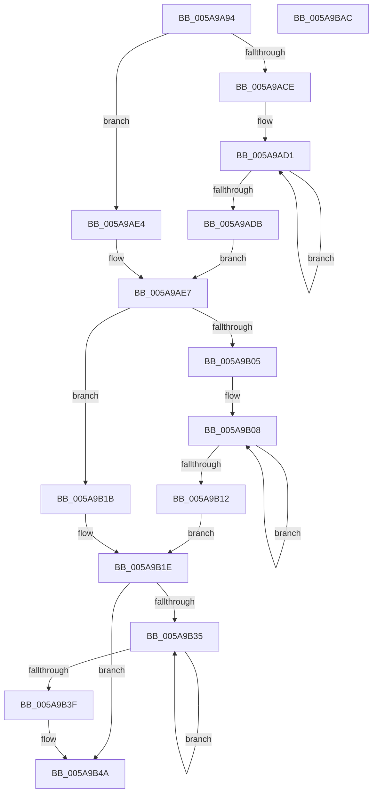

# McTemplateK0zzzt_EtwWriteTransfer

- RVA: `0x005A9A94`–`0x005A9BAD` (길이 `281` bytes)
- VA: `0x00000001405A9A94`
- 실행 섹션: `.text`
- PDB 이름 있음: `예`; PDB Function 태그: `아니요`
- unwind 정보 RVA: `0x000BD124`
- 디코드: `70`개 명령, `281/281` bytes 표시
- 미해석 바이트: `0` (있으면 어셈블리에 `.byte`로 보존)

> 이 문서는 커널 이미지의 기계어와 PDB 기호를 분석해 생성했습니다. 4번과 5번은 함수 원형과 자료형을 바이너리 사용 방식에서 추정한 C 해석이며 원본 소스 복구 결과는 아닙니다.

## 1. Dependencies

- 직접 호출 지점: **2**; 고유 호출 대상: **2**
- 직접 호출자로 확인된 함수: **2**
- RIP 상대 이미지 참조: **4**

### Outgoing calls
- `0x005A9B8A` → [McGenEventWrite_EtwWriteTransfer](../42/McGenEventWrite_EtwWriteTransfer_function_00424FC8.md) (function, `0x00424FC8`)
- `0x005A9B96` → [_security_check_cookie](../6A/_security_check_cookie_function_006AC640.md) (function, `0x006AC640`)

### Direct callers
- [PiSwDeviceInterfacesUpdateState](../../page/94/PiSwDeviceInterfacesUpdateState_function_0094E744.md) at `0x0094E84C`
- [PiSwDeviceInterfaceSetState](../../page/94/PiSwDeviceInterfaceSetState_function_0094ED48.md) at `0x0094EE3E`

### Static image references
- `0x005A9AA6` → RVA `0x00E0A740` (`.data`; read)
- `0x005A9AED` → RVA `0x006CB080` (` ?? ::FNODOBFM::`string'`; read)
- `0x005A9B5E` → RVA `0x00027380` (`.rdata`; read)
- `0x005A9B83` → RVA `0x00E06DA0` (`.data`; read)

## 2. Other-region calls and transfers

- 다른 실행 섹션으로 향하는 call: **0**
- 별도 외부 분기/꼬리 이동을 확인하지 못했습니다.

## 3. Assembly (complete function range)

```asm
005A9A94  48 89 5C 24 08                  mov qword ptr [rsp + 8], rbx
005A9A99  55                              push rbp
005A9A9A  48 8D 6C 24 C1                  lea rbp, [rsp - 0x3f]
005A9A9F  48 81 EC 90 00 00 00            sub rsp, 0x90
005A9AA6  48 8B 05 93 0C 86 00            mov rax, qword ptr [rip + 0x860c93]
005A9AAD  48 33 C4                        xor rax, rsp
005A9AB0  48 89 45 2F                     mov qword ptr [rbp + 0x2f], rax
005A9AB4  4C 8B 55 77                     mov r10, qword ptr [rbp + 0x77]
005A9AB8  48 83 C8 FF                     or rax, 0xffffffffffffffff
005A9ABC  48 8B 55 6F                     mov rdx, qword ptr [rbp + 0x6f]
005A9AC0  45 33 DB                        xor r11d, r11d
005A9AC3  41 B8 0A 00 00 00               mov r8d, 0xa
005A9AC9  4D 85 C9                        test r9, r9
005A9ACC  74 16                           je 0x1405a9ae4
005A9ACE  48 8B C8                        mov rcx, rax
005A9AD1  48 FF C1                        inc rcx
005A9AD4  66 45 39 1C 49                  cmp word ptr [r9 + rcx*2], r11w
005A9AD9  75 F6                           jne 0x1405a9ad1
005A9ADB  8D 0C 4D 02 00 00 00            lea ecx, [rcx*2 + 2]
005A9AE2  EB 03                           jmp 0x1405a9ae7
005A9AE4  41 8B C8                        mov ecx, r8d
005A9AE7  4D 85 C9                        test r9, r9
005A9AEA  89 4D F7                        mov dword ptr [rbp - 9], ecx
005A9AED  48 8D 1D 8C 15 12 00            lea rbx, [rip + 0x12158c]
005A9AF4  44 89 5D FB                     mov dword ptr [rbp - 5], r11d
005A9AF8  4C 0F 44 CB                     cmove r9, rbx
005A9AFC  4C 89 4D EF                     mov qword ptr [rbp - 0x11], r9
005A9B00  48 85 D2                        test rdx, rdx
005A9B03  74 16                           je 0x1405a9b1b
005A9B05  48 8B C8                        mov rcx, rax
005A9B08  48 FF C1                        inc rcx
005A9B0B  66 44 39 1C 4A                  cmp word ptr [rdx + rcx*2], r11w
005A9B10  75 F6                           jne 0x1405a9b08
005A9B12  8D 0C 4D 02 00 00 00            lea ecx, [rcx*2 + 2]
005A9B19  EB 03                           jmp 0x1405a9b1e
005A9B1B  41 8B C8                        mov ecx, r8d
005A9B1E  48 85 D2                        test rdx, rdx
005A9B21  89 4D 07                        mov dword ptr [rbp + 7], ecx
005A9B24  44 89 5D 0B                     mov dword ptr [rbp + 0xb], r11d
005A9B28  48 0F 44 D3                     cmove rdx, rbx
005A9B2C  48 89 55 FF                     mov qword ptr [rbp - 1], rdx
005A9B30  4D 85 D2                        test r10, r10
005A9B33  74 15                           je 0x1405a9b4a
005A9B35  48 FF C0                        inc rax
005A9B38  66 45 39 1C 42                  cmp word ptr [r10 + rax*2], r11w
005A9B3D  75 F6                           jne 0x1405a9b35
005A9B3F  44 8D 04 45 02 00 00 00         lea r8d, [rax*2 + 2]
005A9B47  4D 85 D2                        test r10, r10
005A9B4A  4C 0F 44 D3                     cmove r10, rbx
005A9B4E  44 89 45 17                     mov dword ptr [rbp + 0x17], r8d
005A9B52  48 8D 45 7F                     lea rax, [rbp + 0x7f]
005A9B56  4C 89 55 0F                     mov qword ptr [rbp + 0xf], r10
005A9B5A  48 89 45 1F                     mov qword ptr [rbp + 0x1f], rax
005A9B5E  48 8D 15 1B D8 A7 FF            lea rdx, [rip - 0x5827e5]
005A9B65  48 8D 45 DF                     lea rax, [rbp - 0x21]
005A9B69  44 89 5D 1B                     mov dword ptr [rbp + 0x1b], r11d
005A9B6D  41 B9 05 00 00 00               mov r9d, 5
005A9B73  48 89 44 24 20                  mov qword ptr [rsp + 0x20], rax
005A9B78  45 33 C0                        xor r8d, r8d
005A9B7B  48 C7 45 27 04 00 00 00         mov qword ptr [rbp + 0x27], 4
005A9B83  48 8D 0D 16 D2 85 00            lea rcx, [rip + 0x85d216]
005A9B8A  E8 39 B4 E7 FF                  call 0x140424fc8
005A9B8F  48 8B 4D 2F                     mov rcx, qword ptr [rbp + 0x2f]
005A9B93  48 33 CC                        xor rcx, rsp
005A9B96  E8 A5 2A 10 00                  call 0x1406ac640
005A9B9B  48 8B 9C 24 A0 00 00 00         mov rbx, qword ptr [rsp + 0xa0]
005A9BA3  48 81 C4 90 00 00 00            add rsp, 0x90
005A9BAA  5D                              pop rbp
005A9BAB  C3                              ret
005A9BAC  CC                              int3
```

## 4. C-style interpretation (structured pseudocode)

```c
__int64 __fastcall McTemplateK0zzzt_EtwWriteTransfer(__int64 a1, __int64 a2, __int64 a3, __int64 a4, __int64 a5, __int64 a6, __int64 a7)
{
    __int64 result;
    __int64 v_r11;
    __int64 v_rsp;
    unsigned __int64 v_stack_m18;
    unsigned __int64 v_stack_m20;
    unsigned __int64 v_stack_m28;
    unsigned int v_stack_m2C;
    unsigned int v_stack_m30;
    unsigned __int64 v_stack_m38;
    unsigned int v_stack_m3C;
    unsigned int v_stack_m40;
    unsigned __int64 v_stack_m47;
    unsigned __int64 v_stack_m48;
    unsigned int v_stack_m4C;
    unsigned int v_stack_m50;
    unsigned __int64 v_stack_m58;
    unsigned __int64 v_stack_m68;
    unsigned __int64 v_stack_m78;
    unsigned __int64 v_stack_p8;

    v_stack_p8 = v_rbx;
    v_rsp = (v_rsp) - (144);
    result = (*(unsigned __int64 *)(v_rip + 8785043)) ^ (v_rsp);
    v_stack_m18 = result;
    result = (result) | (-1);
    v_r11 = 0;
    if (a4 == 0) goto loc_005A9AE4;
loc_005A9AD1:
    a1 = (result) + 1;
    if ((*(unsigned __int16 *)(a4 + a1 * 2)) != 0) goto loc_005A9AD1;
    goto loc_005A9AE7;
loc_005A9AE4:
loc_005A9AE7:
    v_stack_m50 = 10;
    v_stack_m4C = 0;
    if (a4 == 0) { a4 = v_rip + 1185164; }
    v_stack_m58 = a4;
    if (a5 == 0) goto loc_005A9B1B;
loc_005A9B08:
    a1 = (result) + 1;
    if ((*(unsigned __int16 *)(a5 + a1 * 2)) != 0) goto loc_005A9B08;
    goto loc_005A9B1E;
loc_005A9B1B:
loc_005A9B1E:
    v_stack_m40 = 10;
    v_stack_m3C = 0;
    if (a5 == 0) { a5 = v_rip + 1185164; }
    v_stack_m48 = a5;
    if (a6 == 0) goto loc_005A9B4A;
loc_005A9B35:
    result = (result) + 1;
    if ((*(unsigned __int16 *)(a6 + result * 2)) != 0) goto loc_005A9B35;
loc_005A9B4A:
    if (a6 == 0) { a6 = v_rip + 1185164; }
    v_stack_m30 = (unsigned int)(result * 2 + 2);
    v_stack_m38 = a6;
    v_stack_m28 = a7;
    v_stack_m2C = 0;
    v_stack_m78 = v_stack_m68;
    a3 = 0;
    v_stack_m20 = 4;
    result = McGenEventWrite_EtwWriteTransfer(v_rip + 8770070, v_rip - 5777381, a3, 5);
    a1 = (v_stack_m18) ^ (v_rsp);
    result = _security_check_cookie(a1, v_rip - 5777381, a3, 5);
    v_rsp = (v_rsp) + (144);
    return result;
}
```

## 5. (Beta) C Style

```c
int64_t McTemplateK0zzzt_EtwWriteTransfer(int64_t Arg1, int64_t Arg2, int64_t Arg3, int64_t Arg4, int64_t Arg5, int64_t Arg6, int64_t Arg7)
{
    int64_t result;
    int64_t local_r11;
    int64_t local_rsp;
    uint64_t v_stack_m18;
    uint64_t v_stack_m20;
    uint64_t v_stack_m28;
    uint32_t v_stack_m2C;
    uint32_t v_stack_m30;
    uint64_t v_stack_m38;
    uint32_t v_stack_m3C;
    uint32_t v_stack_m40;
    uint64_t v_stack_m47;
    uint64_t v_stack_m48;
    uint32_t v_stack_m4C;
    uint32_t v_stack_m50;
    uint64_t v_stack_m58;
    uint64_t v_stack_m68;
    uint64_t v_stack_m78;
    uint64_t v_stack_p8;

    v_stack_p8 = local_rbx;
    local_rsp = (local_rsp) - (144);
    result = (*(uint64_t *)(v_rip + 0x860C93)) ^ (local_rsp);
    v_stack_m18 = result;
    result = (result) | (-1);
    local_r11 = 0;
    if (Arg4 == 0) goto loc_005A9AE4;
loc_005A9AD1:
    Arg1 = (result) + 1;
    if ((*(uint16_t *)(Arg4 + Arg1 * 2)) != 0) goto loc_005A9AD1;
    goto loc_005A9AE7;
loc_005A9AE4:
loc_005A9AE7:
    v_stack_m50 = 10;
    v_stack_m4C = 0;
    if (Arg4 == 0) { Arg4 = v_rip + 1185164; }
    v_stack_m58 = Arg4;
    if (Arg5 == 0) goto loc_005A9B1B;
loc_005A9B08:
    Arg1 = (result) + 1;
    if ((*(uint16_t *)(Arg5 + Arg1 * 2)) != 0) goto loc_005A9B08;
    goto loc_005A9B1E;
loc_005A9B1B:
loc_005A9B1E:
    v_stack_m40 = 10;
    v_stack_m3C = 0;
    if (Arg5 == 0) { Arg5 = v_rip + 1185164; }
    v_stack_m48 = Arg5;
    if (Arg6 == 0) goto loc_005A9B4A;
loc_005A9B35:
    result = (result) + 1;
    if ((*(uint16_t *)(Arg6 + result * 2)) != 0) goto loc_005A9B35;
loc_005A9B4A:
    if (Arg6 == 0) { Arg6 = v_rip + 1185164; }
    v_stack_m30 = (uint32_t)(result * 2 + 2);
    v_stack_m38 = Arg6;
    v_stack_m28 = Arg7;
    v_stack_m2C = 0;
    v_stack_m78 = v_stack_m68;
    Arg3 = 0;
    v_stack_m20 = 4;
    result = McGenEventWrite_EtwWriteTransfer(v_rip + 8770070, v_rip - 5777381, Arg3, 5);
    Arg1 = (v_stack_m18) ^ (local_rsp);
    result = _security_check_cookie(Arg1, v_rip - 5777381, Arg3, 5);
    local_rsp = (local_rsp) + (144);
    return result;
}
```

## 6. Execution-region graph

[열기: 2D/3D 그래프와 함수 탐색 컨트롤 패널](../../../control-panel.html?section=text&rva=0x005A9A94&view=graph)

- 2D 그래프는 위에서 아래로 흐르고, 3D 그래프는 빈 공간을 드래그해 회전합니다. Shift+드래그는 이동, 휠은 확대·축소, 함수 노드 선택은 대상 보고서 이동입니다.

### Static fallback


