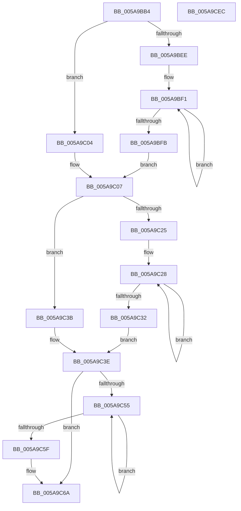

# McTemplateK0zzztdd_EtwWriteTransfer

- RVA: `0x005A9BB4`–`0x005A9CED` (길이 `313` bytes)
- VA: `0x00000001405A9BB4`
- 실행 섹션: `.text`
- PDB 이름 있음: `예`; PDB Function 태그: `아니요`
- unwind 정보 RVA: `0x000C87FC`
- 디코드: `76`개 명령, `313/313` bytes 표시
- 미해석 바이트: `0` (있으면 어셈블리에 `.byte`로 보존)

> 이 문서는 커널 이미지의 기계어와 PDB 기호를 분석해 생성했습니다. 4번과 5번은 함수 원형과 자료형을 바이너리 사용 방식에서 추정한 C 해석이며 원본 소스 복구 결과는 아닙니다.

## 1. Dependencies

- 직접 호출 지점: **2**; 고유 호출 대상: **2**
- 직접 호출자로 확인된 함수: **1**
- RIP 상대 이미지 참조: **4**

### Outgoing calls
- `0x005A9CCA` → [McGenEventWrite_EtwWriteTransfer](../42/McGenEventWrite_EtwWriteTransfer_function_00424FC8.md) (function, `0x00424FC8`)
- `0x005A9CD6` → [_security_check_cookie](../6A/_security_check_cookie_function_006AC640.md) (function, `0x006AC640`)

### Direct callers
- [sub_00B25F7E](../../page/B2/Unknown_function_00B25F7E.md) at `0x00B25FA7`

### Static image references
- `0x005A9BC6` → RVA `0x00E0A740` (`.data`; read)
- `0x005A9C0D` → RVA `0x006CB080` (` ?? ::FNODOBFM::`string'`; read)
- `0x005A9C7E` → RVA `0x00027190` (`.rdata`; read)
- `0x005A9C91` → RVA `0x00E06DA0` (`.data`; read)

## 2. Other-region calls and transfers

- 다른 실행 섹션으로 향하는 call: **0**
- 별도 외부 분기/꼬리 이동을 확인하지 못했습니다.

## 3. Assembly (complete function range)

```asm
005A9BB4  48 89 5C 24 08                  mov qword ptr [rsp + 8], rbx
005A9BB9  55                              push rbp
005A9BBA  48 8D 6C 24 D1                  lea rbp, [rsp - 0x2f]
005A9BBF  48 81 EC B0 00 00 00            sub rsp, 0xb0
005A9BC6  48 8B 05 73 0B 86 00            mov rax, qword ptr [rip + 0x860b73]
005A9BCD  48 33 C4                        xor rax, rsp
005A9BD0  48 89 45 1F                     mov qword ptr [rbp + 0x1f], rax
005A9BD4  4C 8B 55 67                     mov r10, qword ptr [rbp + 0x67]
005A9BD8  48 83 C8 FF                     or rax, 0xffffffffffffffff
005A9BDC  48 8B 4D 5F                     mov rcx, qword ptr [rbp + 0x5f]
005A9BE0  45 33 DB                        xor r11d, r11d
005A9BE3  41 B8 0A 00 00 00               mov r8d, 0xa
005A9BE9  4D 85 C9                        test r9, r9
005A9BEC  74 16                           je 0x1405a9c04
005A9BEE  48 8B D0                        mov rdx, rax
005A9BF1  48 FF C2                        inc rdx
005A9BF4  66 45 39 1C 51                  cmp word ptr [r9 + rdx*2], r11w
005A9BF9  75 F6                           jne 0x1405a9bf1
005A9BFB  8D 14 55 02 00 00 00            lea edx, [rdx*2 + 2]
005A9C02  EB 03                           jmp 0x1405a9c07
005A9C04  41 8B D0                        mov edx, r8d
005A9C07  4D 85 C9                        test r9, r9
005A9C0A  89 55 C7                        mov dword ptr [rbp - 0x39], edx
005A9C0D  48 8D 1D 6C 14 12 00            lea rbx, [rip + 0x12146c]
005A9C14  44 89 5D CB                     mov dword ptr [rbp - 0x35], r11d
005A9C18  4C 0F 44 CB                     cmove r9, rbx
005A9C1C  4C 89 4D BF                     mov qword ptr [rbp - 0x41], r9
005A9C20  48 85 C9                        test rcx, rcx
005A9C23  74 16                           je 0x1405a9c3b
005A9C25  48 8B D0                        mov rdx, rax
005A9C28  48 FF C2                        inc rdx
005A9C2B  66 44 39 1C 51                  cmp word ptr [rcx + rdx*2], r11w
005A9C30  75 F6                           jne 0x1405a9c28
005A9C32  8D 14 55 02 00 00 00            lea edx, [rdx*2 + 2]
005A9C39  EB 03                           jmp 0x1405a9c3e
005A9C3B  41 8B D0                        mov edx, r8d
005A9C3E  48 85 C9                        test rcx, rcx
005A9C41  89 55 D7                        mov dword ptr [rbp - 0x29], edx
005A9C44  44 89 5D DB                     mov dword ptr [rbp - 0x25], r11d
005A9C48  48 0F 44 CB                     cmove rcx, rbx
005A9C4C  48 89 4D CF                     mov qword ptr [rbp - 0x31], rcx
005A9C50  4D 85 D2                        test r10, r10
005A9C53  74 15                           je 0x1405a9c6a
005A9C55  48 FF C0                        inc rax
005A9C58  66 45 39 1C 42                  cmp word ptr [r10 + rax*2], r11w
005A9C5D  75 F6                           jne 0x1405a9c55
005A9C5F  44 8D 04 45 02 00 00 00         lea r8d, [rax*2 + 2]
005A9C67  4D 85 D2                        test r10, r10
005A9C6A  4C 0F 44 D3                     cmove r10, rbx
005A9C6E  44 89 45 E7                     mov dword ptr [rbp - 0x19], r8d
005A9C72  48 8D 45 6F                     lea rax, [rbp + 0x6f]
005A9C76  4C 89 55 DF                     mov qword ptr [rbp - 0x21], r10
005A9C7A  48 89 45 EF                     mov qword ptr [rbp - 0x11], rax
005A9C7E  48 8D 15 0B D5 A7 FF            lea rdx, [rip - 0x582af5]
005A9C85  48 8D 45 77                     lea rax, [rbp + 0x77]
005A9C89  44 89 5D EB                     mov dword ptr [rbp - 0x15], r11d
005A9C8D  48 89 45 FF                     mov qword ptr [rbp - 1], rax
005A9C91  48 8D 0D 08 D1 85 00            lea rcx, [rip + 0x85d108]
005A9C98  48 8D 45 7F                     lea rax, [rbp + 0x7f]
005A9C9C  48 C7 45 F7 04 00 00 00         mov qword ptr [rbp - 9], 4
005A9CA4  48 89 45 0F                     mov qword ptr [rbp + 0xf], rax
005A9CA8  41 B9 07 00 00 00               mov r9d, 7
005A9CAE  48 8D 45 AF                     lea rax, [rbp - 0x51]
005A9CB2  48 C7 45 07 04 00 00 00         mov qword ptr [rbp + 7], 4
005A9CBA  45 33 C0                        xor r8d, r8d
005A9CBD  48 89 44 24 20                  mov qword ptr [rsp + 0x20], rax
005A9CC2  48 C7 45 17 04 00 00 00         mov qword ptr [rbp + 0x17], 4
005A9CCA  E8 F9 B2 E7 FF                  call 0x140424fc8
005A9CCF  48 8B 4D 1F                     mov rcx, qword ptr [rbp + 0x1f]
005A9CD3  48 33 CC                        xor rcx, rsp
005A9CD6  E8 65 29 10 00                  call 0x1406ac640
005A9CDB  48 8B 9C 24 C0 00 00 00         mov rbx, qword ptr [rsp + 0xc0]
005A9CE3  48 81 C4 B0 00 00 00            add rsp, 0xb0
005A9CEA  5D                              pop rbp
005A9CEB  C3                              ret
005A9CEC  CC                              int3
```

## 4. C-style interpretation (structured pseudocode)

```c
__int64 __fastcall McTemplateK0zzztdd_EtwWriteTransfer(__int64 a1, __int64 a2, __int64 a3, __int64 a4, __int64 a5, __int64 a6, __int64 a7, __int64 a8, __int64 a9)
{
    __int64 result;
    __int64 v_r11;
    __int64 v_rsp;
    unsigned __int64 v_stack_m18;
    unsigned __int64 v_stack_m20;
    unsigned __int64 v_stack_m28;
    unsigned __int64 v_stack_m30;
    unsigned __int64 v_stack_m37;
    unsigned __int64 v_stack_m38;
    unsigned __int64 v_stack_m40;
    unsigned __int64 v_stack_m48;
    unsigned int v_stack_m4C;
    unsigned int v_stack_m50;
    unsigned __int64 v_stack_m58;
    unsigned int v_stack_m5C;
    unsigned int v_stack_m60;
    unsigned __int64 v_stack_m68;
    unsigned int v_stack_m6C;
    unsigned int v_stack_m70;
    unsigned __int64 v_stack_m78;
    unsigned __int64 v_stack_m88;
    unsigned __int64 v_stack_m98;
    unsigned __int64 v_stack_p8;

    v_stack_p8 = v_rbx;
    v_rsp = (v_rsp) - (176);
    result = (*(unsigned __int64 *)(v_rip + 8784755)) ^ (v_rsp);
    v_stack_m18 = result;
    result = (result) | (-1);
    v_r11 = 0;
    if (a4 == 0) goto loc_005A9C04;
loc_005A9BF1:
    a2 = (result) + 1;
    if ((*(unsigned __int16 *)(a4 + a2 * 2)) != 0) goto loc_005A9BF1;
    goto loc_005A9C07;
loc_005A9C04:
loc_005A9C07:
    v_stack_m70 = 10;
    v_stack_m6C = 0;
    if (a4 == 0) { a4 = v_rip + 1184876; }
    v_stack_m78 = a4;
    if (a5 == 0) goto loc_005A9C3B;
loc_005A9C28:
    a2 = (result) + 1;
    if ((*(unsigned __int16 *)(a5 + a2 * 2)) != 0) goto loc_005A9C28;
    goto loc_005A9C3E;
loc_005A9C3B:
loc_005A9C3E:
    v_stack_m60 = 10;
    v_stack_m5C = 0;
    if (a5 == 0) { a5 = v_rip + 1184876; }
    v_stack_m68 = a5;
    if (a6 == 0) goto loc_005A9C6A;
loc_005A9C55:
    result = (result) + 1;
    if ((*(unsigned __int16 *)(a6 + result * 2)) != 0) goto loc_005A9C55;
loc_005A9C6A:
    if (a6 == 0) { a6 = v_rip + 1184876; }
    v_stack_m50 = (unsigned int)(result * 2 + 2);
    v_stack_m58 = a6;
    v_stack_m48 = a7;
    v_stack_m4C = 0;
    v_stack_m38 = a8;
    v_stack_m40 = 4;
    v_stack_m28 = a9;
    v_stack_m30 = 4;
    a3 = 0;
    v_stack_m98 = v_stack_m88;
    v_stack_m20 = 4;
    result = McGenEventWrite_EtwWriteTransfer(v_rip + 8769800, v_rip - 5778165, a3, 7);
    a1 = (v_stack_m18) ^ (v_rsp);
    result = _security_check_cookie(a1, v_rip - 5778165, a3, 7);
    v_rsp = (v_rsp) + (176);
    return result;
}
```

## 5. (Beta) C Style

```c
int64_t McTemplateK0zzztdd_EtwWriteTransfer(int64_t Arg1, int64_t Arg2, int64_t Arg3, int64_t Arg4, int64_t Arg5, int64_t Arg6, int64_t Arg7, int64_t Arg8, int64_t Arg9)
{
    int64_t result;
    int64_t local_r11;
    int64_t local_rsp;
    uint64_t v_stack_m18;
    uint64_t v_stack_m20;
    uint64_t v_stack_m28;
    uint64_t v_stack_m30;
    uint64_t v_stack_m37;
    uint64_t v_stack_m38;
    uint64_t v_stack_m40;
    uint64_t v_stack_m48;
    uint32_t v_stack_m4C;
    uint32_t v_stack_m50;
    uint64_t v_stack_m58;
    uint32_t v_stack_m5C;
    uint32_t v_stack_m60;
    uint64_t v_stack_m68;
    uint32_t v_stack_m6C;
    uint32_t v_stack_m70;
    uint64_t v_stack_m78;
    uint64_t v_stack_m88;
    uint64_t v_stack_m98;
    uint64_t v_stack_p8;

    v_stack_p8 = local_rbx;
    local_rsp = (local_rsp) - (176);
    result = (*(uint64_t *)(v_rip + 0x860B73)) ^ (local_rsp);
    v_stack_m18 = result;
    result = (result) | (-1);
    local_r11 = 0;
    if (Arg4 == 0) goto loc_005A9C04;
loc_005A9BF1:
    Arg2 = (result) + 1;
    if ((*(uint16_t *)(Arg4 + Arg2 * 2)) != 0) goto loc_005A9BF1;
    goto loc_005A9C07;
loc_005A9C04:
loc_005A9C07:
    v_stack_m70 = 10;
    v_stack_m6C = 0;
    if (Arg4 == 0) { Arg4 = v_rip + 1184876; }
    v_stack_m78 = Arg4;
    if (Arg5 == 0) goto loc_005A9C3B;
loc_005A9C28:
    Arg2 = (result) + 1;
    if ((*(uint16_t *)(Arg5 + Arg2 * 2)) != 0) goto loc_005A9C28;
    goto loc_005A9C3E;
loc_005A9C3B:
loc_005A9C3E:
    v_stack_m60 = 10;
    v_stack_m5C = 0;
    if (Arg5 == 0) { Arg5 = v_rip + 1184876; }
    v_stack_m68 = Arg5;
    if (Arg6 == 0) goto loc_005A9C6A;
loc_005A9C55:
    result = (result) + 1;
    if ((*(uint16_t *)(Arg6 + result * 2)) != 0) goto loc_005A9C55;
loc_005A9C6A:
    if (Arg6 == 0) { Arg6 = v_rip + 1184876; }
    v_stack_m50 = (uint32_t)(result * 2 + 2);
    v_stack_m58 = Arg6;
    v_stack_m48 = Arg7;
    v_stack_m4C = 0;
    v_stack_m38 = Arg8;
    v_stack_m40 = 4;
    v_stack_m28 = Arg9;
    v_stack_m30 = 4;
    Arg3 = 0;
    v_stack_m98 = v_stack_m88;
    v_stack_m20 = 4;
    result = McGenEventWrite_EtwWriteTransfer(v_rip + 8769800, v_rip - 5778165, Arg3, 7);
    Arg1 = (v_stack_m18) ^ (local_rsp);
    result = _security_check_cookie(Arg1, v_rip - 5778165, Arg3, 7);
    local_rsp = (local_rsp) + (176);
    return result;
}
```

## 6. Execution-region graph

[열기: 2D/3D 그래프와 함수 탐색 컨트롤 패널](../../../control-panel.html?section=text&rva=0x005A9BB4&view=graph)

- 2D 그래프는 위에서 아래로 흐르고, 3D 그래프는 빈 공간을 드래그해 회전합니다. Shift+드래그는 이동, 휠은 확대·축소, 함수 노드 선택은 대상 보고서 이동입니다.

### Static fallback


