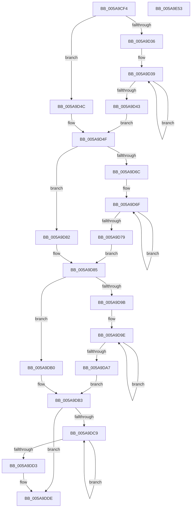

# McTemplateK0zzzzdd_EtwWriteTransfer

- RVA: `0x005A9CF4`–`0x005A9E54` (길이 `352` bytes)
- VA: `0x00000001405A9CF4`
- 실행 섹션: `.text`
- PDB 이름 있음: `예`; PDB Function 태그: `아니요`
- unwind 정보 RVA: `0x000BD7B8`
- 디코드: `91`개 명령, `352/352` bytes 표시
- 미해석 바이트: `0` (있으면 어셈블리에 `.byte`로 보존)

> 이 문서는 커널 이미지의 기계어와 PDB 기호를 분석해 생성했습니다. 4번과 5번은 함수 원형과 자료형을 바이너리 사용 방식에서 추정한 C 해석이며 원본 소스 복구 결과는 아닙니다.

## 1. Dependencies

- 직접 호출 지점: **2**; 고유 호출 대상: **2**
- 직접 호출자로 확인된 함수: **1**
- RIP 상대 이미지 참조: **4**

### Outgoing calls
- `0x005A9E2D` → [McGenEventWrite_EtwWriteTransfer](../42/McGenEventWrite_EtwWriteTransfer_function_00424FC8.md) (function, `0x00424FC8`)
- `0x005A9E39` → [_security_check_cookie](../6A/_security_check_cookie_function_006AC640.md) (function, `0x006AC640`)

### Direct callers
- [sub_00B1FC90](../../page/B1/Unknown_function_00B1FC90.md) at `0x00B1FCF0`

### Static image references
- `0x005A9D0B` → RVA `0x00E0A740` (`.data`; read)
- `0x005A9D55` → RVA `0x006CB080` (` ?? ::FNODOBFM::`string'`; read)
- `0x005A9DF2` → RVA `0x00027140` (`.rdata`; read)
- `0x005A9E04` → RVA `0x00E06DA0` (`.data`; read)

## 2. Other-region calls and transfers

- 다른 실행 섹션으로 향하는 call: **0**
- 별도 외부 분기/꼬리 이동을 확인하지 못했습니다.

## 3. Assembly (complete function range)

```asm
005A9CF4  48 89 5C 24 08                  mov qword ptr [rsp + 8], rbx
005A9CF9  48 89 7C 24 10                  mov qword ptr [rsp + 0x10], rdi
005A9CFE  55                              push rbp
005A9CFF  48 8D 6C 24 D1                  lea rbp, [rsp - 0x2f]
005A9D04  48 81 EC B0 00 00 00            sub rsp, 0xb0
005A9D0B  48 8B 05 2E 0A 86 00            mov rax, qword ptr [rip + 0x860a2e]
005A9D12  48 33 C4                        xor rax, rsp
005A9D15  48 89 45 1F                     mov qword ptr [rbp + 0x1f], rax
005A9D19  4C 8B 5D 6F                     mov r11, qword ptr [rbp + 0x6f]
005A9D1D  48 83 C8 FF                     or rax, 0xffffffffffffffff
005A9D21  48 8B 55 67                     mov rdx, qword ptr [rbp + 0x67]
005A9D25  33 DB                           xor ebx, ebx
005A9D27  4C 8B 45 5F                     mov r8, qword ptr [rbp + 0x5f]
005A9D2B  41 BA 0A 00 00 00               mov r10d, 0xa
005A9D31  4D 85 C9                        test r9, r9
005A9D34  74 16                           je 0x1405a9d4c
005A9D36  48 8B C8                        mov rcx, rax
005A9D39  48 FF C1                        inc rcx
005A9D3C  66 41 39 1C 49                  cmp word ptr [r9 + rcx*2], bx
005A9D41  75 F6                           jne 0x1405a9d39
005A9D43  8D 0C 4D 02 00 00 00            lea ecx, [rcx*2 + 2]
005A9D4A  EB 03                           jmp 0x1405a9d4f
005A9D4C  41 8B CA                        mov ecx, r10d
005A9D4F  4D 85 C9                        test r9, r9
005A9D52  89 4D C7                        mov dword ptr [rbp - 0x39], ecx
005A9D55  48 8D 3D 24 13 12 00            lea rdi, [rip + 0x121324]
005A9D5C  89 5D CB                        mov dword ptr [rbp - 0x35], ebx
005A9D5F  4C 0F 44 CF                     cmove r9, rdi
005A9D63  4C 89 4D BF                     mov qword ptr [rbp - 0x41], r9
005A9D67  4D 85 C0                        test r8, r8
005A9D6A  74 16                           je 0x1405a9d82
005A9D6C  48 8B C8                        mov rcx, rax
005A9D6F  48 FF C1                        inc rcx
005A9D72  66 41 39 1C 48                  cmp word ptr [r8 + rcx*2], bx
005A9D77  75 F6                           jne 0x1405a9d6f
005A9D79  8D 0C 4D 02 00 00 00            lea ecx, [rcx*2 + 2]
005A9D80  EB 03                           jmp 0x1405a9d85
005A9D82  41 8B CA                        mov ecx, r10d
005A9D85  4D 85 C0                        test r8, r8
005A9D88  89 4D D7                        mov dword ptr [rbp - 0x29], ecx
005A9D8B  89 5D DB                        mov dword ptr [rbp - 0x25], ebx
005A9D8E  4C 0F 44 C7                     cmove r8, rdi
005A9D92  4C 89 45 CF                     mov qword ptr [rbp - 0x31], r8
005A9D96  48 85 D2                        test rdx, rdx
005A9D99  74 15                           je 0x1405a9db0
005A9D9B  48 8B C8                        mov rcx, rax
005A9D9E  48 FF C1                        inc rcx
005A9DA1  66 39 1C 4A                     cmp word ptr [rdx + rcx*2], bx
005A9DA5  75 F7                           jne 0x1405a9d9e
005A9DA7  8D 0C 4D 02 00 00 00            lea ecx, [rcx*2 + 2]
005A9DAE  EB 03                           jmp 0x1405a9db3
005A9DB0  41 8B CA                        mov ecx, r10d
005A9DB3  48 85 D2                        test rdx, rdx
005A9DB6  89 4D E7                        mov dword ptr [rbp - 0x19], ecx
005A9DB9  89 5D EB                        mov dword ptr [rbp - 0x15], ebx
005A9DBC  48 0F 44 D7                     cmove rdx, rdi
005A9DC0  48 89 55 DF                     mov qword ptr [rbp - 0x21], rdx
005A9DC4  4D 85 DB                        test r11, r11
005A9DC7  74 15                           je 0x1405a9dde
005A9DC9  48 FF C0                        inc rax
005A9DCC  66 41 39 1C 43                  cmp word ptr [r11 + rax*2], bx
005A9DD1  75 F6                           jne 0x1405a9dc9
005A9DD3  44 8D 14 45 02 00 00 00         lea r10d, [rax*2 + 2]
005A9DDB  4D 85 DB                        test r11, r11
005A9DDE  4C 0F 44 DF                     cmove r11, rdi
005A9DE2  44 89 55 F7                     mov dword ptr [rbp - 9], r10d
005A9DE6  48 8D 45 77                     lea rax, [rbp + 0x77]
005A9DEA  4C 89 5D EF                     mov qword ptr [rbp - 0x11], r11
005A9DEE  48 89 45 FF                     mov qword ptr [rbp - 1], rax
005A9DF2  48 8D 15 47 D3 A7 FF            lea rdx, [rip - 0x582cb9]
005A9DF9  48 8D 45 7F                     lea rax, [rbp + 0x7f]
005A9DFD  89 5D FB                        mov dword ptr [rbp - 5], ebx
005A9E00  48 89 45 0F                     mov qword ptr [rbp + 0xf], rax
005A9E04  48 8D 0D 95 CF 85 00            lea rcx, [rip + 0x85cf95]
005A9E0B  48 8D 45 AF                     lea rax, [rbp - 0x51]
005A9E0F  48 C7 45 07 04 00 00 00         mov qword ptr [rbp + 7], 4
005A9E17  41 B9 07 00 00 00               mov r9d, 7
005A9E1D  48 89 44 24 20                  mov qword ptr [rsp + 0x20], rax
005A9E22  45 33 C0                        xor r8d, r8d
005A9E25  48 C7 45 17 04 00 00 00         mov qword ptr [rbp + 0x17], 4
005A9E2D  E8 96 B1 E7 FF                  call 0x140424fc8
005A9E32  48 8B 4D 1F                     mov rcx, qword ptr [rbp + 0x1f]
005A9E36  48 33 CC                        xor rcx, rsp
005A9E39  E8 02 28 10 00                  call 0x1406ac640
005A9E3E  4C 8D 9C 24 B0 00 00 00         lea r11, [rsp + 0xb0]
005A9E46  49 8B 5B 10                     mov rbx, qword ptr [r11 + 0x10]
005A9E4A  49 8B 7B 18                     mov rdi, qword ptr [r11 + 0x18]
005A9E4E  49 8B E3                        mov rsp, r11
005A9E51  5D                              pop rbp
005A9E52  C3                              ret
005A9E53  CC                              int3
```

## 4. C-style interpretation (structured pseudocode)

```c
__int64 __fastcall McTemplateK0zzzzdd_EtwWriteTransfer(__int64 a1, __int64 a2, __int64 a3, __int64 a4, __int64 a5, __int64 a6, __int64 a7, __int64 a8, __int64 a9)
{
    __int64 result;
    __int64 v_rbx;
    __int64 v_rsp;
    unsigned __int64 v_stack_m18;
    unsigned __int64 v_stack_m20;
    unsigned __int64 v_stack_m28;
    unsigned __int64 v_stack_m30;
    unsigned __int64 v_stack_m37;
    unsigned __int64 v_stack_m38;
    unsigned int v_stack_m3C;
    unsigned int v_stack_m40;
    unsigned __int64 v_stack_m48;
    unsigned int v_stack_m4C;
    unsigned int v_stack_m50;
    unsigned __int64 v_stack_m58;
    unsigned int v_stack_m5C;
    unsigned int v_stack_m60;
    unsigned __int64 v_stack_m68;
    unsigned int v_stack_m6C;
    unsigned int v_stack_m70;
    unsigned __int64 v_stack_m78;
    unsigned __int64 v_stack_m8;
    unsigned __int64 v_stack_m88;
    unsigned __int64 v_stack_m98;
    unsigned __int64 v_stack_p10;
    unsigned __int64 v_stack_p8;

    v_stack_p8 = v_rbx;
    v_stack_p10 = v_rdi;
    v_rsp = (v_rsp) - (176);
    result = (*(unsigned __int64 *)(v_rip + 8784430)) ^ (v_rsp);
    v_stack_m18 = result;
    result = (result) | (-1);
    v_rbx = 0;
    if (a4 == 0) goto loc_005A9D4C;
loc_005A9D39:
    a1 = (result) + 1;
    if ((*(unsigned __int16 *)(a4 + a1 * 2)) != 0) goto loc_005A9D39;
    goto loc_005A9D4F;
loc_005A9D4C:
loc_005A9D4F:
    v_stack_m70 = 10;
    v_stack_m6C = 0;
    if (a4 == 0) { a4 = v_rip + 1184548; }
    v_stack_m78 = a4;
    if (a5 == 0) goto loc_005A9D82;
loc_005A9D6F:
    a1 = (result) + 1;
    if ((*(unsigned __int16 *)(a5 + a1 * 2)) != 0) goto loc_005A9D6F;
    goto loc_005A9D85;
loc_005A9D82:
loc_005A9D85:
    v_stack_m60 = 10;
    v_stack_m5C = 0;
    if (a5 == 0) { a5 = v_rip + 1184548; }
    v_stack_m68 = a5;
    if (a6 == 0) goto loc_005A9DB0;
loc_005A9D9E:
    a1 = (result) + 1;
    if ((*(unsigned __int16 *)(a6 + a1 * 2)) != 0) goto loc_005A9D9E;
    goto loc_005A9DB3;
loc_005A9DB0:
loc_005A9DB3:
    v_stack_m50 = 10;
    v_stack_m4C = 0;
    if (a6 == 0) { a6 = v_rip + 1184548; }
    v_stack_m58 = a6;
    if (a7 == 0) goto loc_005A9DDE;
loc_005A9DC9:
    result = (result) + 1;
    if ((*(unsigned __int16 *)(a7 + result * 2)) != 0) goto loc_005A9DC9;
loc_005A9DDE:
    if (a7 == 0) { a7 = v_rip + 1184548; }
    v_stack_m40 = (unsigned int)(result * 2 + 2);
    v_stack_m48 = a7;
    v_stack_m38 = a8;
    v_stack_m3C = 0;
    v_stack_m28 = a9;
    v_stack_m30 = 4;
    v_stack_m98 = v_stack_m88;
    a3 = 0;
    v_stack_m20 = 4;
    result = McGenEventWrite_EtwWriteTransfer(v_rip + 8769429, v_rip - 5778617, a3, 7);
    a1 = (v_stack_m18) ^ (v_rsp);
    result = _security_check_cookie(a1, v_rip - 5778617, a3, 7);
    return result;
}
```

## 5. (Beta) C Style

```c
int64_t McTemplateK0zzzzdd_EtwWriteTransfer(int64_t Arg1, int64_t Arg2, int64_t Arg3, int64_t Arg4, int64_t Arg5, int64_t Arg6, int64_t Arg7, int64_t Arg8, int64_t Arg9)
{
    int64_t result;
    int64_t local_rbx;
    int64_t local_rsp;
    uint64_t v_stack_m18;
    uint64_t v_stack_m20;
    uint64_t v_stack_m28;
    uint64_t v_stack_m30;
    uint64_t v_stack_m37;
    uint64_t v_stack_m38;
    uint32_t v_stack_m3C;
    uint32_t v_stack_m40;
    uint64_t v_stack_m48;
    uint32_t v_stack_m4C;
    uint32_t v_stack_m50;
    uint64_t v_stack_m58;
    uint32_t v_stack_m5C;
    uint32_t v_stack_m60;
    uint64_t v_stack_m68;
    uint32_t v_stack_m6C;
    uint32_t v_stack_m70;
    uint64_t v_stack_m78;
    uint64_t v_stack_m8;
    uint64_t v_stack_m88;
    uint64_t v_stack_m98;
    uint64_t v_stack_p10;
    uint64_t v_stack_p8;

    v_stack_p8 = local_rbx;
    v_stack_p10 = local_rdi;
    local_rsp = (local_rsp) - (176);
    result = (*(uint64_t *)(v_rip + 0x860A2E)) ^ (local_rsp);
    v_stack_m18 = result;
    result = (result) | (-1);
    local_rbx = 0;
    if (Arg4 == 0) goto loc_005A9D4C;
loc_005A9D39:
    Arg1 = (result) + 1;
    if ((*(uint16_t *)(Arg4 + Arg1 * 2)) != 0) goto loc_005A9D39;
    goto loc_005A9D4F;
loc_005A9D4C:
loc_005A9D4F:
    v_stack_m70 = 10;
    v_stack_m6C = 0;
    if (Arg4 == 0) { Arg4 = v_rip + 1184548; }
    v_stack_m78 = Arg4;
    if (Arg5 == 0) goto loc_005A9D82;
loc_005A9D6F:
    Arg1 = (result) + 1;
    if ((*(uint16_t *)(Arg5 + Arg1 * 2)) != 0) goto loc_005A9D6F;
    goto loc_005A9D85;
loc_005A9D82:
loc_005A9D85:
    v_stack_m60 = 10;
    v_stack_m5C = 0;
    if (Arg5 == 0) { Arg5 = v_rip + 1184548; }
    v_stack_m68 = Arg5;
    if (Arg6 == 0) goto loc_005A9DB0;
loc_005A9D9E:
    Arg1 = (result) + 1;
    if ((*(uint16_t *)(Arg6 + Arg1 * 2)) != 0) goto loc_005A9D9E;
    goto loc_005A9DB3;
loc_005A9DB0:
loc_005A9DB3:
    v_stack_m50 = 10;
    v_stack_m4C = 0;
    if (Arg6 == 0) { Arg6 = v_rip + 1184548; }
    v_stack_m58 = Arg6;
    if (Arg7 == 0) goto loc_005A9DDE;
loc_005A9DC9:
    result = (result) + 1;
    if ((*(uint16_t *)(Arg7 + result * 2)) != 0) goto loc_005A9DC9;
loc_005A9DDE:
    if (Arg7 == 0) { Arg7 = v_rip + 1184548; }
    v_stack_m40 = (uint32_t)(result * 2 + 2);
    v_stack_m48 = Arg7;
    v_stack_m38 = Arg8;
    v_stack_m3C = 0;
    v_stack_m28 = Arg9;
    v_stack_m30 = 4;
    v_stack_m98 = v_stack_m88;
    Arg3 = 0;
    v_stack_m20 = 4;
    result = McGenEventWrite_EtwWriteTransfer(v_rip + 8769429, v_rip - 5778617, Arg3, 7);
    Arg1 = (v_stack_m18) ^ (local_rsp);
    result = _security_check_cookie(Arg1, v_rip - 5778617, Arg3, 7);
    return result;
}
```

## 6. Execution-region graph

[열기: 2D/3D 그래프와 함수 탐색 컨트롤 패널](../../../control-panel.html?section=text&rva=0x005A9CF4&view=graph)

- 2D 그래프는 위에서 아래로 흐르고, 3D 그래프는 빈 공간을 드래그해 회전합니다. Shift+드래그는 이동, 휠은 확대·축소, 함수 노드 선택은 대상 보고서 이동입니다.

### Static fallback


