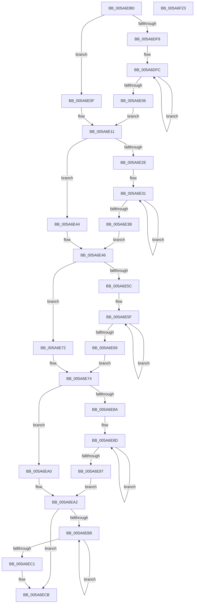

# McTemplateK0zzzzz_EtwWriteTransfer

- RVA: `0x005A6DB0`–`0x005A6F24` (길이 `372` bytes)
- VA: `0x00000001405A6DB0`
- 실행 섹션: `.text`
- PDB 이름 있음: `예`; PDB Function 태그: `아니요`
- unwind 정보 RVA: `0x000C8798`
- 디코드: `103`개 명령, `372/372` bytes 표시
- 미해석 바이트: `0` (있으면 어셈블리에 `.byte`로 보존)

> 이 문서는 커널 이미지의 기계어와 PDB 기호를 분석해 생성했습니다. 4번과 5번은 함수 원형과 자료형을 바이너리 사용 방식에서 추정한 C 해석이며 원본 소스 복구 결과는 아닙니다.

## 1. Dependencies

- 직접 호출 지점: **2**; 고유 호출 대상: **2**
- 직접 호출자로 확인된 함수: **1**
- RIP 상대 이미지 참조: **4**

### Outgoing calls
- `0x005A6EF9` → [McGenEventWrite_EtwWriteTransfer](../42/McGenEventWrite_EtwWriteTransfer_function_00424FC8.md) (function, `0x00424FC8`)
- `0x005A6F05` → [_security_check_cookie](../6A/_security_check_cookie_function_006AC640.md) (function, `0x006AC640`)

### Direct callers
- [PiProcessNewDeviceNode](../../page/A2/PiProcessNewDeviceNode_function_00A28F20.md) at `0x00A2941A`

### Static image references
- `0x005A6DCB` → RVA `0x00E0A740` (`.data`; read)
- `0x005A6E17` → RVA `0x006CB080` (` ?? ::FNODOBFM::`string'`; read)
- `0x005A6EE2` → RVA `0x00027718` (`.rdata`; read)
- `0x005A6EF2` → RVA `0x00E06DA0` (`.data`; read)

## 2. Other-region calls and transfers

- 다른 실행 섹션으로 향하는 call: **0**
- 별도 외부 분기/꼬리 이동을 확인하지 못했습니다.

## 3. Assembly (complete function range)

```asm
005A6DB0  48 8B C4                        mov rax, rsp
005A6DB3  48 89 58 08                     mov qword ptr [rax + 8], rbx
005A6DB7  48 89 70 10                     mov qword ptr [rax + 0x10], rsi
005A6DBB  48 89 78 18                     mov qword ptr [rax + 0x18], rdi
005A6DBF  55                              push rbp
005A6DC0  48 8D 68 C1                     lea rbp, [rax - 0x3f]
005A6DC4  48 81 EC A0 00 00 00            sub rsp, 0xa0
005A6DCB  48 8B 05 6E 39 86 00            mov rax, qword ptr [rip + 0x86396e]
005A6DD2  48 33 C4                        xor rax, rsp
005A6DD5  48 89 45 27                     mov qword ptr [rbp + 0x27], rax
005A6DD9  48 8B 5D 7F                     mov rbx, qword ptr [rbp + 0x7f]
005A6DDD  48 83 C8 FF                     or rax, 0xffffffffffffffff
005A6DE1  4C 8B 45 77                     mov r8, qword ptr [rbp + 0x77]
005A6DE5  33 FF                           xor edi, edi
005A6DE7  4C 8B 55 6F                     mov r10, qword ptr [rbp + 0x6f]
005A6DEB  BA 0A 00 00 00                  mov edx, 0xa
005A6DF0  4C 8B 5D 67                     mov r11, qword ptr [rbp + 0x67]
005A6DF4  4D 85 C9                        test r9, r9
005A6DF7  74 16                           je 0x1405a6e0f
005A6DF9  48 8B C8                        mov rcx, rax
005A6DFC  48 FF C1                        inc rcx
005A6DFF  66 41 39 3C 49                  cmp word ptr [r9 + rcx*2], di
005A6E04  75 F6                           jne 0x1405a6dfc
005A6E06  8D 0C 4D 02 00 00 00            lea ecx, [rcx*2 + 2]
005A6E0D  EB 02                           jmp 0x1405a6e11
005A6E0F  8B CA                           mov ecx, edx
005A6E11  4D 85 C9                        test r9, r9
005A6E14  89 4D DF                        mov dword ptr [rbp - 0x21], ecx
005A6E17  48 8D 35 62 42 12 00            lea rsi, [rip + 0x124262]
005A6E1E  89 7D E3                        mov dword ptr [rbp - 0x1d], edi
005A6E21  4C 0F 44 CE                     cmove r9, rsi
005A6E25  4C 89 4D D7                     mov qword ptr [rbp - 0x29], r9
005A6E29  4D 85 DB                        test r11, r11
005A6E2C  74 16                           je 0x1405a6e44
005A6E2E  48 8B C8                        mov rcx, rax
005A6E31  48 FF C1                        inc rcx
005A6E34  66 41 39 3C 4B                  cmp word ptr [r11 + rcx*2], di
005A6E39  75 F6                           jne 0x1405a6e31
005A6E3B  8D 0C 4D 02 00 00 00            lea ecx, [rcx*2 + 2]
005A6E42  EB 02                           jmp 0x1405a6e46
005A6E44  8B CA                           mov ecx, edx
005A6E46  4D 85 DB                        test r11, r11
005A6E49  89 4D EF                        mov dword ptr [rbp - 0x11], ecx
005A6E4C  89 7D F3                        mov dword ptr [rbp - 0xd], edi
005A6E4F  4C 0F 44 DE                     cmove r11, rsi
005A6E53  4C 89 5D E7                     mov qword ptr [rbp - 0x19], r11
005A6E57  4D 85 D2                        test r10, r10
005A6E5A  74 16                           je 0x1405a6e72
005A6E5C  48 8B C8                        mov rcx, rax
005A6E5F  48 FF C1                        inc rcx
005A6E62  66 41 39 3C 4A                  cmp word ptr [r10 + rcx*2], di
005A6E67  75 F6                           jne 0x1405a6e5f
005A6E69  8D 0C 4D 02 00 00 00            lea ecx, [rcx*2 + 2]
005A6E70  EB 02                           jmp 0x1405a6e74
005A6E72  8B CA                           mov ecx, edx
005A6E74  4D 85 D2                        test r10, r10
005A6E77  89 4D FF                        mov dword ptr [rbp - 1], ecx
005A6E7A  89 7D 03                        mov dword ptr [rbp + 3], edi
005A6E7D  4C 0F 44 D6                     cmove r10, rsi
005A6E81  4C 89 55 F7                     mov qword ptr [rbp - 9], r10
005A6E85  4D 85 C0                        test r8, r8
005A6E88  74 16                           je 0x1405a6ea0
005A6E8A  48 8B C8                        mov rcx, rax
005A6E8D  48 FF C1                        inc rcx
005A6E90  66 41 39 3C 48                  cmp word ptr [r8 + rcx*2], di
005A6E95  75 F6                           jne 0x1405a6e8d
005A6E97  8D 0C 4D 02 00 00 00            lea ecx, [rcx*2 + 2]
005A6E9E  EB 02                           jmp 0x1405a6ea2
005A6EA0  8B CA                           mov ecx, edx
005A6EA2  4D 85 C0                        test r8, r8
005A6EA5  89 4D 0F                        mov dword ptr [rbp + 0xf], ecx
005A6EA8  89 7D 13                        mov dword ptr [rbp + 0x13], edi
005A6EAB  4C 0F 44 C6                     cmove r8, rsi
005A6EAF  4C 89 45 07                     mov qword ptr [rbp + 7], r8
005A6EB3  48 85 DB                        test rbx, rbx
005A6EB6  74 13                           je 0x1405a6ecb
005A6EB8  48 FF C0                        inc rax
005A6EBB  66 39 3C 43                     cmp word ptr [rbx + rax*2], di
005A6EBF  75 F7                           jne 0x1405a6eb8
005A6EC1  8D 14 45 02 00 00 00            lea edx, [rax*2 + 2]
005A6EC8  48 85 DB                        test rbx, rbx
005A6ECB  48 0F 44 DE                     cmove rbx, rsi
005A6ECF  89 55 1F                        mov dword ptr [rbp + 0x1f], edx
005A6ED2  48 8D 45 C7                     lea rax, [rbp - 0x39]
005A6ED6  48 89 5D 17                     mov qword ptr [rbp + 0x17], rbx
005A6EDA  45 33 C0                        xor r8d, r8d
005A6EDD  48 89 44 24 20                  mov qword ptr [rsp + 0x20], rax
005A6EE2  48 8D 15 2F 08 A8 FF            lea rdx, [rip - 0x57f7d1]
005A6EE9  89 7D 23                        mov dword ptr [rbp + 0x23], edi
005A6EEC  41 B9 06 00 00 00               mov r9d, 6
005A6EF2  48 8D 0D A7 FE 85 00            lea rcx, [rip + 0x85fea7]
005A6EF9  E8 CA E0 E7 FF                  call 0x140424fc8
005A6EFE  48 8B 4D 27                     mov rcx, qword ptr [rbp + 0x27]
005A6F02  48 33 CC                        xor rcx, rsp
005A6F05  E8 36 57 10 00                  call 0x1406ac640
005A6F0A  4C 8D 9C 24 A0 00 00 00         lea r11, [rsp + 0xa0]
005A6F12  49 8B 5B 10                     mov rbx, qword ptr [r11 + 0x10]
005A6F16  49 8B 73 18                     mov rsi, qword ptr [r11 + 0x18]
005A6F1A  49 8B 7B 20                     mov rdi, qword ptr [r11 + 0x20]
005A6F1E  49 8B E3                        mov rsp, r11
005A6F21  5D                              pop rbp
005A6F22  C3                              ret
005A6F23  CC                              int3
```

## 4. C-style interpretation (structured pseudocode)

```c
__int64 __fastcall McTemplateK0zzzzz_EtwWriteTransfer(__int64 a1, __int64 a2, __int64 a3, __int64 a4)
{
    __int64 result;
    __int64 v_r10;
    __int64 v_r11;
    __int64 v_rbx;
    __int64 v_rdi;
    __int64 v_rsp;
    unsigned __int64 v_stack_m8;
    unsigned __int64 v_stack_m88;

    *(unsigned __int64 *)(v_rsp + 8) = v_rbx;
    *(unsigned __int64 *)(v_rsp + 16) = v_rsi;
    *(unsigned __int64 *)(v_rsp + 24) = v_rdi;
    v_rsp = (v_rsp) - (160);
    result = (*(unsigned __int64 *)(v_rip + 8796526)) ^ (v_rsp);
    *(unsigned __int64 *)(v_rsp - 63 + 39) = result;
    result = (result) | (-1);
    v_rdi = 0;
    if (a4 == 0) goto loc_005A6E0F;
loc_005A6DFC:
    a1 = (result) + 1;
    if ((*(unsigned __int16 *)(a4 + a1 * 2)) != 0) goto loc_005A6DFC;
    goto loc_005A6E11;
loc_005A6E0F:
loc_005A6E11:
    *(unsigned int *)(v_rsp - 63 - 33) = 10;
    *(unsigned int *)(v_rsp - 63 - 29) = 0;
    if (a4 == 0) { a4 = v_rip + 1196642; }
    *(unsigned __int64 *)(v_rsp - 63 - 41) = a4;
    if (*(unsigned __int64 *)(v_rsp - 63 + 103) == 0) goto loc_005A6E44;
loc_005A6E31:
    a1 = (result) + 1;
    if ((*(unsigned __int16 *)(*(unsigned __int64 *)(v_rsp - 63 + 103) + a1 * 2)) != 0) goto loc_005A6E31;
    goto loc_005A6E46;
loc_005A6E44:
loc_005A6E46:
    *(unsigned int *)(v_rsp - 63 - 17) = 10;
    *(unsigned int *)(v_rsp - 63 - 13) = 0;
    v_r11 = *(unsigned __int64 *)(v_rsp - 63 + 103);
    if (*(unsigned __int64 *)(v_rsp - 63 + 103) == 0) { v_r11 = v_rip + 1196642; }
    *(unsigned __int64 *)(v_rsp - 63 - 25) = v_r11;
    if (*(unsigned __int64 *)(v_rsp - 63 + 111) == 0) goto loc_005A6E72;
loc_005A6E5F:
    a1 = (result) + 1;
    if ((*(unsigned __int16 *)(*(unsigned __int64 *)(v_rsp - 63 + 111) + a1 * 2)) != 0) goto loc_005A6E5F;
    goto loc_005A6E74;
loc_005A6E72:
loc_005A6E74:
    *(unsigned int *)(v_rsp - 63 - 1) = 10;
    *(unsigned int *)(v_rsp - 63 + 3) = 0;
    v_r10 = *(unsigned __int64 *)(v_rsp - 63 + 111);
    if (*(unsigned __int64 *)(v_rsp - 63 + 111) == 0) { v_r10 = v_rip + 1196642; }
    *(unsigned __int64 *)(v_rsp - 63 - 9) = v_r10;
    if (*(unsigned __int64 *)(v_rsp - 63 + 119) == 0) goto loc_005A6EA0;
loc_005A6E8D:
    a1 = (result) + 1;
    if ((*(unsigned __int16 *)(*(unsigned __int64 *)(v_rsp - 63 + 119) + a1 * 2)) != 0) goto loc_005A6E8D;
    goto loc_005A6EA2;
loc_005A6EA0:
loc_005A6EA2:
    *(unsigned int *)(v_rsp - 63 + 15) = 10;
    *(unsigned int *)(v_rsp - 63 + 19) = 0;
    a3 = *(unsigned __int64 *)(v_rsp - 63 + 119);
    if (*(unsigned __int64 *)(v_rsp - 63 + 119) == 0) { a3 = v_rip + 1196642; }
    *(unsigned __int64 *)(v_rsp - 63 + 7) = a3;
    if (*(unsigned __int64 *)(v_rsp - 63 + 127) == 0) goto loc_005A6ECB;
loc_005A6EB8:
    result = (result) + 1;
    if ((*(unsigned __int16 *)(*(unsigned __int64 *)(v_rsp - 63 + 127) + result * 2)) != 0) goto loc_005A6EB8;
loc_005A6ECB:
    v_rbx = *(unsigned __int64 *)(v_rsp - 63 + 127);
    if (*(unsigned __int64 *)(v_rsp - 63 + 127) == 0) { v_rbx = v_rip + 1196642; }
    *(unsigned int *)(v_rsp - 63 + 31) = (unsigned int)(result * 2 + 2);
    *(unsigned __int64 *)(v_rsp - 63 + 23) = v_rbx;
    a3 = 0;
    v_stack_m88 = v_rsp - 63 - 57;
    *(unsigned int *)(v_rsp - 63 + 35) = 0;
    result = McGenEventWrite_EtwWriteTransfer(v_rip + 8781479, v_rip - 5765073, a3, 6);
    a1 = (*(unsigned __int64 *)(v_rsp - 63 + 39)) ^ (v_rsp);
    result = _security_check_cookie(a1, v_rip - 5765073, a3, 6);
    return result;
}
```

## 5. (Beta) C Style

```c
int64_t McTemplateK0zzzzz_EtwWriteTransfer(int64_t Arg1, int64_t Arg2, int64_t Arg3, int64_t Arg4)
{
    int64_t result;
    int64_t local_r10;
    int64_t local_r11;
    int64_t local_rbx;
    int64_t local_rdi;
    int64_t local_rsp;
    uint64_t v_stack_m8;
    uint64_t v_stack_m88;

    *(uint64_t *)(local_rsp + 0x8) = local_rbx;
    *(uint64_t *)(local_rsp + 0x10) = local_rsi;
    *(uint64_t *)(local_rsp + 0x18) = local_rdi;
    local_rsp = (local_rsp) - (160);
    result = (*(uint64_t *)(v_rip + 0x86396E)) ^ (local_rsp);
    *(uint64_t *)(local_rsp - 0x3F + 0x27) = result;
    result = (result) | (-1);
    local_rdi = 0;
    if (Arg4 == 0) goto loc_005A6E0F;
loc_005A6DFC:
    Arg1 = (result) + 1;
    if ((*(uint16_t *)(Arg4 + Arg1 * 2)) != 0) goto loc_005A6DFC;
    goto loc_005A6E11;
loc_005A6E0F:
loc_005A6E11:
    *(uint32_t *)(local_rsp - 0x3F - 0x21) = 10;
    *(uint32_t *)(local_rsp - 0x3F - 0x1D) = 0;
    if (Arg4 == 0) { Arg4 = v_rip + 1196642; }
    *(uint64_t *)(local_rsp - 0x3F - 0x29) = Arg4;
    if (*(uint64_t *)(local_rsp - 0x3F + 0x67) == 0) goto loc_005A6E44;
loc_005A6E31:
    Arg1 = (result) + 1;
    if ((*(uint16_t *)(*(uint64_t *)(local_rsp - 0x3F + 0x67) + Arg1 * 2)) != 0) goto loc_005A6E31;
    goto loc_005A6E46;
loc_005A6E44:
loc_005A6E46:
    *(uint32_t *)(local_rsp - 0x3F - 0x11) = 10;
    *(uint32_t *)(local_rsp - 0x3F - 0xD) = 0;
    local_r11 = *(uint64_t *)(local_rsp - 0x3F + 0x67);
    if (*(uint64_t *)(local_rsp - 0x3F + 0x67) == 0) { local_r11 = v_rip + 1196642; }
    *(uint64_t *)(local_rsp - 0x3F - 0x19) = local_r11;
    if (*(uint64_t *)(local_rsp - 0x3F + 0x6F) == 0) goto loc_005A6E72;
loc_005A6E5F:
    Arg1 = (result) + 1;
    if ((*(uint16_t *)(*(uint64_t *)(local_rsp - 0x3F + 0x6F) + Arg1 * 2)) != 0) goto loc_005A6E5F;
    goto loc_005A6E74;
loc_005A6E72:
loc_005A6E74:
    *(uint32_t *)(local_rsp - 0x3F - 0x1) = 10;
    *(uint32_t *)(local_rsp - 0x3F + 0x3) = 0;
    local_r10 = *(uint64_t *)(local_rsp - 0x3F + 0x6F);
    if (*(uint64_t *)(local_rsp - 0x3F + 0x6F) == 0) { local_r10 = v_rip + 1196642; }
    *(uint64_t *)(local_rsp - 0x3F - 0x9) = local_r10;
    if (*(uint64_t *)(local_rsp - 0x3F + 0x77) == 0) goto loc_005A6EA0;
loc_005A6E8D:
    Arg1 = (result) + 1;
    if ((*(uint16_t *)(*(uint64_t *)(local_rsp - 0x3F + 0x77) + Arg1 * 2)) != 0) goto loc_005A6E8D;
    goto loc_005A6EA2;
loc_005A6EA0:
loc_005A6EA2:
    *(uint32_t *)(local_rsp - 0x3F + 0xF) = 10;
    *(uint32_t *)(local_rsp - 0x3F + 0x13) = 0;
    Arg3 = *(uint64_t *)(local_rsp - 0x3F + 0x77);
    if (*(uint64_t *)(local_rsp - 0x3F + 0x77) == 0) { Arg3 = v_rip + 1196642; }
    *(uint64_t *)(local_rsp - 0x3F + 0x7) = Arg3;
    if (*(uint64_t *)(local_rsp - 0x3F + 0x7F) == 0) goto loc_005A6ECB;
loc_005A6EB8:
    result = (result) + 1;
    if ((*(uint16_t *)(*(uint64_t *)(local_rsp - 0x3F + 0x7F) + result * 2)) != 0) goto loc_005A6EB8;
loc_005A6ECB:
    local_rbx = *(uint64_t *)(local_rsp - 0x3F + 0x7F);
    if (*(uint64_t *)(local_rsp - 0x3F + 0x7F) == 0) { local_rbx = v_rip + 1196642; }
    *(uint32_t *)(local_rsp - 0x3F + 0x1F) = (uint32_t)(result * 2 + 2);
    *(uint64_t *)(local_rsp - 0x3F + 0x17) = local_rbx;
    Arg3 = 0;
    v_stack_m88 = local_rsp - 63 - 57;
    *(uint32_t *)(local_rsp - 0x3F + 0x23) = 0;
    result = McGenEventWrite_EtwWriteTransfer(v_rip + 8781479, v_rip - 5765073, Arg3, 6);
    Arg1 = (*(uint64_t *)(local_rsp - 0x3F + 0x27)) ^ (local_rsp);
    result = _security_check_cookie(Arg1, v_rip - 5765073, Arg3, 6);
    return result;
}
```

## 6. Execution-region graph

[열기: 2D/3D 그래프와 함수 탐색 컨트롤 패널](../../../control-panel.html?section=text&rva=0x005A6DB0&view=graph)

- 2D 그래프는 위에서 아래로 흐르고, 3D 그래프는 빈 공간을 드래그해 회전합니다. Shift+드래그는 이동, 휠은 확대·축소, 함수 노드 선택은 대상 보고서 이동입니다.

### Static fallback


