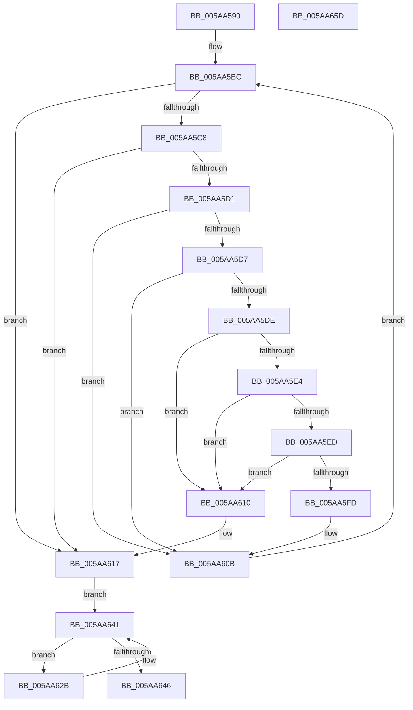

# PiCollapseRebalanceRequests

- RVA: `0x005AA590`–`0x005AA65E` (길이 `206` bytes)
- VA: `0x00000001405AA590`
- 실행 섹션: `.text`
- PDB 이름 있음: `예`; PDB Function 태그: `아니요`
- unwind 정보 RVA: `0x00060BC4`
- 디코드: `59`개 명령, `206/206` bytes 표시
- 미해석 바이트: `0` (있으면 어셈블리에 `.byte`로 보존)

> 이 문서는 커널 이미지의 기계어와 PDB 기호를 분석해 생성했습니다. 4번과 5번은 함수 원형과 자료형을 바이너리 사용 방식에서 추정한 C 해석이며 원본 소스 복구 결과는 아닙니다.

## 1. Dependencies

- 직접 호출 지점: **3**; 고유 호출 대상: **3**
- 직접 호출자로 확인된 함수: **1**
- RIP 상대 이미지 참조: **2**

### Outgoing calls
- `0x005AA5A9` → [KeAcquireSpinLockRaiseToDpc](../20/KeAcquireSpinLockRaiseToDpc_function_00208470.md) (function, `0x00208470`)
- `0x005AA621` → [KeReleaseSpinLock](../39/KeReleaseSpinLock_function_00392BA0.md) (function, `0x00392BA0`)
- `0x005AA634` → [ObfDereferenceObjectWithTag](../2F/ObfDereferenceObjectWithTag_function_002F78E0.md) (function, `0x002F78E0`)

### Direct callers
- [PnpProcessRebalance](PnpProcessRebalance_function_005AA7C8.md) at `0x005AA822`

### Static image references
- `0x005AA5A2` → RVA `0x00F8AD90` (`.data`; read)
- `0x005AA5AE` → RVA `0x00F8AD80` (`.data`; read)

## 2. Other-region calls and transfers

- 다른 실행 섹션으로 향하는 call: **0**
- 별도 외부 분기/꼬리 이동을 확인하지 못했습니다.

## 3. Assembly (complete function range)

```asm
005AA590  48 89 5C 24 08                  mov qword ptr [rsp + 8], rbx
005AA595  48 89 74 24 10                  mov qword ptr [rsp + 0x10], rsi
005AA59A  57                              push rdi
005AA59B  48 83 EC 20                     sub rsp, 0x20
005AA59F  48 8B F9                        mov rdi, rcx
005AA5A2  48 8D 0D E7 07 9E 00            lea rcx, [rip + 0x9e07e7]
005AA5A9  E8 C2 DE C5 FF                  call 0x140208470
005AA5AE  48 8B 15 CB 07 9E 00            mov rdx, qword ptr [rip + 0x9e07cb]
005AA5B5  44 8A C0                        mov r8b, al
005AA5B8  48 8B 77 08                     mov rsi, qword ptr [rdi + 8]
005AA5BC  48 8D 05 BD 07 9E 00            lea rax, [rip + 0x9e07bd]
005AA5C3  48 3B D0                        cmp rdx, rax
005AA5C6  74 4F                           je 0x1405aa617
005AA5C8  80 7A 1C 00                     cmp byte ptr [rdx + 0x1c], 0
005AA5CC  48 8B 0A                        mov rcx, qword ptr [rdx]
005AA5CF  75 46                           jne 0x1405aa617
005AA5D1  83 7A 18 06                     cmp dword ptr [rdx + 0x18], 6
005AA5D5  75 34                           jne 0x1405aa60b
005AA5D7  8B 42 28                        mov eax, dword ptr [rdx + 0x28]
005AA5DA  A8 01                           test al, 1
005AA5DC  74 2D                           je 0x1405aa60b
005AA5DE  48 39 51 08                     cmp qword ptr [rcx + 8], rdx
005AA5E2  75 2C                           jne 0x1405aa610
005AA5E4  48 8B 42 08                     mov rax, qword ptr [rdx + 8]
005AA5E8  48 39 10                        cmp qword ptr [rax], rdx
005AA5EB  75 23                           jne 0x1405aa610
005AA5ED  48 89 08                        mov qword ptr [rax], rcx
005AA5F0  48 89 41 08                     mov qword ptr [rcx + 8], rax
005AA5F4  48 8B 47 08                     mov rax, qword ptr [rdi + 8]
005AA5F8  48 39 38                        cmp qword ptr [rax], rdi
005AA5FB  75 13                           jne 0x1405aa610
005AA5FD  48 89 3A                        mov qword ptr [rdx], rdi
005AA600  48 89 42 08                     mov qword ptr [rdx + 8], rax
005AA604  48 89 10                        mov qword ptr [rax], rdx
005AA607  48 89 57 08                     mov qword ptr [rdi + 8], rdx
005AA60B  48 8B D1                        mov rdx, rcx
005AA60E  EB AC                           jmp 0x1405aa5bc
005AA610  B9 03 00 00 00                  mov ecx, 3
005AA615  CD 29                           int 0x29
005AA617  41 8A D0                        mov dl, r8b
005AA61A  48 8D 0D 6F 07 9E 00            lea rcx, [rip + 0x9e076f]
005AA621  E8 7A 85 DE FF                  call 0x140392ba0
005AA626  48 8B 1E                        mov rbx, qword ptr [rsi]
005AA629  EB 16                           jmp 0x1405aa641
005AA62B  48 8B 4B 10                     mov rcx, qword ptr [rbx + 0x10]
005AA62F  BA 44 66 6C 74                  mov edx, 0x746c6644
005AA634  E8 A7 D2 D4 FF                  call 0x1402f78e0
005AA639  48 83 63 10 00                  and qword ptr [rbx + 0x10], 0
005AA63E  48 8B 1B                        mov rbx, qword ptr [rbx]
005AA641  48 3B DF                        cmp rbx, rdi
005AA644  75 E5                           jne 0x1405aa62b
005AA646  48 3B 77 08                     cmp rsi, qword ptr [rdi + 8]
005AA64A  48 8B 5C 24 30                  mov rbx, qword ptr [rsp + 0x30]
005AA64F  48 8B 74 24 38                  mov rsi, qword ptr [rsp + 0x38]
005AA654  0F 95 C0                        setne al
005AA657  48 83 C4 20                     add rsp, 0x20
005AA65B  5F                              pop rdi
005AA65C  C3                              ret
005AA65D  CC                              int3
```

## 4. C-style interpretation (structured pseudocode)

```c
__int64 __fastcall PiCollapseRebalanceRequests(__int64 a1)
{
    __int64 result;
    __int64 v_rsp;
    unsigned __int64 v_stack_p10;
    unsigned __int64 v_stack_p8;

    v_stack_p8 = v_rbx;
    v_stack_p10 = v_rsi;
    v_rsp = (v_rsp) - (32);
    result = KeAcquireSpinLockRaiseToDpc(v_rip + 10356711, a2, a3, a4);
loc_005AA5BC:
    if ((*(unsigned __int64 *)(v_rip + 10356683)) == (v_rip + 10356669)) goto loc_005AA617;
    if ((*(unsigned __int8 *)(*(unsigned __int64 *)(v_rip + 10356683) + 28)) != 0) goto loc_005AA617;
    if ((*(unsigned int *)(*(unsigned __int64 *)(v_rip + 10356683) + 24)) != 6) goto loc_005AA60B;
    if ((((unsigned __int8)((unsigned int)(*(unsigned int *)(*(unsigned __int64 *)(v_rip + 10356683) + 40)))) & (1)) == 0) goto loc_005AA60B;
    if ((*(unsigned __int64 *)(*(unsigned __int64 *)(*(unsigned __int64 *)(v_rip + 10356683)) + 8)) != (*(unsigned __int64 *)(v_rip + 10356683))) goto loc_005AA610;
    if ((*(unsigned __int64 *)(*(unsigned __int64 *)(*(unsigned __int64 *)(v_rip + 10356683) + 8))) != (*(unsigned __int64 *)(v_rip + 10356683))) goto loc_005AA610;
    *(unsigned __int64 *)(*(unsigned __int64 *)(*(unsigned __int64 *)(v_rip + 10356683) + 8)) = *(unsigned __int64 *)(*(unsigned __int64 *)(v_rip + 10356683));
    *(unsigned __int64 *)(*(unsigned __int64 *)(*(unsigned __int64 *)(v_rip + 10356683)) + 8) = *(unsigned __int64 *)(*(unsigned __int64 *)(v_rip + 10356683) + 8);
    if ((*(unsigned __int64 *)(*(unsigned __int64 *)(a1 + 8))) != a1) goto loc_005AA610;
    *(unsigned __int64 *)(*(unsigned __int64 *)(v_rip + 10356683)) = a1;
    *(unsigned __int64 *)(*(unsigned __int64 *)(v_rip + 10356683) + 8) = *(unsigned __int64 *)(a1 + 8);
    *(unsigned __int64 *)(*(unsigned __int64 *)(a1 + 8)) = *(unsigned __int64 *)(v_rip + 10356683);
    *(unsigned __int64 *)(a1 + 8) = *(unsigned __int64 *)(v_rip + 10356683);
loc_005AA60B:
    goto loc_005AA5BC;
loc_005AA610:
loc_005AA617:
    result = KeReleaseSpinLock(v_rip + 10356591, (unsigned __int8)((unsigned __int8)(result)), (unsigned __int8)(result), a4);
    goto loc_005AA641;
loc_005AA62B:
    result = ObfDereferenceObjectWithTag(*(unsigned __int64 *)(*(unsigned __int64 *)(*(unsigned __int64 *)(a1 + 8)) + 16), (unsigned int)(0x746C6644ULL), (unsigned __int8)(result), a4);
loc_005AA641:
    if ((*(unsigned __int64 *)(*(unsigned __int64 *)(*(unsigned __int64 *)(a1 + 8)))) != a1) goto loc_005AA62B;
    result = ((*(unsigned __int64 *)(a1 + 8)) != (*(unsigned __int64 *)(a1 + 8))) ? 1 : 0;
    v_rsp = (v_rsp) + (32);
    return result;
}
```

## 5. (Beta) C Style

```c
int64_t PiCollapseRebalanceRequests(void *Arg1)
{
    uint8_t *arg1 = (uint8_t *)Arg1;

    int64_t result;
    int64_t local_rsp;
    uint64_t v_stack_p10;
    uint64_t v_stack_p8;

    v_stack_p8 = local_rbx;
    v_stack_p10 = local_rsi;
    local_rsp = (local_rsp) - (32);
    result = KeAcquireSpinLockRaiseToDpc(v_rip + 10356711, a2, a3, a4);
loc_005AA5BC:
    if ((*(uint64_t *)(v_rip + 0x9E07CB)) == (v_rip + 10356669)) goto loc_005AA617;
    if ((*(uint8_t *)(*(uint64_t *)(v_rip + 0x9E07CB) + 0x1C)) != 0) goto loc_005AA617;
    if ((*(uint32_t *)(*(uint64_t *)(v_rip + 0x9E07CB) + 0x18)) != 6) goto loc_005AA60B;
    if ((((uint8_t)((uint32_t)(*(uint32_t *)(*(uint64_t *)(v_rip + 0x9E07CB) + 0x28)))) & (1)) == 0) goto loc_005AA60B;
    if ((*(uint64_t *)(*(uint64_t *)(*(uint64_t *)(v_rip + 0x9E07CB)) + 0x8)) != (*(uint64_t *)(v_rip + 0x9E07CB))) goto loc_005AA610;
    if ((*(uint64_t *)(*(uint64_t *)(*(uint64_t *)(v_rip + 0x9E07CB) + 0x8))) != (*(uint64_t *)(v_rip + 0x9E07CB))) goto loc_005AA610;
    *(uint64_t *)(*(uint64_t *)(*(uint64_t *)(v_rip + 0x9E07CB) + 0x8)) = *(uint64_t *)(*(uint64_t *)(v_rip + 0x9E07CB));
    *(uint64_t *)(*(uint64_t *)(*(uint64_t *)(v_rip + 0x9E07CB)) + 0x8) = *(uint64_t *)(*(uint64_t *)(v_rip + 0x9E07CB) + 0x8);
    if ((*(uint64_t *)(*(uint64_t *)(arg1 + 0x8))) != Arg1) goto loc_005AA610;
    *(void **)(*(uint64_t *)(v_rip + 0x9E07CB)) = Arg1;
    *(uint64_t *)(*(uint64_t *)(v_rip + 0x9E07CB) + 0x8) = *(uint64_t *)(arg1 + 0x8);
    *(uint64_t *)(*(uint64_t *)(arg1 + 0x8)) = *(uint64_t *)(v_rip + 0x9E07CB);
    *(uint64_t *)(arg1 + 0x8) = *(uint64_t *)(v_rip + 0x9E07CB);
loc_005AA60B:
    goto loc_005AA5BC;
loc_005AA610:
loc_005AA617:
    result = KeReleaseSpinLock(v_rip + 10356591, (uint8_t)((uint8_t)(result)), (uint8_t)(result), a4);
    goto loc_005AA641;
loc_005AA62B:
    result = ObfDereferenceObjectWithTag(*(uint64_t *)(*(uint64_t *)(*(uint64_t *)(arg1 + 0x8)) + 0x10), (uint32_t)(0x746C6644ULL), (uint8_t)(result), a4);
loc_005AA641:
    if ((*(uint64_t *)(*(uint64_t *)(*(uint64_t *)(arg1 + 0x8)))) != Arg1) goto loc_005AA62B;
    result = ((*(uint64_t *)(arg1 + 0x8)) != (*(uint64_t *)(arg1 + 0x8))) ? 1 : 0;
    local_rsp = (local_rsp) + (32);
    return result;
}
```

### 관측된 메모리 오프셋

구조체 형식이 확인되지 않은 접근은 인자 기준의 오프셋으로만 기록했습니다.

| 기준 인자 | 오프셋 표현 | 폭 (bit) | 접근 |
|---|---:|---:|---|
| `Arg1` | `+ 0x8` | `64` | `R` |
| `Arg1` | `+ 0x8` | `64` | `W` |

## 6. Execution-region graph

[열기: 2D/3D 그래프와 함수 탐색 컨트롤 패널](../../../control-panel.html?section=text&rva=0x005AA590&view=graph)

- 2D 그래프는 위에서 아래로 흐르고, 3D 그래프는 빈 공간을 드래그해 회전합니다. Shift+드래그는 이동, 휠은 확대·축소, 함수 노드 선택은 대상 보고서 이동입니다.

### Static fallback


