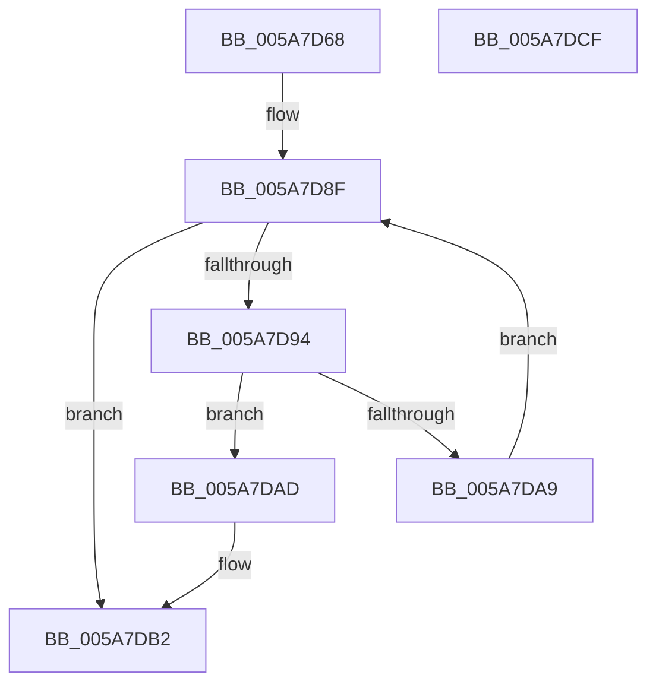

# PiDevCfgGetDriverConfigurationKeyScope

- RVA: `0x005A7D68`–`0x005A7DD0` (길이 `104` bytes)
- VA: `0x00000001405A7D68`
- 실행 섹션: `.text`
- PDB 이름 있음: `예`; PDB Function 태그: `아니요`
- unwind 정보 RVA: `0x0005E6B4`
- 디코드: `32`개 명령, `104/104` bytes 표시
- 미해석 바이트: `0` (있으면 어셈블리에 `.byte`로 보존)

> 이 문서는 커널 이미지의 기계어와 PDB 기호를 분석해 생성했습니다. 4번과 5번은 함수 원형과 자료형을 바이너리 사용 방식에서 추정한 C 해석이며 원본 소스 복구 결과는 아닙니다.

## 1. Dependencies

- 직접 호출 지점: **1**; 고유 호출 대상: **1**
- 직접 호출자로 확인된 함수: **2**
- RIP 상대 이미지 참조: **1**

### Outgoing calls
- `0x005A7DA0` → [wcsicmp](../50/wcsicmp_function_00500080.md) (function, `0x00500080`)

### Direct callers
- [PiDevCfgQueryIncludedDriverNode](../../page/73/PiDevCfgQueryIncludedDriverNode_function_00734D88.md) at `0x007351A2`
- [PiDevCfgQueryIncludedDriverConfigurations](../../page/97/PiDevCfgQueryIncludedDriverConfigurations_function_009754BC.md) at `0x0097562A`

### Static image references
- `0x005A7D83` → RVA `0x00B4CD60` (`PAGE`; read)

## 2. Other-region calls and transfers

- 다른 실행 섹션으로 향하는 call: **0**
- 별도 외부 분기/꼬리 이동을 확인하지 못했습니다.

## 3. Assembly (complete function range)

```asm
005A7D68  48 8B C4                        mov rax, rsp
005A7D6B  48 89 58 08                     mov qword ptr [rax + 8], rbx
005A7D6F  48 89 68 10                     mov qword ptr [rax + 0x10], rbp
005A7D73  48 89 70 18                     mov qword ptr [rax + 0x18], rsi
005A7D77  48 89 78 20                     mov qword ptr [rax + 0x20], rdi
005A7D7B  41 56                           push r14
005A7D7D  48 83 EC 20                     sub rsp, 0x20
005A7D81  33 DB                           xor ebx, ebx
005A7D83  4C 8D 35 D6 4F 5A 00            lea r14, [rip + 0x5a4fd6]
005A7D8A  8B FB                           mov edi, ebx
005A7D8C  48 8B E9                        mov rbp, rcx
005A7D8F  83 FF 0B                        cmp edi, 0xb
005A7D92  73 1E                           jae 0x1405a7db2
005A7D94  8B F7                           mov esi, edi
005A7D96  48 8B D5                        mov rdx, rbp
005A7D99  48 03 F6                        add rsi, rsi
005A7D9C  49 8B 0C F6                     mov rcx, qword ptr [r14 + rsi*8]
005A7DA0  E8 DB 82 F5 FF                  call 0x140500080
005A7DA5  85 C0                           test eax, eax
005A7DA7  74 04                           je 0x1405a7dad
005A7DA9  FF C7                           inc edi
005A7DAB  EB E2                           jmp 0x1405a7d8f
005A7DAD  41 8B 5C F6 08                  mov ebx, dword ptr [r14 + rsi*8 + 8]
005A7DB2  48 8B 6C 24 38                  mov rbp, qword ptr [rsp + 0x38]
005A7DB7  8B C3                           mov eax, ebx
005A7DB9  48 8B 5C 24 30                  mov rbx, qword ptr [rsp + 0x30]
005A7DBE  48 8B 74 24 40                  mov rsi, qword ptr [rsp + 0x40]
005A7DC3  48 8B 7C 24 48                  mov rdi, qword ptr [rsp + 0x48]
005A7DC8  48 83 C4 20                     add rsp, 0x20
005A7DCC  41 5E                           pop r14
005A7DCE  C3                              ret
005A7DCF  CC                              int3
```

## 4. C-style interpretation (structured pseudocode)

```c
__int64 __fastcall PiDevCfgGetDriverConfigurationKeyScope(__int64 a1)
{
    __int64 result;
    __int64 v_rbx;
    __int64 v_rdi;
    __int64 v_rsi;
    __int64 v_rsp;
    unsigned __int64 v_stack_p10;
    unsigned __int64 v_stack_p18;
    unsigned __int64 v_stack_p20;
    unsigned __int64 v_stack_p8;

    *(unsigned __int64 *)(v_rsp + 8) = v_rbx;
    *(unsigned __int64 *)(v_rsp + 16) = v_rbp;
    *(unsigned __int64 *)(v_rsp + 24) = v_rsi;
    *(unsigned __int64 *)(v_rsp + 32) = v_rdi;
    v_rsp = (v_rsp) - (32);
    v_rbx = 0;
loc_005A7D8F:
    if (0 >= 11) goto loc_005A7DB2;
    v_rsi = (0) + (0);
    result = wcsicmp(*(unsigned __int64 *)(v_rip + 5918678 + v_rsi * 8), a1, a3, a4);
    if ((unsigned int)(result) == 0) goto loc_005A7DAD;
    v_rdi = (unsigned int)((0) + 1);
    goto loc_005A7D8F;
loc_005A7DAD:
loc_005A7DB2:
    v_rsp = (v_rsp) + (32);
    return (unsigned int)((unsigned int)((unsigned int)(*(unsigned int *)(v_rip + 5918678 + v_rsi * 8 + 8))));
}
```

## 5. (Beta) C Style

```c
int64_t PiDevCfgGetDriverConfigurationKeyScope(int64_t Arg1)
{
    int64_t result;
    int64_t local_rbx;
    int64_t local_rdi;
    int64_t local_rsi;
    int64_t local_rsp;
    uint64_t v_stack_p10;
    uint64_t v_stack_p18;
    uint64_t v_stack_p20;
    uint64_t v_stack_p8;

    *(uint64_t *)(local_rsp + 0x8) = local_rbx;
    *(uint64_t *)(local_rsp + 0x10) = local_rbp;
    *(uint64_t *)(local_rsp + 0x18) = local_rsi;
    *(uint64_t *)(local_rsp + 0x20) = local_rdi;
    local_rsp = (local_rsp) - (32);
    local_rbx = 0;
loc_005A7D8F:
    if (0 >= 11) goto loc_005A7DB2;
    local_rsi = (0) + (0);
    result = wcsicmp(*(uint64_t *)(v_rip + 0x5A4FD6 + local_rsi * 8), Arg1, a3, a4);
    if ((uint32_t)(result) == 0) goto loc_005A7DAD;
    local_rdi = (uint32_t)((0) + 1);
    goto loc_005A7D8F;
loc_005A7DAD:
loc_005A7DB2:
    local_rsp = (local_rsp) + (32);
    return (uint32_t)((uint32_t)((uint32_t)(*(uint32_t *)(v_rip + 0x5A4FD6 + local_rsi * 8 + 0x8))));
}
```

## 6. Execution-region graph

[열기: 2D/3D 그래프와 함수 탐색 컨트롤 패널](../../../control-panel.html?section=text&rva=0x005A7D68&view=graph)

- 2D 그래프는 위에서 아래로 흐르고, 3D 그래프는 빈 공간을 드래그해 회전합니다. Shift+드래그는 이동, 휠은 확대·축소, 함수 노드 선택은 대상 보고서 이동입니다.

### Static fallback


