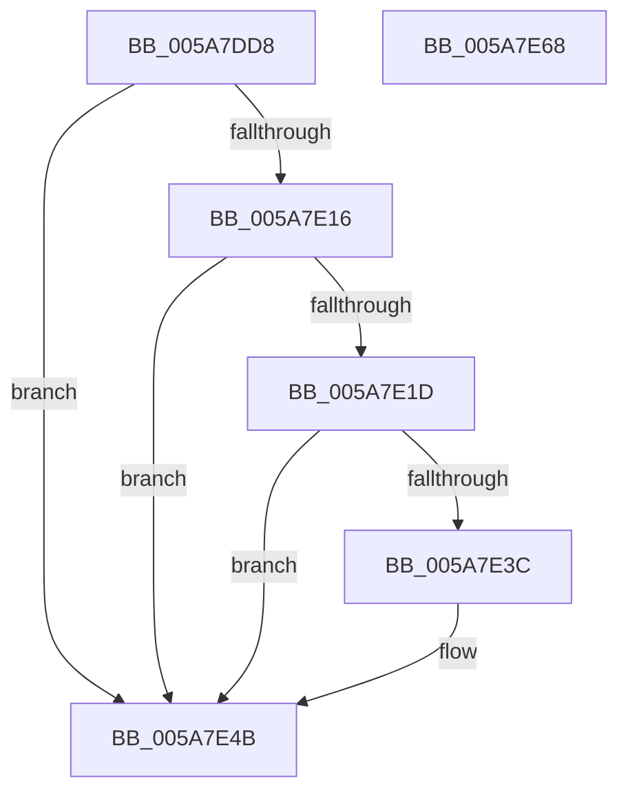

# PiDevCfgMatchDriverConfigurationId

- RVA: `0x005A7DD8`–`0x005A7E69` (길이 `145` bytes)
- VA: `0x00000001405A7DD8`
- 실행 섹션: `.text`
- PDB 이름 있음: `예`; PDB Function 태그: `아니요`
- unwind 정보 RVA: `0x0005E6B4`
- 디코드: `43`개 명령, `145/145` bytes 표시
- 미해석 바이트: `0` (있으면 어셈블리에 `.byte`로 보존)

> 이 문서는 커널 이미지의 기계어와 PDB 기호를 분석해 생성했습니다. 4번과 5번은 함수 원형과 자료형을 바이너리 사용 방식에서 추정한 C 해석이며 원본 소스 복구 결과는 아닙니다.

## 1. Dependencies

- 직접 호출 지점: **2**; 고유 호출 대상: **1**
- 직접 호출자로 확인된 함수: **1**
- RIP 상대 이미지 참조: **0**

### Outgoing calls
- `0x005A7E0D` → [wcsnicmp](../50/wcsnicmp_function_005001C0.md) (function, `0x005001C0`)
- `0x005A7E33` → [wcsnicmp](../50/wcsnicmp_function_005001C0.md) (function, `0x005001C0`)

### Direct callers
- [PiDevCfgFindDeviceDriver](../../page/97/PiDevCfgFindDeviceDriver_function_0097602C.md) at `0x0097652C`
- [PiDevCfgFindDeviceDriver](../../page/97/PiDevCfgFindDeviceDriver_function_0097602C.md) at `0x0097655D`
- [PiDevCfgFindDeviceDriver](../../page/97/PiDevCfgFindDeviceDriver_function_0097602C.md) at `0x00976A4D`

### Static image references
- 디코드된 RIP-relative 메모리 참조가 없습니다.

## 2. Other-region calls and transfers

- 다른 실행 섹션으로 향하는 call: **0**
- 별도 외부 분기/꼬리 이동을 확인하지 못했습니다.

## 3. Assembly (complete function range)

```asm
005A7DD8  48 8B C4                        mov rax, rsp
005A7DDB  48 89 58 08                     mov qword ptr [rax + 8], rbx
005A7DDF  48 89 68 10                     mov qword ptr [rax + 0x10], rbp
005A7DE3  48 89 70 18                     mov qword ptr [rax + 0x18], rsi
005A7DE7  48 89 78 20                     mov qword ptr [rax + 0x20], rdi
005A7DEB  41 56                           push r14
005A7DED  48 83 EC 20                     sub rsp, 0x20
005A7DF1  0F B7 41 28                     movzx eax, word ptr [rcx + 0x28]
005A7DF5  48 8B FA                        mov rdi, rdx
005A7DF8  48 8B 51 30                     mov rdx, qword ptr [rcx + 0x30]
005A7DFC  48 8B E9                        mov rbp, rcx
005A7DFF  66 D1 E8                        shr ax, 1
005A7E02  48 8B CF                        mov rcx, rdi
005A7E05  0F B7 F0                        movzx esi, ax
005A7E08  33 DB                           xor ebx, ebx
005A7E0A  44 8B C6                        mov r8d, esi
005A7E0D  E8 AE 83 F5 FF                  call 0x1405001c0
005A7E12  85 C0                           test eax, eax
005A7E14  75 35                           jne 0x1405a7e4b
005A7E16  66 83 3C 77 3A                  cmp word ptr [rdi + rsi*2], 0x3a
005A7E1B  75 2E                           jne 0x1405a7e4b
005A7E1D  48 8B 55 50                     mov rdx, qword ptr [rbp + 0x50]
005A7E21  48 8D 34 77                     lea rsi, [rdi + rsi*2]
005A7E25  0F B7 7D 48                     movzx edi, word ptr [rbp + 0x48]
005A7E29  48 8D 4E 02                     lea rcx, [rsi + 2]
005A7E2D  48 D1 EF                        shr rdi, 1
005A7E30  4C 8B C7                        mov r8, rdi
005A7E33  E8 88 83 F5 FF                  call 0x1405001c0
005A7E38  85 C0                           test eax, eax
005A7E3A  75 0F                           jne 0x1405a7e4b
005A7E3C  66 83 7C 7E 02 2C               cmp word ptr [rsi + rdi*2 + 2], 0x2c
005A7E42  8D 48 01                        lea ecx, [rax + 1]
005A7E45  0F B6 DB                        movzx ebx, bl
005A7E48  0F 44 D9                        cmove ebx, ecx
005A7E4B  48 8B 6C 24 38                  mov rbp, qword ptr [rsp + 0x38]
005A7E50  8A C3                           mov al, bl
005A7E52  48 8B 5C 24 30                  mov rbx, qword ptr [rsp + 0x30]
005A7E57  48 8B 74 24 40                  mov rsi, qword ptr [rsp + 0x40]
005A7E5C  48 8B 7C 24 48                  mov rdi, qword ptr [rsp + 0x48]
005A7E61  48 83 C4 20                     add rsp, 0x20
005A7E65  41 5E                           pop r14
005A7E67  C3                              ret
005A7E68  CC                              int3
```

## 4. C-style interpretation (structured pseudocode)

```c
__int64 __fastcall PiDevCfgMatchDriverConfigurationId(__int64 a1, __int64 a2)
{
    __int64 result;
    __int64 v_rbx;
    __int64 v_rdi;
    __int64 v_rsp;
    unsigned __int64 v_stack_p10;
    unsigned __int64 v_stack_p18;
    unsigned __int64 v_stack_p20;
    unsigned __int64 v_stack_p8;

    *(unsigned __int64 *)(v_rsp + 8) = v_rbx;
    *(unsigned __int64 *)(v_rsp + 16) = v_rbp;
    *(unsigned __int64 *)(v_rsp + 24) = v_rsi;
    *(unsigned __int64 *)(v_rsp + 32) = v_rdi;
    v_rsp = (v_rsp) - (32);
    result = (unsigned __int16)((*(unsigned __int16 *)(a1 + 40)) >> (1));
    v_rbx = 0;
    result = wcsnicmp(a2, *(unsigned __int64 *)(a1 + 48), (unsigned int)((unsigned int)((unsigned __int16)(result))), a4);
    if ((unsigned int)(result) != 0) goto loc_005A7E4B;
    if ((*(unsigned __int16 *)(a2 + (unsigned __int16)(result) * 2)) != 58) goto loc_005A7E4B;
    v_rdi = (*(unsigned __int16 *)(a1 + 72)) >> (1);
    result = wcsnicmp(a2 + (unsigned __int16)(result) * 2 + 2, *(unsigned __int64 *)(a1 + 80), v_rdi, a4);
    if ((unsigned int)(result) == 0) {
        a1 = result + 1;
        v_rbx = 0;
        if ((*(unsigned __int16 *)(a2 + (unsigned __int16)(result) * 2 + v_rdi * 2 + 2)) == 44) { v_rbx = (unsigned int)(a1); }
    }
    v_rsp = (v_rsp) + (32);
    return (unsigned __int8)(v_rbx);
}
```

## 5. (Beta) C Style

```c
int64_t PiDevCfgMatchDriverConfigurationId(void *Arg1, void *Arg2)
{
    uint8_t *arg1 = (uint8_t *)Arg1;
    uint8_t *arg2 = (uint8_t *)Arg2;

    int64_t result;
    int64_t local_rbx;
    int64_t local_rdi;
    int64_t local_rsp;
    uint64_t v_stack_p10;
    uint64_t v_stack_p18;
    uint64_t v_stack_p20;
    uint64_t v_stack_p8;

    *(uint64_t *)(local_rsp + 0x8) = local_rbx;
    *(uint64_t *)(local_rsp + 0x10) = local_rbp;
    *(uint64_t *)(local_rsp + 0x18) = local_rsi;
    *(uint64_t *)(local_rsp + 0x20) = local_rdi;
    local_rsp = (local_rsp) - (32);
    result = (uint16_t)((*(uint16_t *)(arg1 + 0x28)) >> (1));
    local_rbx = 0;
    result = wcsnicmp(Arg2, *(uint64_t *)(arg1 + 0x30), (uint32_t)((uint32_t)((uint16_t)(result))), a4);
    if ((uint32_t)(result) != 0) goto loc_005A7E4B;
    if ((*(uint16_t *)(arg2 + (uint16_t)(result) * 2)) != 58) goto loc_005A7E4B;
    local_rdi = (*(uint16_t *)(arg1 + 0x48)) >> (1);
    result = wcsnicmp(Arg2 + (uint16_t)(result) * 2 + 2, *(uint64_t *)(arg1 + 0x50), local_rdi, a4);
    if ((uint32_t)(result) == 0) {
        Arg1 = result + 1;
        local_rbx = 0;
        if ((*(uint16_t *)(arg2 + (uint16_t)(result) * 2 + local_rdi * 2 + 0x2)) == 44) { local_rbx = (uint32_t)(Arg1); }
    }
    local_rsp = (local_rsp) + (32);
    return (uint8_t)(local_rbx);
}
```

### 관측된 메모리 오프셋

구조체 형식이 확인되지 않은 접근은 인자 기준의 오프셋으로만 기록했습니다.

| 기준 인자 | 오프셋 표현 | 폭 (bit) | 접근 |
|---|---:|---:|---|
| `Arg1` | `+ 0x28` | `16` | `R` |
| `Arg1` | `+ 0x30` | `64` | `R` |
| `Arg1` | `+ 0x48` | `16` | `R` |
| `Arg1` | `+ 0x50` | `64` | `R` |
| `Arg2` | `+ 0x0 + rsi*2` | `16` | `R` |
| `Arg2` | `+ 0x0 + rsi*2` | `64` | `R` |
| `Arg2` | `+ 0x2` | `64` | `R` |
| `Arg2` | `+ 0x2 + rdi*2` | `16` | `R` |

## 6. Execution-region graph

[열기: 2D/3D 그래프와 함수 탐색 컨트롤 패널](../../../control-panel.html?section=text&rva=0x005A7DD8&view=graph)

- 2D 그래프는 위에서 아래로 흐르고, 3D 그래프는 빈 공간을 드래그해 회전합니다. Shift+드래그는 이동, 휠은 확대·축소, 함수 노드 선택은 대상 보고서 이동입니다.

### Static fallback


