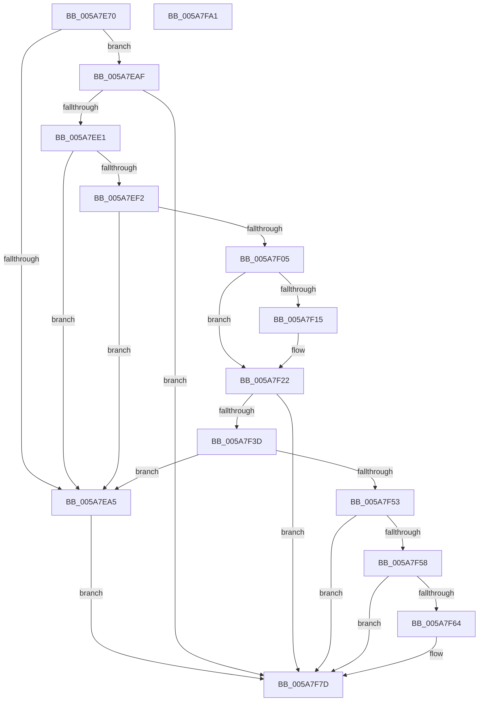

# PiDevCfgParsePropertyKeyName

- RVA: `0x005A7E70`–`0x005A7FA2` (길이 `306` bytes)
- VA: `0x00000001405A7E70`
- 실행 섹션: `.text`
- PDB 이름 있음: `예`; PDB Function 태그: `아니요`
- unwind 정보 RVA: `0x000BCFE0`
- 디코드: `93`개 명령, `306/306` bytes 표시
- 미해석 바이트: `0` (있으면 어셈블리에 `.byte`로 보존)

> 이 문서는 커널 이미지의 기계어와 PDB 기호를 분석해 생성했습니다. 4번과 5번은 함수 원형과 자료형을 바이너리 사용 방식에서 추정한 C 해석이며 원본 소스 복구 결과는 아닙니다.

## 1. Dependencies

- 직접 호출 지점: **6**; 고유 호출 대상: **5**
- 직접 호출자로 확인된 함수: **1**
- RIP 상대 이미지 참조: **1**

### Outgoing calls
- `0x005A7ED2` → [RtlGUIDFromString](../../page/8F/RtlGUIDFromString_function_008F1EF0.md) (function, `0x008F1EF0`)
- `0x005A7F08` → [wcschr](../50/wcschr_function_00501A60.md) (function, `0x00501A60`)
- `0x005A7F32` → [RtlStringCchCopyNW](../47/RtlStringCchCopyNW_function_0047169C.md) (function, `0x0047169C`)
- `0x005A7F46` → [PnpStringToDwordValue](../4E/PnpStringToDwordValue_function_004E1894.md) (function, `0x004E1894`)
- `0x005A7F6A` → [PnpStringToDwordValue](../4E/PnpStringToDwordValue_function_004E1894.md) (function, `0x004E1894`)
- `0x005A7F8D` → [_security_check_cookie](../6A/_security_check_cookie_function_006AC640.md) (function, `0x006AC640`)

### Direct callers
- [PiDevCfgCopyDeviceKey](../../page/99/PiDevCfgCopyDeviceKey_function_00997374.md) at `0x00997A04`

### Static image references
- `0x005A7E7F` → RVA `0x00E0A740` (`.data`; read)

## 2. Other-region calls and transfers

- 다른 실행 섹션으로 향하는 call: **1**
  - `0x005A7ED2` → [RtlGUIDFromString](../../page/8F/RtlGUIDFromString_function_008F1EF0.md) (`.text` → `PAGE`)
- 별도 외부 분기/꼬리 이동을 확인하지 못했습니다.

## 3. Assembly (complete function range)

```asm
005A7E70  40 53                           push rbx
005A7E72  55                              push rbp
005A7E73  56                              push rsi
005A7E74  57                              push rdi
005A7E75  41 54                           push r12
005A7E77  41 56                           push r14
005A7E79  41 57                           push r15
005A7E7B  48 83 EC 50                     sub rsp, 0x50
005A7E7F  48 8B 05 BA 28 86 00            mov rax, qword ptr [rip + 0x8628ba]
005A7E86  48 33 C4                        xor rax, rsp
005A7E89  48 89 44 24 48                  mov qword ptr [rsp + 0x48], rax
005A7E8E  45 33 FF                        xor r15d, r15d
005A7E91  4D 8B F0                        mov r14, r8
005A7E94  66 83 39 50                     cmp word ptr [rcx], 0x50
005A7E98  48 8B EA                        mov rbp, rdx
005A7E9B  48 8B F1                        mov rsi, rcx
005A7E9E  44 89 7C 24 24                  mov dword ptr [rsp + 0x24], r15d
005A7EA3  73 0A                           jae 0x1405a7eaf
005A7EA5  BB 01 00 00 C0                  mov ebx, 0xc0000001
005A7EAA  E9 CE 00 00 00                  jmp 0x1405a7f7d
005A7EAF  48 8B 41 08                     mov rax, qword ptr [rcx + 8]
005A7EB3  41 BC 4C 00 00 00               mov r12d, 0x4c
005A7EB9  48 89 44 24 28                  mov qword ptr [rsp + 0x28], rax
005A7EBE  0F B7 41 02                     movzx eax, word ptr [rcx + 2]
005A7EC2  48 8D 4C 24 20                  lea rcx, [rsp + 0x20]
005A7EC7  66 89 44 24 22                  mov word ptr [rsp + 0x22], ax
005A7ECC  66 44 89 64 24 20               mov word ptr [rsp + 0x20], r12w
005A7ED2  E8 19 A0 34 00                  call 0x1408f1ef0
005A7ED7  8B D8                           mov ebx, eax
005A7ED9  85 C0                           test eax, eax
005A7EDB  0F 88 9C 00 00 00               js 0x1405a7f7d
005A7EE1  48 8B 7E 08                     mov rdi, qword ptr [rsi + 8]
005A7EE5  41 8D 54 24 E0                  lea edx, [r12 - 0x20]
005A7EEA  49 03 FC                        add rdi, r12
005A7EED  66 39 17                        cmp word ptr [rdi], dx
005A7EF0  75 B3                           jne 0x1405a7ea5
005A7EF2  0F B7 1E                        movzx ebx, word ptr [rsi]
005A7EF5  48 83 C7 02                     add rdi, 2
005A7EF9  D1 EB                           shr ebx, 1
005A7EFB  83 EB 27                        sub ebx, 0x27
005A7EFE  66 44 39 3C 5F                  cmp word ptr [rdi + rbx*2], r15w
005A7F03  75 A0                           jne 0x1405a7ea5
005A7F05  48 8B CF                        mov rcx, rdi
005A7F08  E8 53 9B F5 FF                  call 0x140501a60
005A7F0D  48 8B F0                        mov rsi, rax
005A7F10  48 85 C0                        test rax, rax
005A7F13  74 0D                           je 0x1405a7f22
005A7F15  48 8B D8                        mov rbx, rax
005A7F18  48 2B DF                        sub rbx, rdi
005A7F1B  48 D1 FB                        sar rbx, 1
005A7F1E  48 83 C6 02                     add rsi, 2
005A7F22  44 8B CB                        mov r9d, ebx
005A7F25  48 8D 4C 24 30                  lea rcx, [rsp + 0x30]
005A7F2A  4C 8B C7                        mov r8, rdi
005A7F2D  BA 0B 00 00 00                  mov edx, 0xb
005A7F32  E8 65 97 EC FF                  call 0x14047169c
005A7F37  8B D8                           mov ebx, eax
005A7F39  85 C0                           test eax, eax
005A7F3B  78 40                           js 0x1405a7f7d
005A7F3D  48 8D 55 10                     lea rdx, [rbp + 0x10]
005A7F41  48 8D 4C 24 30                  lea rcx, [rsp + 0x30]
005A7F46  E8 49 99 F3 FF                  call 0x1404e1894
005A7F4B  84 C0                           test al, al
005A7F4D  0F 84 52 FF FF FF               je 0x1405a7ea5
005A7F53  4D 85 F6                        test r14, r14
005A7F56  74 25                           je 0x1405a7f7d
005A7F58  41 C7 06 01 00 00 00            mov dword ptr [r14], 1
005A7F5F  48 85 F6                        test rsi, rsi
005A7F62  74 19                           je 0x1405a7f7d
005A7F64  49 8B D6                        mov rdx, r14
005A7F67  48 8B CE                        mov rcx, rsi
005A7F6A  E8 25 99 F3 FF                  call 0x1404e1894
005A7F6F  8B CB                           mov ecx, ebx
005A7F71  84 C0                           test al, al
005A7F73  BB 01 00 00 C0                  mov ebx, 0xc0000001
005A7F78  0F 44 CB                        cmove ecx, ebx
005A7F7B  8B D9                           mov ebx, ecx
005A7F7D  C1 EB 1F                        shr ebx, 0x1f
005A7F80  80 F3 01                        xor bl, 1
005A7F83  8A C3                           mov al, bl
005A7F85  48 8B 4C 24 48                  mov rcx, qword ptr [rsp + 0x48]
005A7F8A  48 33 CC                        xor rcx, rsp
005A7F8D  E8 AE 46 10 00                  call 0x1406ac640
005A7F92  48 83 C4 50                     add rsp, 0x50
005A7F96  41 5F                           pop r15
005A7F98  41 5E                           pop r14
005A7F9A  41 5C                           pop r12
005A7F9C  5F                              pop rdi
005A7F9D  5E                              pop rsi
005A7F9E  5D                              pop rbp
005A7F9F  5B                              pop rbx
005A7FA0  C3                              ret
005A7FA1  CC                              int3
```

## 4. C-style interpretation (structured pseudocode)

```c
__int64 __fastcall PiDevCfgParsePropertyKeyName(__int64 a1, __int64 a2, __int64 a3)
{
    __int64 result;
    __int64 v_r15;
    __int64 v_rbx;
    __int64 v_rdi;
    __int64 v_rsi;
    __int64 v_rsp;
    unsigned __int64 v_stack_m40;
    unsigned __int64 v_stack_m58;
    unsigned __int64 v_stack_m60;
    unsigned int v_stack_m64;
    unsigned __int16 v_stack_m66;
    unsigned __int64 v_stack_m68;

    v_rsp = (v_rsp) - (80);
    result = (*(unsigned __int64 *)(v_rip + 8792250)) ^ (v_rsp);
    v_stack_m40 = result;
    v_r15 = 0;
    v_stack_m64 = 0;
    if ((*(unsigned __int16 *)(a1)) >= 80) goto loc_005A7EAF;
loc_005A7EA5:
    goto loc_005A7F7D;
loc_005A7EAF:
    v_stack_m60 = *(unsigned __int64 *)(a1 + 8);
    v_stack_m66 = (unsigned __int16)(*(unsigned __int16 *)(a1 + 2));
    v_stack_m68 = 76;
    result = RtlGUIDFromString(v_stack_m68, a2, a3, a4);
    if (sign_flag) goto loc_005A7F7D;
    v_rdi = (*(unsigned __int64 *)(a1 + 8)) + (76);
    if ((*(unsigned __int16 *)(v_rdi)) != ((unsigned __int16)(76 - 32))) goto loc_005A7EA5;
    v_rdi = (v_rdi) + (2);
    v_rbx = (unsigned int)((*(unsigned __int16 *)(a1)) >> (1));
    v_rbx = (unsigned int)((v_rbx) - (39));
    if ((*(unsigned __int16 *)(v_rdi + v_rbx * 2)) != 0) goto loc_005A7EA5;
    result = wcschr(v_rdi, 76 - 32, a3, a4);
    v_rsi = result;
    if (result != 0) {
        v_rbx = result;
        v_rbx = (v_rbx) - (v_rdi);
        v_rbx = (v_rbx) >> (1);
        v_rsi = (result) + (2);
    }
    result = RtlStringCchCopyNW(v_stack_m58, 11, v_rdi, (unsigned int)((unsigned int)(v_rbx)));
    if (sign_flag) goto loc_005A7F7D;
    result = PnpStringToDwordValue(v_stack_m58, a2 + 16, v_rdi, (unsigned int)((unsigned int)(v_rbx)));
    if ((unsigned __int8)(result) == 0) goto loc_005A7EA5;
    if (a3 == 0) goto loc_005A7F7D;
    *(unsigned int *)(a3) = 1;
    v_rbx = (unsigned int)((unsigned int)(result));
    if (v_rsi != 0) {
        a2 = a3;
        a1 = v_rsi;
        result = PnpStringToDwordValue(a1, a2, v_rdi, (unsigned int)((unsigned int)(v_rbx)));
        a1 = (unsigned int)((unsigned int)((unsigned int)(result)));
        v_rbx = 0xC0000001ULL;
        if ((unsigned __int8)(result) == 0) { a1 = (unsigned int)(v_rbx); }
        v_rbx = (unsigned int)(a1);
    }
    v_rbx = (unsigned int)((v_rbx) >> (31));
    v_rbx = (unsigned __int8)((v_rbx) ^ (1));
    a1 = (v_stack_m40) ^ (v_rsp);
    result = _security_check_cookie(a1, a2, v_rdi, (unsigned int)((unsigned int)(v_rbx)));
    v_rsp = (v_rsp) + (80);
    return result;
}
```

## 5. (Beta) C Style

```c
int64_t PiDevCfgParsePropertyKeyName(void *Arg1, void *Arg2, int64_t Arg3)
{
    uint8_t *arg1 = (uint8_t *)Arg1;
    uint8_t *arg2 = (uint8_t *)Arg2;

    int64_t result;
    int64_t local_r15;
    int64_t local_rbx;
    int64_t local_rdi;
    int64_t local_rsi;
    int64_t local_rsp;
    uint64_t v_stack_m40;
    uint64_t v_stack_m58;
    uint64_t v_stack_m60;
    uint32_t v_stack_m64;
    uint16_t v_stack_m66;
    uint64_t v_stack_m68;

    local_rsp = (local_rsp) - (80);
    result = (*(uint64_t *)(v_rip + 0x8628BA)) ^ (local_rsp);
    v_stack_m40 = result;
    local_r15 = 0;
    v_stack_m64 = 0;
    if ((*(uint16_t *)(arg1)) >= 80) goto loc_005A7EAF;
loc_005A7EA5:
    goto loc_005A7F7D;
loc_005A7EAF:
    v_stack_m60 = *(uint64_t *)(arg1 + 0x8);
    v_stack_m66 = (uint16_t)(*(uint16_t *)(arg1 + 0x2));
    v_stack_m68 = 76;
    result = RtlGUIDFromString(v_stack_m68, Arg2, Arg3, a4);
    if (sign_flag) goto loc_005A7F7D;
    local_rdi = (*(uint64_t *)(arg1 + 0x8)) + (76);
    if ((*(uint16_t *)(local_rdi)) != ((uint16_t)(76 - 32))) goto loc_005A7EA5;
    local_rdi = (local_rdi) + (2);
    local_rbx = (uint32_t)((*(uint16_t *)(arg1)) >> (1));
    local_rbx = (uint32_t)((local_rbx) - (39));
    if ((*(uint16_t *)(local_rdi + local_rbx * 2)) != 0) goto loc_005A7EA5;
    result = wcschr(local_rdi, 76 - 32, Arg3, a4);
    local_rsi = result;
    if (result != 0) {
        local_rbx = result;
        local_rbx = (local_rbx) - (local_rdi);
        local_rbx = (local_rbx) >> (1);
        local_rsi = (result) + (2);
    }
    result = RtlStringCchCopyNW(v_stack_m58, 11, local_rdi, (uint32_t)((uint32_t)(local_rbx)));
    if (sign_flag) goto loc_005A7F7D;
    result = PnpStringToDwordValue(v_stack_m58, Arg2 + 16, local_rdi, (uint32_t)((uint32_t)(local_rbx)));
    if ((uint8_t)(result) == 0) goto loc_005A7EA5;
    if (Arg3 == 0) goto loc_005A7F7D;
    *(uint32_t *)(Arg3) = 1;
    local_rbx = (uint32_t)((uint32_t)(result));
    if (local_rsi != 0) {
        Arg2 = Arg3;
        Arg1 = local_rsi;
        result = PnpStringToDwordValue(Arg1, Arg2, local_rdi, (uint32_t)((uint32_t)(local_rbx)));
        Arg1 = (uint32_t)((uint32_t)((uint32_t)(result)));
        local_rbx = 0xC0000001ULL;
        if ((uint8_t)(result) == 0) { Arg1 = (uint32_t)(local_rbx); }
        local_rbx = (uint32_t)(Arg1);
    }
    local_rbx = (uint32_t)((local_rbx) >> (31));
    local_rbx = (uint8_t)((local_rbx) ^ (1));
    Arg1 = (v_stack_m40) ^ (local_rsp);
    result = _security_check_cookie(Arg1, Arg2, local_rdi, (uint32_t)((uint32_t)(local_rbx)));
    local_rsp = (local_rsp) + (80);
    return result;
}
```

### 관측된 메모리 오프셋

구조체 형식이 확인되지 않은 접근은 인자 기준의 오프셋으로만 기록했습니다.

| 기준 인자 | 오프셋 표현 | 폭 (bit) | 접근 |
|---|---:|---:|---|
| `Arg1` | `+ 0x0` | `16` | `R` |
| `Arg1` | `+ 0x2` | `16` | `R` |
| `Arg1` | `+ 0x8` | `64` | `R` |
| `Arg2` | `+ 0x10` | `64` | `R` |

## 6. Execution-region graph

[열기: 2D/3D 그래프와 함수 탐색 컨트롤 패널](../../../control-panel.html?section=text&rva=0x005A7E70&view=graph)

- 2D 그래프는 위에서 아래로 흐르고, 3D 그래프는 빈 공간을 드래그해 회전합니다. Shift+드래그는 이동, 휠은 확대·축소, 함수 노드 선택은 대상 보고서 이동입니다.

### Static fallback


