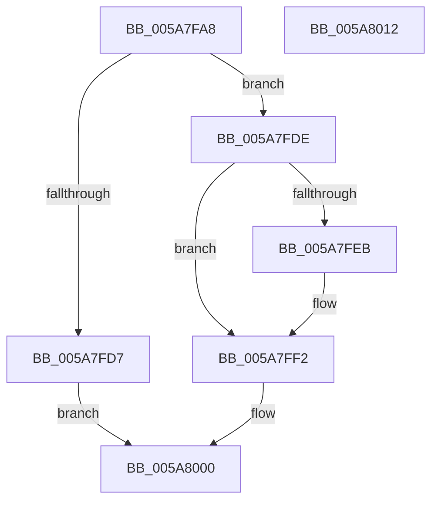

# PiDevCfgPushDriverNodeEntry

- RVA: `0x005A7FA8`–`0x005A8013` (길이 `107` bytes)
- VA: `0x00000001405A7FA8`
- 실행 섹션: `.text`
- PDB 이름 있음: `예`; PDB Function 태그: `아니요`
- unwind 정보 RVA: `0x00060BC4`
- 디코드: `32`개 명령, `107/107` bytes 표시
- 미해석 바이트: `0` (있으면 어셈블리에 `.byte`로 보존)

> 이 문서는 커널 이미지의 기계어와 PDB 기호를 분석해 생성했습니다. 4번과 5번은 함수 원형과 자료형을 바이너리 사용 방식에서 추정한 C 해석이며 원본 소스 복구 결과는 아닙니다.

## 1. Dependencies

- 직접 호출 지점: **1**; 고유 호출 대상: **1**
- 직접 호출자로 확인된 함수: **1**
- RIP 상대 이미지 참조: **0**

### Outgoing calls
- `0x005A7FCD` → [ExAllocatePool2](../../poolcode/B8/ExAllocatePool2_function_00B820F0.md) (function, `0x00B820F0`)

### Direct callers
- [PiDevCfgQueryIncludedDriverConfigurations](../../page/97/PiDevCfgQueryIncludedDriverConfigurations_function_009754BC.md) at `0x0097550E`
- [PiDevCfgQueryIncludedDriverConfigurations](../../page/97/PiDevCfgQueryIncludedDriverConfigurations_function_009754BC.md) at `0x009757BE`

### Static image references
- 디코드된 RIP-relative 메모리 참조가 없습니다.

## 2. Other-region calls and transfers

- 다른 실행 섹션으로 향하는 call: **1**
  - `0x005A7FCD` → [ExAllocatePool2](../../poolcode/B8/ExAllocatePool2_function_00B820F0.md) (`.text` → `POOLCODE`)
- 별도 외부 분기/꼬리 이동을 확인하지 못했습니다.

## 3. Assembly (complete function range)

```asm
005A7FA8  48 89 5C 24 08                  mov qword ptr [rsp + 8], rbx
005A7FAD  48 89 74 24 10                  mov qword ptr [rsp + 0x10], rsi
005A7FB2  57                              push rdi
005A7FB3  48 83 EC 20                     sub rsp, 0x20
005A7FB7  48 8B F2                        mov rsi, rdx
005A7FBA  48 8B D9                        mov rbx, rcx
005A7FBD  33 FF                           xor edi, edi
005A7FBF  B9 00 01 00 00                  mov ecx, 0x100
005A7FC4  41 B8 50 70 64 63               mov r8d, 0x63647050
005A7FCA  8D 57 18                        lea edx, [rdi + 0x18]
005A7FCD  E8 1E A1 5D 00                  call 0x140b820f0
005A7FD2  48 85 C0                        test rax, rax
005A7FD5  75 07                           jne 0x1405a7fde
005A7FD7  BF 9A 00 00 C0                  mov edi, 0xc000009a
005A7FDC  EB 22                           jmp 0x1405a8000
005A7FDE  48 89 70 10                     mov qword ptr [rax + 0x10], rsi
005A7FE2  48 8B 4B 08                     mov rcx, qword ptr [rbx + 8]
005A7FE6  48 39 19                        cmp qword ptr [rcx], rbx
005A7FE9  74 07                           je 0x1405a7ff2
005A7FEB  B9 03 00 00 00                  mov ecx, 3
005A7FF0  CD 29                           int 0x29
005A7FF2  48 89 18                        mov qword ptr [rax], rbx
005A7FF5  48 89 48 08                     mov qword ptr [rax + 8], rcx
005A7FF9  48 89 01                        mov qword ptr [rcx], rax
005A7FFC  48 89 43 08                     mov qword ptr [rbx + 8], rax
005A8000  48 8B 5C 24 30                  mov rbx, qword ptr [rsp + 0x30]
005A8005  8B C7                           mov eax, edi
005A8007  48 8B 74 24 38                  mov rsi, qword ptr [rsp + 0x38]
005A800C  48 83 C4 20                     add rsp, 0x20
005A8010  5F                              pop rdi
005A8011  C3                              ret
005A8012  CC                              int3
```

## 4. C-style interpretation (structured pseudocode)

```c
__int64 __fastcall PiDevCfgPushDriverNodeEntry(__int64 a1, __int64 a2)
{
    __int64 result;
    __int64 v_rdi;
    __int64 v_rsp;
    unsigned __int64 v_stack_p10;
    unsigned __int64 v_stack_p8;

    v_stack_p8 = v_rbx;
    v_stack_p10 = v_rsi;
    v_rsp = (v_rsp) - (32);
    v_rdi = 0;
    result = ExAllocatePool2(256, v_rdi + 24, (unsigned int)(0x63647050ULL), a4);
    if (result != 0) goto loc_005A7FDE;
    goto loc_005A8000;
loc_005A7FDE:
    *(unsigned __int64 *)(result + 16) = a2;
    if ((*(unsigned __int64 *)(*(unsigned __int64 *)(a1 + 8))) != a1) {
        a1 = 3;
    }
    *(unsigned __int64 *)(result) = a1;
    *(unsigned __int64 *)(result + 8) = a1;
    *(unsigned __int64 *)(a1) = result;
    *(unsigned __int64 *)(a1 + 8) = result;
loc_005A8000:
    v_rsp = (v_rsp) + (32);
    return (unsigned int)((unsigned int)((unsigned int)(0xC000009AULL)));
}
```

## 5. (Beta) C Style

```c
int64_t PiDevCfgPushDriverNodeEntry(void *Arg1, int64_t Arg2)
{
    uint8_t *arg1 = (uint8_t *)Arg1;

    int64_t result;
    int64_t local_rdi;
    int64_t local_rsp;
    uint64_t v_stack_p10;
    uint64_t v_stack_p8;

    v_stack_p8 = local_rbx;
    v_stack_p10 = local_rsi;
    local_rsp = (local_rsp) - (32);
    local_rdi = 0;
    result = ExAllocatePool2(256, local_rdi + 24, (uint32_t)(0x63647050ULL), a4);
    if (result != 0) goto loc_005A7FDE;
    goto loc_005A8000;
loc_005A7FDE:
    *(uint64_t *)(result + 0x10) = Arg2;
    if ((*(uint64_t *)(*(uint64_t *)(arg1 + 0x8))) != Arg1) {
        Arg1 = 3;
    }
    *(void **)(result) = Arg1;
    *(void **)(result + 0x8) = Arg1;
    *(uint64_t *)(arg1) = result;
    *(uint64_t *)(arg1 + 0x8) = result;
loc_005A8000:
    local_rsp = (local_rsp) + (32);
    return (uint32_t)((uint32_t)((uint32_t)(0xC000009AULL)));
}
```

### 관측된 메모리 오프셋

구조체 형식이 확인되지 않은 접근은 인자 기준의 오프셋으로만 기록했습니다.

| 기준 인자 | 오프셋 표현 | 폭 (bit) | 접근 |
|---|---:|---:|---|
| `Arg1` | `+ 0x8` | `64` | `R` |
| `Arg1` | `+ 0x8` | `64` | `W` |

## 6. Execution-region graph

[열기: 2D/3D 그래프와 함수 탐색 컨트롤 패널](../../../control-panel.html?section=text&rva=0x005A7FA8&view=graph)

- 2D 그래프는 위에서 아래로 흐르고, 3D 그래프는 빈 공간을 드래그해 회전합니다. Shift+드래그는 이동, 휠은 확대·축소, 함수 노드 선택은 대상 보고서 이동입니다.

### Static fallback


