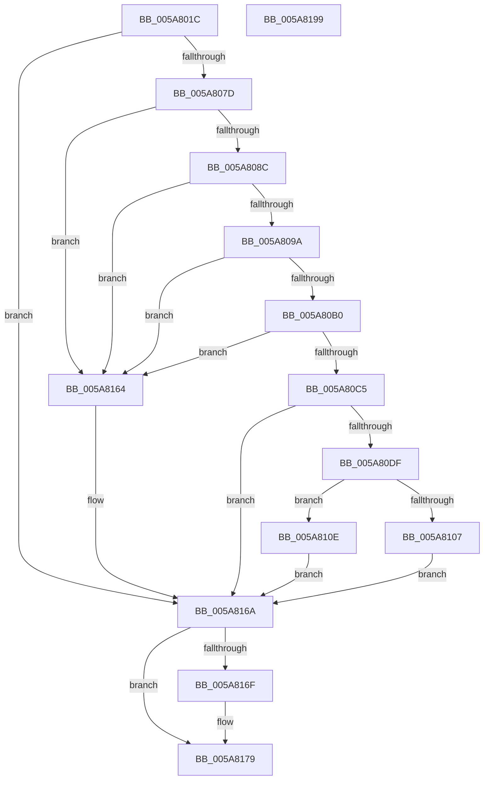

# PiDevCfgQueryResolveValue

- RVA: `0x005A801C`–`0x005A819A` (길이 `382` bytes)
- VA: `0x00000001405A801C`
- 실행 섹션: `.text`
- PDB 이름 있음: `예`; PDB Function 태그: `아니요`
- unwind 정보 RVA: `0x000C8B64`
- 디코드: `111`개 명령, `382/382` bytes 표시
- 미해석 바이트: `0` (있으면 어셈블리에 `.byte`로 보존)

> 이 문서는 커널 이미지의 기계어와 PDB 기호를 분석해 생성했습니다. 4번과 5번은 함수 원형과 자료형을 바이너리 사용 방식에서 추정한 C 해석이며 원본 소스 복구 결과는 아닙니다.

## 1. Dependencies

- 직접 호출 지점: **8**; 고유 호출 대상: **7**
- 직접 호출자로 확인된 함수: **2**
- RIP 상대 이미지 참조: **0**

### Outgoing calls
- `0x005A806A` → [IopGetRegistryValue](../../page/99/IopGetRegistryValue_function_009990EC.md) (function, `0x009990EC`)
- `0x005A80A3` → [PnpValidateStringData](../4B/PnpValidateStringData_function_004B7678.md) (function, `0x004B7678`)
- `0x005A80B8` → [PiDevCfgParseVariableName](../42/PiDevCfgParseVariableName_function_0042A6CC.md) (function, `0x0042A6CC`)
- `0x005A80D0` → [PiDevCfgResolveVariable](../../page/A8/PiDevCfgResolveVariable_function_00A81AB8.md) (function, `0x00A81AB8`)
- `0x005A80FA` → [ExAllocatePool2](../../poolcode/B8/ExAllocatePool2_function_00B820F0.md) (function, `0x00B820F0`)
- `0x005A813B` → [memcpy](../6C/memcpy_function_006C6840.md) (function, `0x006C6840`)
- `0x005A815A` → [memcpy](../6C/memcpy_function_006C6840.md) (function, `0x006C6840`)
- `0x005A8174` → [ExFreePoolWithTag](../../poolcode/B8/ExFreePoolWithTag_function_00B82870.md) (function, `0x00B82870`)

### Direct callers
- [PiDevCfgConfigureDeviceKeys](../../page/96/PiDevCfgConfigureDeviceKeys_function_00964BA8.md) at `0x00964D1C`
- [PiDevCfgConfigureDeviceKeys](../../page/96/PiDevCfgConfigureDeviceKeys_function_00964BA8.md) at `0x00964D58`
- [PiDevCfgConfigureDeviceKeys](../../page/96/PiDevCfgConfigureDeviceKeys_function_00964BA8.md) at `0x00964D99`
- [PiDevCfgVerifyDeviceAllowed](../../page/96/PiDevCfgVerifyDeviceAllowed_function_009664E4.md) at `0x00966592`

### Static image references
- 디코드된 RIP-relative 메모리 참조가 없습니다.

## 2. Other-region calls and transfers

- 다른 실행 섹션으로 향하는 call: **4**
  - `0x005A806A` → [IopGetRegistryValue](../../page/99/IopGetRegistryValue_function_009990EC.md) (`.text` → `PAGE`)
  - `0x005A80D0` → [PiDevCfgResolveVariable](../../page/A8/PiDevCfgResolveVariable_function_00A81AB8.md) (`.text` → `PAGE`)
  - `0x005A80FA` → [ExAllocatePool2](../../poolcode/B8/ExAllocatePool2_function_00B820F0.md) (`.text` → `POOLCODE`)
  - `0x005A8174` → [ExFreePoolWithTag](../../poolcode/B8/ExFreePoolWithTag_function_00B82870.md) (`.text` → `POOLCODE`)
- 별도 외부 분기/꼬리 이동을 확인하지 못했습니다.

## 3. Assembly (complete function range)

```asm
005A801C  48 8B C4                        mov rax, rsp
005A801F  48 89 58 08                     mov qword ptr [rax + 8], rbx
005A8023  48 89 70 10                     mov qword ptr [rax + 0x10], rsi
005A8027  48 89 78 18                     mov qword ptr [rax + 0x18], rdi
005A802B  4C 89 60 20                     mov qword ptr [rax + 0x20], r12
005A802F  55                              push rbp
005A8030  41 56                           push r14
005A8032  41 57                           push r15
005A8034  48 8B EC                        mov rbp, rsp
005A8037  48 83 EC 50                     sub rsp, 0x50
005A803B  49 8B C0                        mov rax, r8
005A803E  4C 8B D2                        mov r10, rdx
005A8041  45 33 E4                        xor r12d, r12d
005A8044  4D 8B F9                        mov r15, r9
005A8047  48 8B F1                        mov rsi, rcx
005A804A  4C 89 65 D8                     mov qword ptr [rbp - 0x28], r12
005A804E  0F 57 C0                        xorps xmm0, xmm0
005A8051  44 89 65 D0                     mov dword ptr [rbp - 0x30], r12d
005A8055  48 8B D0                        mov rdx, rax
005A8058  4C 89 65 E0                     mov qword ptr [rbp - 0x20], r12
005A805C  49 8B CA                        mov rcx, r10
005A805F  4C 8D 4D D8                     lea r9, [rbp - 0x28]
005A8063  45 33 C0                        xor r8d, r8d
005A8066  0F 11 45 E8                     movups xmmword ptr [rbp - 0x18], xmm0
005A806A  E8 7D 10 3F 00                  call 0x1409990ec
005A806F  48 8B 5D D8                     mov rbx, qword ptr [rbp - 0x28]
005A8073  8B F8                           mov edi, eax
005A8075  85 C0                           test eax, eax
005A8077  0F 88 ED 00 00 00               js 0x1405a816a
005A807D  66 44 89 63 06                  mov word ptr [rbx + 6], r12w
005A8082  4C 39 66 10                     cmp qword ptr [rsi + 0x10], r12
005A8086  0F 84 D8 00 00 00               je 0x1405a8164
005A808C  8B 4B 04                        mov ecx, dword ptr [rbx + 4]
005A808F  FF C9                           dec ecx
005A8091  83 F9 01                        cmp ecx, 1
005A8094  0F 87 CA 00 00 00               ja 0x1405a8164
005A809A  8B 4B 08                        mov ecx, dword ptr [rbx + 8]
005A809D  8B 53 0C                        mov edx, dword ptr [rbx + 0xc]
005A80A0  48 03 CB                        add rcx, rbx
005A80A3  E8 D0 F5 F0 FF                  call 0x1404b7678
005A80A8  84 C0                           test al, al
005A80AA  0F 84 B4 00 00 00               je 0x1405a8164
005A80B0  4C 8D 45 D0                     lea r8, [rbp - 0x30]
005A80B4  48 8D 55 E8                     lea rdx, [rbp - 0x18]
005A80B8  E8 0F 26 E8 FF                  call 0x14042a6cc
005A80BD  84 C0                           test al, al
005A80BF  0F 84 9F 00 00 00               je 0x1405a8164
005A80C5  48 8B 55 F0                     mov rdx, qword ptr [rbp - 0x10]
005A80C9  4C 8D 45 E0                     lea r8, [rbp - 0x20]
005A80CD  48 8B CE                        mov rcx, rsi
005A80D0  E8 E3 99 4D 00                  call 0x140a81ab8
005A80D5  8B F8                           mov edi, eax
005A80D7  85 C0                           test eax, eax
005A80D9  0F 88 8B 00 00 00               js 0x1405a816a
005A80DF  8B 53 10                        mov edx, dword ptr [rbx + 0x10]
005A80E2  41 B8 50 70 64 63               mov r8d, 0x63647050
005A80E8  4C 8B 75 E0                     mov r14, qword ptr [rbp - 0x20]
005A80EC  41 8B 4E 24                     mov ecx, dword ptr [r14 + 0x24]
005A80F0  83 C1 1A                        add ecx, 0x1a
005A80F3  03 D1                           add edx, ecx
005A80F5  B9 00 01 00 00                  mov ecx, 0x100
005A80FA  E8 F1 9F 5D 00                  call 0x140b820f0
005A80FF  48 8B F0                        mov rsi, rax
005A8102  48 85 C0                        test rax, rax
005A8105  75 07                           jne 0x1405a810e
005A8107  BF 9A 00 00 C0                  mov edi, 0xc000009a
005A810C  EB 5C                           jmp 0x1405a816a
005A810E  8B 03                           mov eax, dword ptr [rbx]
005A8110  48 8D 53 14                     lea rdx, [rbx + 0x14]
005A8114  89 06                           mov dword ptr [rsi], eax
005A8116  48 8D 4E 14                     lea rcx, [rsi + 0x14]
005A811A  8B 43 10                        mov eax, dword ptr [rbx + 0x10]
005A811D  89 46 10                        mov dword ptr [rsi + 0x10], eax
005A8120  41 8B 46 20                     mov eax, dword ptr [r14 + 0x20]
005A8124  89 46 04                        mov dword ptr [rsi + 4], eax
005A8127  41 8B 46 24                     mov eax, dword ptr [r14 + 0x24]
005A812B  89 46 0C                        mov dword ptr [rsi + 0xc], eax
005A812E  8B 43 10                        mov eax, dword ptr [rbx + 0x10]
005A8131  83 C0 16                        add eax, 0x16
005A8134  89 46 08                        mov dword ptr [rsi + 8], eax
005A8137  44 8B 43 10                     mov r8d, dword ptr [rbx + 0x10]
005A813B  E8 00 E7 11 00                  call 0x1406c6840
005A8140  8B 43 10                        mov eax, dword ptr [rbx + 0x10]
005A8143  48 D1 E8                        shr rax, 1
005A8146  66 44 89 64 43 14               mov word ptr [rbx + rax*2 + 0x14], r12w
005A814C  8B 4E 08                        mov ecx, dword ptr [rsi + 8]
005A814F  45 8B 46 24                     mov r8d, dword ptr [r14 + 0x24]
005A8153  48 03 CE                        add rcx, rsi
005A8156  49 8B 56 28                     mov rdx, qword ptr [r14 + 0x28]
005A815A  E8 E1 E6 11 00                  call 0x1406c6840
005A815F  49 89 37                        mov qword ptr [r15], rsi
005A8162  EB 06                           jmp 0x1405a816a
005A8164  49 89 1F                        mov qword ptr [r15], rbx
005A8167  49 8B DC                        mov rbx, r12
005A816A  48 85 DB                        test rbx, rbx
005A816D  74 0A                           je 0x1405a8179
005A816F  33 D2                           xor edx, edx
005A8171  48 8B CB                        mov rcx, rbx
005A8174  E8 F7 A6 5D 00                  call 0x140b82870
005A8179  4C 8D 5C 24 50                  lea r11, [rsp + 0x50]
005A817E  8B C7                           mov eax, edi
005A8180  49 8B 5B 20                     mov rbx, qword ptr [r11 + 0x20]
005A8184  49 8B 73 28                     mov rsi, qword ptr [r11 + 0x28]
005A8188  49 8B 7B 30                     mov rdi, qword ptr [r11 + 0x30]
005A818C  4D 8B 63 38                     mov r12, qword ptr [r11 + 0x38]
005A8190  49 8B E3                        mov rsp, r11
005A8193  41 5F                           pop r15
005A8195  41 5E                           pop r14
005A8197  5D                              pop rbp
005A8198  C3                              ret
005A8199  CC                              int3
```

## 4. C-style interpretation (structured pseudocode)

```c
__int64 __fastcall PiDevCfgQueryResolveValue(__int64 a1, __int64 a2, __int64 a3, __int64 a4)
{
    __int64 result;
    __int64 v_r12;
    __int64 v_rsp;
    unsigned __int64 v_stack_m18;
    unsigned __int64 v_stack_m28;
    unsigned __int64 v_stack_m30;
    unsigned __int64 v_stack_m38;
    unsigned __int64 v_stack_m40;
    unsigned int v_stack_m48;

    *(unsigned __int64 *)(v_rsp + 8) = v_rbx;
    *(unsigned __int64 *)(v_rsp + 16) = v_rsi;
    *(unsigned __int64 *)(v_rsp + 24) = v_rdi;
    *(unsigned __int64 *)(v_rsp + 32) = v_r12;
    v_rsp = (v_rsp) - (80);
    v_r12 = 0;
    v_stack_m40 = 0;
    v_stack_m48 = 0;
    v_stack_m38 = 0;
    a3 = 0;
    v_stack_m30 = v_xmm0;
    result = IopGetRegistryValue(a2, a3, a3, v_stack_m40);
    if (sign_flag) goto loc_005A816A;
    *(unsigned __int16 *)(v_stack_m40 + 6) = 0;
    if ((*(unsigned __int64 *)(a1 + 16)) == 0) goto loc_005A8164;
    a1 = (unsigned int)(((unsigned int)(*(unsigned int *)(v_stack_m40 + 4))) - 1);
    if (((unsigned int)(a1)) > 1) goto loc_005A8164;
    a1 = ((unsigned int)(*(unsigned int *)(v_stack_m40 + 8))) + (v_stack_m40);
    result = PnpValidateStringData(a1, (unsigned int)(*(unsigned int *)(v_stack_m40 + 12)), a3, v_stack_m40);
    if ((unsigned __int8)(result) == 0) goto loc_005A8164;
    result = PiDevCfgParseVariableName(a1, v_stack_m30, v_stack_m48, v_stack_m40);
    if ((unsigned __int8)(result) == 0) goto loc_005A8164;
    result = PiDevCfgResolveVariable(a1, v_stack_m28, v_stack_m38, v_stack_m40);
    if (sign_flag) goto loc_005A816A;
    a1 = (unsigned int)(((unsigned int)(*(unsigned int *)(v_stack_m38 + 36))) + (26));
    a2 = (unsigned int)(((unsigned int)(*(unsigned int *)(v_stack_m40 + 16))) + ((unsigned int)(a1)));
    result = ExAllocatePool2(256, a2, (unsigned int)(0x63647050ULL), v_stack_m40);
    if (result != 0) goto loc_005A810E;
    goto loc_005A816A;
loc_005A810E:
    *(unsigned int *)(result) = (unsigned int)((unsigned int)(*(unsigned int *)(v_stack_m40)));
    *(unsigned int *)(result + 16) = (unsigned int)((unsigned int)(*(unsigned int *)(v_stack_m40 + 16)));
    *(unsigned int *)(result + 4) = (unsigned int)((unsigned int)(*(unsigned int *)(v_stack_m38 + 32)));
    *(unsigned int *)(result + 12) = (unsigned int)((unsigned int)(*(unsigned int *)(v_stack_m38 + 36)));
    result = (unsigned int)(((unsigned int)(*(unsigned int *)(v_stack_m40 + 16))) + (22));
    *(unsigned int *)(result + 8) = (unsigned int)(result);
    result = memcpy(result + 20, v_stack_m40 + 20, (unsigned int)(*(unsigned int *)(v_stack_m40 + 16)), v_stack_m40);
    result = ((unsigned int)(*(unsigned int *)(v_stack_m40 + 16))) >> (1);
    *(unsigned __int16 *)(v_stack_m40 + result * 2 + 20) = 0;
    a1 = ((unsigned int)(*(unsigned int *)(result + 8))) + (result);
    result = memcpy(a1, *(unsigned __int64 *)(v_stack_m38 + 40), (unsigned int)(*(unsigned int *)(v_stack_m38 + 36)), v_stack_m40);
    *(unsigned __int64 *)(a4) = result;
    goto loc_005A816A;
loc_005A8164:
    *(unsigned __int64 *)(a4) = v_stack_m40;
loc_005A816A:
    if (0 != 0) {
        a2 = 0;
        a1 = 0;
        result = ExFreePoolWithTag(a1, a2, (unsigned int)(*(unsigned int *)(v_stack_m38 + 36)), v_stack_m40);
    }
    return (unsigned int)((unsigned int)((unsigned int)(0xC000009AULL)));
}
```

## 5. (Beta) C Style

```c
int64_t PiDevCfgQueryResolveValue(void *Arg1, int64_t Arg2, int64_t Arg3, void *Arg4)
{
    uint8_t *arg1 = (uint8_t *)Arg1;
    uint8_t *arg4 = (uint8_t *)Arg4;

    int64_t result;
    int64_t local_r12;
    int64_t local_rsp;
    uint64_t v_stack_m18;
    uint64_t v_stack_m28;
    uint64_t v_stack_m30;
    uint64_t v_stack_m38;
    uint64_t v_stack_m40;
    uint32_t v_stack_m48;

    *(uint64_t *)(local_rsp + 0x8) = local_rbx;
    *(uint64_t *)(local_rsp + 0x10) = local_rsi;
    *(uint64_t *)(local_rsp + 0x18) = local_rdi;
    *(uint64_t *)(local_rsp + 0x20) = local_r12;
    local_rsp = (local_rsp) - (80);
    local_r12 = 0;
    v_stack_m40 = 0;
    v_stack_m48 = 0;
    v_stack_m38 = 0;
    Arg3 = 0;
    v_stack_m30 = v_xmm0;
    result = IopGetRegistryValue(Arg2, Arg3, Arg3, v_stack_m40);
    if (sign_flag) goto loc_005A816A;
    *(uint16_t *)(v_stack_m40 + 0x6) = 0;
    if ((*(uint64_t *)(arg1 + 0x10)) == 0) goto loc_005A8164;
    Arg1 = (uint32_t)(((uint32_t)(*(uint32_t *)(v_stack_m40 + 0x4))) - 1);
    if (((uint32_t)(Arg1)) > 1) goto loc_005A8164;
    Arg1 = ((uint32_t)(*(uint32_t *)(v_stack_m40 + 0x8))) + (v_stack_m40);
    result = PnpValidateStringData(Arg1, (uint32_t)(*(uint32_t *)(v_stack_m40 + 0xC)), Arg3, v_stack_m40);
    if ((uint8_t)(result) == 0) goto loc_005A8164;
    result = PiDevCfgParseVariableName(Arg1, v_stack_m30, v_stack_m48, v_stack_m40);
    if ((uint8_t)(result) == 0) goto loc_005A8164;
    result = PiDevCfgResolveVariable(Arg1, v_stack_m28, v_stack_m38, v_stack_m40);
    if (sign_flag) goto loc_005A816A;
    Arg1 = (uint32_t)(((uint32_t)(*(uint32_t *)(v_stack_m38 + 0x24))) + (26));
    Arg2 = (uint32_t)(((uint32_t)(*(uint32_t *)(v_stack_m40 + 0x10))) + ((uint32_t)(Arg1)));
    result = ExAllocatePool2(256, Arg2, (uint32_t)(0x63647050ULL), v_stack_m40);
    if (result != 0) goto loc_005A810E;
    goto loc_005A816A;
loc_005A810E:
    *(uint32_t *)(result) = (uint32_t)((uint32_t)(*(uint32_t *)(v_stack_m40)));
    *(uint32_t *)(result + 0x10) = (uint32_t)((uint32_t)(*(uint32_t *)(v_stack_m40 + 0x10)));
    *(uint32_t *)(result + 0x4) = (uint32_t)((uint32_t)(*(uint32_t *)(v_stack_m38 + 0x20)));
    *(uint32_t *)(result + 0xC) = (uint32_t)((uint32_t)(*(uint32_t *)(v_stack_m38 + 0x24)));
    result = (uint32_t)(((uint32_t)(*(uint32_t *)(v_stack_m40 + 0x10))) + (22));
    *(uint32_t *)(result + 0x8) = (uint32_t)(result);
    result = memcpy(result + 20, v_stack_m40 + 20, (uint32_t)(*(uint32_t *)(v_stack_m40 + 0x10)), v_stack_m40);
    result = ((uint32_t)(*(uint32_t *)(v_stack_m40 + 0x10))) >> (1);
    *(uint16_t *)(v_stack_m40 + result * 2 + 0x14) = 0;
    Arg1 = ((uint32_t)(*(uint32_t *)(result + 0x8))) + (result);
    result = memcpy(Arg1, *(uint64_t *)(v_stack_m38 + 0x28), (uint32_t)(*(uint32_t *)(v_stack_m38 + 0x24)), v_stack_m40);
    *(uint64_t *)(arg4) = result;
    goto loc_005A816A;
loc_005A8164:
    *(uint64_t *)(arg4) = v_stack_m40;
loc_005A816A:
    if (0 != 0) {
        Arg2 = 0;
        Arg1 = 0;
        result = ExFreePoolWithTag(Arg1, Arg2, (uint32_t)(*(uint32_t *)(v_stack_m38 + 0x24)), v_stack_m40);
    }
    return (uint32_t)((uint32_t)((uint32_t)(0xC000009AULL)));
}
```

### 관측된 메모리 오프셋

구조체 형식이 확인되지 않은 접근은 인자 기준의 오프셋으로만 기록했습니다.

| 기준 인자 | 오프셋 표현 | 폭 (bit) | 접근 |
|---|---:|---:|---|
| `Arg1` | `+ 0x10` | `64` | `R` |
| `Arg4` | `+ 0x0` | `64` | `W` |

## 6. Execution-region graph

[열기: 2D/3D 그래프와 함수 탐색 컨트롤 패널](../../../control-panel.html?section=text&rva=0x005A801C&view=graph)

- 2D 그래프는 위에서 아래로 흐르고, 3D 그래프는 빈 공간을 드래그해 회전합니다. Shift+드래그는 이동, 휠은 확대·축소, 함수 노드 선택은 대상 보고서 이동입니다.

### Static fallback


