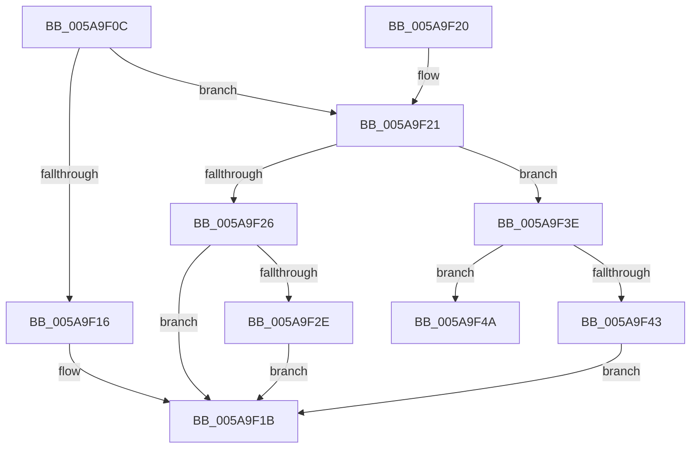

# PiDmaGuardInitialize

- RVA: `0x005A9F0C`–`0x005A9F51` (길이 `69` bytes)
- VA: `0x00000001405A9F0C`
- 실행 섹션: `.text`
- PDB 이름 있음: `예`; PDB Function 태그: `아니요`
- unwind 정보 RVA: `0x0008A250`
- 디코드: `21`개 명령, `69/69` bytes 표시
- 미해석 바이트: `0` (있으면 어셈블리에 `.byte`로 보존)

> 이 문서는 커널 이미지의 기계어와 PDB 기호를 분석해 생성했습니다. 4번과 5번은 함수 원형과 자료형을 바이너리 사용 방식에서 추정한 C 해석이며 원본 소스 복구 결과는 아닙니다.

## 1. Dependencies

- 직접 호출 지점: **2**; 고유 호출 대상: **2**
- 직접 호출자로 확인된 함수: **2**
- RIP 상대 이미지 참조: **3**

### Outgoing calls
- `0x005A9F16` → [PipDmgInitPhaseZero](../../init/C3/PipDmgInitPhaseZero_function_00C358C0.md) (function, `0x00C358C0`)
- `0x005A9F43` → [PipDmgInitPhaseTwo](../../page/73/PipDmgInitPhaseTwo_function_0073C07C.md) (function, `0x0073C07C`)

### Direct callers
- [PnpBootPhaseComplete](../../page/72/PnpBootPhaseComplete_function_00723A44.md) at `0x00723AAA`
- [IopInitializePlugPlayServices](../../init/C2/IopInitializePlugPlayServices_function_00C2F298.md) at `0x00C2FE89`
- [IopInitializePlugPlayServices](../../init/C2/IopInitializePlugPlayServices_function_00C2F298.md) at `0x00C2FFEC`

### Static image references
- `0x005A9F26` → RVA `0x00F8A9AC` (`.data`; read)
- `0x005A9F2E` → RVA `0x0073BE80` (`PipDmgConsoleUnlockCallback`; read)
- `0x005A9F35` → RVA `0x00F8A9A0` (`.data`; write)

## 2. Other-region calls and transfers

- 다른 실행 섹션으로 향하는 call: **2**
  - `0x005A9F16` → [PipDmgInitPhaseZero](../../init/C3/PipDmgInitPhaseZero_function_00C358C0.md) (`.text` → `INIT`)
  - `0x005A9F43` → [PipDmgInitPhaseTwo](../../page/73/PipDmgInitPhaseTwo_function_0073C07C.md) (`.text` → `PAGE`)
- 별도 외부 분기/꼬리 이동을 확인하지 못했습니다.

## 3. Assembly (complete function range)

```asm
005A9F0C  48 83 EC 28                     sub rsp, 0x28
005A9F10  33 C0                           xor eax, eax
005A9F12  85 C9                           test ecx, ecx
005A9F14  75 0B                           jne 0x1405a9f21
005A9F16  E8 A5 B9 68 00                  call 0x140c358c0
005A9F1B  48 83 C4 28                     add rsp, 0x28
005A9F1F  C3                              ret
005A9F20  CC                              int3
005A9F21  83 F9 01                        cmp ecx, 1
005A9F24  75 18                           jne 0x1405a9f3e
005A9F26  39 05 80 0A 9E 00               cmp dword ptr [rip + 0x9e0a80], eax
005A9F2C  74 ED                           je 0x1405a9f1b
005A9F2E  48 8D 0D 4B 1F 19 00            lea rcx, [rip + 0x191f4b]
005A9F35  48 89 0D 64 0A 9E 00            mov qword ptr [rip + 0x9e0a64], rcx
005A9F3C  EB DD                           jmp 0x1405a9f1b
005A9F3E  83 F9 02                        cmp ecx, 2
005A9F41  75 07                           jne 0x1405a9f4a
005A9F43  E8 34 21 19 00                  call 0x14073c07c
005A9F48  EB D1                           jmp 0x1405a9f1b
005A9F4A  B9 05 00 00 00                  mov ecx, 5
005A9F4F  CD 29                           int 0x29
```

## 4. C-style interpretation (structured pseudocode)

```c
__int64 __fastcall PiDmaGuardInitialize(int a1)
{
    __int64 result;
    __int64 v_rsp;

    v_rsp = (v_rsp) - (40);
    result = 0;
    if (a1 != 0) goto loc_005A9F21;
    result = PipDmgInitPhaseZero(a1, a2, a3, a4);
loc_005A9F1B:
    v_rsp = (v_rsp) + (40);
    return result;
loc_005A9F21:
    if (a1 != 1) goto loc_005A9F3E;
    if ((*(unsigned int *)(v_rip + 10357376)) == ((unsigned int)(result))) goto loc_005A9F1B;
    *(unsigned __int64 *)(v_rip + 10357348) = v_rip + 1646411;
    goto loc_005A9F1B;
loc_005A9F3E:
    if (((unsigned int)(v_rip + 1646411)) != 2) goto loc_005A9F4A;
    result = PipDmgInitPhaseTwo(v_rip + 1646411, a2, a3, a4);
    goto loc_005A9F1B;
loc_005A9F4A:
    return result;
}
```

## 5. (Beta) C Style

```c
int64_t PiDmaGuardInitialize(int32_t Arg1)
{
    int64_t result;
    int64_t local_rsp;

    local_rsp = (local_rsp) - (40);
    result = 0;
    if (Arg1 != 0) goto loc_005A9F21;
    result = PipDmgInitPhaseZero(Arg1, a2, a3, a4);
loc_005A9F1B:
    local_rsp = (local_rsp) + (40);
    return result;
loc_005A9F21:
    if (Arg1 != 1) goto loc_005A9F3E;
    if ((*(uint32_t *)(v_rip + 0x9E0A80)) == ((uint32_t)(result))) goto loc_005A9F1B;
    *(uint64_t *)(v_rip + 0x9E0A64) = v_rip + 1646411;
    goto loc_005A9F1B;
loc_005A9F3E:
    if (((uint32_t)(v_rip + 1646411)) != 2) goto loc_005A9F4A;
    result = PipDmgInitPhaseTwo(v_rip + 1646411, a2, a3, a4);
    goto loc_005A9F1B;
loc_005A9F4A:
    return result;
}
```

## 6. Execution-region graph

[열기: 2D/3D 그래프와 함수 탐색 컨트롤 패널](../../../control-panel.html?section=text&rva=0x005A9F0C&view=graph)

- 2D 그래프는 위에서 아래로 흐르고, 3D 그래프는 빈 공간을 드래그해 회전합니다. Shift+드래그는 이동, 휠은 확대·축소, 함수 노드 선택은 대상 보고서 이동입니다.

### Static fallback


