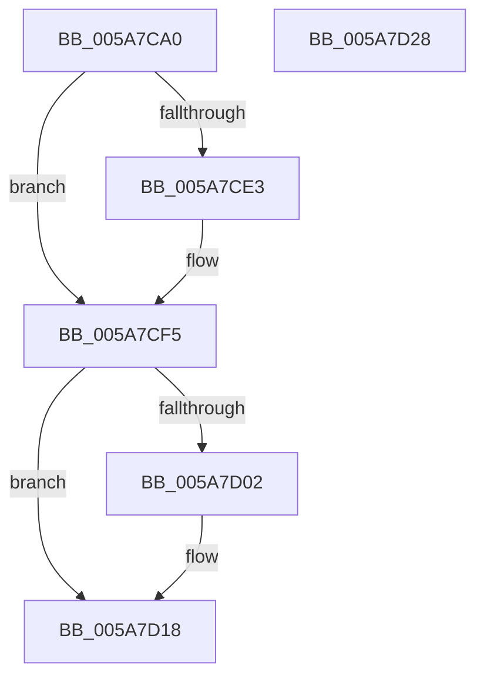

# PiDqIrpCancel

- RVA: `0x005A7CA0`–`0x005A7D29` (길이 `137` bytes)
- VA: `0x00000001405A7CA0`
- 실행 섹션: `.text`
- PDB 이름 있음: `예`; PDB Function 태그: `아니요`
- unwind 정보 RVA: `0x00060BC4`
- 디코드: `34`개 명령, `137/137` bytes 표시
- 미해석 바이트: `0` (있으면 어셈블리에 `.byte`로 보존)

> 이 문서는 커널 이미지의 기계어와 PDB 기호를 분석해 생성했습니다. 4번과 5번은 함수 원형과 자료형을 바이너리 사용 방식에서 추정한 C 해석이며 원본 소스 복구 결과는 아닙니다.

## 1. Dependencies

- 직접 호출 지점: **4**; 고유 호출 대상: **4**
- 직접 호출자로 확인된 함수: **0**
- RIP 상대 이미지 참조: **0**

### Outgoing calls
- `0x005A7CCC` → [KeReleaseQueuedSpinLock](../27/KeReleaseQueuedSpinLock_function_00272540.md) (function, `0x00272540`)
- `0x005A7CD4` → [PiDqQueryLock](../../page/8D/PiDqQueryLock_function_008DDA0C.md) (function, `0x008DDA0C`)
- `0x005A7CF8` → [PiDqQueryUnlock](../../page/8D/PiDqQueryUnlock_function_008DDA6C.md) (function, `0x008DDA6C`)
- `0x005A7D13` → [IofCompleteRequest](../29/IofCompleteRequest_function_0029B5C0.md) (function, `0x0029B5C0`)

### Direct callers
- 이 함수 시작 RVA로 연결되는 직접 call은 확인되지 않았습니다. 간접 호출은 완전히 역산할 수 없습니다.

### Static image references
- 디코드된 RIP-relative 메모리 참조가 없습니다.

## 2. Other-region calls and transfers

- 다른 실행 섹션으로 향하는 call: **2**
  - `0x005A7CD4` → [PiDqQueryLock](../../page/8D/PiDqQueryLock_function_008DDA0C.md) (`.text` → `PAGE`)
  - `0x005A7CF8` → [PiDqQueryUnlock](../../page/8D/PiDqQueryUnlock_function_008DDA6C.md) (`.text` → `PAGE`)
- 별도 외부 분기/꼬리 이동을 확인하지 못했습니다.

## 3. Assembly (complete function range)

```asm
005A7CA0  48 89 5C 24 08                  mov qword ptr [rsp + 8], rbx
005A7CA5  48 89 74 24 10                  mov qword ptr [rsp + 0x10], rsi
005A7CAA  57                              push rdi
005A7CAB  48 83 EC 20                     sub rsp, 0x20
005A7CAF  48 8B 82 B8 00 00 00            mov rax, qword ptr [rdx + 0xb8]
005A7CB6  48 8B FA                        mov rdi, rdx
005A7CB9  8A 52 45                        mov dl, byte ptr [rdx + 0x45]
005A7CBC  40 32 F6                        xor sil, sil
005A7CBF  48 8B 48 30                     mov rcx, qword ptr [rax + 0x30]
005A7CC3  48 8B 59 20                     mov rbx, qword ptr [rcx + 0x20]
005A7CC7  B9 07 00 00 00                  mov ecx, 7
005A7CCC  E8 6F A8 CC FF                  call 0x140272540
005A7CD1  48 8B CB                        mov rcx, rbx
005A7CD4  E8 33 5D 33 00                  call 0x1408dda0c
005A7CD9  48 83 BB B0 00 00 00 00         cmp qword ptr [rbx + 0xb0], 0
005A7CE1  74 12                           je 0x1405a7cf5
005A7CE3  83 A3 D8 00 00 00 EF            and dword ptr [rbx + 0xd8], 0xffffffef
005A7CEA  40 B6 01                        mov sil, 1
005A7CED  48 83 A3 B0 00 00 00 00         and qword ptr [rbx + 0xb0], 0
005A7CF5  48 8B CB                        mov rcx, rbx
005A7CF8  E8 6F 5D 33 00                  call 0x1408dda6c
005A7CFD  40 84 F6                        test sil, sil
005A7D00  74 16                           je 0x1405a7d18
005A7D02  48 83 67 38 00                  and qword ptr [rdi + 0x38], 0
005A7D07  33 D2                           xor edx, edx
005A7D09  48 8B CF                        mov rcx, rdi
005A7D0C  C7 47 30 20 01 00 C0            mov dword ptr [rdi + 0x30], 0xc0000120
005A7D13  E8 A8 38 CF FF                  call 0x14029b5c0
005A7D18  48 8B 5C 24 30                  mov rbx, qword ptr [rsp + 0x30]
005A7D1D  48 8B 74 24 38                  mov rsi, qword ptr [rsp + 0x38]
005A7D22  48 83 C4 20                     add rsp, 0x20
005A7D26  5F                              pop rdi
005A7D27  C3                              ret
005A7D28  CC                              int3
```

## 4. C-style interpretation (structured pseudocode)

```c
__int64 __fastcall PiDqIrpCancel(__int64 a1, __int64 a2)
{
    __int64 result;
    __int64 v_rsi;
    __int64 v_rsp;
    unsigned __int64 v_stack_p10;
    unsigned __int64 v_stack_p8;

    v_stack_p8 = v_rbx;
    v_stack_p10 = v_rsi;
    v_rsp = (v_rsp) - (32);
    v_rsi = 0;
    result = KeReleaseQueuedSpinLock(7, *(unsigned __int8 *)(a2 + 69), a3, a4);
    result = PiDqQueryLock(*(unsigned __int64 *)(*(unsigned __int64 *)(*(unsigned __int64 *)(a2 + 184) + 48) + 32), *(unsigned __int8 *)(a2 + 69), a3, a4);
    if ((*(unsigned __int64 *)(*(unsigned __int64 *)(*(unsigned __int64 *)(*(unsigned __int64 *)(a2 + 184) + 48) + 32) + 176)) != 0) {
        v_rsi = 1;
    }
    result = PiDqQueryUnlock(*(unsigned __int64 *)(*(unsigned __int64 *)(*(unsigned __int64 *)(a2 + 184) + 48) + 32), *(unsigned __int8 *)(a2 + 69), a3, a4);
    if ((unsigned __int8)(v_rsi) != 0) {
        a2 = 0;
        a1 = 0;
        *(unsigned int *)(a2 + 48) = 0xC0000120ULL;
        result = IofCompleteRequest(a1, a2, a3, a4);
    }
    v_rsp = (v_rsp) + (32);
    return result;
}
```

## 5. (Beta) C Style

```c
int64_t PiDqIrpCancel(int64_t Arg1, void *Arg2)
{
    uint8_t *arg2 = (uint8_t *)Arg2;

    int64_t result;
    int64_t local_rsi;
    int64_t local_rsp;
    uint64_t v_stack_p10;
    uint64_t v_stack_p8;

    v_stack_p8 = local_rbx;
    v_stack_p10 = local_rsi;
    local_rsp = (local_rsp) - (32);
    local_rsi = 0;
    result = KeReleaseQueuedSpinLock(7, *(uint8_t *)(arg2 + 0x45), a3, a4);
    result = PiDqQueryLock(*(uint64_t *)(*(uint64_t *)(*(uint64_t *)(arg2 + 0xB8) + 0x30) + 0x20), *(uint8_t *)(arg2 + 0x45), a3, a4);
    if ((*(uint64_t *)(*(uint64_t *)(*(uint64_t *)(*(uint64_t *)(arg2 + 0xB8) + 0x30) + 0x20) + 0xB0)) != 0) {
        local_rsi = 1;
    }
    result = PiDqQueryUnlock(*(uint64_t *)(*(uint64_t *)(*(uint64_t *)(arg2 + 0xB8) + 0x30) + 0x20), *(uint8_t *)(arg2 + 0x45), a3, a4);
    if ((uint8_t)(local_rsi) != 0) {
        Arg2 = 0;
        Arg1 = 0;
        *(uint32_t *)(arg2 + 0x30) = 0xC0000120ULL;
        result = IofCompleteRequest(Arg1, Arg2, a3, a4);
    }
    local_rsp = (local_rsp) + (32);
    return result;
}
```

### 관측된 메모리 오프셋

구조체 형식이 확인되지 않은 접근은 인자 기준의 오프셋으로만 기록했습니다.

| 기준 인자 | 오프셋 표현 | 폭 (bit) | 접근 |
|---|---:|---:|---|
| `Arg2` | `+ 0x30` | `32` | `W` |
| `Arg2` | `+ 0x38` | `64` | `R/W` |
| `Arg2` | `+ 0x45` | `8` | `R` |
| `Arg2` | `+ 0xB8` | `64` | `R` |

## 6. Execution-region graph

[열기: 2D/3D 그래프와 함수 탐색 컨트롤 패널](../../../control-panel.html?section=text&rva=0x005A7CA0&view=graph)

- 2D 그래프는 위에서 아래로 흐르고, 3D 그래프는 빈 공간을 드래그해 회전합니다. Shift+드래그는 이동, 휠은 확대·축소, 함수 노드 선택은 대상 보고서 이동입니다.

### Static fallback


