# PiProcessDeviceResetAction

- RVA: `0x005A5CD8`–`0x005A5F4B` (길이 `627` bytes)
- VA: `0x00000001405A5CD8`
- 실행 섹션: `.text`
- PDB 이름 있음: `예`; PDB Function 태그: `아니요`
- unwind 정보 RVA: `0x000C851C`
- 디코드: `168`개 명령, `627/627` bytes 표시
- 미해석 바이트: `0` (있으면 어셈블리에 `.byte`로 보존)

> 이 문서는 커널 이미지의 기계어와 PDB 기호를 분석해 생성했습니다. 4번과 5번은 함수 원형과 자료형을 바이너리 사용 방식에서 추정한 C 해석이며 원본 소스 복구 결과는 아닙니다.

## 1. Dependencies

- 직접 호출 지점: **16**; 고유 호출 대상: **6**
- 직접 호출자로 확인된 함수: **1**
- RIP 상대 이미지 참조: **2**

### Outgoing calls
- `0x005A5D47` → [McTemplateK0zq_EtwWriteTransfer](../42/McTemplateK0zq_EtwWriteTransfer_function_00424958.md) (function, `0x00424958`)
- `0x005A5D54` → [IopQueueDeviceResetEvent](../../page/72/IopQueueDeviceResetEvent_function_0072AB14.md) (function, `0x0072AB14`)
- `0x005A5D63` → [PnpTraceRequestDeviceRemovalForReset](../../page/73/PnpTraceRequestDeviceRemovalForReset_function_0073D108.md) (function, `0x0073D108`)
- `0x005A5D7C` → [IopLogDeviceResetComplete](../../page/72/IopLogDeviceResetComplete_function_0072A914.md) (function, `0x0072A914`)
- `0x005A5DA0` → [IoAddTriageDumpDataBlock](../42/IoAddTriageDumpDataBlock_function_00428374.md) (function, `0x00428374`)
- `0x005A5DB6` → [IoAddTriageDumpDataBlock](../42/IoAddTriageDumpDataBlock_function_00428374.md) (function, `0x00428374`)
- `0x005A5DCE` → [IoAddTriageDumpDataBlock](../42/IoAddTriageDumpDataBlock_function_00428374.md) (function, `0x00428374`)
- `0x005A5DE3` → [IoAddTriageDumpDataBlock](../42/IoAddTriageDumpDataBlock_function_00428374.md) (function, `0x00428374`)
- `0x005A5E12` → [IoAddTriageDumpDataBlock](../42/IoAddTriageDumpDataBlock_function_00428374.md) (function, `0x00428374`)
- `0x005A5E23` → [IoAddTriageDumpDataBlock](../42/IoAddTriageDumpDataBlock_function_00428374.md) (function, `0x00428374`)
- `0x005A5E30` → [IoAddTriageDumpDataBlock](../42/IoAddTriageDumpDataBlock_function_00428374.md) (function, `0x00428374`)
- `0x005A5E6F` → [IoAddTriageDumpDataBlock](../42/IoAddTriageDumpDataBlock_function_00428374.md) (function, `0x00428374`)
- `0x005A5E9B` → [IoAddTriageDumpDataBlock](../42/IoAddTriageDumpDataBlock_function_00428374.md) (function, `0x00428374`)
- `0x005A5EF8` → [IoAddTriageDumpDataBlock](../42/IoAddTriageDumpDataBlock_function_00428374.md) (function, `0x00428374`)
- `0x005A5F2C` → [IoAddTriageDumpDataBlock](../42/IoAddTriageDumpDataBlock_function_00428374.md) (function, `0x00428374`)
- `0x005A5F45` → [KeBugCheckEx](../4F/KeBugCheckEx_function_004FD660.md) (function, `0x004FD660`)

### Direct callers
- [sub_006F45AA](../6F/Unknown_function_006F45AA.md) at `0x006F46EB`

### Static image references
- `0x005A5D24` → RVA `0x00EF012C` (`.data`; read)
- `0x005A5D39` → RVA `0x00026F20` (`.rdata`; read)

## 2. Other-region calls and transfers

- 다른 실행 섹션으로 향하는 call: **3**
  - `0x005A5D54` → [IopQueueDeviceResetEvent](../../page/72/IopQueueDeviceResetEvent_function_0072AB14.md) (`.text` → `PAGE`)
  - `0x005A5D63` → [PnpTraceRequestDeviceRemovalForReset](../../page/73/PnpTraceRequestDeviceRemovalForReset_function_0073D108.md) (`.text` → `PAGE`)
  - `0x005A5D7C` → [IopLogDeviceResetComplete](../../page/72/IopLogDeviceResetComplete_function_0072A914.md) (`.text` → `PAGE`)
- 별도 외부 분기/꼬리 이동을 확인하지 못했습니다.

## 3. Assembly (complete function range)

```asm
005A5CD8  48 89 5C 24 10                  mov qword ptr [rsp + 0x10], rbx
005A5CDD  48 89 6C 24 18                  mov qword ptr [rsp + 0x18], rbp
005A5CE2  48 89 74 24 20                  mov qword ptr [rsp + 0x20], rsi
005A5CE7  57                              push rdi
005A5CE8  48 83 EC 30                     sub rsp, 0x30
005A5CEC  48 8B 79 10                     mov rdi, qword ptr [rcx + 0x10]
005A5CF0  33 ED                           xor ebp, ebp
005A5CF2  48 8B D9                        mov rbx, rcx
005A5CF5  BE 02 00 00 00                  mov esi, 2
005A5CFA  48 85 FF                        test rdi, rdi
005A5CFD  0F 84 2E 02 00 00               je 0x1405a5f31
005A5D03  48 8B 87 38 01 00 00            mov rax, qword ptr [rdi + 0x138]
005A5D0A  4C 8B 48 28                     mov r9, qword ptr [rax + 0x28]
005A5D0E  4D 85 C9                        test r9, r9
005A5D11  0F 84 82 00 00 00               je 0x1405a5d99
005A5D17  41 F7 81 8C 01 00 00 00 00 02 00  test dword ptr [r9 + 0x18c], 0x20000
005A5D22  75 75                           jne 0x1405a5d99
005A5D24  F6 05 01 A4 94 00 08            test byte ptr [rip + 0x94a401], 8
005A5D2B  8B 71 28                        mov esi, dword ptr [rcx + 0x28]
005A5D2E  40 88 6C 24 40                  mov byte ptr [rsp + 0x40], bpl
005A5D33  74 17                           je 0x1405a5d4c
005A5D35  4D 8B 49 30                     mov r9, qword ptr [r9 + 0x30]
005A5D39  48 8D 15 E0 11 A8 FF            lea rdx, [rip - 0x57ee20]
005A5D40  45 33 C0                        xor r8d, r8d
005A5D43  89 74 24 20                     mov dword ptr [rsp + 0x20], esi
005A5D47  E8 0C EC E7 FF                  call 0x140424958
005A5D4C  48 8D 54 24 40                  lea rdx, [rsp + 0x40]
005A5D51  48 8B CF                        mov rcx, rdi
005A5D54  E8 BB 4D 18 00                  call 0x14072ab14
005A5D59  44 8B C0                        mov r8d, eax
005A5D5C  8B D6                           mov edx, esi
005A5D5E  48 8B CF                        mov rcx, rdi
005A5D61  8B D8                           mov ebx, eax
005A5D63  E8 A0 73 19 00                  call 0x14073d108
005A5D68  40 38 6C 24 40                  cmp byte ptr [rsp + 0x40], bpl
005A5D6D  75 12                           jne 0x1405a5d81
005A5D6F  48 8B 8F 38 01 00 00            mov rcx, qword ptr [rdi + 0x138]
005A5D76  8B D3                           mov edx, ebx
005A5D78  48 8B 49 28                     mov rcx, qword ptr [rcx + 0x28]
005A5D7C  E8 93 4B 18 00                  call 0x14072a914
005A5D81  48 8B 6C 24 50                  mov rbp, qword ptr [rsp + 0x50]
005A5D86  8B C3                           mov eax, ebx
005A5D88  48 8B 5C 24 48                  mov rbx, qword ptr [rsp + 0x48]
005A5D8D  48 8B 74 24 58                  mov rsi, qword ptr [rsp + 0x58]
005A5D92  48 83 C4 30                     add rsp, 0x30
005A5D96  5F                              pop rdi
005A5D97  C3                              ret
005A5D98  CC                              int3
005A5D99  0F B7 57 02                     movzx edx, word ptr [rdi + 2]
005A5D9D  48 8B CF                        mov rcx, rdi
005A5DA0  E8 CF 25 E8 FF                  call 0x140428374
005A5DA5  48 8B 43 10                     mov rax, qword ptr [rbx + 0x10]
005A5DA9  48 8B 48 08                     mov rcx, qword ptr [rax + 8]
005A5DAD  48 85 C9                        test rcx, rcx
005A5DB0  74 36                           je 0x1405a5de8
005A5DB2  0F BF 51 02                     movsx edx, word ptr [rcx + 2]
005A5DB6  E8 B9 25 E8 FF                  call 0x140428374
005A5DBB  48 8B 43 10                     mov rax, qword ptr [rbx + 0x10]
005A5DBF  48 8B 48 08                     mov rcx, qword ptr [rax + 8]
005A5DC3  48 83 C1 38                     add rcx, 0x38
005A5DC7  66 39 29                        cmp word ptr [rcx], bp
005A5DCA  74 1C                           je 0x1405a5de8
005A5DCC  8B D6                           mov edx, esi
005A5DCE  E8 A1 25 E8 FF                  call 0x140428374
005A5DD3  48 8B 43 10                     mov rax, qword ptr [rbx + 0x10]
005A5DD7  48 8B 48 08                     mov rcx, qword ptr [rax + 8]
005A5DDB  0F B7 51 38                     movzx edx, word ptr [rcx + 0x38]
005A5DDF  48 8B 49 40                     mov rcx, qword ptr [rcx + 0x40]
005A5DE3  E8 8C 25 E8 FF                  call 0x140428374
005A5DE8  48 8B 4B 10                     mov rcx, qword ptr [rbx + 0x10]
005A5DEC  48 85 C9                        test rcx, rcx
005A5DEF  0F 84 3C 01 00 00               je 0x1405a5f31
005A5DF5  48 8B 81 38 01 00 00            mov rax, qword ptr [rcx + 0x138]
005A5DFC  48 39 68 28                     cmp qword ptr [rax + 0x28], rbp
005A5E00  0F 84 2B 01 00 00               je 0x1405a5f31
005A5E06  48 8B 78 28                     mov rdi, qword ptr [rax + 0x28]
005A5E0A  BA 88 03 00 00                  mov edx, 0x388
005A5E0F  48 8B CF                        mov rcx, rdi
005A5E12  E8 5D 25 E8 FF                  call 0x140428374
005A5E17  66 39 6F 28                     cmp word ptr [rdi + 0x28], bp
005A5E1B  74 18                           je 0x1405a5e35
005A5E1D  8B D6                           mov edx, esi
005A5E1F  48 8D 4F 28                     lea rcx, [rdi + 0x28]
005A5E23  E8 4C 25 E8 FF                  call 0x140428374
005A5E28  0F B7 57 28                     movzx edx, word ptr [rdi + 0x28]
005A5E2C  48 8B 4F 30                     mov rcx, qword ptr [rdi + 0x30]
005A5E30  E8 3F 25 E8 FF                  call 0x140428374
005A5E35  48 8B 53 10                     mov rdx, qword ptr [rbx + 0x10]
005A5E39  48 8D 8A 38 01 00 00            lea rcx, [rdx + 0x138]
005A5E40  48 85 D2                        test rdx, rdx
005A5E43  74 09                           je 0x1405a5e4e
005A5E45  48 8B 01                        mov rax, qword ptr [rcx]
005A5E48  4C 8B 40 28                     mov r8, qword ptr [rax + 0x28]
005A5E4C  EB 03                           jmp 0x1405a5e51
005A5E4E  4C 8B C5                        mov r8, rbp
005A5E51  66 41 39 68 38                  cmp word ptr [r8 + 0x38], bp
005A5E56  74 48                           je 0x1405a5ea0
005A5E58  48 85 D2                        test rdx, rdx
005A5E5B  74 09                           je 0x1405a5e66
005A5E5D  48 8B 01                        mov rax, qword ptr [rcx]
005A5E60  48 8B 48 28                     mov rcx, qword ptr [rax + 0x28]
005A5E64  EB 03                           jmp 0x1405a5e69
005A5E66  48 8B CD                        mov rcx, rbp
005A5E69  48 83 C1 38                     add rcx, 0x38
005A5E6D  8B D6                           mov edx, esi
005A5E6F  E8 00 25 E8 FF                  call 0x140428374
005A5E74  48 8B 4B 10                     mov rcx, qword ptr [rbx + 0x10]
005A5E78  48 85 C9                        test rcx, rcx
005A5E7B  74 10                           je 0x1405a5e8d
005A5E7D  48 8B 81 38 01 00 00            mov rax, qword ptr [rcx + 0x138]
005A5E84  48 8B 50 28                     mov rdx, qword ptr [rax + 0x28]
005A5E88  48 8B CA                        mov rcx, rdx
005A5E8B  EB 06                           jmp 0x1405a5e93
005A5E8D  48 8B D5                        mov rdx, rbp
005A5E90  48 8B CD                        mov rcx, rbp
005A5E93  0F B7 52 38                     movzx edx, word ptr [rdx + 0x38]
005A5E97  48 8B 49 40                     mov rcx, qword ptr [rcx + 0x40]
005A5E9B  E8 D4 24 E8 FF                  call 0x140428374
005A5EA0  48 8B 53 10                     mov rdx, qword ptr [rbx + 0x10]
005A5EA4  48 8D 8A 38 01 00 00            lea rcx, [rdx + 0x138]
005A5EAB  48 85 D2                        test rdx, rdx
005A5EAE  74 09                           je 0x1405a5eb9
005A5EB0  48 8B 01                        mov rax, qword ptr [rcx]
005A5EB3  4C 8B 40 28                     mov r8, qword ptr [rax + 0x28]
005A5EB7  EB 03                           jmp 0x1405a5ebc
005A5EB9  4C 8B C5                        mov r8, rbp
005A5EBC  49 39 68 10                     cmp qword ptr [r8 + 0x10], rbp
005A5EC0  74 6F                           je 0x1405a5f31
005A5EC2  48 85 D2                        test rdx, rdx
005A5EC5  74 09                           je 0x1405a5ed0
005A5EC7  48 8B 01                        mov rax, qword ptr [rcx]
005A5ECA  48 8B 40 28                     mov rax, qword ptr [rax + 0x28]
005A5ECE  EB 03                           jmp 0x1405a5ed3
005A5ED0  48 8B C5                        mov rax, rbp
005A5ED3  48 8B 40 10                     mov rax, qword ptr [rax + 0x10]
005A5ED7  66 39 68 38                     cmp word ptr [rax + 0x38], bp
005A5EDB  74 54                           je 0x1405a5f31
005A5EDD  48 85 D2                        test rdx, rdx
005A5EE0  74 09                           je 0x1405a5eeb
005A5EE2  48 8B 01                        mov rax, qword ptr [rcx]
005A5EE5  48 8B 48 28                     mov rcx, qword ptr [rax + 0x28]
005A5EE9  EB 03                           jmp 0x1405a5eee
005A5EEB  48 8B CD                        mov rcx, rbp
005A5EEE  48 8B 49 10                     mov rcx, qword ptr [rcx + 0x10]
005A5EF2  8B D6                           mov edx, esi
005A5EF4  48 83 C1 38                     add rcx, 0x38
005A5EF8  E8 77 24 E8 FF                  call 0x140428374
005A5EFD  48 8B 4B 10                     mov rcx, qword ptr [rbx + 0x10]
005A5F01  48 85 C9                        test rcx, rcx
005A5F04  74 10                           je 0x1405a5f16
005A5F06  48 8B 81 38 01 00 00            mov rax, qword ptr [rcx + 0x138]
005A5F0D  48 8B 50 28                     mov rdx, qword ptr [rax + 0x28]
005A5F11  48 8B CA                        mov rcx, rdx
005A5F14  EB 06                           jmp 0x1405a5f1c
005A5F16  48 8B D5                        mov rdx, rbp
005A5F19  48 8B CD                        mov rcx, rbp
005A5F1C  48 8B 42 10                     mov rax, qword ptr [rdx + 0x10]
005A5F20  48 8B 49 10                     mov rcx, qword ptr [rcx + 0x10]
005A5F24  0F B7 50 38                     movzx edx, word ptr [rax + 0x38]
005A5F28  48 8B 49 40                     mov rcx, qword ptr [rcx + 0x40]
005A5F2C  E8 43 24 E8 FF                  call 0x140428374
005A5F31  4C 8B 43 10                     mov r8, qword ptr [rbx + 0x10]
005A5F35  45 33 C9                        xor r9d, r9d
005A5F38  48 8B D6                        mov rdx, rsi
005A5F3B  48 89 6C 24 20                  mov qword ptr [rsp + 0x20], rbp
005A5F40  B9 CA 00 00 00                  mov ecx, 0xca
005A5F45  E8 16 77 F5 FF                  call 0x1404fd660
005A5F4A  CC                              int3
```

## 4. C-style interpretation (structured pseudocode)

```c
__int64 __fastcall PiProcessDeviceResetAction(__int64 a1, __int64 a2, int a3)
{
    __int64 result;
    __int64 v_rbp;
    __int64 v_rsp;
    unsigned int v_stack_m18;
    unsigned __int64 v_stack_p10;
    unsigned __int64 v_stack_p18;
    unsigned __int64 v_stack_p20;
    unsigned __int8 v_stack_p8;

    v_stack_p10 = v_rbx;
    v_stack_p18 = v_rbp;
    v_stack_p20 = v_rsi;
    v_rsp = (v_rsp) - (48);
    v_rbp = 0;
    if (*(unsigned __int64 *)(a1 + 16) == 0) goto loc_005A5F31;
    if (*(unsigned __int64 *)(*(unsigned __int64 *)(*(unsigned __int64 *)(a1 + 16) + 312) + 40) == 0) goto loc_005A5D99;
    if (((*(unsigned int *)(*(unsigned __int64 *)(*(unsigned __int64 *)(*(unsigned __int64 *)(a1 + 16) + 312) + 40) + 396)) & (0x20000ULL)) != 0) goto loc_005A5D99;
    v_stack_p8 = 0;
    result = *(unsigned __int64 *)(*(unsigned __int64 *)(a1 + 16) + 312);
    if (((*(unsigned __int8 *)(v_rip + 9741313)) & (8)) != 0) {
        a4 = *(unsigned __int64 *)(*(unsigned __int64 *)(*(unsigned __int64 *)(*(unsigned __int64 *)(a1 + 16) + 312) + 40) + 48);
        a2 = v_rip - 5762592;
        a3 = 0;
        v_stack_m18 = (unsigned int)((unsigned int)(*(unsigned int *)(a1 + 40)));
        result = McTemplateK0zq_EtwWriteTransfer(a1, a2, a3, a4);
    }
    result = IopQueueDeviceResetEvent(*(unsigned __int64 *)(a1 + 16), v_stack_p8, a3, a4);
    result = PnpTraceRequestDeviceRemovalForReset(*(unsigned __int64 *)(a1 + 16), (unsigned int)((unsigned int)((unsigned int)(*(unsigned int *)(a1 + 40)))), (unsigned int)((unsigned int)(result)), a4);
    if (v_stack_p8 == 0) {
        a1 = *(unsigned __int64 *)(*(unsigned __int64 *)(a1 + 16) + 312);
        a2 = (unsigned int)((unsigned int)((unsigned int)(result)));
        a1 = *(unsigned __int64 *)(a1 + 40);
        result = IopLogDeviceResetComplete(a1, a2, (unsigned int)((unsigned int)(result)), a4);
    }
    v_rsp = (v_rsp) + (48);
    return (unsigned int)((unsigned int)((unsigned int)((unsigned int)(result))));
loc_005A5D99:
    result = IoAddTriageDumpDataBlock(*(unsigned __int64 *)(a1 + 16), *(unsigned __int16 *)(*(unsigned __int64 *)(a1 + 16) + 2), (unsigned int)((unsigned int)(result)), a4);
    if (*(unsigned __int64 *)(*(unsigned __int64 *)(v_stack_p10 + 16) + 8) == 0) goto loc_005A5DE8;
    result = IoAddTriageDumpDataBlock(*(unsigned __int64 *)(*(unsigned __int64 *)(v_stack_p10 + 16) + 8), (__int16)(*(unsigned __int16 *)(*(unsigned __int64 *)(*(unsigned __int64 *)(v_stack_p10 + 16) + 8) + 2)), (unsigned int)((unsigned int)(result)), a4);
    a1 = (*(unsigned __int64 *)(*(unsigned __int64 *)(v_stack_p10 + 16) + 8)) + (56);
    result = *(unsigned __int64 *)(v_stack_p10 + 16);
    if ((*(unsigned __int16 *)(a1)) != ((unsigned __int16)(v_stack_p18))) {
        a2 = (unsigned int)(v_stack_p20);
        result = IoAddTriageDumpDataBlock(a1, a2, (unsigned int)((unsigned int)(result)), a4);
        result = *(unsigned __int64 *)(v_stack_p10 + 16);
        a1 = *(unsigned __int64 *)(result + 8);
        a2 = *(unsigned __int16 *)(a1 + 56);
        a1 = *(unsigned __int64 *)(a1 + 64);
        result = IoAddTriageDumpDataBlock(a1, a2, (unsigned int)((unsigned int)(result)), a4);
    }
    if (*(unsigned __int64 *)(v_stack_p10 + 16) == 0) goto loc_005A5F31;
    if ((*(unsigned __int64 *)(*(unsigned __int64 *)(*(unsigned __int64 *)(v_stack_p10 + 16) + 312) + 40)) == v_stack_p18) goto loc_005A5F31;
    result = IoAddTriageDumpDataBlock(*(unsigned __int64 *)(*(unsigned __int64 *)(*(unsigned __int64 *)(v_stack_p10 + 16) + 312) + 40), 904, (unsigned int)((unsigned int)(result)), a4);
    if ((*(unsigned __int16 *)(*(unsigned __int64 *)(*(unsigned __int64 *)(*(unsigned __int64 *)(v_stack_p10 + 16) + 312) + 40) + 40)) != ((unsigned __int16)(v_stack_p18))) {
        a2 = (unsigned int)(v_stack_p20);
        a1 = *(unsigned __int64 *)(*(unsigned __int64 *)(*(unsigned __int64 *)(v_stack_p10 + 16) + 312) + 40) + 40;
        result = IoAddTriageDumpDataBlock(a1, a2, (unsigned int)((unsigned int)(result)), a4);
        a2 = *(unsigned __int16 *)(*(unsigned __int64 *)(*(unsigned __int64 *)(*(unsigned __int64 *)(v_stack_p10 + 16) + 312) + 40) + 40);
        a1 = *(unsigned __int64 *)(*(unsigned __int64 *)(*(unsigned __int64 *)(*(unsigned __int64 *)(v_stack_p10 + 16) + 312) + 40) + 48);
        result = IoAddTriageDumpDataBlock(a1, a2, (unsigned int)((unsigned int)(result)), a4);
    }
    if (*(unsigned __int64 *)(v_stack_p10 + 16) == 0) goto loc_005A5E4E;
    goto loc_005A5E51;
loc_005A5E4E:
loc_005A5E51:
    if ((*(unsigned __int16 *)(v_stack_p18 + 56)) == ((unsigned __int16)(v_stack_p18))) goto loc_005A5EA0;
    if (*(unsigned __int64 *)(v_stack_p10 + 16) == 0) goto loc_005A5E66;
    goto loc_005A5E69;
loc_005A5E66:
loc_005A5E69:
    a1 = (v_stack_p18) + (56);
    result = IoAddTriageDumpDataBlock(a1, (unsigned int)((unsigned int)(v_stack_p20)), v_stack_p18, a4);
    if (*(unsigned __int64 *)(v_stack_p10 + 16) == 0) goto loc_005A5E8D;
    goto loc_005A5E93;
loc_005A5E8D:
loc_005A5E93:
    result = IoAddTriageDumpDataBlock(*(unsigned __int64 *)(v_stack_p18 + 64), *(unsigned __int16 *)(v_stack_p18 + 56), v_stack_p18, a4);
loc_005A5EA0:
    if (*(unsigned __int64 *)(v_stack_p10 + 16) == 0) goto loc_005A5EB9;
    goto loc_005A5EBC;
loc_005A5EB9:
loc_005A5EBC:
    if ((*(unsigned __int64 *)(v_stack_p18 + 16)) == v_stack_p18) goto loc_005A5F31;
    if (*(unsigned __int64 *)(v_stack_p10 + 16) == 0) goto loc_005A5ED0;
    goto loc_005A5ED3;
loc_005A5ED0:
loc_005A5ED3:
    if ((*(unsigned __int16 *)(*(unsigned __int64 *)(v_stack_p18 + 16) + 56)) == ((unsigned __int16)(v_stack_p18))) goto loc_005A5F31;
    if (*(unsigned __int64 *)(v_stack_p10 + 16) == 0) goto loc_005A5EEB;
    goto loc_005A5EEE;
loc_005A5EEB:
loc_005A5EEE:
    a1 = (*(unsigned __int64 *)(v_stack_p18 + 16)) + (56);
    result = IoAddTriageDumpDataBlock(a1, (unsigned int)((unsigned int)(v_stack_p20)), v_stack_p18, a4);
    if (*(unsigned __int64 *)(v_stack_p10 + 16) == 0) goto loc_005A5F16;
    goto loc_005A5F1C;
loc_005A5F16:
loc_005A5F1C:
    result = IoAddTriageDumpDataBlock(*(unsigned __int64 *)(*(unsigned __int64 *)(v_stack_p18 + 16) + 64), *(unsigned __int16 *)(*(unsigned __int64 *)(v_stack_p18 + 16) + 56), v_stack_p18, a4);
loc_005A5F31:
    a4 = 0;
    v_stack_p20 = v_stack_p18;
    result = KeBugCheckEx(202, v_stack_p20, *(unsigned __int64 *)(v_stack_p10 + 16), a4);
    return result;
}
```

## 5. (Beta) C Style

```c
int64_t PiProcessDeviceResetAction(void *Arg1, int64_t Arg2, int32_t Arg3)
{
    uint8_t *arg1 = (uint8_t *)Arg1;

    int64_t result;
    int64_t local_rbp;
    int64_t local_rsp;
    uint32_t v_stack_m18;
    uint64_t v_stack_p10;
    uint64_t v_stack_p18;
    uint64_t v_stack_p20;
    uint8_t v_stack_p8;

    v_stack_p10 = local_rbx;
    v_stack_p18 = local_rbp;
    v_stack_p20 = local_rsi;
    local_rsp = (local_rsp) - (48);
    local_rbp = 0;
    if (*(uint64_t *)(arg1 + 0x10) == 0) goto loc_005A5F31;
    if (*(uint64_t *)(*(uint64_t *)(*(uint64_t *)(arg1 + 0x10) + 0x138) + 0x28) == 0) goto loc_005A5D99;
    if (((*(uint32_t *)(*(uint64_t *)(*(uint64_t *)(*(uint64_t *)(arg1 + 0x10) + 0x138) + 0x28) + 0x18C)) & (0x20000ULL)) != 0) goto loc_005A5D99;
    v_stack_p8 = 0;
    result = *(uint64_t *)(*(uint64_t *)(arg1 + 0x10) + 0x138);
    if (((*(uint8_t *)(v_rip + 0x94A401)) & (8)) != 0) {
        a4 = *(uint64_t *)(*(uint64_t *)(*(uint64_t *)(*(uint64_t *)(arg1 + 0x10) + 0x138) + 0x28) + 0x30);
        Arg2 = v_rip - 5762592;
        Arg3 = 0;
        v_stack_m18 = (uint32_t)((uint32_t)(*(uint32_t *)(arg1 + 0x28)));
        result = McTemplateK0zq_EtwWriteTransfer(Arg1, Arg2, Arg3, a4);
    }
    result = IopQueueDeviceResetEvent(*(uint64_t *)(arg1 + 0x10), v_stack_p8, Arg3, a4);
    result = PnpTraceRequestDeviceRemovalForReset(*(uint64_t *)(arg1 + 0x10), (uint32_t)((uint32_t)((uint32_t)(*(uint32_t *)(arg1 + 0x28)))), (uint32_t)((uint32_t)(result)), a4);
    if (v_stack_p8 == 0) {
        Arg1 = *(uint64_t *)(*(uint64_t *)(arg1 + 0x10) + 0x138);
        Arg2 = (uint32_t)((uint32_t)((uint32_t)(result)));
        Arg1 = *(uint64_t *)(arg1 + 0x28);
        result = IopLogDeviceResetComplete(Arg1, Arg2, (uint32_t)((uint32_t)(result)), a4);
    }
    local_rsp = (local_rsp) + (48);
    return (uint32_t)((uint32_t)((uint32_t)((uint32_t)(result))));
loc_005A5D99:
    result = IoAddTriageDumpDataBlock(*(uint64_t *)(arg1 + 0x10), *(uint16_t *)(*(uint64_t *)(arg1 + 0x10) + 0x2), (uint32_t)((uint32_t)(result)), a4);
    if (*(uint64_t *)(*(uint64_t *)(v_stack_p10 + 0x10) + 0x8) == 0) goto loc_005A5DE8;
    result = IoAddTriageDumpDataBlock(*(uint64_t *)(*(uint64_t *)(v_stack_p10 + 0x10) + 0x8), (int16_t)(*(uint16_t *)(*(uint64_t *)(*(uint64_t *)(v_stack_p10 + 0x10) + 0x8) + 0x2)), (uint32_t)((uint32_t)(result)), a4);
    Arg1 = (*(uint64_t *)(*(uint64_t *)(v_stack_p10 + 0x10) + 0x8)) + (56);
    result = *(uint64_t *)(v_stack_p10 + 0x10);
    if ((*(uint16_t *)(arg1)) != ((uint16_t)(v_stack_p18))) {
        Arg2 = (uint32_t)(v_stack_p20);
        result = IoAddTriageDumpDataBlock(Arg1, Arg2, (uint32_t)((uint32_t)(result)), a4);
        result = *(uint64_t *)(v_stack_p10 + 0x10);
        Arg1 = *(uint64_t *)(result + 0x8);
        Arg2 = *(uint16_t *)(arg1 + 0x38);
        Arg1 = *(uint64_t *)(arg1 + 0x40);
        result = IoAddTriageDumpDataBlock(Arg1, Arg2, (uint32_t)((uint32_t)(result)), a4);
    }
    if (*(uint64_t *)(v_stack_p10 + 0x10) == 0) goto loc_005A5F31;
    if ((*(uint64_t *)(*(uint64_t *)(*(uint64_t *)(v_stack_p10 + 0x10) + 0x138) + 0x28)) == v_stack_p18) goto loc_005A5F31;
    result = IoAddTriageDumpDataBlock(*(uint64_t *)(*(uint64_t *)(*(uint64_t *)(v_stack_p10 + 0x10) + 0x138) + 0x28), 904, (uint32_t)((uint32_t)(result)), a4);
    if ((*(uint16_t *)(*(uint64_t *)(*(uint64_t *)(*(uint64_t *)(v_stack_p10 + 0x10) + 0x138) + 0x28) + 0x28)) != ((uint16_t)(v_stack_p18))) {
        Arg2 = (uint32_t)(v_stack_p20);
        Arg1 = *(uint64_t *)(*(uint64_t *)(*(uint64_t *)(v_stack_p10 + 0x10) + 0x138) + 0x28) + 40;
        result = IoAddTriageDumpDataBlock(Arg1, Arg2, (uint32_t)((uint32_t)(result)), a4);
        Arg2 = *(uint16_t *)(*(uint64_t *)(*(uint64_t *)(*(uint64_t *)(v_stack_p10 + 0x10) + 0x138) + 0x28) + 0x28);
        Arg1 = *(uint64_t *)(*(uint64_t *)(*(uint64_t *)(*(uint64_t *)(v_stack_p10 + 0x10) + 0x138) + 0x28) + 0x30);
        result = IoAddTriageDumpDataBlock(Arg1, Arg2, (uint32_t)((uint32_t)(result)), a4);
    }
    if (*(uint64_t *)(v_stack_p10 + 0x10) == 0) goto loc_005A5E4E;
    goto loc_005A5E51;
loc_005A5E4E:
loc_005A5E51:
    if ((*(uint16_t *)(v_stack_p18 + 0x38)) == ((uint16_t)(v_stack_p18))) goto loc_005A5EA0;
    if (*(uint64_t *)(v_stack_p10 + 0x10) == 0) goto loc_005A5E66;
    goto loc_005A5E69;
loc_005A5E66:
loc_005A5E69:
    Arg1 = (v_stack_p18) + (56);
    result = IoAddTriageDumpDataBlock(Arg1, (uint32_t)((uint32_t)(v_stack_p20)), v_stack_p18, a4);
    if (*(uint64_t *)(v_stack_p10 + 0x10) == 0) goto loc_005A5E8D;
    goto loc_005A5E93;
loc_005A5E8D:
loc_005A5E93:
    result = IoAddTriageDumpDataBlock(*(uint64_t *)(v_stack_p18 + 0x40), *(uint16_t *)(v_stack_p18 + 0x38), v_stack_p18, a4);
loc_005A5EA0:
    if (*(uint64_t *)(v_stack_p10 + 0x10) == 0) goto loc_005A5EB9;
    goto loc_005A5EBC;
loc_005A5EB9:
loc_005A5EBC:
    if ((*(uint64_t *)(v_stack_p18 + 0x10)) == v_stack_p18) goto loc_005A5F31;
    if (*(uint64_t *)(v_stack_p10 + 0x10) == 0) goto loc_005A5ED0;
    goto loc_005A5ED3;
loc_005A5ED0:
loc_005A5ED3:
    if ((*(uint16_t *)(*(uint64_t *)(v_stack_p18 + 0x10) + 0x38)) == ((uint16_t)(v_stack_p18))) goto loc_005A5F31;
    if (*(uint64_t *)(v_stack_p10 + 0x10) == 0) goto loc_005A5EEB;
    goto loc_005A5EEE;
loc_005A5EEB:
loc_005A5EEE:
    Arg1 = (*(uint64_t *)(v_stack_p18 + 0x10)) + (56);
    result = IoAddTriageDumpDataBlock(Arg1, (uint32_t)((uint32_t)(v_stack_p20)), v_stack_p18, a4);
    if (*(uint64_t *)(v_stack_p10 + 0x10) == 0) goto loc_005A5F16;
    goto loc_005A5F1C;
loc_005A5F16:
loc_005A5F1C:
    result = IoAddTriageDumpDataBlock(*(uint64_t *)(*(uint64_t *)(v_stack_p18 + 0x10) + 0x40), *(uint16_t *)(*(uint64_t *)(v_stack_p18 + 0x10) + 0x38), v_stack_p18, a4);
loc_005A5F31:
    a4 = 0;
    v_stack_p20 = v_stack_p18;
    result = KeBugCheckEx(202, v_stack_p20, *(uint64_t *)(v_stack_p10 + 0x10), a4);
    return result;
}
```

### 관측된 메모리 오프셋

구조체 형식이 확인되지 않은 접근은 인자 기준의 오프셋으로만 기록했습니다.

| 기준 인자 | 오프셋 표현 | 폭 (bit) | 접근 |
|---|---:|---:|---|
| `Arg1` | `+ 0x10` | `64` | `R` |
| `Arg1` | `+ 0x28` | `32` | `R` |

## 6. Execution-region graph

[열기: 2D/3D 그래프와 함수 탐색 컨트롤 패널](../../../control-panel.html?section=text&rva=0x005A5CD8&view=graph)

- 2D 그래프는 위에서 아래로 흐르고, 3D 그래프는 빈 공간을 드래그해 회전합니다. Shift+드래그는 이동, 휠은 확대·축소, 함수 노드 선택은 대상 보고서 이동입니다.

### Static fallback

```mermaid
flowchart TD
  bb_005A5CD8[BB_005A5CD8]
  bb_005A5D03[BB_005A5D03]
  bb_005A5D17[BB_005A5D17]
  bb_005A5D24[BB_005A5D24]
  bb_005A5D35[BB_005A5D35]
  bb_005A5D4C[BB_005A5D4C]
  bb_005A5D6F[BB_005A5D6F]
  bb_005A5D81[BB_005A5D81]
  bb_005A5D98[BB_005A5D98]
  bb_005A5D99[BB_005A5D99]
  bb_005A5DB2[BB_005A5DB2]
  bb_005A5DCC[BB_005A5DCC]
  bb_005A5DE8[BB_005A5DE8]
  bb_005A5DF5[BB_005A5DF5]
  bb_005A5E06[BB_005A5E06]
  bb_005A5E1D[BB_005A5E1D]
  bb_005A5E35[BB_005A5E35]
  bb_005A5E45[BB_005A5E45]
  bb_005A5E4E[BB_005A5E4E]
  bb_005A5E51[BB_005A5E51]
  bb_005A5E58[BB_005A5E58]
  bb_005A5E5D[BB_005A5E5D]
  bb_005A5E66[BB_005A5E66]
  bb_005A5E69[BB_005A5E69]
  bb_005A5E7D[BB_005A5E7D]
  bb_005A5E8D[BB_005A5E8D]
  bb_005A5E93[BB_005A5E93]
  bb_005A5EA0[BB_005A5EA0]
  bb_005A5EB0[BB_005A5EB0]
  bb_005A5EB9[BB_005A5EB9]
  bb_005A5EBC[BB_005A5EBC]
  bb_005A5EC2[BB_005A5EC2]
  bb_005A5EC7[BB_005A5EC7]
  bb_005A5ED0[BB_005A5ED0]
  bb_005A5ED3[BB_005A5ED3]
  bb_005A5EDD[BB_005A5EDD]
  bb_005A5EE2[BB_005A5EE2]
  bb_005A5EEB[BB_005A5EEB]
  bb_005A5EEE[BB_005A5EEE]
  bb_005A5F06[BB_005A5F06]
  bb_005A5F16[BB_005A5F16]
  bb_005A5F1C[BB_005A5F1C]
  bb_005A5F31[BB_005A5F31]
  bb_005A5CD8 -->|branch| bb_005A5F31
  bb_005A5CD8 -->|fallthrough| bb_005A5D03
  bb_005A5D03 -->|branch| bb_005A5D99
  bb_005A5D03 -->|fallthrough| bb_005A5D17
  bb_005A5D17 -->|branch| bb_005A5D99
  bb_005A5D17 -->|fallthrough| bb_005A5D24
  bb_005A5D24 -->|branch| bb_005A5D4C
  bb_005A5D24 -->|fallthrough| bb_005A5D35
  bb_005A5D35 -->|flow| bb_005A5D4C
  bb_005A5D4C -->|branch| bb_005A5D81
  bb_005A5D4C -->|fallthrough| bb_005A5D6F
  bb_005A5D6F -->|flow| bb_005A5D81
  bb_005A5D98 -->|flow| bb_005A5D99
  bb_005A5D99 -->|branch| bb_005A5DE8
  bb_005A5D99 -->|fallthrough| bb_005A5DB2
  bb_005A5DB2 -->|branch| bb_005A5DE8
  bb_005A5DB2 -->|fallthrough| bb_005A5DCC
  bb_005A5DCC -->|flow| bb_005A5DE8
  bb_005A5DE8 -->|branch| bb_005A5F31
  bb_005A5DE8 -->|fallthrough| bb_005A5DF5
  bb_005A5DF5 -->|branch| bb_005A5F31
  bb_005A5DF5 -->|fallthrough| bb_005A5E06
  bb_005A5E06 -->|branch| bb_005A5E35
  bb_005A5E06 -->|fallthrough| bb_005A5E1D
  bb_005A5E1D -->|flow| bb_005A5E35
  bb_005A5E35 -->|branch| bb_005A5E4E
  bb_005A5E35 -->|fallthrough| bb_005A5E45
  bb_005A5E45 -->|branch| bb_005A5E51
  bb_005A5E4E -->|flow| bb_005A5E51
  bb_005A5E51 -->|branch| bb_005A5EA0
  bb_005A5E51 -->|fallthrough| bb_005A5E58
  bb_005A5E58 -->|branch| bb_005A5E66
  bb_005A5E58 -->|fallthrough| bb_005A5E5D
  bb_005A5E5D -->|branch| bb_005A5E69
  bb_005A5E66 -->|flow| bb_005A5E69
  bb_005A5E69 -->|branch| bb_005A5E8D
  bb_005A5E69 -->|fallthrough| bb_005A5E7D
  bb_005A5E7D -->|branch| bb_005A5E93
  bb_005A5E8D -->|flow| bb_005A5E93
  bb_005A5E93 -->|flow| bb_005A5EA0
  bb_005A5EA0 -->|branch| bb_005A5EB9
  bb_005A5EA0 -->|fallthrough| bb_005A5EB0
  bb_005A5EB0 -->|branch| bb_005A5EBC
  bb_005A5EB9 -->|flow| bb_005A5EBC
  bb_005A5EBC -->|branch| bb_005A5F31
  bb_005A5EBC -->|fallthrough| bb_005A5EC2
  bb_005A5EC2 -->|branch| bb_005A5ED0
  bb_005A5EC2 -->|fallthrough| bb_005A5EC7
  bb_005A5EC7 -->|branch| bb_005A5ED3
  bb_005A5ED0 -->|flow| bb_005A5ED3
  bb_005A5ED3 -->|branch| bb_005A5F31
  bb_005A5ED3 -->|fallthrough| bb_005A5EDD
  bb_005A5EDD -->|branch| bb_005A5EEB
  bb_005A5EDD -->|fallthrough| bb_005A5EE2
  bb_005A5EE2 -->|branch| bb_005A5EEE
  bb_005A5EEB -->|flow| bb_005A5EEE
  bb_005A5EEE -->|branch| bb_005A5F16
  bb_005A5EEE -->|fallthrough| bb_005A5F06
  bb_005A5F06 -->|branch| bb_005A5F1C
  bb_005A5F16 -->|flow| bb_005A5F1C
  bb_005A5F1C -->|flow| bb_005A5F31
```


