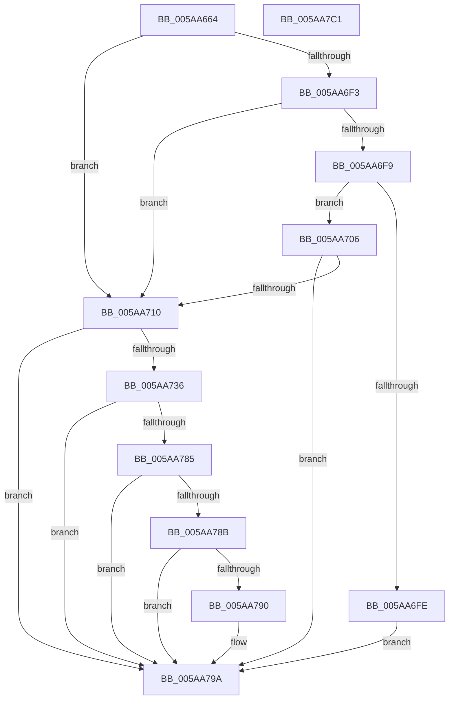

# PiRebalanceOptOut

- RVA: `0x005AA664`–`0x005AA7C2` (길이 `350` bytes)
- VA: `0x00000001405AA664`
- 실행 섹션: `.text`
- PDB 이름 있음: `예`; PDB Function 태그: `아니요`
- unwind 정보 RVA: `0x000BCECC`
- 디코드: `90`개 명령, `350/350` bytes 표시
- 미해석 바이트: `0` (있으면 어셈블리에 `.byte`로 보존)

> 이 문서는 커널 이미지의 기계어와 PDB 기호를 분석해 생성했습니다. 4번과 5번은 함수 원형과 자료형을 바이너리 사용 방식에서 추정한 C 해석이며 원본 소스 복구 결과는 아닙니다.

## 1. Dependencies

- 직접 호출 지점: **4**; 고유 호출 대상: **3**
- 직접 호출자로 확인된 함수: **1**
- RIP 상대 이미지 참조: **4**

### Outgoing calls
- `0x005AA6EA` → [PnpGetObjectProperty](../../page/8E/PnpGetObjectProperty_function_008E2180.md) (function, `0x008E2180`)
- `0x005AA72D` → [IoGetDeviceProperty](../../page/8F/IoGetDeviceProperty_function_008FA720.md) (function, `0x008FA720`)
- `0x005AA77C` → [PnpGetObjectProperty](../../page/8E/PnpGetObjectProperty_function_008E2180.md) (function, `0x008E2180`)
- `0x005AA7A3` → [_security_check_cookie](../6A/_security_check_cookie_function_006AC640.md) (function, `0x006AC640`)

### Direct callers
- [PnpQueryStopDeviceNode](../../page/73/PnpQueryStopDeviceNode_function_0073F47C.md) at `0x0073F49F`

### Static image references
- `0x005AA67F` → RVA `0x00E0A740` (`.data`; read)
- `0x005AA69A` → RVA `0x00E66398` (`.data`; read)
- `0x005AA6D0` → RVA `0x00027EF0` (`.rdata`; read)
- `0x005AA767` → RVA `0x00027CC8` (`.rdata`; read)

## 2. Other-region calls and transfers

- 다른 실행 섹션으로 향하는 call: **3**
  - `0x005AA6EA` → [PnpGetObjectProperty](../../page/8E/PnpGetObjectProperty_function_008E2180.md) (`.text` → `PAGE`)
  - `0x005AA72D` → [IoGetDeviceProperty](../../page/8F/IoGetDeviceProperty_function_008FA720.md) (`.text` → `PAGE`)
  - `0x005AA77C` → [PnpGetObjectProperty](../../page/8E/PnpGetObjectProperty_function_008E2180.md) (`.text` → `PAGE`)
- 별도 외부 분기/꼬리 이동을 확인하지 못했습니다.

## 3. Assembly (complete function range)

```asm
005AA664  48 8B C4                        mov rax, rsp
005AA667  48 89 58 10                     mov qword ptr [rax + 0x10], rbx
005AA66B  48 89 70 18                     mov qword ptr [rax + 0x18], rsi
005AA66F  48 89 78 20                     mov qword ptr [rax + 0x20], rdi
005AA673  55                              push rbp
005AA674  48 8D 68 A1                     lea rbp, [rax - 0x5f]
005AA678  48 81 EC E0 00 00 00            sub rsp, 0xe0
005AA67F  48 8B 05 BA 00 86 00            mov rax, qword ptr [rip + 0x8600ba]
005AA686  48 33 C4                        xor rax, rsp
005AA689  48 89 45 47                     mov qword ptr [rbp + 0x47], rax
005AA68D  48 8B 51 30                     mov rdx, qword ptr [rcx + 0x30]
005AA691  48 8D 45 E3                     lea rax, [rbp - 0x1d]
005AA695  33 DB                           xor ebx, ebx
005AA697  48 8B F9                        mov rdi, rcx
005AA69A  48 8B 0D F7 BC 8B 00            mov rcx, qword ptr [rip + 0x8bbcf7]
005AA6A1  45 33 C9                        xor r9d, r9d
005AA6A4  89 5C 24 50                     mov dword ptr [rsp + 0x50], ebx
005AA6A8  48 89 44 24 48                  mov qword ptr [rsp + 0x48], rax
005AA6AD  48 8D 45 DF                     lea rax, [rbp - 0x21]
005AA6B1  C7 44 24 40 04 00 00 00         mov dword ptr [rsp + 0x40], 4
005AA6B9  8D 73 01                        lea esi, [rbx + 1]
005AA6BC  48 89 44 24 38                  mov qword ptr [rsp + 0x38], rax
005AA6C1  44 8B C6                        mov r8d, esi
005AA6C4  48 8D 45 DB                     lea rax, [rbp - 0x25]
005AA6C8  89 5D DF                        mov dword ptr [rbp - 0x21], ebx
005AA6CB  48 89 44 24 30                  mov qword ptr [rsp + 0x30], rax
005AA6D0  48 8D 05 19 D8 A7 FF            lea rax, [rip - 0x5827e7]
005AA6D7  48 89 44 24 28                  mov qword ptr [rsp + 0x28], rax
005AA6DC  48 89 5C 24 20                  mov qword ptr [rsp + 0x20], rbx
005AA6E1  89 5D E3                        mov dword ptr [rbp - 0x1d], ebx
005AA6E4  89 5D DB                        mov dword ptr [rbp - 0x25], ebx
005AA6E7  88 5D D7                        mov byte ptr [rbp - 0x29], bl
005AA6EA  E8 91 7A 33 00                  call 0x1408e2180
005AA6EF  85 C0                           test eax, eax
005AA6F1  78 1D                           js 0x1405aa710
005AA6F3  83 7D DB 07                     cmp dword ptr [rbp - 0x25], 7
005AA6F7  75 17                           jne 0x1405aa710
005AA6F9  39 75 DF                        cmp dword ptr [rbp - 0x21], esi
005AA6FC  75 08                           jne 0x1405aa706
005AA6FE  40 8A DE                        mov bl, sil
005AA701  E9 94 00 00 00                  jmp 0x1405aa79a
005AA706  83 7D DF 02                     cmp dword ptr [rbp - 0x21], 2
005AA70A  0F 84 8A 00 00 00               je 0x1405aa79a
005AA710  48 8B 4F 20                     mov rcx, qword ptr [rdi + 0x20]
005AA714  48 8D 45 E7                     lea rax, [rbp - 0x19]
005AA718  BA 06 00 00 00                  mov edx, 6
005AA71D  89 5D E7                        mov dword ptr [rbp - 0x19], ebx
005AA720  4C 8D 4D F7                     lea r9, [rbp - 9]
005AA724  48 89 44 24 20                  mov qword ptr [rsp + 0x20], rax
005AA729  44 8D 42 48                     lea r8d, [rdx + 0x48]
005AA72D  E8 EE FF 34 00                  call 0x1408fa720
005AA732  85 C0                           test eax, eax
005AA734  78 64                           js 0x1405aa79a
005AA736  48 8B 0D 5B BC 8B 00            mov rcx, qword ptr [rip + 0x8bbc5b]
005AA73D  48 8D 45 E3                     lea rax, [rbp - 0x1d]
005AA741  89 5C 24 50                     mov dword ptr [rsp + 0x50], ebx
005AA745  48 8D 55 F7                     lea rdx, [rbp - 9]
005AA749  48 89 44 24 48                  mov qword ptr [rsp + 0x48], rax
005AA74E  45 33 C9                        xor r9d, r9d
005AA751  89 74 24 40                     mov dword ptr [rsp + 0x40], esi
005AA755  48 8D 45 D7                     lea rax, [rbp - 0x29]
005AA759  48 89 44 24 38                  mov qword ptr [rsp + 0x38], rax
005AA75E  48 8D 45 DB                     lea rax, [rbp - 0x25]
005AA762  48 89 44 24 30                  mov qword ptr [rsp + 0x30], rax
005AA767  48 8D 05 5A D5 A7 FF            lea rax, [rip - 0x582aa6]
005AA76E  48 89 44 24 28                  mov qword ptr [rsp + 0x28], rax
005AA773  45 8D 41 02                     lea r8d, [r9 + 2]
005AA777  48 89 5C 24 20                  mov qword ptr [rsp + 0x20], rbx
005AA77C  E8 FF 79 33 00                  call 0x1408e2180
005AA781  85 C0                           test eax, eax
005AA783  78 15                           js 0x1405aa79a
005AA785  83 7D DB 11                     cmp dword ptr [rbp - 0x25], 0x11
005AA789  75 0F                           jne 0x1405aa79a
005AA78B  39 75 E3                        cmp dword ptr [rbp - 0x1d], esi
005AA78E  75 0A                           jne 0x1405aa79a
005AA790  80 7D D7 FF                     cmp byte ptr [rbp - 0x29], 0xff
005AA794  0F B6 DB                        movzx ebx, bl
005AA797  0F 44 DE                        cmove ebx, esi
005AA79A  8A C3                           mov al, bl
005AA79C  48 8B 4D 47                     mov rcx, qword ptr [rbp + 0x47]
005AA7A0  48 33 CC                        xor rcx, rsp
005AA7A3  E8 98 1E 10 00                  call 0x1406ac640
005AA7A8  4C 8D 9C 24 E0 00 00 00         lea r11, [rsp + 0xe0]
005AA7B0  49 8B 5B 18                     mov rbx, qword ptr [r11 + 0x18]
005AA7B4  49 8B 73 20                     mov rsi, qword ptr [r11 + 0x20]
005AA7B8  49 8B 7B 28                     mov rdi, qword ptr [r11 + 0x28]
005AA7BC  49 8B E3                        mov rsp, r11
005AA7BF  5D                              pop rbp
005AA7C0  C3                              ret
005AA7C1  CC                              int3
```

## 4. C-style interpretation (structured pseudocode)

```c
__int64 __fastcall PiRebalanceOptOut(__int64 a1, __int64 a2, __int64 a3, int a4)
{
    __int64 result;
    __int64 v_rbx;
    __int64 v_rsp;
    unsigned __int64 v_stack_m8;
    unsigned int v_stack_m98;
    unsigned __int64 v_stack_mA0;
    unsigned int v_stack_mA8;
    unsigned __int64 v_stack_mB0;
    unsigned __int64 v_stack_mB8;
    unsigned __int64 v_stack_mC0;
    unsigned __int64 v_stack_mC8;

    *(unsigned __int64 *)(v_rsp + 16) = v_rbx;
    *(unsigned __int64 *)(v_rsp + 24) = v_rsi;
    *(unsigned __int64 *)(v_rsp + 32) = v_rdi;
    v_rsp = (v_rsp) - (224);
    result = (*(unsigned __int64 *)(v_rip + 8782010)) ^ (v_rsp);
    *(unsigned __int64 *)(v_rsp - 95 + 71) = result;
    v_rbx = 0;
    a4 = 0;
    v_stack_m98 = 0;
    v_stack_mA0 = v_rsp - 95 - 29;
    v_stack_mA8 = 4;
    v_stack_mB0 = v_rsp - 95 - 33;
    *(unsigned int *)(v_rsp - 95 - 33) = 0;
    v_stack_mB8 = v_rsp - 95 - 37;
    v_stack_mC0 = v_rip - 5777383;
    v_stack_mC8 = 0;
    *(unsigned int *)(v_rsp - 95 - 29) = 0;
    *(unsigned int *)(v_rsp - 95 - 37) = 0;
    *(unsigned __int8 *)(v_rsp - 95 - 41) = 0;
    result = PnpGetObjectProperty(*(unsigned __int64 *)(v_rip + 9157879), *(unsigned __int64 *)(a1 + 48), (unsigned int)((unsigned int)(v_rbx + 1)), a4);
    if (sign_flag) goto loc_005AA710;
    if ((*(unsigned int *)(v_rsp - 95 - 37)) != 7) goto loc_005AA710;
    if ((*(unsigned int *)(v_rsp - 95 - 33)) != ((unsigned int)(v_rbx + 1))) goto loc_005AA706;
    goto loc_005AA79A;
loc_005AA706:
    if ((*(unsigned int *)(v_rsp - 95 - 33)) == 2) goto loc_005AA79A;
loc_005AA710:
    *(unsigned int *)(v_rsp - 95 - 25) = (unsigned int)((unsigned __int8)(v_rbx + 1));
    v_stack_mC8 = v_rsp - 95 - 25;
    result = IoGetDeviceProperty(*(unsigned __int64 *)(a1 + 32), 6, 6 + 72, v_rsp - 95 - 9);
    if (sign_flag) goto loc_005AA79A;
    v_stack_m98 = (unsigned int)((unsigned __int8)(v_rbx + 1));
    v_stack_mA0 = v_rsp - 95 - 29;
    a4 = 0;
    v_stack_mA8 = (unsigned int)(v_rbx + 1);
    v_stack_mB0 = v_rsp - 95 - 41;
    v_stack_mB8 = v_rsp - 95 - 37;
    v_stack_mC0 = v_rip - 5778086;
    v_stack_mC8 = (unsigned __int8)(v_rbx + 1);
    result = PnpGetObjectProperty(*(unsigned __int64 *)(v_rip + 9157723), v_rsp - 95 - 9, a4 + 2, a4);
    if (sign_flag) goto loc_005AA79A;
    if ((*(unsigned int *)(v_rsp - 95 - 37)) != 17) goto loc_005AA79A;
    v_rbx = (unsigned __int8)(v_rbx + 1);
    if ((*(unsigned int *)(v_rsp - 95 - 29)) == ((unsigned int)(v_rbx + 1))) {
        v_rbx = (unsigned __int8)((unsigned __int8)(v_rbx + 1));
        if ((*(unsigned __int8 *)(v_rsp - 95 - 41)) == 255) { v_rbx = (unsigned int)(v_rbx + 1); }
    }
    a1 = (*(unsigned __int64 *)(v_rsp - 95 + 71)) ^ (v_rsp);
    result = _security_check_cookie(a1, v_rsp - 95 - 9, a4 + 2, a4);
    return result;
}
```

## 5. (Beta) C Style

```c
int64_t PiRebalanceOptOut(void *Arg1, int64_t Arg2, int64_t Arg3, int32_t Arg4)
{
    uint8_t *arg1 = (uint8_t *)Arg1;

    int64_t result;
    int64_t local_rbx;
    int64_t local_rsp;
    uint64_t v_stack_m8;
    uint32_t v_stack_m98;
    uint64_t v_stack_mA0;
    uint32_t v_stack_mA8;
    uint64_t v_stack_mB0;
    uint64_t v_stack_mB8;
    uint64_t v_stack_mC0;
    uint64_t v_stack_mC8;

    *(uint64_t *)(local_rsp + 0x10) = local_rbx;
    *(uint64_t *)(local_rsp + 0x18) = local_rsi;
    *(uint64_t *)(local_rsp + 0x20) = local_rdi;
    local_rsp = (local_rsp) - (224);
    result = (*(uint64_t *)(v_rip + 0x8600BA)) ^ (local_rsp);
    *(uint64_t *)(local_rsp - 0x5F + 0x47) = result;
    local_rbx = 0;
    Arg4 = 0;
    v_stack_m98 = 0;
    v_stack_mA0 = local_rsp - 95 - 29;
    v_stack_mA8 = 4;
    v_stack_mB0 = local_rsp - 95 - 33;
    *(uint32_t *)(local_rsp - 0x5F - 0x21) = 0;
    v_stack_mB8 = local_rsp - 95 - 37;
    v_stack_mC0 = v_rip - 5777383;
    v_stack_mC8 = 0;
    *(uint32_t *)(local_rsp - 0x5F - 0x1D) = 0;
    *(uint32_t *)(local_rsp - 0x5F - 0x25) = 0;
    *(uint8_t *)(local_rsp - 0x5F - 0x29) = 0;
    result = PnpGetObjectProperty(*(uint64_t *)(v_rip + 0x8BBCF7), *(uint64_t *)(arg1 + 0x30), (uint32_t)((uint32_t)(local_rbx + 1)), Arg4);
    if (sign_flag) goto loc_005AA710;
    if ((*(uint32_t *)(local_rsp - 0x5F - 0x25)) != 7) goto loc_005AA710;
    if ((*(uint32_t *)(local_rsp - 0x5F - 0x21)) != ((uint32_t)(local_rbx + 1))) goto loc_005AA706;
    goto loc_005AA79A;
loc_005AA706:
    if ((*(uint32_t *)(local_rsp - 0x5F - 0x21)) == 2) goto loc_005AA79A;
loc_005AA710:
    *(uint32_t *)(local_rsp - 0x5F - 0x19) = (uint32_t)((uint8_t)(local_rbx + 1));
    v_stack_mC8 = local_rsp - 95 - 25;
    result = IoGetDeviceProperty(*(uint64_t *)(arg1 + 0x20), 6, 6 + 72, local_rsp - 95 - 9);
    if (sign_flag) goto loc_005AA79A;
    v_stack_m98 = (uint32_t)((uint8_t)(local_rbx + 1));
    v_stack_mA0 = local_rsp - 95 - 29;
    Arg4 = 0;
    v_stack_mA8 = (uint32_t)(local_rbx + 1);
    v_stack_mB0 = local_rsp - 95 - 41;
    v_stack_mB8 = local_rsp - 95 - 37;
    v_stack_mC0 = v_rip - 5778086;
    v_stack_mC8 = (uint8_t)(local_rbx + 1);
    result = PnpGetObjectProperty(*(uint64_t *)(v_rip + 0x8BBC5B), local_rsp - 95 - 9, Arg4 + 2, Arg4);
    if (sign_flag) goto loc_005AA79A;
    if ((*(uint32_t *)(local_rsp - 0x5F - 0x25)) != 17) goto loc_005AA79A;
    local_rbx = (uint8_t)(local_rbx + 1);
    if ((*(uint32_t *)(local_rsp - 0x5F - 0x1D)) == ((uint32_t)(local_rbx + 1))) {
        local_rbx = (uint8_t)((uint8_t)(local_rbx + 1));
        if ((*(uint8_t *)(local_rsp - 0x5F - 0x29)) == 255) { local_rbx = (uint32_t)(local_rbx + 1); }
    }
    Arg1 = (*(uint64_t *)(local_rsp - 0x5F + 0x47)) ^ (local_rsp);
    result = _security_check_cookie(Arg1, local_rsp - 95 - 9, Arg4 + 2, Arg4);
    return result;
}
```

### 관측된 메모리 오프셋

구조체 형식이 확인되지 않은 접근은 인자 기준의 오프셋으로만 기록했습니다.

| 기준 인자 | 오프셋 표현 | 폭 (bit) | 접근 |
|---|---:|---:|---|
| `Arg1` | `+ 0x20` | `64` | `R` |
| `Arg1` | `+ 0x30` | `64` | `R` |

## 6. Execution-region graph

[열기: 2D/3D 그래프와 함수 탐색 컨트롤 패널](../../../control-panel.html?section=text&rva=0x005AA664&view=graph)

- 2D 그래프는 위에서 아래로 흐르고, 3D 그래프는 빈 공간을 드래그해 회전합니다. Shift+드래그는 이동, 휠은 확대·축소, 함수 노드 선택은 대상 보고서 이동입니다.

### Static fallback


