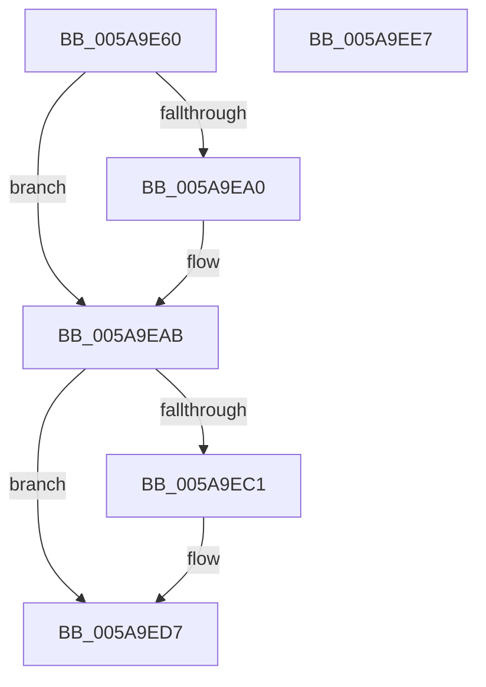

# PiSwIrpCancelStartCreate

- RVA: `0x005A9E60`–`0x005A9EE8` (길이 `136` bytes)
- VA: `0x00000001405A9E60`
- 실행 섹션: `.text`
- PDB 이름 있음: `예`; PDB Function 태그: `아니요`
- unwind 정보 RVA: `0x00060BC4`
- 디코드: `33`개 명령, `136/136` bytes 표시
- 미해석 바이트: `0` (있으면 어셈블리에 `.byte`로 보존)

> 이 문서는 커널 이미지의 기계어와 PDB 기호를 분석해 생성했습니다. 4번과 5번은 함수 원형과 자료형을 바이너리 사용 방식에서 추정한 C 해석이며 원본 소스 복구 결과는 아닙니다.

## 1. Dependencies

- 직접 호출 지점: **5**; 고유 호출 대상: **5**
- 직접 호출자로 확인된 함수: **0**
- RIP 상대 이미지 참조: **1**

### Outgoing calls
- `0x005A9E8C` → [KeReleaseQueuedSpinLock](../27/KeReleaseQueuedSpinLock_function_00272540.md) (function, `0x00272540`)
- `0x005A9E91` → [PiSwLock](../../page/8F/PiSwLock_function_008F7D50.md) (function, `0x008F7D50`)
- `0x005A9EB2` → [ExReleaseResourceLite](../25/ExReleaseResourceLite_function_0025FA10.md) (function, `0x0025FA10`)
- `0x005A9EB7` → [KeLeaveCriticalRegion](../25/KeLeaveCriticalRegion_function_0025D8B0.md) (function, `0x0025D8B0`)
- `0x005A9ED2` → [IofCompleteRequest](../29/IofCompleteRequest_function_0029B5C0.md) (function, `0x0029B5C0`)

### Direct callers
- 이 함수 시작 RVA로 연결되는 직접 call은 확인되지 않았습니다. 간접 호출은 완전히 역산할 수 없습니다.

### Static image references
- `0x005A9EAB` → RVA `0x00F8AB20` (`.data`; read)

## 2. Other-region calls and transfers

- 다른 실행 섹션으로 향하는 call: **1**
  - `0x005A9E91` → [PiSwLock](../../page/8F/PiSwLock_function_008F7D50.md) (`.text` → `PAGE`)
- 별도 외부 분기/꼬리 이동을 확인하지 못했습니다.

## 3. Assembly (complete function range)

```asm
005A9E60  48 89 5C 24 08                  mov qword ptr [rsp + 8], rbx
005A9E65  48 89 74 24 10                  mov qword ptr [rsp + 0x10], rsi
005A9E6A  57                              push rdi
005A9E6B  48 83 EC 20                     sub rsp, 0x20
005A9E6F  48 8B 82 B8 00 00 00            mov rax, qword ptr [rdx + 0xb8]
005A9E76  48 8B DA                        mov rbx, rdx
005A9E79  8A 52 45                        mov dl, byte ptr [rdx + 0x45]
005A9E7C  40 32 FF                        xor dil, dil
005A9E7F  48 8B 48 30                     mov rcx, qword ptr [rax + 0x30]
005A9E83  48 8B 71 20                     mov rsi, qword ptr [rcx + 0x20]
005A9E87  B9 07 00 00 00                  mov ecx, 7
005A9E8C  E8 AF 86 CC FF                  call 0x140272540
005A9E91  E8 BA DE 34 00                  call 0x1408f7d50
005A9E96  48 83 BE 90 00 00 00 00         cmp qword ptr [rsi + 0x90], 0
005A9E9E  74 0B                           je 0x1405a9eab
005A9EA0  48 83 A6 90 00 00 00 00         and qword ptr [rsi + 0x90], 0
005A9EA8  40 B7 01                        mov dil, 1
005A9EAB  48 8D 0D 6E 0C 9E 00            lea rcx, [rip + 0x9e0c6e]
005A9EB2  E8 59 5B CB FF                  call 0x14025fa10
005A9EB7  E8 F4 39 CB FF                  call 0x14025d8b0
005A9EBC  40 84 FF                        test dil, dil
005A9EBF  74 16                           je 0x1405a9ed7
005A9EC1  48 83 63 38 00                  and qword ptr [rbx + 0x38], 0
005A9EC6  33 D2                           xor edx, edx
005A9EC8  48 8B CB                        mov rcx, rbx
005A9ECB  C7 43 30 20 01 00 C0            mov dword ptr [rbx + 0x30], 0xc0000120
005A9ED2  E8 E9 16 CF FF                  call 0x14029b5c0
005A9ED7  48 8B 5C 24 30                  mov rbx, qword ptr [rsp + 0x30]
005A9EDC  48 8B 74 24 38                  mov rsi, qword ptr [rsp + 0x38]
005A9EE1  48 83 C4 20                     add rsp, 0x20
005A9EE5  5F                              pop rdi
005A9EE6  C3                              ret
005A9EE7  CC                              int3
```

## 4. C-style interpretation (structured pseudocode)

```c
__int64 __fastcall PiSwIrpCancelStartCreate(__int64 a1, __int64 a2)
{
    __int64 result;
    __int64 v_rdi;
    __int64 v_rsp;
    unsigned __int64 v_stack_p10;
    unsigned __int64 v_stack_p8;

    v_stack_p8 = v_rbx;
    v_stack_p10 = v_rsi;
    v_rsp = (v_rsp) - (32);
    v_rdi = 0;
    result = KeReleaseQueuedSpinLock(7, *(unsigned __int8 *)(a2 + 69), a3, a4);
    result = PiSwLock(7, *(unsigned __int8 *)(a2 + 69), a3, a4);
    if ((*(unsigned __int64 *)(*(unsigned __int64 *)(*(unsigned __int64 *)(*(unsigned __int64 *)(a2 + 184) + 48) + 32) + 144)) != 0) {
        v_rdi = 1;
    }
    result = ExReleaseResourceLite(v_rip + 10357870, *(unsigned __int8 *)(a2 + 69), a3, a4);
    result = KeLeaveCriticalRegion(v_rip + 10357870, *(unsigned __int8 *)(a2 + 69), a3, a4);
    if ((unsigned __int8)(v_rdi) != 0) {
        a2 = 0;
        a1 = 0;
        *(unsigned int *)(a2 + 48) = 0xC0000120ULL;
        result = IofCompleteRequest(a1, a2, a3, a4);
    }
    v_rsp = (v_rsp) + (32);
    return result;
}
```

## 5. (Beta) C Style

```c
int64_t PiSwIrpCancelStartCreate(int64_t Arg1, void *Arg2)
{
    uint8_t *arg2 = (uint8_t *)Arg2;

    int64_t result;
    int64_t local_rdi;
    int64_t local_rsp;
    uint64_t v_stack_p10;
    uint64_t v_stack_p8;

    v_stack_p8 = local_rbx;
    v_stack_p10 = local_rsi;
    local_rsp = (local_rsp) - (32);
    local_rdi = 0;
    result = KeReleaseQueuedSpinLock(7, *(uint8_t *)(arg2 + 0x45), a3, a4);
    result = PiSwLock(7, *(uint8_t *)(arg2 + 0x45), a3, a4);
    if ((*(uint64_t *)(*(uint64_t *)(*(uint64_t *)(*(uint64_t *)(arg2 + 0xB8) + 0x30) + 0x20) + 0x90)) != 0) {
        local_rdi = 1;
    }
    result = ExReleaseResourceLite(v_rip + 10357870, *(uint8_t *)(arg2 + 0x45), a3, a4);
    result = KeLeaveCriticalRegion(v_rip + 10357870, *(uint8_t *)(arg2 + 0x45), a3, a4);
    if ((uint8_t)(local_rdi) != 0) {
        Arg2 = 0;
        Arg1 = 0;
        *(uint32_t *)(arg2 + 0x30) = 0xC0000120ULL;
        result = IofCompleteRequest(Arg1, Arg2, a3, a4);
    }
    local_rsp = (local_rsp) + (32);
    return result;
}
```

### 관측된 메모리 오프셋

구조체 형식이 확인되지 않은 접근은 인자 기준의 오프셋으로만 기록했습니다.

| 기준 인자 | 오프셋 표현 | 폭 (bit) | 접근 |
|---|---:|---:|---|
| `Arg2` | `+ 0x30` | `32` | `W` |
| `Arg2` | `+ 0x38` | `64` | `R/W` |
| `Arg2` | `+ 0x45` | `8` | `R` |
| `Arg2` | `+ 0xB8` | `64` | `R` |

## 6. Execution-region graph

[열기: 2D/3D 그래프와 함수 탐색 컨트롤 패널](../../../control-panel.html?section=text&rva=0x005A9E60&view=graph)

- 2D 그래프는 위에서 아래로 흐르고, 3D 그래프는 빈 공간을 드래그해 회전합니다. Shift+드래그는 이동, 휠은 확대·축소, 함수 노드 선택은 대상 보고서 이동입니다.

### Static fallback


