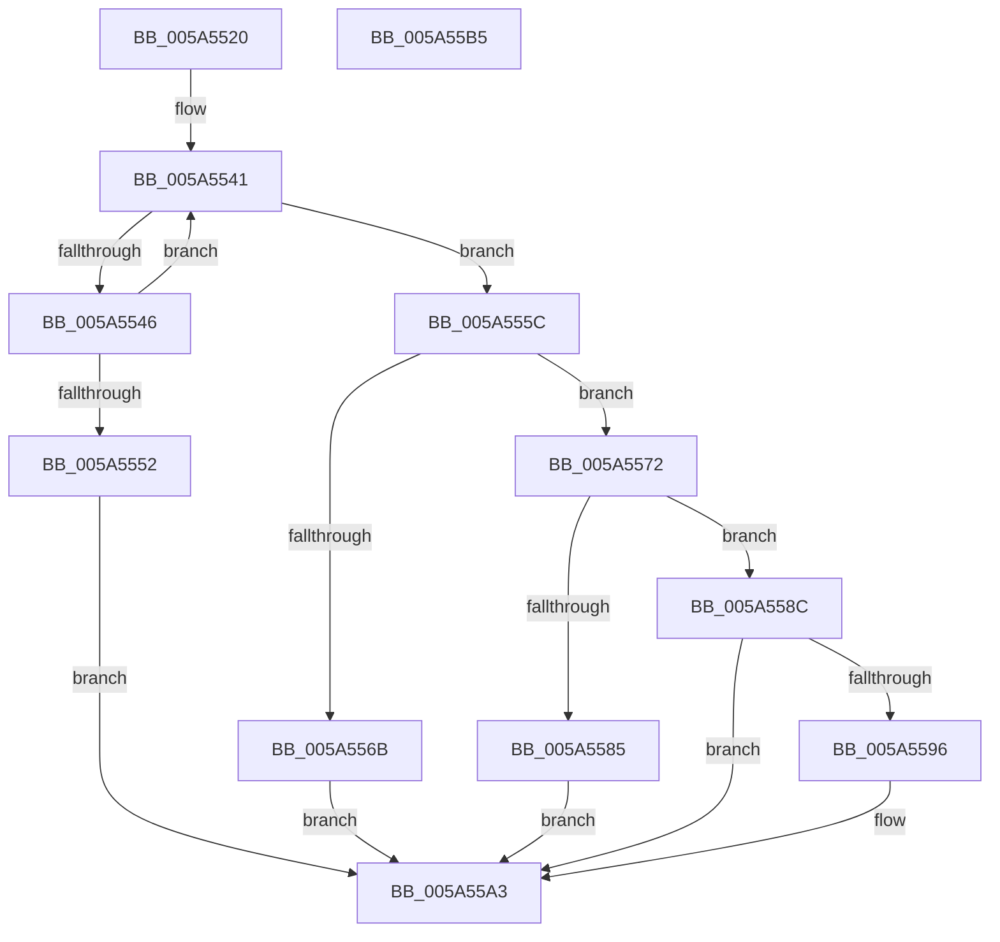

# PipAddDependencyEdgeBetweenNodes

- RVA: `0x005A5520`–`0x005A55B6` (길이 `150` bytes)
- VA: `0x00000001405A5520`
- 실행 섹션: `.text`
- PDB 이름 있음: `예`; PDB Function 태그: `아니요`
- unwind 정보 RVA: `0x00060BC4`
- 디코드: `47`개 명령, `150/150` bytes 표시
- 미해석 바이트: `0` (있으면 어셈블리에 `.byte`로 보존)

> 이 문서는 커널 이미지의 기계어와 PDB 기호를 분석해 생성했습니다. 4번과 5번은 함수 원형과 자료형을 바이너리 사용 방식에서 추정한 C 해석이며 원본 소스 복구 결과는 아닙니다.

## 1. Dependencies

- 직접 호출 지점: **4**; 고유 호출 대상: **4**
- 직접 호출자로 확인된 함수: **2**
- RIP 상대 이미지 참조: **0**

### Outgoing calls
- `0x005A5555` → [PipAddRequestToEdge](../../page/72/PipAddRequestToEdge_function_00727898.md) (function, `0x00727898`)
- `0x005A5562` → [PipCheckValidNewDependencyEdge](../../page/72/PipCheckValidNewDependencyEdge_function_00727A80.md) (function, `0x00727A80`)
- `0x005A557B` → [PipCreateNewDependencyEdge](PipCreateNewDependencyEdge_function_005A55BC.md) (function, `0x005A55BC`)
- `0x005A559E` → [PipAddtoRebuildPowerRelationsQueue](../../page/A0/PipAddtoRebuildPowerRelationsQueue_function_00A07174.md) (function, `0x00A07174`)

### Direct callers
- [IoDuplicateDependency](../../page/72/IoDuplicateDependency_function_00727580.md) at `0x00727652`
- [PipSetDependency](../../page/72/PipSetDependency_function_00727F24.md) at `0x00727F93`

### Static image references
- 디코드된 RIP-relative 메모리 참조가 없습니다.

## 2. Other-region calls and transfers

- 다른 실행 섹션으로 향하는 call: **3**
  - `0x005A5555` → [PipAddRequestToEdge](../../page/72/PipAddRequestToEdge_function_00727898.md) (`.text` → `PAGE`)
  - `0x005A5562` → [PipCheckValidNewDependencyEdge](../../page/72/PipCheckValidNewDependencyEdge_function_00727A80.md) (`.text` → `PAGE`)
  - `0x005A559E` → [PipAddtoRebuildPowerRelationsQueue](../../page/A0/PipAddtoRebuildPowerRelationsQueue_function_00A07174.md) (`.text` → `PAGE`)
- 별도 외부 분기/꼬리 이동을 확인하지 못했습니다.

## 3. Assembly (complete function range)

```asm
005A5520  48 89 5C 24 08                  mov qword ptr [rsp + 8], rbx
005A5525  48 89 74 24 10                  mov qword ptr [rsp + 0x10], rsi
005A552A  57                              push rdi
005A552B  48 83 EC 20                     sub rsp, 0x20
005A552F  4C 8B DA                        mov r11, rdx
005A5532  49 8B F0                        mov rsi, r8
005A5535  48 8D 51 10                     lea rdx, [rcx + 0x10]
005A5539  48 8B F9                        mov rdi, rcx
005A553C  48 8B 02                        mov rax, qword ptr [rdx]
005A553F  33 DB                           xor ebx, ebx
005A5541  48 3B C2                        cmp rax, rdx
005A5544  74 16                           je 0x1405a555c
005A5546  48 8B C8                        mov rcx, rax
005A5549  48 8B 00                        mov rax, qword ptr [rax]
005A554C  4C 39 59 20                     cmp qword ptr [rcx + 0x20], r11
005A5550  75 EF                           jne 0x1405a5541
005A5552  48 8B D6                        mov rdx, rsi
005A5555  E8 3E 23 18 00                  call 0x140727898
005A555A  EB 47                           jmp 0x1405a55a3
005A555C  49 8B D3                        mov rdx, r11
005A555F  48 8B CF                        mov rcx, rdi
005A5562  E8 19 25 18 00                  call 0x140727a80
005A5567  84 C0                           test al, al
005A5569  75 07                           jne 0x1405a5572
005A556B  BB 01 00 00 C0                  mov ebx, 0xc0000001
005A5570  EB 31                           jmp 0x1405a55a3
005A5572  4C 8B C6                        mov r8, rsi
005A5575  49 8B D3                        mov rdx, r11
005A5578  48 8B CF                        mov rcx, rdi
005A557B  E8 3C 00 00 00                  call 0x1405a55bc
005A5580  48 85 C0                        test rax, rax
005A5583  75 07                           jne 0x1405a558c
005A5585  BB 9A 00 00 C0                  mov ebx, 0xc000009a
005A558A  EB 17                           jmp 0x1405a55a3
005A558C  48 8B 48 20                     mov rcx, qword ptr [rax + 0x20]
005A5590  48 39 59 30                     cmp qword ptr [rcx + 0x30], rbx
005A5594  74 0D                           je 0x1405a55a3
005A5596  48 8B 48 28                     mov rcx, qword ptr [rax + 0x28]
005A559A  48 8B 49 30                     mov rcx, qword ptr [rcx + 0x30]
005A559E  E8 D1 1B 46 00                  call 0x140a07174
005A55A3  48 8B 74 24 38                  mov rsi, qword ptr [rsp + 0x38]
005A55A8  8B C3                           mov eax, ebx
005A55AA  48 8B 5C 24 30                  mov rbx, qword ptr [rsp + 0x30]
005A55AF  48 83 C4 20                     add rsp, 0x20
005A55B3  5F                              pop rdi
005A55B4  C3                              ret
005A55B5  CC                              int3
```

## 4. C-style interpretation (structured pseudocode)

```c
__int64 __fastcall PipAddDependencyEdgeBetweenNodes(__int64 a1, __int64 a2, __int64 a3)
{
    __int64 result;
    __int64 v_rbx;
    __int64 v_rsp;
    unsigned __int64 v_stack_p10;
    unsigned __int64 v_stack_p8;

    v_stack_p8 = v_rbx;
    v_stack_p10 = v_rsi;
    v_rsp = (v_rsp) - (32);
    v_rbx = 0;
loc_005A5541:
    if ((*(unsigned __int64 *)(a1 + 16)) == (a1 + 16)) goto loc_005A555C;
    if ((*(unsigned __int64 *)(*(unsigned __int64 *)(a1 + 16) + 32)) != a2) goto loc_005A5541;
    result = PipAddRequestToEdge(*(unsigned __int64 *)(a1 + 16), a3, a3, a4);
    goto loc_005A55A3;
loc_005A555C:
    result = PipCheckValidNewDependencyEdge(a1, a2, a3, a4);
    if ((unsigned __int8)(result) != 0) goto loc_005A5572;
    goto loc_005A55A3;
loc_005A5572:
    result = PipCreateNewDependencyEdge(a1, a2, a3, a4);
    if (result != 0) goto loc_005A558C;
    goto loc_005A55A3;
loc_005A558C:
    if ((*(unsigned __int64 *)(*(unsigned __int64 *)(result + 32) + 48)) != ((unsigned int)(0xC000009AULL))) {
        a1 = *(unsigned __int64 *)(result + 40);
        a1 = *(unsigned __int64 *)(a1 + 48);
        result = PipAddtoRebuildPowerRelationsQueue(a1, a2, a3, a4);
    }
    v_rsp = (v_rsp) + (32);
    return (unsigned int)((unsigned int)((unsigned int)(0xC000009AULL)));
}
```

## 5. (Beta) C Style

```c
int64_t PipAddDependencyEdgeBetweenNodes(void *Arg1, int64_t Arg2, int64_t Arg3)
{
    uint8_t *arg1 = (uint8_t *)Arg1;

    int64_t result;
    int64_t local_rbx;
    int64_t local_rsp;
    uint64_t v_stack_p10;
    uint64_t v_stack_p8;

    v_stack_p8 = local_rbx;
    v_stack_p10 = local_rsi;
    local_rsp = (local_rsp) - (32);
    local_rbx = 0;
loc_005A5541:
    if ((*(uint64_t *)(arg1 + 0x10)) == (Arg1 + 16)) goto loc_005A555C;
    if ((*(uint64_t *)(*(uint64_t *)(arg1 + 0x10) + 0x20)) != Arg2) goto loc_005A5541;
    result = PipAddRequestToEdge(*(uint64_t *)(arg1 + 0x10), Arg3, Arg3, a4);
    goto loc_005A55A3;
loc_005A555C:
    result = PipCheckValidNewDependencyEdge(Arg1, Arg2, Arg3, a4);
    if ((uint8_t)(result) != 0) goto loc_005A5572;
    goto loc_005A55A3;
loc_005A5572:
    result = PipCreateNewDependencyEdge(Arg1, Arg2, Arg3, a4);
    if (result != 0) goto loc_005A558C;
    goto loc_005A55A3;
loc_005A558C:
    if ((*(uint64_t *)(*(uint64_t *)(result + 0x20) + 0x30)) != ((uint32_t)(0xC000009AULL))) {
        Arg1 = *(uint64_t *)(result + 0x28);
        Arg1 = *(uint64_t *)(arg1 + 0x30);
        result = PipAddtoRebuildPowerRelationsQueue(Arg1, Arg2, Arg3, a4);
    }
    local_rsp = (local_rsp) + (32);
    return (uint32_t)((uint32_t)((uint32_t)(0xC000009AULL)));
}
```

### 관측된 메모리 오프셋

구조체 형식이 확인되지 않은 접근은 인자 기준의 오프셋으로만 기록했습니다.

| 기준 인자 | 오프셋 표현 | 폭 (bit) | 접근 |
|---|---:|---:|---|
| `Arg1` | `+ 0x0` | `64` | `R` |
| `Arg1` | `+ 0x10` | `64` | `R` |

## 6. Execution-region graph

[열기: 2D/3D 그래프와 함수 탐색 컨트롤 패널](../../../control-panel.html?section=text&rva=0x005A5520&view=graph)

- 2D 그래프는 위에서 아래로 흐르고, 3D 그래프는 빈 공간을 드래그해 회전합니다. Shift+드래그는 이동, 휠은 확대·축소, 함수 노드 선택은 대상 보고서 이동입니다.

### Static fallback


