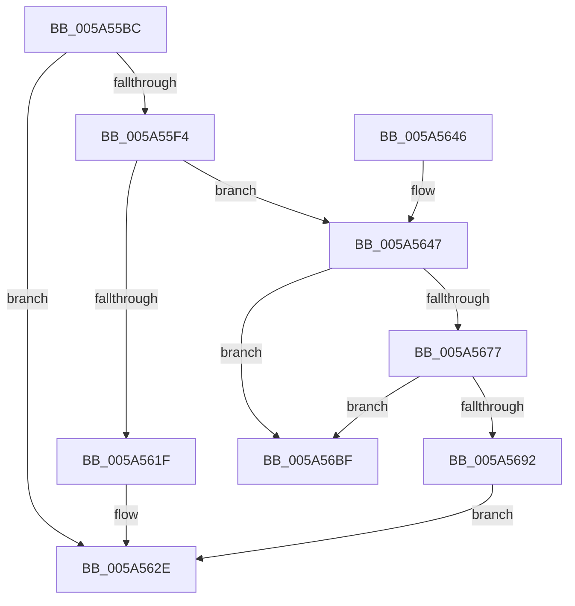

# PipCreateNewDependencyEdge

- RVA: `0x005A55BC`–`0x005A56C6` (길이 `266` bytes)
- VA: `0x00000001405A55BC`
- 실행 섹션: `.text`
- PDB 이름 있음: `예`; PDB Function 태그: `아니요`
- unwind 정보 RVA: `0x0008C898`
- 디코드: `72`개 명령, `266/266` bytes 표시
- 미해석 바이트: `0` (있으면 어셈블리에 `.byte`로 보존)

> 이 문서는 커널 이미지의 기계어와 PDB 기호를 분석해 생성했습니다. 4번과 5번은 함수 원형과 자료형을 바이너리 사용 방식에서 추정한 C 해석이며 원본 소스 복구 결과는 아닙니다.

## 1. Dependencies

- 직접 호출 지점: **8**; 고유 호출 대상: **7**
- 직접 호출자로 확인된 함수: **1**
- RIP 상대 이미지 참조: **1**

### Outgoing calls
- `0x005A55E7` → [ExAllocatePool2](../../poolcode/B8/ExAllocatePool2_function_00B820F0.md) (function, `0x00B820F0`)
- `0x005A5615` → [PipAddRequestToEdge](../../page/72/PipAddRequestToEdge_function_00727898.md) (function, `0x00727898`)
- `0x005A5627` → [ExFreePoolWithTag](../../poolcode/B8/ExFreePoolWithTag_function_00B82870.md) (function, `0x00B82870`)
- `0x005A564A` → [PipReferenceDependencyNode](../../page/70/PipReferenceDependencyNode_function_00705A64.md) (function, `0x00705A64`)
- `0x005A5652` → [PipReferenceDependencyNode](../../page/70/PipReferenceDependencyNode_function_00705A64.md) (function, `0x00705A64`)
- `0x005A565E` → [KeAcquireSpinLockRaiseToDpc](../20/KeAcquireSpinLockRaiseToDpc_function_00208470.md) (function, `0x00208470`)
- `0x005A56AA` → [KeReleaseSpinLock](../39/KeReleaseSpinLock_function_00392BA0.md) (function, `0x00392BA0`)
- `0x005A56B5` → [PipNotifyDependenciesChanged](../../page/70/PipNotifyDependenciesChanged_function_007038F8.md) (function, `0x007038F8`)

### Direct callers
- [PipAddDependencyEdgeBetweenNodes](PipAddDependencyEdgeBetweenNodes_function_005A5520.md) at `0x005A557B`

### Static image references
- `0x005A5657` → RVA `0x00F8CF08` (`.data`; read)

## 2. Other-region calls and transfers

- 다른 실행 섹션으로 향하는 call: **6**
  - `0x005A55E7` → [ExAllocatePool2](../../poolcode/B8/ExAllocatePool2_function_00B820F0.md) (`.text` → `POOLCODE`)
  - `0x005A5615` → [PipAddRequestToEdge](../../page/72/PipAddRequestToEdge_function_00727898.md) (`.text` → `PAGE`)
  - `0x005A5627` → [ExFreePoolWithTag](../../poolcode/B8/ExFreePoolWithTag_function_00B82870.md) (`.text` → `POOLCODE`)
  - `0x005A564A` → [PipReferenceDependencyNode](../../page/70/PipReferenceDependencyNode_function_00705A64.md) (`.text` → `PAGE`)
  - `0x005A5652` → [PipReferenceDependencyNode](../../page/70/PipReferenceDependencyNode_function_00705A64.md) (`.text` → `PAGE`)
  - `0x005A56B5` → [PipNotifyDependenciesChanged](../../page/70/PipNotifyDependenciesChanged_function_007038F8.md) (`.text` → `PAGE`)
- 별도 외부 분기/꼬리 이동을 확인하지 못했습니다.

## 3. Assembly (complete function range)

```asm
005A55BC  48 89 5C 24 08                  mov qword ptr [rsp + 8], rbx
005A55C1  48 89 6C 24 10                  mov qword ptr [rsp + 0x10], rbp
005A55C6  48 89 74 24 18                  mov qword ptr [rsp + 0x18], rsi
005A55CB  57                              push rdi
005A55CC  48 83 EC 20                     sub rsp, 0x20
005A55D0  48 8B F2                        mov rsi, rdx
005A55D3  49 8B E8                        mov rbp, r8
005A55D6  BA 50 00 00 00                  mov edx, 0x50
005A55DB  48 8B F9                        mov rdi, rcx
005A55DE  41 B8 50 6E 70 53               mov r8d, 0x53706e50
005A55E4  8D 4A F0                        lea ecx, [rdx - 0x10]
005A55E7  E8 04 CB 5D 00                  call 0x140b820f0
005A55EC  48 8B D8                        mov rbx, rax
005A55EF  48 85 C0                        test rax, rax
005A55F2  74 3A                           je 0x1405a562e
005A55F4  83 60 30 00                     and dword ptr [rax + 0x30], 0
005A55F8  48 8D 48 38                     lea rcx, [rax + 0x38]
005A55FC  48 89 78 28                     mov qword ptr [rax + 0x28], rdi
005A5600  48 8B D5                        mov rdx, rbp
005A5603  48 89 70 20                     mov qword ptr [rax + 0x20], rsi
005A5607  48 89 49 08                     mov qword ptr [rcx + 8], rcx
005A560B  48 89 09                        mov qword ptr [rcx], rcx
005A560E  48 8B C8                        mov rcx, rax
005A5611  C6 40 48 00                     mov byte ptr [rax + 0x48], 0
005A5615  E8 7E 22 18 00                  call 0x140727898
005A561A  48 85 C0                        test rax, rax
005A561D  75 28                           jne 0x1405a5647
005A561F  BA 50 6E 70 53                  mov edx, 0x53706e50
005A5624  48 8B CB                        mov rcx, rbx
005A5627  E8 44 D2 5D 00                  call 0x140b82870
005A562C  33 DB                           xor ebx, ebx
005A562E  48 8B 6C 24 38                  mov rbp, qword ptr [rsp + 0x38]
005A5633  48 8B C3                        mov rax, rbx
005A5636  48 8B 5C 24 30                  mov rbx, qword ptr [rsp + 0x30]
005A563B  48 8B 74 24 40                  mov rsi, qword ptr [rsp + 0x40]
005A5640  48 83 C4 20                     add rsp, 0x20
005A5644  5F                              pop rdi
005A5645  C3                              ret
005A5646  CC                              int3
005A5647  48 8B CF                        mov rcx, rdi
005A564A  E8 15 04 16 00                  call 0x140705a64
005A564F  48 8B CE                        mov rcx, rsi
005A5652  E8 0D 04 16 00                  call 0x140705a64
005A5657  48 8D 0D AA 78 9E 00            lea rcx, [rip + 0x9e78aa]
005A565E  E8 0D 2E C6 FF                  call 0x140208470
005A5663  4C 8D 46 20                     lea r8, [rsi + 0x20]
005A5667  44 8A D0                        mov r10b, al
005A566A  4D 8B 48 08                     mov r9, qword ptr [r8 + 8]
005A566E  48 8D 53 10                     lea rdx, [rbx + 0x10]
005A5672  4D 39 01                        cmp qword ptr [r9], r8
005A5675  75 48                           jne 0x1405a56bf
005A5677  4C 89 02                        mov qword ptr [rdx], r8
005A567A  4C 89 4A 08                     mov qword ptr [rdx + 8], r9
005A567E  49 89 11                        mov qword ptr [r9], rdx
005A5681  49 89 50 08                     mov qword ptr [r8 + 8], rdx
005A5685  48 8D 57 10                     lea rdx, [rdi + 0x10]
005A5689  48 8B 42 08                     mov rax, qword ptr [rdx + 8]
005A568D  48 39 10                        cmp qword ptr [rax], rdx
005A5690  75 2D                           jne 0x1405a56bf
005A5692  48 89 13                        mov qword ptr [rbx], rdx
005A5695  48 8D 0D 6C 78 9E 00            lea rcx, [rip + 0x9e786c]
005A569C  48 89 43 08                     mov qword ptr [rbx + 8], rax
005A56A0  48 89 18                        mov qword ptr [rax], rbx
005A56A3  48 89 5A 08                     mov qword ptr [rdx + 8], rbx
005A56A7  41 8A D2                        mov dl, r10b
005A56AA  E8 F1 D4 DE FF                  call 0x140392ba0
005A56AF  48 8B D6                        mov rdx, rsi
005A56B2  48 8B CF                        mov rcx, rdi
005A56B5  E8 3E E2 15 00                  call 0x1407038f8
005A56BA  E9 6F FF FF FF                  jmp 0x1405a562e
005A56BF  B9 03 00 00 00                  mov ecx, 3
005A56C4  CD 29                           int 0x29
```

## 4. C-style interpretation (structured pseudocode)

```c
__int64 __fastcall PipCreateNewDependencyEdge(__int64 a1, __int64 a2, __int64 a3)
{
    __int64 result;
    __int64 v_rbx;
    __int64 v_rsp;
    unsigned __int64 v_stack_p10;
    unsigned __int64 v_stack_p18;
    unsigned __int64 v_stack_p8;

    v_stack_p8 = v_rbx;
    v_stack_p10 = v_rbp;
    v_stack_p18 = v_rsi;
    v_rsp = (v_rsp) - (32);
    result = ExAllocatePool2(80 - 16, 80, (unsigned int)(0x53706E50ULL), a4);
    if (result == 0) goto loc_005A562E;
    *(unsigned __int64 *)(result + 40) = a1;
    *(unsigned __int64 *)(result + 32) = a2;
    *(unsigned __int64 *)(result + 56 + 8) = result + 56;
    *(unsigned __int64 *)(result + 56) = result + 56;
    *(unsigned __int8 *)(result + 72) = 0;
    result = PipAddRequestToEdge(result, a3, (unsigned int)(0x53706E50ULL), a4);
    if (result != 0) goto loc_005A5647;
    result = ExFreePoolWithTag(result, (unsigned int)(0x53706E50ULL), (unsigned int)(0x53706E50ULL), a4);
    v_rbx = 0;
loc_005A562E:
    v_rsp = (v_rsp) + (32);
    return 0;
loc_005A5647:
    result = PipReferenceDependencyNode(a1, (unsigned int)(0x53706E50ULL), (unsigned int)(0x53706E50ULL), a4);
    result = PipReferenceDependencyNode(v_stack_p18, (unsigned int)(0x53706E50ULL), (unsigned int)(0x53706E50ULL), a4);
    result = KeAcquireSpinLockRaiseToDpc(v_rip + 10385578, (unsigned int)(0x53706E50ULL), (unsigned int)(0x53706E50ULL), a4);
    if ((*(unsigned __int64 *)(*(unsigned __int64 *)(v_stack_p18 + 32 + 8))) != (v_stack_p18 + 32)) goto loc_005A56BF;
    *(unsigned __int64 *)(v_stack_p8 + 16) = v_stack_p18 + 32;
    *(unsigned __int64 *)(v_stack_p8 + 16 + 8) = *(unsigned __int64 *)(v_stack_p18 + 32 + 8);
    *(unsigned __int64 *)(*(unsigned __int64 *)(v_stack_p18 + 32 + 8)) = v_stack_p8 + 16;
    *(unsigned __int64 *)(v_stack_p18 + 32 + 8) = v_stack_p8 + 16;
    if ((*(unsigned __int64 *)(*(unsigned __int64 *)(a1 + 16 + 8))) != (a1 + 16)) goto loc_005A56BF;
    *(unsigned __int64 *)(v_stack_p8) = a1 + 16;
    *(unsigned __int64 *)(v_stack_p8 + 8) = *(unsigned __int64 *)(a1 + 16 + 8);
    *(unsigned __int64 *)(*(unsigned __int64 *)(a1 + 16 + 8)) = v_stack_p8;
    *(unsigned __int64 *)(a1 + 16 + 8) = v_stack_p8;
    result = KeReleaseSpinLock(v_rip + 10385516, (unsigned __int8)((unsigned __int8)(result)), v_stack_p18 + 32, *(unsigned __int64 *)(v_stack_p18 + 32 + 8));
    result = PipNotifyDependenciesChanged(a1, v_stack_p18, v_stack_p18 + 32, *(unsigned __int64 *)(v_stack_p18 + 32 + 8));
    goto loc_005A562E;
loc_005A56BF:
    return result;
}
```

## 5. (Beta) C Style

```c
int64_t PipCreateNewDependencyEdge(void *Arg1, void *Arg2, int64_t Arg3)
{
    uint8_t *arg1 = (uint8_t *)Arg1;
    uint8_t *arg2 = (uint8_t *)Arg2;

    int64_t result;
    int64_t local_rbx;
    int64_t local_rsp;
    uint64_t v_stack_p10;
    uint64_t v_stack_p18;
    uint64_t v_stack_p8;

    v_stack_p8 = local_rbx;
    v_stack_p10 = local_rbp;
    v_stack_p18 = local_rsi;
    local_rsp = (local_rsp) - (32);
    result = ExAllocatePool2(80 - 16, 80, (uint32_t)(0x53706E50ULL), a4);
    if (result == 0) goto loc_005A562E;
    *(void **)(result + 0x28) = Arg1;
    *(void **)(result + 0x20) = Arg2;
    *(uint64_t *)(result + 0x38 + 0x8) = result + 56;
    *(uint64_t *)(result + 0x38) = result + 56;
    *(uint8_t *)(result + 0x48) = 0;
    result = PipAddRequestToEdge(result, Arg3, (uint32_t)(0x53706E50ULL), a4);
    if (result != 0) goto loc_005A5647;
    result = ExFreePoolWithTag(result, (uint32_t)(0x53706E50ULL), (uint32_t)(0x53706E50ULL), a4);
    local_rbx = 0;
loc_005A562E:
    local_rsp = (local_rsp) + (32);
    return 0;
loc_005A5647:
    result = PipReferenceDependencyNode(Arg1, (uint32_t)(0x53706E50ULL), (uint32_t)(0x53706E50ULL), a4);
    result = PipReferenceDependencyNode(v_stack_p18, (uint32_t)(0x53706E50ULL), (uint32_t)(0x53706E50ULL), a4);
    result = KeAcquireSpinLockRaiseToDpc(v_rip + 10385578, (uint32_t)(0x53706E50ULL), (uint32_t)(0x53706E50ULL), a4);
    if ((*(uint64_t *)(*(uint64_t *)(v_stack_p18 + 0x20 + 0x8))) != (v_stack_p18 + 32)) goto loc_005A56BF;
    *(uint64_t *)(v_stack_p8 + 0x10) = v_stack_p18 + 32;
    *(uint64_t *)(v_stack_p8 + 0x10 + 0x8) = *(uint64_t *)(v_stack_p18 + 0x20 + 0x8);
    *(uint64_t *)(*(uint64_t *)(v_stack_p18 + 0x20 + 0x8)) = v_stack_p8 + 16;
    *(uint64_t *)(v_stack_p18 + 0x20 + 0x8) = v_stack_p8 + 16;
    if ((*(uint64_t *)(*(uint64_t *)(arg1 + 0x10 + 0x8))) != (Arg1 + 16)) goto loc_005A56BF;
    *(void **)(v_stack_p8) = Arg1 + 16;
    *(uint64_t *)(v_stack_p8 + 0x8) = *(uint64_t *)(arg1 + 0x10 + 0x8);
    *(uint64_t *)(*(uint64_t *)(arg1 + 0x10 + 0x8)) = v_stack_p8;
    *(uint64_t *)(arg1 + 0x10 + 0x8) = v_stack_p8;
    result = KeReleaseSpinLock(v_rip + 10385516, (uint8_t)((uint8_t)(result)), v_stack_p18 + 32, *(uint64_t *)(v_stack_p18 + 0x20 + 0x8));
    result = PipNotifyDependenciesChanged(Arg1, v_stack_p18, v_stack_p18 + 32, *(uint64_t *)(v_stack_p18 + 0x20 + 0x8));
    goto loc_005A562E;
loc_005A56BF:
    return result;
}
```

### 관측된 메모리 오프셋

구조체 형식이 확인되지 않은 접근은 인자 기준의 오프셋으로만 기록했습니다.

| 기준 인자 | 오프셋 표현 | 폭 (bit) | 접근 |
|---|---:|---:|---|
| `Arg1` | `+ 0x8` | `64` | `R` |
| `Arg1` | `+ 0x8` | `64` | `W` |
| `Arg1` | `+ 0x10` | `64` | `R` |
| `Arg2` | `+ 0x8` | `64` | `R` |
| `Arg2` | `+ 0x8` | `64` | `W` |
| `Arg2` | `+ 0x20` | `64` | `R` |

## 6. Execution-region graph

[열기: 2D/3D 그래프와 함수 탐색 컨트롤 패널](../../../control-panel.html?section=text&rva=0x005A55BC&view=graph)

- 2D 그래프는 위에서 아래로 흐르고, 3D 그래프는 빈 공간을 드래그해 회전합니다. Shift+드래그는 이동, 휠은 확대·축소, 함수 노드 선택은 대상 보고서 이동입니다.

### Static fallback


