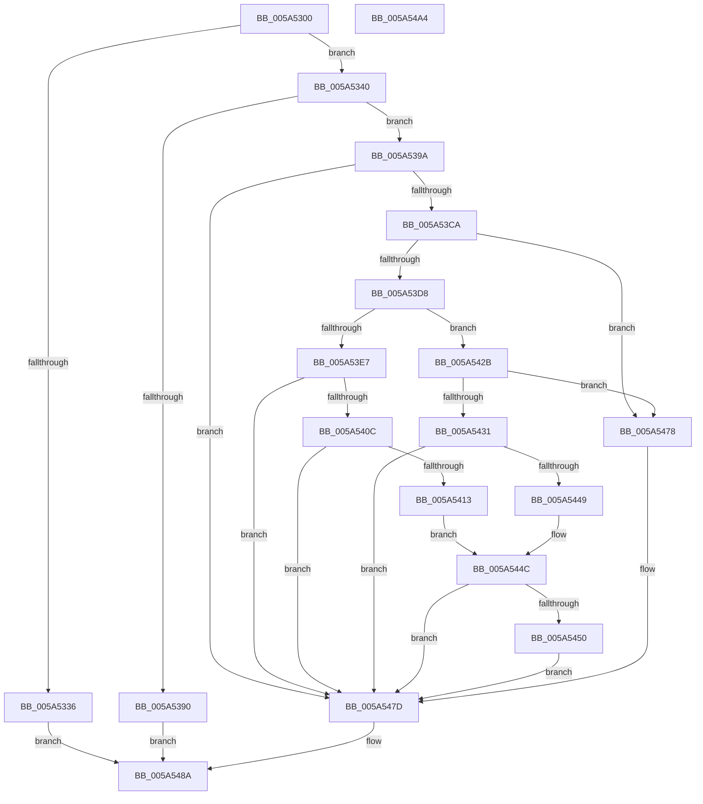

# PipEnumeratePersistedMemoryCallback

- RVA: `0x005A5300`–`0x005A54A5` (길이 `421` bytes)
- VA: `0x00000001405A5300`
- 실행 섹션: `.text`
- PDB 이름 있음: `예`; PDB Function 태그: `아니요`
- unwind 정보 RVA: `0x000BCF10`
- 디코드: `125`개 명령, `421/421` bytes 표시
- 미해석 바이트: `0` (있으면 어셈블리에 `.byte`로 보존)

> 이 문서는 커널 이미지의 기계어와 PDB 기호를 분석해 생성했습니다. 4번과 5번은 함수 원형과 자료형을 바이너리 사용 방식에서 추정한 C 해석이며 원본 소스 복구 결과는 아닙니다.

## 1. Dependencies

- 직접 호출 지점: **7**; 고유 호출 대상: **6**
- 직접 호출자로 확인된 함수: **0**
- RIP 상대 이미지 참조: **1**

### Outgoing calls
- `0x005A5369` → `ext-ms-win-ntos-ksr-l1-1-5.dll!KsrQueryMetadata` (import, 간접 대상; import `ext-ms-win-ntos-ksr-l1-1-5.dll!KsrQueryMetadata`)
- `0x005A5383` → [ExAllocatePool2](../../poolcode/B8/ExAllocatePool2_function_00B820F0.md) (function, `0x00B820F0`)
- `0x005A53B4` → `ext-ms-win-ntos-ksr-l1-1-5.dll!KsrQueryMetadata` (import, 간접 대상; import `ext-ms-win-ntos-ksr-l1-1-5.dll!KsrQueryMetadata`)
- `0x005A5401` → [PipMatchPersistentMemory](../../page/72/PipMatchPersistentMemory_function_0072594C.md) (function, `0x0072594C`)
- `0x005A543E` → [PipMatchPersistentMemoryV1](../../page/72/PipMatchPersistentMemoryV1_function_00725A30.md) (function, `0x00725A30`)
- `0x005A546F` → [guard_dispatch_icall](../6B/guard_dispatch_icall_function_006BAAD0.md) (function, `0x006BAAD0`)
- `0x005A5485` → [ExFreePoolWithTag](../../poolcode/B8/ExFreePoolWithTag_function_00B82870.md) (function, `0x00B82870`)

### Direct callers
- 이 함수 시작 RVA로 연결되는 직접 call은 확인되지 않았습니다. 간접 호출은 완전히 역산할 수 없습니다.

### Static image references
- `0x005A5369` → RVA `0x00151328` (`ext-ms-win-ntos-ksr-l1-1-5.dll!KsrQueryMetadata (IAT)`; read)

## 2. Other-region calls and transfers

- 다른 실행 섹션으로 향하는 call: **4**
  - `0x005A5383` → [ExAllocatePool2](../../poolcode/B8/ExAllocatePool2_function_00B820F0.md) (`.text` → `POOLCODE`)
  - `0x005A5401` → [PipMatchPersistentMemory](../../page/72/PipMatchPersistentMemory_function_0072594C.md) (`.text` → `PAGE`)
  - `0x005A543E` → [PipMatchPersistentMemoryV1](../../page/72/PipMatchPersistentMemoryV1_function_00725A30.md) (`.text` → `PAGE`)
  - `0x005A5485` → [ExFreePoolWithTag](../../poolcode/B8/ExFreePoolWithTag_function_00B82870.md) (`.text` → `POOLCODE`)
- 별도 외부 분기/꼬리 이동을 확인하지 못했습니다.

## 3. Assembly (complete function range)

```asm
005A5300  48 89 5C 24 08                  mov qword ptr [rsp + 8], rbx
005A5305  55                              push rbp
005A5306  56                              push rsi
005A5307  57                              push rdi
005A5308  41 54                           push r12
005A530A  41 55                           push r13
005A530C  41 56                           push r14
005A530E  41 57                           push r15
005A5310  48 8B EC                        mov rbp, rsp
005A5313  48 83 EC 60                     sub rsp, 0x60
005A5317  45 33 FF                        xor r15d, r15d
005A531A  49 8B F0                        mov rsi, r8
005A531D  48 8B DA                        mov rbx, rdx
005A5320  4C 8B F1                        mov r14, rcx
005A5323  66 44 89 7D 58                  mov word ptr [rbp + 0x58], r15w
005A5328  44 89 7D E4                     mov dword ptr [rbp - 0x1c], r15d
005A532C  44 89 7D E0                     mov dword ptr [rbp - 0x20], r15d
005A5330  4D 39 78 18                     cmp qword ptr [r8 + 0x18], r15
005A5334  75 0A                           jne 0x1405a5340
005A5336  BB 0D 00 00 C0                  mov ebx, 0xc000000d
005A533B  E9 4A 01 00 00                  jmp 0x1405a548a
005A5340  49 8B 00                        mov rax, qword ptr [r8]
005A5343  48 8D 4D E0                     lea rcx, [rbp - 0x20]
005A5347  4D 8B 60 08                     mov r12, qword ptr [r8 + 8]
005A534B  45 33 C9                        xor r9d, r9d
005A534E  4D 8B 68 10                     mov r13, qword ptr [r8 + 0x10]
005A5352  48 89 45 F0                     mov qword ptr [rbp - 0x10], rax
005A5356  49 8B 40 20                     mov rax, qword ptr [r8 + 0x20]
005A535A  45 33 C0                        xor r8d, r8d
005A535D  48 89 4C 24 20                  mov qword ptr [rsp + 0x20], rcx
005A5362  49 8B CE                        mov rcx, r14
005A5365  48 89 45 E8                     mov qword ptr [rbp - 0x18], rax
005A5369  48 FF 15 B8 BF BA FF            call qword ptr [rip - 0x454048]
005A5370  0F 1F 44 00 00                  nop dword ptr [rax + rax]
005A5375  8B 55 E0                        mov edx, dword ptr [rbp - 0x20]
005A5378  B9 40 00 00 00                  mov ecx, 0x40
005A537D  41 B8 50 6E 70 61               mov r8d, 0x61706e50
005A5383  E8 68 CD 5D 00                  call 0x140b820f0
005A5388  48 8B F8                        mov rdi, rax
005A538B  48 85 C0                        test rax, rax
005A538E  75 0A                           jne 0x1405a539a
005A5390  BB 9A 00 00 C0                  mov ebx, 0xc000009a
005A5395  E9 F0 00 00 00                  jmp 0x1405a548a
005A539A  33 C0                           xor eax, eax
005A539C  4C 8B C7                        mov r8, rdi
005A539F  89 07                           mov dword ptr [rdi], eax
005A53A1  48 8B D3                        mov rdx, rbx
005A53A4  44 8B 4D E0                     mov r9d, dword ptr [rbp - 0x20]
005A53A8  48 8D 45 E0                     lea rax, [rbp - 0x20]
005A53AC  49 8B CE                        mov rcx, r14
005A53AF  48 89 44 24 20                  mov qword ptr [rsp + 0x20], rax
005A53B4  48 FF 15 6D BF BA FF            call qword ptr [rip - 0x454093]
005A53BB  0F 1F 44 00 00                  nop dword ptr [rax + rax]
005A53C0  8B D8                           mov ebx, eax
005A53C2  85 C0                           test eax, eax
005A53C4  0F 88 B3 00 00 00               js 0x1405a547d
005A53CA  B9 02 00 00 00                  mov ecx, 2
005A53CF  39 4D E0                        cmp dword ptr [rbp - 0x20], ecx
005A53D2  0F 82 A0 00 00 00               jb 0x1405a5478
005A53D8  0F B7 07                        movzx eax, word ptr [rdi]
005A53DB  4D 8B F7                        mov r14, r15
005A53DE  44 88 7D 50                     mov byte ptr [rbp + 0x50], r15b
005A53E2  66 3B C1                        cmp ax, cx
005A53E5  75 44                           jne 0x1405a542b
005A53E7  48 8D 45 50                     lea rax, [rbp + 0x50]
005A53EB  4C 8B CF                        mov r9, rdi
005A53EE  48 89 44 24 28                  mov qword ptr [rsp + 0x28], rax
005A53F3  45 33 C0                        xor r8d, r8d
005A53F6  49 8B D5                        mov rdx, r13
005A53F9  C6 44 24 20 01                  mov byte ptr [rsp + 0x20], 1
005A53FE  49 8B CC                        mov rcx, r12
005A5401  E8 46 05 18 00                  call 0x14072594c
005A5406  8B D8                           mov ebx, eax
005A5408  85 C0                           test eax, eax
005A540A  78 71                           js 0x1405a547d
005A540C  8A 4D 50                        mov cl, byte ptr [rbp + 0x50]
005A540F  84 C9                           test cl, cl
005A5411  74 6A                           je 0x1405a547d
005A5413  0F B7 47 10                     movzx eax, word ptr [rdi + 0x10]
005A5417  4C 8D 75 58                     lea r14, [rbp + 0x58]
005A541B  66 89 45 58                     mov word ptr [rbp + 0x58], ax
005A541F  4C 8D 7D E4                     lea r15, [rbp - 0x1c]
005A5423  8B 47 14                        mov eax, dword ptr [rdi + 0x14]
005A5426  89 45 E4                        mov dword ptr [rbp - 0x1c], eax
005A5429  EB 21                           jmp 0x1405a544c
005A542B  66 83 F8 01                     cmp ax, 1
005A542F  75 47                           jne 0x1405a5478
005A5431  4C 8D 4D 50                     lea r9, [rbp + 0x50]
005A5435  44 8A C0                        mov r8b, al
005A5438  48 8B D7                        mov rdx, rdi
005A543B  49 8B CC                        mov rcx, r12
005A543E  E8 ED 05 18 00                  call 0x140725a30
005A5443  8B D8                           mov ebx, eax
005A5445  85 C0                           test eax, eax
005A5447  78 34                           js 0x1405a547d
005A5449  8A 4D 50                        mov cl, byte ptr [rbp + 0x50]
005A544C  84 C9                           test cl, cl
005A544E  74 2D                           je 0x1405a547d
005A5450  48 8B 4D E8                     mov rcx, qword ptr [rbp - 0x18]
005A5454  4D 8B CE                        mov r9, r14
005A5457  48 8B 46 18                     mov rax, qword ptr [rsi + 0x18]
005A545B  4D 8B C5                        mov r8, r13
005A545E  48 89 4C 24 28                  mov qword ptr [rsp + 0x28], rcx
005A5463  49 8B D4                        mov rdx, r12
005A5466  48 8B 4D F0                     mov rcx, qword ptr [rbp - 0x10]
005A546A  4C 89 7C 24 20                  mov qword ptr [rsp + 0x20], r15
005A546F  E8 5C 56 11 00                  call 0x1406baad0
005A5474  8B D8                           mov ebx, eax
005A5476  EB 05                           jmp 0x1405a547d
005A5478  BB BB 00 00 C0                  mov ebx, 0xc00000bb
005A547D  BA 50 6E 70 61                  mov edx, 0x61706e50
005A5482  48 8B CF                        mov rcx, rdi
005A5485  E8 E6 D3 5D 00                  call 0x140b82870
005A548A  8B C3                           mov eax, ebx
005A548C  48 8B 9C 24 A0 00 00 00         mov rbx, qword ptr [rsp + 0xa0]
005A5494  48 83 C4 60                     add rsp, 0x60
005A5498  41 5F                           pop r15
005A549A  41 5E                           pop r14
005A549C  41 5D                           pop r13
005A549E  41 5C                           pop r12
005A54A0  5F                              pop rdi
005A54A1  5E                              pop rsi
005A54A2  5D                              pop rbp
005A54A3  C3                              ret
005A54A4  CC                              int3
```

## 4. C-style interpretation (structured pseudocode)

```c
__int64 __fastcall PipEnumeratePersistedMemoryCallback(__int64 a1, __int64 a2, __int64 a3, int a4)
{
    __int64 result;
    __int64 v_r15;
    __int64 v_rsp;
    unsigned __int64 v_stack_m48;
    unsigned __int64 v_stack_m50;
    unsigned int v_stack_m54;
    unsigned int v_stack_m58;
    unsigned __int64 v_stack_m70;
    unsigned __int64 v_stack_m78;
    unsigned __int8 v_stack_p18;
    unsigned __int16 v_stack_p20;
    unsigned __int64 v_stack_p8;

    v_stack_p8 = v_rbx;
    v_rsp = (v_rsp) - (96);
    v_r15 = 0;
    v_stack_p20 = 0;
    v_stack_m54 = 0;
    v_stack_m58 = 0;
    if ((*(unsigned __int64 *)(a3 + 24)) != 0) goto loc_005A5340;
    goto loc_005A548A;
loc_005A5340:
    a4 = 0;
    v_stack_m48 = *(unsigned __int64 *)(a3);
    a3 = 0;
    v_stack_m78 = v_stack_m58;
    v_stack_m50 = *(unsigned __int64 *)(a3 + 32);
    result = ext_ms_win_ntos_ksr_l1_1_5_dll_KsrQueryMetadata(a1, a2, a3, a4);
    result = ExAllocatePool2(64, (unsigned int)(v_stack_m58), (unsigned int)(0x61706E50ULL), a4);
    if (result != 0) goto loc_005A539A;
    goto loc_005A548A;
loc_005A539A:
    result = 0;
    *(unsigned int *)(result) = 0;
    v_stack_m78 = v_stack_m58;
    result = ext_ms_win_ntos_ksr_l1_1_5_dll_KsrQueryMetadata(a1, (unsigned int)(0xC000009AULL), 0, (unsigned int)(v_stack_m58));
    if (sign_flag) goto loc_005A547D;
    if (v_stack_m58 < 2) goto loc_005A5478;
    v_stack_p18 = 0;
    if (((unsigned __int16)(*(unsigned __int16 *)(result))) != 2) goto loc_005A542B;
    v_stack_m70 = v_stack_p18;
    a3 = 0;
    v_stack_m78 = 1;
    result = PipMatchPersistentMemory(*(unsigned __int64 *)(a3 + 8), *(unsigned __int64 *)(a3 + 16), a3, result);
    if (sign_flag) goto loc_005A547D;
    if ((unsigned __int8)(v_stack_p18) == 0) goto loc_005A547D;
    v_stack_p20 = (unsigned __int16)(*(unsigned __int16 *)(result + 16));
    v_stack_m54 = (unsigned int)((unsigned int)(*(unsigned int *)(result + 20)));
    goto loc_005A544C;
loc_005A542B:
    if (((unsigned __int16)((unsigned int)(*(unsigned int *)(result + 20)))) != 1) goto loc_005A5478;
    result = PipMatchPersistentMemoryV1(*(unsigned __int64 *)(a3 + 8), result, (unsigned __int8)((unsigned int)(*(unsigned int *)(result + 20))), v_stack_p18);
    if (sign_flag) goto loc_005A547D;
loc_005A544C:
    if ((unsigned __int8)(v_stack_p18) == 0) goto loc_005A547D;
    v_stack_m70 = v_stack_m50;
    v_stack_m78 = v_stack_m54;
    result = guard_dispatch_icall(v_stack_m48, *(unsigned __int64 *)(a3 + 8), *(unsigned __int64 *)(a3 + 16), v_stack_p20);
    goto loc_005A547D;
loc_005A5478:
loc_005A547D:
    result = ExFreePoolWithTag(result, (unsigned int)(0x61706E50ULL), *(unsigned __int64 *)(a3 + 16), v_stack_p20);
loc_005A548A:
    v_rsp = (v_rsp) + (96);
    return (unsigned int)((unsigned int)((unsigned int)(0xC00000BBULL)));
}
```

## 5. (Beta) C Style

```c
int64_t PipEnumeratePersistedMemoryCallback(int64_t Arg1, int64_t Arg2, void *Arg3, int32_t Arg4)
{
    uint8_t *arg3 = (uint8_t *)Arg3;

    int64_t result;
    int64_t local_r15;
    int64_t local_rsp;
    uint64_t v_stack_m48;
    uint64_t v_stack_m50;
    uint32_t v_stack_m54;
    uint32_t v_stack_m58;
    uint64_t v_stack_m70;
    uint64_t v_stack_m78;
    uint8_t v_stack_p18;
    uint16_t v_stack_p20;
    uint64_t v_stack_p8;

    v_stack_p8 = local_rbx;
    local_rsp = (local_rsp) - (96);
    local_r15 = 0;
    v_stack_p20 = 0;
    v_stack_m54 = 0;
    v_stack_m58 = 0;
    if ((*(uint64_t *)(arg3 + 0x18)) != 0) goto loc_005A5340;
    goto loc_005A548A;
loc_005A5340:
    Arg4 = 0;
    v_stack_m48 = *(uint64_t *)(arg3);
    Arg3 = 0;
    v_stack_m78 = v_stack_m58;
    v_stack_m50 = *(uint64_t *)(arg3 + 0x20);
    result = kernel_indirect_call(Arg1, Arg2, Arg3, Arg4);
    result = ExAllocatePool2(64, (uint32_t)(v_stack_m58), (uint32_t)(0x61706E50ULL), Arg4);
    if (result != 0) goto loc_005A539A;
    goto loc_005A548A;
loc_005A539A:
    result = 0;
    *(uint32_t *)(result) = 0;
    v_stack_m78 = v_stack_m58;
    result = kernel_indirect_call(Arg1, (uint32_t)(0xC000009AULL), 0, (uint32_t)(v_stack_m58));
    if (sign_flag) goto loc_005A547D;
    if (v_stack_m58 < 2) goto loc_005A5478;
    v_stack_p18 = 0;
    if (((uint16_t)(*(uint16_t *)(result))) != 2) goto loc_005A542B;
    v_stack_m70 = v_stack_p18;
    Arg3 = 0;
    v_stack_m78 = 1;
    result = PipMatchPersistentMemory(*(uint64_t *)(arg3 + 0x8), *(uint64_t *)(arg3 + 0x10), Arg3, result);
    if (sign_flag) goto loc_005A547D;
    if ((uint8_t)(v_stack_p18) == 0) goto loc_005A547D;
    v_stack_p20 = (uint16_t)(*(uint16_t *)(result + 0x10));
    v_stack_m54 = (uint32_t)((uint32_t)(*(uint32_t *)(result + 0x14)));
    goto loc_005A544C;
loc_005A542B:
    if (((uint16_t)((uint32_t)(*(uint32_t *)(result + 0x14)))) != 1) goto loc_005A5478;
    result = PipMatchPersistentMemoryV1(*(uint64_t *)(arg3 + 0x8), result, (uint8_t)((uint32_t)(*(uint32_t *)(result + 0x14))), v_stack_p18);
    if (sign_flag) goto loc_005A547D;
loc_005A544C:
    if ((uint8_t)(v_stack_p18) == 0) goto loc_005A547D;
    v_stack_m70 = v_stack_m50;
    v_stack_m78 = v_stack_m54;
    result = guard_dispatch_icall(v_stack_m48, *(uint64_t *)(arg3 + 0x8), *(uint64_t *)(arg3 + 0x10), v_stack_p20);
    goto loc_005A547D;
loc_005A5478:
loc_005A547D:
    result = ExFreePoolWithTag(result, (uint32_t)(0x61706E50ULL), *(uint64_t *)(arg3 + 0x10), v_stack_p20);
loc_005A548A:
    local_rsp = (local_rsp) + (96);
    return (uint32_t)((uint32_t)((uint32_t)(0xC00000BBULL)));
}
```

### 관측된 메모리 오프셋

구조체 형식이 확인되지 않은 접근은 인자 기준의 오프셋으로만 기록했습니다.

| 기준 인자 | 오프셋 표현 | 폭 (bit) | 접근 |
|---|---:|---:|---|
| `Arg3` | `+ 0x0` | `64` | `R` |
| `Arg3` | `+ 0x8` | `64` | `R` |
| `Arg3` | `+ 0x10` | `64` | `R` |
| `Arg3` | `+ 0x18` | `64` | `R` |
| `Arg3` | `+ 0x20` | `64` | `R` |

## 6. Execution-region graph

[열기: 2D/3D 그래프와 함수 탐색 컨트롤 패널](../../../control-panel.html?section=text&rva=0x005A5300&view=graph)

- 2D 그래프는 위에서 아래로 흐르고, 3D 그래프는 빈 공간을 드래그해 회전합니다. Shift+드래그는 이동, 휠은 확대·축소, 함수 노드 선택은 대상 보고서 이동입니다.

### Static fallback


