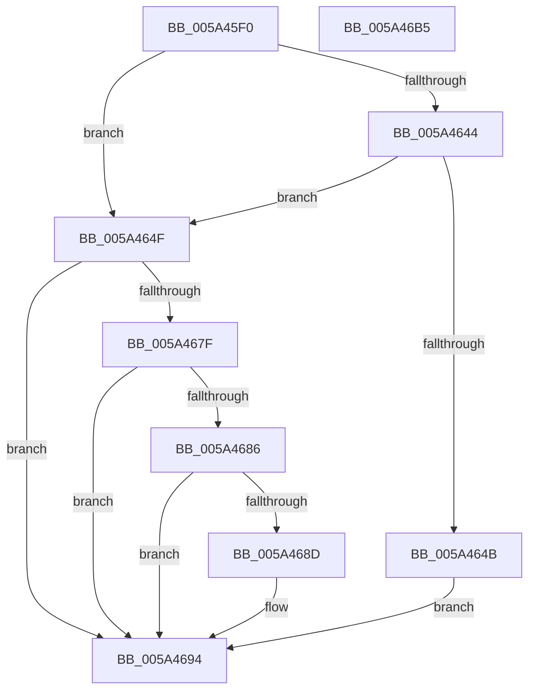

# PipIs32bitKey

- RVA: `0x005A45F0`–`0x005A46B6` (길이 `198` bytes)
- VA: `0x00000001405A45F0`
- 실행 섹션: `.text`
- PDB 이름 있음: `예`; PDB Function 태그: `아니요`
- unwind 정보 RVA: `0x000C8144`
- 디코드: `54`개 명령, `198/198` bytes 표시
- 미해석 바이트: `0` (있으면 어셈블리에 `.byte`로 보존)

> 이 문서는 커널 이미지의 기계어와 PDB 기호를 분석해 생성했습니다. 4번과 5번은 함수 원형과 자료형을 바이너리 사용 방식에서 추정한 C 해석이며 원본 소스 복구 결과는 아닙니다.

## 1. Dependencies

- 직접 호출 지점: **3**; 고유 호출 대상: **3**
- 직접 호출자로 확인된 함수: **1**
- RIP 상대 이미지 참조: **2**

### Outgoing calls
- `0x005A4636` → [ZwQueryKey](../6A/ZwQueryKey_function_006AD390.md) (function, `0x006AD390`)
- `0x005A4676` → [ZwQueryValueKey](../6A/ZwQueryValueKey_function_006AD3B0.md) (function, `0x006AD3B0`)
- `0x005A469E` → [_security_check_cookie](../6A/_security_check_cookie_function_006AC640.md) (function, `0x006AC640`)

### Direct callers
- [PnpLoadBootFilterDriver](../../init/C7/PnpLoadBootFilterDriver_function_00C77938.md) at `0x00C77AA5`

### Static image references
- `0x005A4600` → RVA `0x00E0A740` (`.data`; read)
- `0x005A4660` → RVA `0x00009F70` (`.rdata`; read)

## 2. Other-region calls and transfers

- 다른 실행 섹션으로 향하는 call: **0**
- 별도 외부 분기/꼬리 이동을 확인하지 못했습니다.

## 3. Assembly (complete function range)

```asm
005A45F0  4C 8B DC                        mov r11, rsp
005A45F3  49 89 5B 10                     mov qword ptr [r11 + 0x10], rbx
005A45F7  49 89 73 18                     mov qword ptr [r11 + 0x18], rsi
005A45FB  57                              push rdi
005A45FC  48 83 EC 70                     sub rsp, 0x70
005A4600  48 8B 05 39 61 86 00            mov rax, qword ptr [rip + 0x866139]
005A4607  48 33 C4                        xor rax, rsp
005A460A  48 89 44 24 60                  mov qword ptr [rsp + 0x60], rax
005A460F  33 C0                           xor eax, eax
005A4611  4D 8D 43 C0                     lea r8, [r11 - 0x40]
005A4615  21 44 24 30                     and dword ptr [rsp + 0x30], eax
005A4619  41 B9 0C 00 00 00               mov r9d, 0xc
005A461F  49 89 43 C0                     mov qword ptr [r11 - 0x40], rax
005A4623  48 8B F9                        mov rdi, rcx
005A4626  89 44 24 40                     mov dword ptr [rsp + 0x40], eax
005A462A  49 8D 43 B8                     lea rax, [r11 - 0x48]
005A462E  49 89 43 A8                     mov qword ptr [r11 - 0x58], rax
005A4632  41 8D 51 F9                     lea edx, [r9 - 7]
005A4636  E8 55 8D 10 00                  call 0x1406ad390
005A463B  BE 01 00 00 00                  mov esi, 1
005A4640  85 C0                           test eax, eax
005A4642  78 0B                           js 0x1405a464f
005A4644  40 84 74 24 38                  test byte ptr [rsp + 0x38], sil
005A4649  74 04                           je 0x1405a464f
005A464B  8B DE                           mov ebx, esi
005A464D  EB 45                           jmp 0x1405a4694
005A464F  48 8D 44 24 30                  lea rax, [rsp + 0x30]
005A4654  33 DB                           xor ebx, ebx
005A4656  48 89 44 24 28                  mov qword ptr [rsp + 0x28], rax
005A465B  4C 8D 4C 24 48                  lea r9, [rsp + 0x48]
005A4660  48 8D 15 09 59 A6 FF            lea rdx, [rip - 0x59a6f7]
005A4667  C7 44 24 20 14 00 00 00         mov dword ptr [rsp + 0x20], 0x14
005A466F  48 8B CF                        mov rcx, rdi
005A4672  44 8D 43 02                     lea r8d, [rbx + 2]
005A4676  E8 35 8D 10 00                  call 0x1406ad3b0
005A467B  85 C0                           test eax, eax
005A467D  78 15                           js 0x1405a4694
005A467F  83 7C 24 4C 04                  cmp dword ptr [rsp + 0x4c], 4
005A4684  75 0E                           jne 0x1405a4694
005A4686  83 7C 24 50 04                  cmp dword ptr [rsp + 0x50], 4
005A468B  75 07                           jne 0x1405a4694
005A468D  39 74 24 54                     cmp dword ptr [rsp + 0x54], esi
005A4691  0F 44 DE                        cmove ebx, esi
005A4694  8B C3                           mov eax, ebx
005A4696  48 8B 4C 24 60                  mov rcx, qword ptr [rsp + 0x60]
005A469B  48 33 CC                        xor rcx, rsp
005A469E  E8 9D 7F 10 00                  call 0x1406ac640
005A46A3  4C 8D 5C 24 70                  lea r11, [rsp + 0x70]
005A46A8  49 8B 5B 18                     mov rbx, qword ptr [r11 + 0x18]
005A46AC  49 8B 73 20                     mov rsi, qword ptr [r11 + 0x20]
005A46B0  49 8B E3                        mov rsp, r11
005A46B3  5F                              pop rdi
005A46B4  C3                              ret
005A46B5  CC                              int3
```

## 4. C-style interpretation (structured pseudocode)

```c
__int64 __fastcall PipIs32bitKey(__int64 a1)
{
    __int64 result;
    __int64 v_rbx;
    __int64 v_rsp;
    unsigned __int64 v_stack_m18;
    unsigned int v_stack_m24;
    unsigned int v_stack_m28;
    unsigned int v_stack_m2C;
    unsigned __int64 v_stack_m30;
    unsigned int v_stack_m38;
    unsigned __int8 v_stack_m40;
    unsigned int v_stack_m48;
    unsigned __int64 v_stack_m50;
    unsigned int v_stack_m58;
    unsigned __int64 v_stack_m8;

    *(unsigned __int64 *)(v_rsp + 16) = v_rbx;
    *(unsigned __int64 *)(v_rsp + 24) = v_rsi;
    v_rsp = (v_rsp) - (112);
    result = (*(unsigned __int64 *)(v_rip + 8806713)) ^ (v_rsp);
    v_stack_m18 = result;
    result = 0;
    *(unsigned __int64 *)(v_rsp - 64) = 0;
    v_stack_m38 = 0;
    *(unsigned __int64 *)(v_rsp - 88) = v_rsp - 72;
    result = ZwQueryKey(a1, 12 - 7, v_rsp - 64, 12);
    if (sign_flag) goto loc_005A464F;
    if (((v_stack_m40) & (1)) == 0) goto loc_005A464F;
    goto loc_005A4694;
loc_005A464F:
    v_rbx = 0;
    v_stack_m50 = v_stack_m48;
    v_stack_m58 = 20;
    result = ZwQueryValueKey(a1, v_rip - 5875447, v_rbx + 2, v_stack_m30);
    if (sign_flag) goto loc_005A4694;
    if (v_stack_m2C != 4) goto loc_005A4694;
    if (v_stack_m28 == 4) {
        if (v_stack_m24 == 1) { v_rbx = 1; }
    }
    a1 = (v_stack_m18) ^ (v_rsp);
    result = _security_check_cookie(a1, v_rip - 5875447, v_rbx + 2, v_stack_m30);
    return result;
}
```

## 5. (Beta) C Style

```c
int64_t PipIs32bitKey(int64_t Arg1)
{
    int64_t result;
    int64_t local_rbx;
    int64_t local_rsp;
    uint64_t v_stack_m18;
    uint32_t v_stack_m24;
    uint32_t v_stack_m28;
    uint32_t v_stack_m2C;
    uint64_t v_stack_m30;
    uint32_t v_stack_m38;
    uint8_t v_stack_m40;
    uint32_t v_stack_m48;
    uint64_t v_stack_m50;
    uint32_t v_stack_m58;
    uint64_t v_stack_m8;

    *(uint64_t *)(local_rsp + 0x10) = local_rbx;
    *(uint64_t *)(local_rsp + 0x18) = local_rsi;
    local_rsp = (local_rsp) - (112);
    result = (*(uint64_t *)(v_rip + 0x866139)) ^ (local_rsp);
    v_stack_m18 = result;
    result = 0;
    *(uint64_t *)(local_rsp - 0x40) = 0;
    v_stack_m38 = 0;
    *(uint64_t *)(local_rsp - 0x58) = local_rsp - 72;
    result = ZwQueryKey(Arg1, 12 - 7, local_rsp - 64, 12);
    if (sign_flag) goto loc_005A464F;
    if (((v_stack_m40) & (1)) == 0) goto loc_005A464F;
    goto loc_005A4694;
loc_005A464F:
    local_rbx = 0;
    v_stack_m50 = v_stack_m48;
    v_stack_m58 = 20;
    result = ZwQueryValueKey(Arg1, v_rip - 5875447, local_rbx + 2, v_stack_m30);
    if (sign_flag) goto loc_005A4694;
    if (v_stack_m2C != 4) goto loc_005A4694;
    if (v_stack_m28 == 4) {
        if (v_stack_m24 == 1) { local_rbx = 1; }
    }
    Arg1 = (v_stack_m18) ^ (local_rsp);
    result = _security_check_cookie(Arg1, v_rip - 5875447, local_rbx + 2, v_stack_m30);
    return result;
}
```

## 6. Execution-region graph

[열기: 2D/3D 그래프와 함수 탐색 컨트롤 패널](../../../control-panel.html?section=text&rva=0x005A45F0&view=graph)

- 2D 그래프는 위에서 아래로 흐르고, 3D 그래프는 빈 공간을 드래그해 회전합니다. Shift+드래그는 이동, 휠은 확대·축소, 함수 노드 선택은 대상 보고서 이동입니다.

### Static fallback


