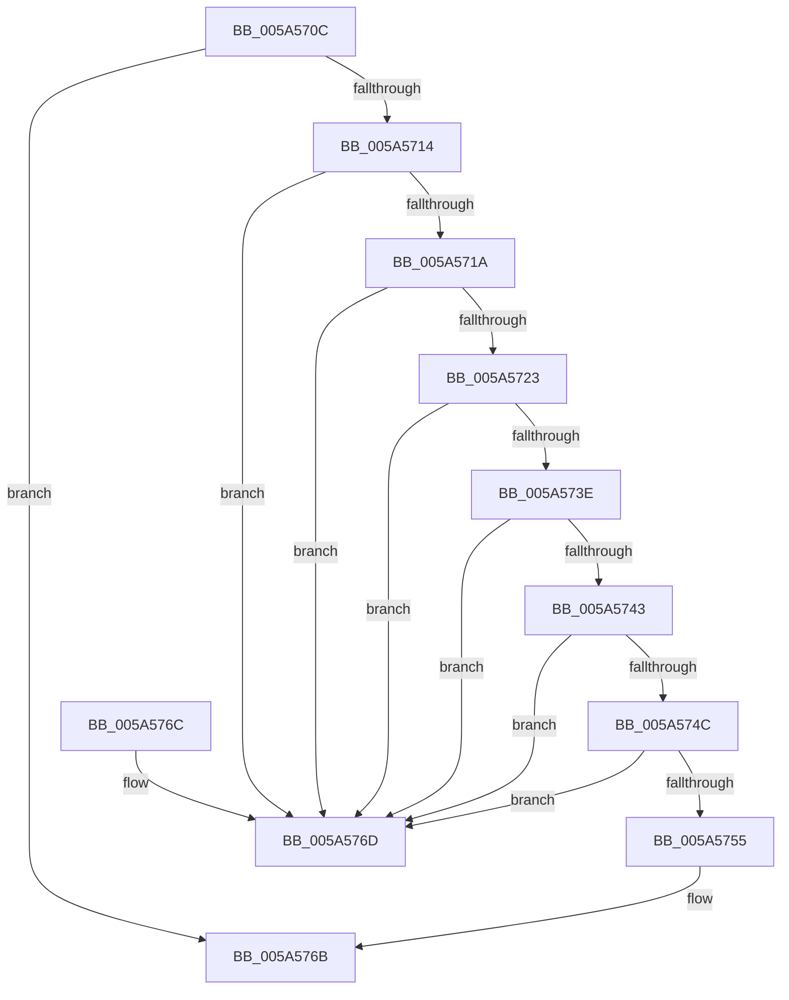

# PipMoveListEntries

- RVA: `0x005A570C`–`0x005A5774` (길이 `104` bytes)
- VA: `0x00000001405A570C`
- 실행 섹션: `.text`
- PDB 이름 있음: `예`; PDB Function 태그: `아니요`
- unwind 정보 RVA: `0x000DB714`
- 디코드: `34`개 명령, `104/104` bytes 표시
- 미해석 바이트: `0` (있으면 어셈블리에 `.byte`로 보존)

> 이 문서는 커널 이미지의 기계어와 PDB 기호를 분석해 생성했습니다. 4번과 5번은 함수 원형과 자료형을 바이너리 사용 방식에서 추정한 C 해석이며 원본 소스 복구 결과는 아닙니다.

## 1. Dependencies

- 직접 호출 지점: **0**; 고유 호출 대상: **0**
- 직접 호출자로 확인된 함수: **2**
- RIP 상대 이미지 참조: **0**

### Outgoing calls
- 직접 디코드된 call 명령이 없습니다.

### Direct callers
- [PipMergeDependencyEdgeList](../../page/72/PipMergeDependencyEdgeList_function_00727D4C.md) at `0x00727E87`
- [PipMergeDependencyNodes](../../page/72/PipMergeDependencyNodes_function_00727EB8.md) at `0x00727EDC`

### Static image references
- 디코드된 RIP-relative 메모리 참조가 없습니다.

## 2. Other-region calls and transfers

- 다른 실행 섹션으로 향하는 call: **0**
- 별도 외부 분기/꼬리 이동을 확인하지 못했습니다.

## 3. Assembly (complete function range)

```asm
005A570C  4C 8B 02                        mov r8, qword ptr [rdx]
005A570F  4C 3B C2                        cmp r8, rdx
005A5712  74 57                           je 0x1405a576b
005A5714  49 39 50 08                     cmp qword ptr [r8 + 8], rdx
005A5718  75 53                           jne 0x1405a576d
005A571A  48 8B 42 08                     mov rax, qword ptr [rdx + 8]
005A571E  48 39 10                        cmp qword ptr [rax], rdx
005A5721  75 4A                           jne 0x1405a576d
005A5723  4C 89 00                        mov qword ptr [rax], r8
005A5726  49 89 40 08                     mov qword ptr [r8 + 8], rax
005A572A  48 89 52 08                     mov qword ptr [rdx + 8], rdx
005A572E  48 89 12                        mov qword ptr [rdx], rdx
005A5731  48 8B 01                        mov rax, qword ptr [rcx]
005A5734  48 8B 51 08                     mov rdx, qword ptr [rcx + 8]
005A5738  48 39 48 08                     cmp qword ptr [rax + 8], rcx
005A573C  75 2F                           jne 0x1405a576d
005A573E  48 39 0A                        cmp qword ptr [rdx], rcx
005A5741  75 2A                           jne 0x1405a576d
005A5743  49 8B 00                        mov rax, qword ptr [r8]
005A5746  4C 39 40 08                     cmp qword ptr [rax + 8], r8
005A574A  75 21                           jne 0x1405a576d
005A574C  49 8B 40 08                     mov rax, qword ptr [r8 + 8]
005A5750  4C 39 00                        cmp qword ptr [rax], r8
005A5753  75 18                           jne 0x1405a576d
005A5755  4C 89 02                        mov qword ptr [rdx], r8
005A5758  49 8B 40 08                     mov rax, qword ptr [r8 + 8]
005A575C  48 89 41 08                     mov qword ptr [rcx + 8], rax
005A5760  49 8B 40 08                     mov rax, qword ptr [r8 + 8]
005A5764  48 89 08                        mov qword ptr [rax], rcx
005A5767  49 89 50 08                     mov qword ptr [r8 + 8], rdx
005A576B  C3                              ret
005A576C  CC                              int3
005A576D  B9 03 00 00 00                  mov ecx, 3
005A5772  CD 29                           int 0x29
```

## 4. C-style interpretation (structured pseudocode)

```c
__int64 __fastcall PipMoveListEntries(__int64 a1, __int64 a2)
{
    if ((*(unsigned __int64 *)(a2)) == a2) goto loc_005A576B;
    if ((*(unsigned __int64 *)(*(unsigned __int64 *)(a2) + 8)) != a2) goto loc_005A576D;
    if ((*(unsigned __int64 *)(*(unsigned __int64 *)(a2 + 8))) != a2) goto loc_005A576D;
    *(unsigned __int64 *)(*(unsigned __int64 *)(a2 + 8)) = *(unsigned __int64 *)(a2);
    *(unsigned __int64 *)(*(unsigned __int64 *)(a2) + 8) = *(unsigned __int64 *)(a2 + 8);
    *(unsigned __int64 *)(a2 + 8) = a2;
    *(unsigned __int64 *)(a2) = a2;
    if ((*(unsigned __int64 *)(*(unsigned __int64 *)(a1) + 8)) != a1) goto loc_005A576D;
    if ((*(unsigned __int64 *)(*(unsigned __int64 *)(a1 + 8))) != a1) goto loc_005A576D;
    if ((*(unsigned __int64 *)(*(unsigned __int64 *)(*(unsigned __int64 *)(a2)) + 8)) != (*(unsigned __int64 *)(a2))) goto loc_005A576D;
    if ((*(unsigned __int64 *)(*(unsigned __int64 *)(*(unsigned __int64 *)(a2) + 8))) != (*(unsigned __int64 *)(a2))) goto loc_005A576D;
    *(unsigned __int64 *)(*(unsigned __int64 *)(a1 + 8)) = *(unsigned __int64 *)(a2);
    *(unsigned __int64 *)(a1 + 8) = *(unsigned __int64 *)(*(unsigned __int64 *)(a2) + 8);
    *(unsigned __int64 *)(*(unsigned __int64 *)(*(unsigned __int64 *)(a2) + 8)) = a1;
    *(unsigned __int64 *)(*(unsigned __int64 *)(a2) + 8) = *(unsigned __int64 *)(a1 + 8);
loc_005A576B:
    return *(unsigned __int64 *)(*(unsigned __int64 *)(a2) + 8);
loc_005A576D:
    return *(unsigned __int64 *)(*(unsigned __int64 *)(a2) + 8);
}
```

## 5. (Beta) C Style

```c
int64_t PipMoveListEntries(void *Arg1, void *Arg2)
{
    uint8_t *arg1 = (uint8_t *)Arg1;
    uint8_t *arg2 = (uint8_t *)Arg2;

    if ((*(uint64_t *)(arg2)) == Arg2) goto loc_005A576B;
    if ((*(uint64_t *)(*(uint64_t *)(arg2) + 0x8)) != Arg2) goto loc_005A576D;
    if ((*(uint64_t *)(*(uint64_t *)(arg2 + 0x8))) != Arg2) goto loc_005A576D;
    *(uint64_t *)(*(uint64_t *)(arg2 + 0x8)) = *(uint64_t *)(arg2);
    *(uint64_t *)(*(uint64_t *)(arg2) + 0x8) = *(uint64_t *)(arg2 + 0x8);
    *(void **)(arg2 + 0x8) = Arg2;
    *(void **)(arg2) = Arg2;
    if ((*(uint64_t *)(*(uint64_t *)(arg1) + 0x8)) != Arg1) goto loc_005A576D;
    if ((*(uint64_t *)(*(uint64_t *)(arg1 + 0x8))) != Arg1) goto loc_005A576D;
    if ((*(uint64_t *)(*(uint64_t *)(*(uint64_t *)(arg2)) + 0x8)) != (*(uint64_t *)(arg2))) goto loc_005A576D;
    if ((*(uint64_t *)(*(uint64_t *)(*(uint64_t *)(arg2) + 0x8))) != (*(uint64_t *)(arg2))) goto loc_005A576D;
    *(uint64_t *)(*(uint64_t *)(arg1 + 0x8)) = *(uint64_t *)(arg2);
    *(uint64_t *)(arg1 + 0x8) = *(uint64_t *)(*(uint64_t *)(arg2) + 0x8);
    *(void **)(*(uint64_t *)(*(uint64_t *)(arg2) + 0x8)) = Arg1;
    *(uint64_t *)(*(uint64_t *)(arg2) + 0x8) = *(uint64_t *)(arg1 + 0x8);
loc_005A576B:
    return *(uint64_t *)(*(uint64_t *)(arg2) + 0x8);
loc_005A576D:
    return *(uint64_t *)(*(uint64_t *)(arg2) + 0x8);
}
```

### 관측된 메모리 오프셋

구조체 형식이 확인되지 않은 접근은 인자 기준의 오프셋으로만 기록했습니다.

| 기준 인자 | 오프셋 표현 | 폭 (bit) | 접근 |
|---|---:|---:|---|
| `Arg1` | `+ 0x0` | `64` | `R` |
| `Arg1` | `+ 0x8` | `64` | `R` |
| `Arg1` | `+ 0x8` | `64` | `W` |
| `Arg2` | `+ 0x0` | `64` | `R` |
| `Arg2` | `+ 0x0` | `64` | `W` |
| `Arg2` | `+ 0x8` | `64` | `R` |
| `Arg2` | `+ 0x8` | `64` | `W` |

## 6. Execution-region graph

[열기: 2D/3D 그래프와 함수 탐색 컨트롤 패널](../../../control-panel.html?section=text&rva=0x005A570C&view=graph)

- 2D 그래프는 위에서 아래로 흐르고, 3D 그래프는 빈 공간을 드래그해 회전합니다. Shift+드래그는 이동, 휠은 확대·축소, 함수 노드 선택은 대상 보고서 이동입니다.

### Static fallback


