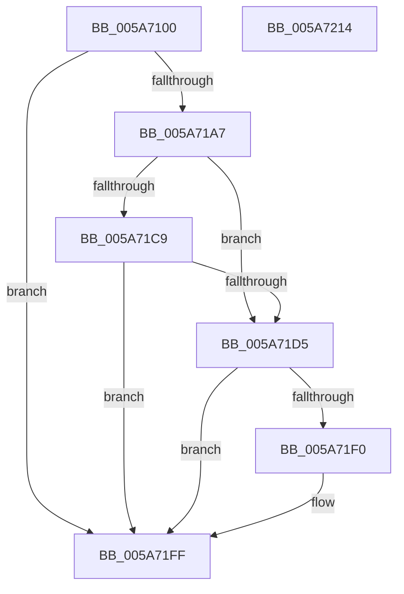

# PipRestoreDevNodeState

- RVA: `0x005A7100`–`0x005A7215` (길이 `277` bytes)
- VA: `0x00000001405A7100`
- 실행 섹션: `.text`
- PDB 이름 있음: `예`; PDB Function 태그: `아니요`
- unwind 정보 RVA: `0x0005C954`
- 디코드: `65`개 명령, `277/277` bytes 표시
- 미해석 바이트: `0` (있으면 어셈블리에 `.byte`로 보존)

> 이 문서는 커널 이미지의 기계어와 PDB 기호를 분석해 생성했습니다. 4번과 5번은 함수 원형과 자료형을 바이너리 사용 방식에서 추정한 C 해석이며 원본 소스 복구 결과는 아닙니다.

## 1. Dependencies

- 직접 호출 지점: **9**; 고유 호출 대상: **5**
- 직접 호출자로 확인된 함수: **5**
- RIP 상대 이미지 참조: **1**

### Outgoing calls
- `0x005A711E` → [KeAcquireSpinLockRaiseToDpc](../20/KeAcquireSpinLockRaiseToDpc_function_00208470.md) (function, `0x00208470`)
- `0x005A7135` → [PipIsDevNodeDNStarted](../47/PipIsDevNodeDNStarted_function_00470870.md) (function, `0x00470870`)
- `0x005A719B` → [KeReleaseSpinLock](../39/KeReleaseSpinLock_function_00392BA0.md) (function, `0x00392BA0`)
- `0x005A71B3` → [PipAreDriversLoadedWorker](../47/PipAreDriversLoadedWorker_function_004708F8.md) (function, `0x004708F8`)
- `0x005A71BF` → [PipAreDriversLoadedWorker](../47/PipAreDriversLoadedWorker_function_004708F8.md) (function, `0x004708F8`)
- `0x005A71CC` → [PipIsDevNodeDNStarted](../47/PipIsDevNodeDNStarted_function_00470870.md) (function, `0x00470870`)
- `0x005A71DF` → [PnpRaiseNtPlugPlayDevicePropertyChangeEvent](../../page/8F/PnpRaiseNtPlugPlayDevicePropertyChangeEvent_function_008F7D80.md) (function, `0x008F7D80`)
- `0x005A71E7` → [PipIsDevNodeDNStarted](../47/PipIsDevNodeDNStarted_function_00470870.md) (function, `0x00470870`)
- `0x005A71FA` → [PnpRaiseNtPlugPlayDevicePropertyChangeEvent](../../page/8F/PnpRaiseNtPlugPlayDevicePropertyChangeEvent_function_008F7D80.md) (function, `0x008F7D80`)

### Direct callers
- [PnpRemoveLockedDeviceNode](../47/PnpRemoveLockedDeviceNode_function_004702AC.md) at `0x00470681`
- [PnpCancelRemoveLockedDeviceNode](../../page/72/PnpCancelRemoveLockedDeviceNode_function_0072CFE0.md) at `0x0072D01D`
- [PnpCancelStopDeviceNode](../../page/73/PnpCancelStopDeviceNode_function_0073F048.md) at `0x0073F0A4`
- [PnpSurpriseRemoveLockedDeviceNode](../../page/A0/PnpSurpriseRemoveLockedDeviceNode_function_00A08370.md) at `0x00A08531`
- [PipDeviceRemovalCheckDeviceNodeState](../../page/A8/PipDeviceRemovalCheckDeviceNodeState_function_00A8FA68.md) at `0x00A8FAA2`

### Static image references
- `0x005A7117` → RVA `0x00F8AD90` (`.data`; read)

## 2. Other-region calls and transfers

- 다른 실행 섹션으로 향하는 call: **2**
  - `0x005A71DF` → [PnpRaiseNtPlugPlayDevicePropertyChangeEvent](../../page/8F/PnpRaiseNtPlugPlayDevicePropertyChangeEvent_function_008F7D80.md) (`.text` → `PAGE`)
  - `0x005A71FA` → [PnpRaiseNtPlugPlayDevicePropertyChangeEvent](../../page/8F/PnpRaiseNtPlugPlayDevicePropertyChangeEvent_function_008F7D80.md) (`.text` → `PAGE`)
- 별도 외부 분기/꼬리 이동을 확인하지 못했습니다.

## 3. Assembly (complete function range)

```asm
005A7100  48 89 5C 24 08                  mov qword ptr [rsp + 8], rbx
005A7105  48 89 6C 24 10                  mov qword ptr [rsp + 0x10], rbp
005A710A  48 89 74 24 18                  mov qword ptr [rsp + 0x18], rsi
005A710F  57                              push rdi
005A7110  48 83 EC 20                     sub rsp, 0x20
005A7114  48 8B D9                        mov rbx, rcx
005A7117  48 8D 0D 72 3C 9E 00            lea rcx, [rip + 0x9e3c72]
005A711E  E8 4D 13 C6 FF                  call 0x140208470
005A7123  8B B3 2C 01 00 00               mov esi, dword ptr [rbx + 0x12c]
005A7129  48 8B CB                        mov rcx, rbx
005A712C  8B AB 30 01 00 00               mov ebp, dword ptr [rbx + 0x130]
005A7132  44 8A C8                        mov r9b, al
005A7135  E8 36 97 EC FF                  call 0x140470870
005A713A  8B 93 2C 01 00 00               mov edx, dword ptr [rbx + 0x12c]
005A7140  8B F8                           mov edi, eax
005A7142  8B 8B 30 01 00 00               mov ecx, dword ptr [rbx + 0x130]
005A7148  89 8B 2C 01 00 00               mov dword ptr [rbx + 0x12c], ecx
005A714E  48 A1 14 00 00 00 80 F7 FF FF   movabs rax, qword ptr [0xfffff78000000014]
005A7158  8B 8B 84 01 00 00               mov ecx, dword ptr [rbx + 0x184]
005A715E  48 89 83 78 03 00 00            mov qword ptr [rbx + 0x378], rax
005A7165  B8 CD CC CC CC                  mov eax, 0xcccccccd
005A716A  89 94 8B 34 01 00 00            mov dword ptr [rbx + rcx*4 + 0x134], edx
005A7171  48 8D 0D 18 3C 9E 00            lea rcx, [rip + 0x9e3c18]
005A7178  44 8B 83 84 01 00 00            mov r8d, dword ptr [rbx + 0x184]
005A717F  41 FF C0                        inc r8d
005A7182  41 F7 E0                        mul r8d
005A7185  C1 EA 04                        shr edx, 4
005A7188  8D 04 92                        lea eax, [rdx + rdx*4]
005A718B  41 8A D1                        mov dl, r9b
005A718E  C1 E0 02                        shl eax, 2
005A7191  44 2B C0                        sub r8d, eax
005A7194  44 89 83 84 01 00 00            mov dword ptr [rbx + 0x184], r8d
005A719B  E8 00 BA DE FF                  call 0x140392ba0
005A71A0  48 83 7B 30 00                  cmp qword ptr [rbx + 0x30], 0
005A71A5  74 58                           je 0x1405a71ff
005A71A7  8B 8B 2C 01 00 00               mov ecx, dword ptr [rbx + 0x12c]
005A71AD  8B 93 30 01 00 00               mov edx, dword ptr [rbx + 0x130]
005A71B3  E8 40 97 EC FF                  call 0x1404708f8
005A71B8  8B D5                           mov edx, ebp
005A71BA  8B CE                           mov ecx, esi
005A71BC  44 8B C8                        mov r9d, eax
005A71BF  E8 34 97 EC FF                  call 0x1404708f8
005A71C4  44 3B C8                        cmp r9d, eax
005A71C7  75 0C                           jne 0x1405a71d5
005A71C9  48 8B CB                        mov rcx, rbx
005A71CC  E8 9F 96 EC FF                  call 0x140470870
005A71D1  3B C7                           cmp eax, edi
005A71D3  74 2A                           je 0x1405a71ff
005A71D5  48 8B 53 30                     mov rdx, qword ptr [rbx + 0x30]
005A71D9  41 B8 0B 00 00 00               mov r8d, 0xb
005A71DF  E8 9C 0B 35 00                  call 0x1408f7d80
005A71E4  48 8B CB                        mov rcx, rbx
005A71E7  E8 84 96 EC FF                  call 0x140470870
005A71EC  3B C7                           cmp eax, edi
005A71EE  74 0F                           je 0x1405a71ff
005A71F0  48 8B 53 30                     mov rdx, qword ptr [rbx + 0x30]
005A71F4  41 B8 1A 00 00 00               mov r8d, 0x1a
005A71FA  E8 81 0B 35 00                  call 0x1408f7d80
005A71FF  48 8B 5C 24 30                  mov rbx, qword ptr [rsp + 0x30]
005A7204  48 8B 6C 24 38                  mov rbp, qword ptr [rsp + 0x38]
005A7209  48 8B 74 24 40                  mov rsi, qword ptr [rsp + 0x40]
005A720E  48 83 C4 20                     add rsp, 0x20
005A7212  5F                              pop rdi
005A7213  C3                              ret
005A7214  CC                              int3
```

## 4. C-style interpretation (structured pseudocode)

```c
__int64 __fastcall PipRestoreDevNodeState(__int64 a1)
{
    __int64 result;
    __int64 v_rsp;
    unsigned __int64 v_stack_p10;
    unsigned __int64 v_stack_p18;
    unsigned __int64 v_stack_p8;

    v_stack_p8 = v_rbx;
    v_stack_p10 = v_rbp;
    v_stack_p18 = v_rsi;
    v_rsp = (v_rsp) - (32);
    result = KeAcquireSpinLockRaiseToDpc(v_rip + 10370162, a2, a3, a4);
    result = PipIsDevNodeDNStarted(a1, a2, a3, (unsigned __int8)(result));
    *(unsigned int *)(a1 + 300) = (unsigned int)((unsigned int)(*(unsigned int *)(a1 + 304)));
    *(unsigned __int64 *)(a1 + 888) = result;
    *(unsigned int *)(a1 + (unsigned int)(*(unsigned int *)(a1 + 388)) * 4 + 308) = (unsigned int)((unsigned int)(*(unsigned int *)(a1 + 300)));
    a3 = (unsigned int)(((unsigned int)(*(unsigned int *)(a1 + 388))) + 1);
    a2 = (unsigned int)(((unsigned int)(*(unsigned int *)(a1 + 300))) >> (4));
    result = (unsigned int)((a2 + a2 * 4) << (2));
    a3 = (unsigned int)((a3) - ((unsigned int)(result)));
    *(unsigned int *)(a1 + 388) = (unsigned int)(a3);
    result = KeReleaseSpinLock(v_rip + 10370072, (unsigned __int8)((unsigned __int8)(result)), a3, (unsigned __int8)(result));
    if ((*(unsigned __int64 *)(a1 + 48)) == 0) goto loc_005A71FF;
    result = PipAreDriversLoadedWorker((unsigned int)(*(unsigned int *)(a1 + 300)), (unsigned int)(*(unsigned int *)(a1 + 304)), a3, (unsigned __int8)(result));
    result = PipAreDriversLoadedWorker((unsigned int)((unsigned int)((unsigned int)(*(unsigned int *)(a1 + 300)))), (unsigned int)((unsigned int)((unsigned int)(*(unsigned int *)(a1 + 304)))), a3, (unsigned int)((unsigned int)(result)));
    if (((unsigned int)((unsigned int)((unsigned int)(result)))) != ((unsigned int)(result))) goto loc_005A71D5;
    result = PipIsDevNodeDNStarted(a1, (unsigned int)((unsigned int)((unsigned int)(*(unsigned int *)(a1 + 304)))), a3, (unsigned int)((unsigned int)(result)));
    if (((unsigned int)(result)) == ((unsigned int)((unsigned int)((unsigned int)(result))))) goto loc_005A71FF;
loc_005A71D5:
    result = PnpRaiseNtPlugPlayDevicePropertyChangeEvent(a1, *(unsigned __int64 *)(a1 + 48), 11, (unsigned int)((unsigned int)(result)));
    result = PipIsDevNodeDNStarted(a1, *(unsigned __int64 *)(a1 + 48), 11, (unsigned int)((unsigned int)(result)));
    if (((unsigned int)(result)) != ((unsigned int)((unsigned int)((unsigned int)(result))))) {
        a2 = *(unsigned __int64 *)(a1 + 48);
        a3 = 26;
        result = PnpRaiseNtPlugPlayDevicePropertyChangeEvent(a1, a2, a3, (unsigned int)((unsigned int)(result)));
    }
    v_rsp = (v_rsp) + (32);
    return result;
}
```

## 5. (Beta) C Style

```c
int64_t PipRestoreDevNodeState(void *Arg1)
{
    uint8_t *arg1 = (uint8_t *)Arg1;

    int64_t result;
    int64_t local_rsp;
    uint64_t v_stack_p10;
    uint64_t v_stack_p18;
    uint64_t v_stack_p8;

    v_stack_p8 = local_rbx;
    v_stack_p10 = local_rbp;
    v_stack_p18 = local_rsi;
    local_rsp = (local_rsp) - (32);
    result = KeAcquireSpinLockRaiseToDpc(v_rip + 10370162, a2, a3, a4);
    result = PipIsDevNodeDNStarted(Arg1, a2, a3, (uint8_t)(result));
    *(uint32_t *)(arg1 + 0x12C) = (uint32_t)((uint32_t)(*(uint32_t *)(arg1 + 0x130)));
    *(uint64_t *)(arg1 + 0x378) = result;
    *(uint32_t *)(arg1 + (uint32_t)(*(uint32_t *)(arg1 + 0x184)) * 4 + 0x134) = (uint32_t)((uint32_t)(*(uint32_t *)(arg1 + 0x12C)));
    a3 = (uint32_t)(((uint32_t)(*(uint32_t *)(arg1 + 0x184))) + 1);
    a2 = (uint32_t)(((uint32_t)(*(uint32_t *)(arg1 + 0x12C))) >> (4));
    result = (uint32_t)((a2 + a2 * 4) << (2));
    a3 = (uint32_t)((a3) - ((uint32_t)(result)));
    *(uint32_t *)(arg1 + 0x184) = (uint32_t)(a3);
    result = KeReleaseSpinLock(v_rip + 10370072, (uint8_t)((uint8_t)(result)), a3, (uint8_t)(result));
    if ((*(uint64_t *)(arg1 + 0x30)) == 0) goto loc_005A71FF;
    result = PipAreDriversLoadedWorker((uint32_t)(*(uint32_t *)(arg1 + 0x12C)), (uint32_t)(*(uint32_t *)(arg1 + 0x130)), a3, (uint8_t)(result));
    result = PipAreDriversLoadedWorker((uint32_t)((uint32_t)((uint32_t)(*(uint32_t *)(arg1 + 0x12C)))), (uint32_t)((uint32_t)((uint32_t)(*(uint32_t *)(arg1 + 0x130)))), a3, (uint32_t)((uint32_t)(result)));
    if (((uint32_t)((uint32_t)((uint32_t)(result)))) != ((uint32_t)(result))) goto loc_005A71D5;
    result = PipIsDevNodeDNStarted(Arg1, (uint32_t)((uint32_t)((uint32_t)(*(uint32_t *)(arg1 + 0x130)))), a3, (uint32_t)((uint32_t)(result)));
    if (((uint32_t)(result)) == ((uint32_t)((uint32_t)((uint32_t)(result))))) goto loc_005A71FF;
loc_005A71D5:
    result = PnpRaiseNtPlugPlayDevicePropertyChangeEvent(Arg1, *(uint64_t *)(arg1 + 0x30), 11, (uint32_t)((uint32_t)(result)));
    result = PipIsDevNodeDNStarted(Arg1, *(uint64_t *)(arg1 + 0x30), 11, (uint32_t)((uint32_t)(result)));
    if (((uint32_t)(result)) != ((uint32_t)((uint32_t)((uint32_t)(result))))) {
        a2 = *(uint64_t *)(arg1 + 0x30);
        a3 = 26;
        result = PnpRaiseNtPlugPlayDevicePropertyChangeEvent(Arg1, a2, a3, (uint32_t)((uint32_t)(result)));
    }
    local_rsp = (local_rsp) + (32);
    return result;
}
```

### 관측된 메모리 오프셋

구조체 형식이 확인되지 않은 접근은 인자 기준의 오프셋으로만 기록했습니다.

| 기준 인자 | 오프셋 표현 | 폭 (bit) | 접근 |
|---|---:|---:|---|
| `Arg1` | `+ 0x30` | `64` | `R` |
| `Arg1` | `+ 0x12C` | `32` | `R` |
| `Arg1` | `+ 0x12C` | `32` | `W` |
| `Arg1` | `+ 0x130` | `32` | `R` |
| `Arg1` | `+ 0x134 + rcx*4` | `32` | `W` |
| `Arg1` | `+ 0x184` | `32` | `R` |
| `Arg1` | `+ 0x184` | `32` | `W` |
| `Arg1` | `+ 0x378` | `64` | `W` |

## 6. Execution-region graph

[열기: 2D/3D 그래프와 함수 탐색 컨트롤 패널](../../../control-panel.html?section=text&rva=0x005A7100&view=graph)

- 2D 그래프는 위에서 아래로 흐르고, 3D 그래프는 빈 공간을 드래그해 회전합니다. Shift+드래그는 이동, 휠은 확대·축소, 함수 노드 선택은 대상 보고서 이동입니다.

### Static fallback


