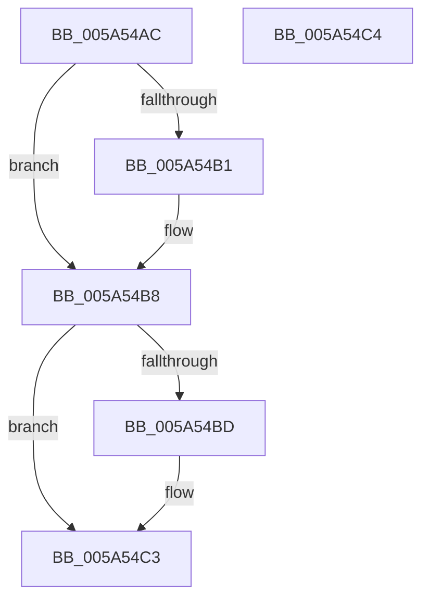

# PipUnpackMetadata

- RVA: `0x005A54AC`–`0x005A54C5` (길이 `25` bytes)
- VA: `0x00000001405A54AC`
- 실행 섹션: `.text`
- PDB 이름 있음: `예`; PDB Function 태그: `아니요`
- unwind 정보 RVA: `0x000DB714`
- 디코드: `10`개 명령, `25/25` bytes 표시
- 미해석 바이트: `0` (있으면 어셈블리에 `.byte`로 보존)

> 이 문서는 커널 이미지의 기계어와 PDB 기호를 분석해 생성했습니다. 4번과 5번은 함수 원형과 자료형을 바이너리 사용 방식에서 추정한 C 해석이며 원본 소스 복구 결과는 아닙니다.

## 1. Dependencies

- 직접 호출 지점: **0**; 고유 호출 대상: **0**
- 직접 호출자로 확인된 함수: **1**
- RIP 상대 이미지 참조: **0**

### Outgoing calls
- 직접 디코드된 call 명령이 없습니다.

### Direct callers
- [PipGetPersistentMemory](../../page/72/PipGetPersistentMemory_function_00725290.md) at `0x00725601`

### Static image references
- 디코드된 RIP-relative 메모리 참조가 없습니다.

## 2. Other-region calls and transfers

- 다른 실행 섹션으로 향하는 call: **0**
- 별도 외부 분기/꼬리 이동을 확인하지 못했습니다.

## 3. Assembly (complete function range)

```asm
005A54AC  48 85 D2                        test rdx, rdx
005A54AF  74 07                           je 0x1405a54b8
005A54B1  0F B7 41 10                     movzx eax, word ptr [rcx + 0x10]
005A54B5  66 89 02                        mov word ptr [rdx], ax
005A54B8  4D 85 C0                        test r8, r8
005A54BB  74 06                           je 0x1405a54c3
005A54BD  8B 41 14                        mov eax, dword ptr [rcx + 0x14]
005A54C0  41 89 00                        mov dword ptr [r8], eax
005A54C3  C3                              ret
005A54C4  CC                              int3
```

## 4. C-style interpretation (structured pseudocode)

```c
__int64 __fastcall PipUnpackMetadata(__int64 a1, __int64 a2, __int64 a3)
{
    __int64 result;

    if (a2 != 0) {
        result = *(unsigned __int16 *)(a1 + 16);
        *(unsigned __int16 *)(a2) = (unsigned __int16)(result);
    }
    if (a3 != 0) {
        result = *(unsigned int *)(a1 + 20);
        *(unsigned int *)(a3) = (unsigned int)(result);
    }
    return result;
}
```

## 5. (Beta) C Style

```c
int64_t PipUnpackMetadata(void *Arg1, int64_t Arg2, int64_t Arg3)
{
    uint8_t *arg1 = (uint8_t *)Arg1;

    int64_t result;

    if (Arg2 != 0) {
        result = *(uint16_t *)(arg1 + 0x10);
        *(uint16_t *)(Arg2) = (uint16_t)(result);
    }
    if (Arg3 != 0) {
        result = *(uint32_t *)(arg1 + 0x14);
        *(uint32_t *)(Arg3) = (uint32_t)(result);
    }
    return result;
}
```

### 관측된 메모리 오프셋

구조체 형식이 확인되지 않은 접근은 인자 기준의 오프셋으로만 기록했습니다.

| 기준 인자 | 오프셋 표현 | 폭 (bit) | 접근 |
|---|---:|---:|---|
| `Arg1` | `+ 0x10` | `16` | `R` |
| `Arg1` | `+ 0x14` | `32` | `R` |

## 6. Execution-region graph

[열기: 2D/3D 그래프와 함수 탐색 컨트롤 패널](../../../control-panel.html?section=text&rva=0x005A54AC&view=graph)

- 2D 그래프는 위에서 아래로 흐르고, 3D 그래프는 빈 공간을 드래그해 회전합니다. Shift+드래그는 이동, 휠은 확대·축소, 함수 노드 선택은 대상 보고서 이동입니다.

### Static fallback


