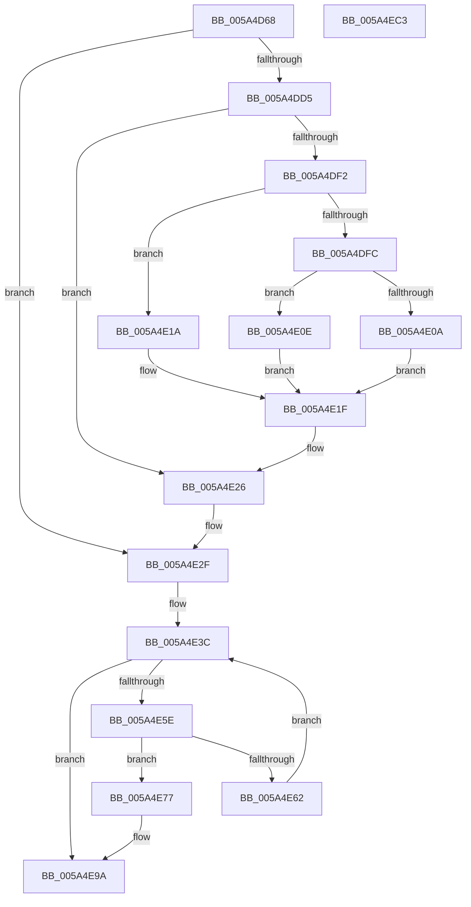

# PnpBootDeviceWait

- RVA: `0x005A4D68`–`0x005A4EC4` (길이 `348` bytes)
- VA: `0x00000001405A4D68`
- 실행 섹션: `.text`
- PDB 이름 있음: `예`; PDB Function 태그: `아니요`
- unwind 정보 RVA: `0x000C8124`
- 디코드: `103`개 명령, `348/348` bytes 표시
- 미해석 바이트: `0` (있으면 어셈블리에 `.byte`로 보존)

> 이 문서는 커널 이미지의 기계어와 PDB 기호를 분석해 생성했습니다. 4번과 5번은 함수 원형과 자료형을 바이너리 사용 방식에서 추정한 C 해석이며 원본 소스 복구 결과는 아닙니다.

## 1. Dependencies

- 직접 호출 지점: **10**; 고유 호출 대상: **9**
- 직접 호출자로 확인된 함수: **4**
- RIP 상대 이미지 참조: **2**

### Outgoing calls
- `0x005A4DCA` → [IopOpenRegistryKeyEx](../../page/A5/IopOpenRegistryKeyEx_function_00A51B44.md) (function, `0x00A51B44`)
- `0x005A4DE7` → [IopGetRegistryValue](../../page/99/IopGetRegistryValue_function_009990EC.md) (function, `0x009990EC`)
- `0x005A4E21` → [ExFreePoolWithTag](../../poolcode/B8/ExFreePoolWithTag_function_00B82870.md) (function, `0x00B82870`)
- `0x005A4E2A` → [ZwClose](../6A/ZwClose_function_006AD2B0.md) (function, `0x006AD2B0`)
- `0x005A4E40` → [RtlFreeAnsiString](../../page/9C/RtlFreeAnsiString_function_009C0800.md) (function, `0x009C0800`)
- `0x005A4E52` → [guard_dispatch_icall](../6B/guard_dispatch_icall_function_006BAAD0.md) (function, `0x006BAAD0`)
- `0x005A4E6A` → [KeDelayExecutionThread](../20/KeDelayExecutionThread_function_00209550.md) (function, `0x00209550`)
- `0x005A4E7C` → [HeadlessKernelAddLogEntry](../4B/HeadlessKernelAddLogEntry_function_004B7DEC.md) (function, `0x004B7DEC`)
- `0x005A4E94` → [KeBugCheckEx](../4F/KeBugCheckEx_function_004FD660.md) (function, `0x004FD660`)
- `0x005A4E9E` → [RtlFreeAnsiString](../../page/9C/RtlFreeAnsiString_function_009C0800.md) (function, `0x009C0800`)

### Direct callers
- [IopInitializeBootDrivers](../../init/C2/IopInitializeBootDrivers_function_00C2E6F4.md) at `0x00C2EF14`
- [PipWaitCriticalDevices](../../init/C3/PipWaitCriticalDevices_function_00C3277C.md) at `0x00C327AF`
- [PipWaitCriticalDevices](../../init/C3/PipWaitCriticalDevices_function_00C3277C.md) at `0x00C327EA`
- [VhdInitialize](../../init/C6/VhdInitialize_function_00C6DBB4.md) at `0x00C6DCDD`
- [CimfsInitialize](../../init/C6/CimfsInitialize_function_00C6E64C.md) at `0x00C6E7F2`

### Static image references
- `0x005A4DA1` → RVA `0x006CB0A0` (` ?? ::FNODOBFM::`string'`; read)
- `0x005A4DE0` → RVA `0x006CB110` (` ?? ::FNODOBFM::`string'`; read)

## 2. Other-region calls and transfers

- 다른 실행 섹션으로 향하는 call: **5**
  - `0x005A4DCA` → [IopOpenRegistryKeyEx](../../page/A5/IopOpenRegistryKeyEx_function_00A51B44.md) (`.text` → `PAGE`)
  - `0x005A4DE7` → [IopGetRegistryValue](../../page/99/IopGetRegistryValue_function_009990EC.md) (`.text` → `PAGE`)
  - `0x005A4E21` → [ExFreePoolWithTag](../../poolcode/B8/ExFreePoolWithTag_function_00B82870.md) (`.text` → `POOLCODE`)
  - `0x005A4E40` → [RtlFreeAnsiString](../../page/9C/RtlFreeAnsiString_function_009C0800.md) (`.text` → `PAGE`)
  - `0x005A4E9E` → [RtlFreeAnsiString](../../page/9C/RtlFreeAnsiString_function_009C0800.md) (`.text` → `PAGE`)
- 별도 외부 분기/꼬리 이동을 확인하지 못했습니다.

## 3. Assembly (complete function range)

```asm
005A4D68  48 89 5C 24 08                  mov qword ptr [rsp + 8], rbx
005A4D6D  48 89 74 24 10                  mov qword ptr [rsp + 0x10], rsi
005A4D72  48 89 7C 24 20                  mov qword ptr [rsp + 0x20], rdi
005A4D77  55                              push rbp
005A4D78  41 54                           push r12
005A4D7A  41 55                           push r13
005A4D7C  41 56                           push r14
005A4D7E  41 57                           push r15
005A4D80  48 8B EC                        mov rbp, rsp
005A4D83  48 83 EC 60                     sub rsp, 0x60
005A4D87  33 FF                           xor edi, edi
005A4D89  4C 63 F2                        movsxd r14, edx
005A4D8C  4D 8B F9                        mov r15, r9
005A4D8F  48 89 7D D0                     mov qword ptr [rbp - 0x30], rdi
005A4D93  4D 8B E0                        mov r12, r8
005A4D96  48 89 7D 40                     mov qword ptr [rbp + 0x40], rdi
005A4D9A  4C 8B E9                        mov r13, rcx
005A4D9D  48 89 7D D8                     mov qword ptr [rbp - 0x28], rdi
005A4DA1  48 8D 05 F8 62 12 00            lea rax, [rip + 0x1262f8]
005A4DA8  48 89 7D E0                     mov qword ptr [rbp - 0x20], rdi
005A4DAC  41 B9 19 00 02 00               mov r9d, 0x20019
005A4DB2  48 89 45 F0                     mov qword ptr [rbp - 0x10], rax
005A4DB6  4C 8D 45 E8                     lea r8, [rbp - 0x18]
005A4DBA  48 C7 45 E8 6C 00 6E 00         mov qword ptr [rbp - 0x18], 0x6e006c
005A4DC2  33 D2                           xor edx, edx
005A4DC4  48 8D 4D 40                     lea rcx, [rbp + 0x40]
005A4DC8  8B DF                           mov ebx, edi
005A4DCA  E8 75 CD 4A 00                  call 0x140a51b44
005A4DCF  8B F0                           mov esi, eax
005A4DD1  85 C0                           test eax, eax
005A4DD3  78 5A                           js 0x1405a4e2f
005A4DD5  48 8B 4D 40                     mov rcx, qword ptr [rbp + 0x40]
005A4DD9  4C 8D 4D D0                     lea r9, [rbp - 0x30]
005A4DDD  45 33 C0                        xor r8d, r8d
005A4DE0  48 8D 15 29 63 12 00            lea rdx, [rip + 0x126329]
005A4DE7  E8 00 43 3F 00                  call 0x1409990ec
005A4DEC  8B F0                           mov esi, eax
005A4DEE  85 C0                           test eax, eax
005A4DF0  78 34                           js 0x1405a4e26
005A4DF2  48 8B 4D D0                     mov rcx, qword ptr [rbp - 0x30]
005A4DF6  83 79 0C 04                     cmp dword ptr [rcx + 0xc], 4
005A4DFA  75 1E                           jne 0x1405a4e1a
005A4DFC  8B 41 08                        mov eax, dword ptr [rcx + 8]
005A4DFF  8B 1C 08                        mov ebx, dword ptr [rax + rcx]
005A4E02  81 FB C8 00 00 00               cmp ebx, 0xc8
005A4E08  73 04                           jae 0x1405a4e0e
005A4E0A  8B DF                           mov ebx, edi
005A4E0C  EB 11                           jmp 0x1405a4e1f
005A4E0E  B8 20 BF 02 00                  mov eax, 0x2bf20
005A4E13  3B D8                           cmp ebx, eax
005A4E15  0F 47 D8                        cmova ebx, eax
005A4E18  EB 05                           jmp 0x1405a4e1f
005A4E1A  BE 01 00 00 C0                  mov esi, 0xc0000001
005A4E1F  33 D2                           xor edx, edx
005A4E21  E8 4A DA 5D 00                  call 0x140b82870
005A4E26  48 8B 4D 40                     mov rcx, qword ptr [rbp + 0x40]
005A4E2A  E8 81 84 10 00                  call 0x1406ad2b0
005A4E2F  85 F6                           test esi, esi
005A4E31  48 C7 45 D0 80 7B E1 FF         mov qword ptr [rbp - 0x30], 0xffffffffffe17b80
005A4E39  0F 49 FB                        cmovns edi, ebx
005A4E3C  48 8D 4D D8                     lea rcx, [rbp - 0x28]
005A4E40  E8 BB B9 41 00                  call 0x1409c0800
005A4E45  4C 8D 45 D8                     lea r8, [rbp - 0x28]
005A4E49  49 8B D7                        mov rdx, r15
005A4E4C  49 8B CD                        mov rcx, r13
005A4E4F  49 8B C4                        mov rax, r12
005A4E52  E8 79 5C 11 00                  call 0x1406baad0
005A4E57  48 63 D8                        movsxd rbx, eax
005A4E5A  85 C0                           test eax, eax
005A4E5C  79 3C                           jns 0x1405a4e9a
005A4E5E  85 FF                           test edi, edi
005A4E60  7E 15                           jle 0x1405a4e77
005A4E62  4C 8D 45 D0                     lea r8, [rbp - 0x30]
005A4E66  33 D2                           xor edx, edx
005A4E68  33 C9                           xor ecx, ecx
005A4E6A  E8 E1 46 C6 FF                  call 0x140209550
005A4E6F  81 EF C8 00 00 00               sub edi, 0xc8
005A4E75  EB C5                           jmp 0x1405a4e3c
005A4E77  33 D2                           xor edx, edx
005A4E79  8D 4A 15                        lea ecx, [rdx + 0x15]
005A4E7C  E8 6B 2F F1 FF                  call 0x1404b7dec
005A4E81  45 33 C9                        xor r9d, r9d
005A4E84  4C 89 74 24 20                  mov qword ptr [rsp + 0x20], r14
005A4E89  4C 8B C3                        mov r8, rbx
005A4E8C  48 8D 55 D8                     lea rdx, [rbp - 0x28]
005A4E90  41 8D 49 7B                     lea ecx, [r9 + 0x7b]
005A4E94  E8 C7 87 F5 FF                  call 0x1404fd660
005A4E99  CC                              int3
005A4E9A  48 8D 4D D8                     lea rcx, [rbp - 0x28]
005A4E9E  E8 5D B9 41 00                  call 0x1409c0800
005A4EA3  4C 8D 5C 24 60                  lea r11, [rsp + 0x60]
005A4EA8  33 C0                           xor eax, eax
005A4EAA  49 8B 5B 30                     mov rbx, qword ptr [r11 + 0x30]
005A4EAE  49 8B 73 38                     mov rsi, qword ptr [r11 + 0x38]
005A4EB2  49 8B 7B 48                     mov rdi, qword ptr [r11 + 0x48]
005A4EB6  49 8B E3                        mov rsp, r11
005A4EB9  41 5F                           pop r15
005A4EBB  41 5E                           pop r14
005A4EBD  41 5D                           pop r13
005A4EBF  41 5C                           pop r12
005A4EC1  5D                              pop rbp
005A4EC2  C3                              ret
005A4EC3  CC                              int3
```

## 4. C-style interpretation (structured pseudocode)

```c
__int64 __fastcall PnpBootDeviceWait(__int64 a1, int a2, __int64 a3, __int64 a4)
{
    __int64 result;
    __int64 v_rbx;
    __int64 v_rdi;
    __int64 v_rsp;
    unsigned __int64 v_stack_m28;
    unsigned __int64 v_stack_m38;
    unsigned __int64 v_stack_m40;
    unsigned __int64 v_stack_m48;
    unsigned __int64 v_stack_m50;
    unsigned __int64 v_stack_m58;
    unsigned __int64 v_stack_m68;
    unsigned __int64 v_stack_p10;
    unsigned __int64 v_stack_p18;
    unsigned __int64 v_stack_p20;
    unsigned __int64 v_stack_p8;

    v_stack_p8 = v_rbx;
    v_stack_p10 = v_rsi;
    v_stack_p20 = v_rdi;
    v_rsp = (v_rsp) - (96);
    v_rdi = 0;
    v_stack_m58 = 0;
    v_stack_p18 = 0;
    v_stack_m50 = 0;
    v_stack_m48 = 0;
    v_stack_m38 = v_rip + 1204984;
    v_stack_m40 = 0x6E006CULL;
    a2 = 0;
    result = IopOpenRegistryKeyEx(v_stack_p18, a2, v_stack_m40, (unsigned int)(0x20019ULL));
    if (sign_flag) goto loc_005A4E2F;
    a3 = 0;
    result = IopGetRegistryValue(v_stack_p18, v_rip + 1205033, a3, v_stack_m58);
    if (sign_flag) goto loc_005A4E26;
    if ((*(unsigned int *)(v_stack_m58 + 12)) != 4) goto loc_005A4E1A;
    if (((unsigned int)((unsigned int)(*(unsigned int *)((unsigned int)(*(unsigned int *)(v_stack_m58 + 8)) + v_stack_m58 * 1)))) >= 200) goto loc_005A4E0E;
    goto loc_005A4E1F;
loc_005A4E0E:
    v_rbx = 0;
    if (0 > ((unsigned int)((unsigned int)(0x2BF20ULL)))) { v_rbx = (unsigned int)((unsigned int)(0x2BF20ULL)); }
    goto loc_005A4E1F;
loc_005A4E1A:
loc_005A4E1F:
    a2 = 0;
    result = ExFreePoolWithTag(v_stack_m58, a2, a3, v_stack_m58);
loc_005A4E26:
    result = ZwClose(v_stack_p18, a2, a3, v_stack_m58);
loc_005A4E2F:
    v_stack_m58 = 0xFFFFFFFFFFE17B80ULL;
    if (!sign_flag) { v_rdi = (unsigned int)(v_rbx); }
loc_005A4E3C:
    result = RtlFreeAnsiString(v_stack_m50, a2, a3, v_stack_m58);
    result = guard_dispatch_icall(a1, a4, v_stack_m50, v_stack_m58);
    if (!sign_flag) goto loc_005A4E9A;
    if (condition_is_less_or_equal) goto loc_005A4E77;
    a2 = 0;
    a1 = 0;
    result = KeDelayExecutionThread(a1, a2, v_stack_m58, v_stack_m58);
    v_rdi = (unsigned int)((v_rdi) - (200));
    goto loc_005A4E3C;
loc_005A4E77:
    a2 = 0;
    result = HeadlessKernelAddLogEntry(a2 + 21, a2, v_stack_m58, v_stack_m58);
    a4 = 0;
    v_stack_m68 = (int)(a2);
    result = KeBugCheckEx(a4 + 123, v_stack_m50, (int)((unsigned int)(result)), a4);
loc_005A4E9A:
    result = RtlFreeAnsiString(v_stack_m50, v_stack_m50, (int)((unsigned int)(result)), a4);
    result = 0;
    return result;
}
```

## 5. (Beta) C Style

```c
int64_t PnpBootDeviceWait(int64_t Arg1, int32_t Arg2, int64_t Arg3, int64_t Arg4)
{
    int64_t result;
    int64_t local_rbx;
    int64_t local_rdi;
    int64_t local_rsp;
    uint64_t v_stack_m28;
    uint64_t v_stack_m38;
    uint64_t v_stack_m40;
    uint64_t v_stack_m48;
    uint64_t v_stack_m50;
    uint64_t v_stack_m58;
    uint64_t v_stack_m68;
    uint64_t v_stack_p10;
    uint64_t v_stack_p18;
    uint64_t v_stack_p20;
    uint64_t v_stack_p8;

    v_stack_p8 = local_rbx;
    v_stack_p10 = local_rsi;
    v_stack_p20 = local_rdi;
    local_rsp = (local_rsp) - (96);
    local_rdi = 0;
    v_stack_m58 = 0;
    v_stack_p18 = 0;
    v_stack_m50 = 0;
    v_stack_m48 = 0;
    v_stack_m38 = v_rip + 1204984;
    v_stack_m40 = 0x6E006CULL;
    Arg2 = 0;
    result = IopOpenRegistryKeyEx(v_stack_p18, Arg2, v_stack_m40, (uint32_t)(0x20019ULL));
    if (sign_flag) goto loc_005A4E2F;
    Arg3 = 0;
    result = IopGetRegistryValue(v_stack_p18, v_rip + 1205033, Arg3, v_stack_m58);
    if (sign_flag) goto loc_005A4E26;
    if ((*(uint32_t *)(v_stack_m58 + 0xC)) != 4) goto loc_005A4E1A;
    if (((uint32_t)((uint32_t)(*(uint32_t *)((uint32_t)(*(uint32_t *)(v_stack_m58 + 0x8)) + v_stack_m58 * 1)))) >= 200) goto loc_005A4E0E;
    goto loc_005A4E1F;
loc_005A4E0E:
    local_rbx = 0;
    if (0 > ((uint32_t)((uint32_t)(0x2BF20ULL)))) { local_rbx = (uint32_t)((uint32_t)(0x2BF20ULL)); }
    goto loc_005A4E1F;
loc_005A4E1A:
loc_005A4E1F:
    Arg2 = 0;
    result = ExFreePoolWithTag(v_stack_m58, Arg2, Arg3, v_stack_m58);
loc_005A4E26:
    result = ZwClose(v_stack_p18, Arg2, Arg3, v_stack_m58);
loc_005A4E2F:
    v_stack_m58 = 0xFFFFFFFFFFE17B80ULL;
    if (!sign_flag) { local_rdi = (uint32_t)(local_rbx); }
loc_005A4E3C:
    result = RtlFreeAnsiString(v_stack_m50, Arg2, Arg3, v_stack_m58);
    result = guard_dispatch_icall(Arg1, Arg4, v_stack_m50, v_stack_m58);
    if (!sign_flag) goto loc_005A4E9A;
    if (condition_is_less_or_equal) goto loc_005A4E77;
    Arg2 = 0;
    Arg1 = 0;
    result = KeDelayExecutionThread(Arg1, Arg2, v_stack_m58, v_stack_m58);
    local_rdi = (uint32_t)((local_rdi) - (200));
    goto loc_005A4E3C;
loc_005A4E77:
    Arg2 = 0;
    result = HeadlessKernelAddLogEntry(Arg2 + 21, Arg2, v_stack_m58, v_stack_m58);
    Arg4 = 0;
    v_stack_m68 = (int32_t)(Arg2);
    result = KeBugCheckEx(Arg4 + 123, v_stack_m50, (int32_t)((uint32_t)(result)), Arg4);
loc_005A4E9A:
    result = RtlFreeAnsiString(v_stack_m50, v_stack_m50, (int32_t)((uint32_t)(result)), Arg4);
    result = 0;
    return result;
}
```

## 6. Execution-region graph

[열기: 2D/3D 그래프와 함수 탐색 컨트롤 패널](../../../control-panel.html?section=text&rva=0x005A4D68&view=graph)

- 2D 그래프는 위에서 아래로 흐르고, 3D 그래프는 빈 공간을 드래그해 회전합니다. Shift+드래그는 이동, 휠은 확대·축소, 함수 노드 선택은 대상 보고서 이동입니다.

### Static fallback


