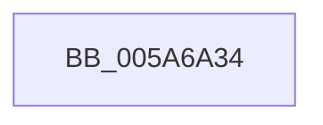

# PnpBugcheckPowerTimeout

- RVA: `0x005A6A34`–`0x005A6A9A` (길이 `102` bytes)
- VA: `0x00000001405A6A34`
- 실행 섹션: `.text`
- PDB 이름 있음: `예`; PDB Function 태그: `아니요`
- unwind 정보 RVA: `0x000C8760`
- 디코드: `23`개 명령, `102/102` bytes 표시
- 미해석 바이트: `0` (있으면 어셈블리에 `.byte`로 보존)

> 이 문서는 커널 이미지의 기계어와 PDB 기호를 분석해 생성했습니다. 4번과 5번은 함수 원형과 자료형을 바이너리 사용 방식에서 추정한 C 해석이며 원본 소스 복구 결과는 아닙니다.

## 1. Dependencies

- 직접 호출 지점: **2**; 고유 호출 대상: **2**
- 직접 호출자로 확인된 함수: **2**
- RIP 상대 이미지 참조: **3**

### Outgoing calls
- `0x005A6A75` → [PnpGetCurrentlyActiveWorkerThread](PnpGetCurrentlyActiveWorkerThread_function_005A6AA0.md) (function, `0x005A6AA0`)
- `0x005A6A94` → [KeBugCheckEx](../4F/KeBugCheckEx_function_004FD660.md) (function, `0x004FD660`)

### Direct callers
- [PnpPowerStateTransitionWatchdogCallback](PnpPowerStateTransitionWatchdogCallback_function_005A6430.md) at `0x005A6434`
- [PopBuildDeviceNotifyListWatchdog](../../pagelk/B7/PopBuildDeviceNotifyListWatchdog_function_00B70C90.md) at `0x00B70CA7`

### Static image references
- `0x005A6A41` → RVA `0x00F8C300` (`.data`; read)
- `0x005A6A59` → RVA `0x00EFAAB8` (`.data`; read)
- `0x005A6A64` → RVA `0x00EFAAB0` (`.data`; read)

## 2. Other-region calls and transfers

- 다른 실행 섹션으로 향하는 call: **0**
- 별도 외부 분기/꼬리 이동을 확인하지 못했습니다.

## 3. Assembly (complete function range)

```asm
005A6A34  4C 8B DC                        mov r11, rsp
005A6A37  53                              push rbx
005A6A38  48 83 EC 60                     sub rsp, 0x60
005A6A3C  83 64 24 34 00                  and dword ptr [rsp + 0x34], 0
005A6A41  48 8D 05 B8 58 9E 00            lea rax, [rip + 0x9e58b8]
005A6A48  49 83 63 E8 00                  and qword ptr [r11 - 0x18], 0
005A6A4D  C7 44 24 30 01 80 03 00         mov dword ptr [rsp + 0x30], 0x38001
005A6A55  49 89 43 D0                     mov qword ptr [r11 - 0x30], rax
005A6A59  48 8B 05 58 40 95 00            mov rax, qword ptr [rip + 0x954058]
005A6A60  49 89 43 D8                     mov qword ptr [r11 - 0x28], rax
005A6A64  48 8B 05 45 40 95 00            mov rax, qword ptr [rip + 0x954045]
005A6A6B  8B D9                           mov ebx, ecx
005A6A6D  49 8D 4B E8                     lea rcx, [r11 - 0x18]
005A6A71  49 89 43 E0                     mov qword ptr [r11 - 0x20], rax
005A6A75  E8 26 00 00 00                  call 0x1405a6aa0
005A6A7A  48 8D 4C 24 30                  lea rcx, [rsp + 0x30]
005A6A7F  44 8B C3                        mov r8d, ebx
005A6A82  48 89 4C 24 20                  mov qword ptr [rsp + 0x20], rcx
005A6A87  4C 8B C8                        mov r9, rax
005A6A8A  B9 9F 00 00 00                  mov ecx, 0x9f
005A6A8F  BA 04 00 00 00                  mov edx, 4
005A6A94  E8 C7 6B F5 FF                  call 0x1404fd660
005A6A99  CC                              int3
```

## 4. C-style interpretation (structured pseudocode)

```c
__int64 __fastcall PnpBugcheckPowerTimeout(int a1)
{
    __int64 result;
    __int64 v_rsp;
    unsigned int v_stack_m34;
    unsigned int v_stack_m38;
    unsigned __int64 v_stack_m48;

    v_rsp = (v_rsp) - (96);
    v_stack_m38 = 0x38001ULL;
    *(unsigned __int64 *)(v_rsp - 48) = v_rip + 10377400;
    *(unsigned __int64 *)(v_rsp - 40) = *(unsigned __int64 *)(v_rip + 9781336);
    *(unsigned __int64 *)(v_rsp - 32) = *(unsigned __int64 *)(v_rip + 9781317);
    result = PnpGetCurrentlyActiveWorkerThread(v_rsp - 24, a2, a3, a4);
    v_stack_m48 = v_stack_m38;
    result = KeBugCheckEx(159, 4, (unsigned int)((unsigned int)((unsigned int)(a1))), result);
    return result;
}
```

## 5. (Beta) C Style

```c
int64_t PnpBugcheckPowerTimeout(int32_t Arg1)
{
    int64_t result;
    int64_t local_rsp;
    uint32_t v_stack_m34;
    uint32_t v_stack_m38;
    uint64_t v_stack_m48;

    local_rsp = (local_rsp) - (96);
    v_stack_m38 = 0x38001ULL;
    *(uint64_t *)(local_rsp - 0x30) = v_rip + 10377400;
    *(uint64_t *)(local_rsp - 0x28) = *(uint64_t *)(v_rip + 0x954058);
    *(uint64_t *)(local_rsp - 0x20) = *(uint64_t *)(v_rip + 0x954045);
    result = PnpGetCurrentlyActiveWorkerThread(local_rsp - 24, a2, a3, a4);
    v_stack_m48 = v_stack_m38;
    result = KeBugCheckEx(159, 4, (uint32_t)((uint32_t)((uint32_t)(Arg1))), result);
    return result;
}
```

## 6. Execution-region graph

[열기: 2D/3D 그래프와 함수 탐색 컨트롤 패널](../../../control-panel.html?section=text&rva=0x005A6A34&view=graph)

- 2D 그래프는 위에서 아래로 흐르고, 3D 그래프는 빈 공간을 드래그해 회전합니다. Shift+드래그는 이동, 휠은 확대·축소, 함수 노드 선택은 대상 보고서 이동입니다.

### Static fallback


