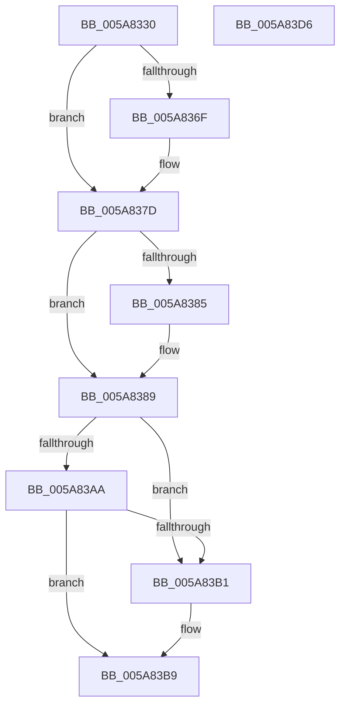

# PnpCancelDeviceActionRequest

- RVA: `0x005A8330`–`0x005A83D7` (길이 `167` bytes)
- VA: `0x00000001405A8330`
- 실행 섹션: `.text`
- PDB 이름 있음: `예`; PDB Function 태그: `아니요`
- unwind 정보 RVA: `0x00060BC4`
- 디코드: `47`개 명령, `167/167` bytes 표시
- 미해석 바이트: `0` (있으면 어셈블리에 `.byte`로 보존)

> 이 문서는 커널 이미지의 기계어와 PDB 기호를 분석해 생성했습니다. 4번과 5번은 함수 원형과 자료형을 바이너리 사용 방식에서 추정한 C 해석이며 원본 소스 복구 결과는 아닙니다.

## 1. Dependencies

- 직접 호출 지점: **5**; 고유 호출 대상: **5**
- 직접 호출자로 확인된 함수: **3**
- RIP 상대 이미지 참조: **0**

### Outgoing calls
- `0x005A835F` → [KeAbPreAcquire](../21/KeAbPreAcquire_function_00210230.md) (function, `0x00210230`)
- `0x005A8378` → [ExfAcquirePushLockExclusiveEx](../20/ExfAcquirePushLockExclusiveEx_function_0020FC90.md) (function, `0x0020FC90`)
- `0x005A83B4` → [ExfReleasePushLock](../26/ExfReleasePushLock_function_002638D0.md) (function, `0x002638D0`)
- `0x005A83BC` → [KeAbPostRelease](../2E/KeAbPostRelease_function_002E1600.md) (function, `0x002E1600`)
- `0x005A83C1` → [KeLeaveCriticalRegion](../25/KeLeaveCriticalRegion_function_0025D8B0.md) (function, `0x0025D8B0`)

### Direct callers
- [PiQueueDeviceRequest](../../page/AD/PiQueueDeviceRequest_function_00AD1878.md) at `0x00AD1980`
- [sub_00B1D2FE](../../page/B1/Unknown_function_00B1D2FE.md) at `0x00B1D37F`
- [sub_00B284C0](../../page/B2/Unknown_function_00B284C0.md) at `0x00B285DB`

### Static image references
- 디코드된 RIP-relative 메모리 참조가 없습니다.

## 2. Other-region calls and transfers

- 다른 실행 섹션으로 향하는 call: **0**
- 별도 외부 분기/꼬리 이동을 확인하지 못했습니다.

## 3. Assembly (complete function range)

```asm
005A8330  48 89 5C 24 08                  mov qword ptr [rsp + 8], rbx
005A8335  48 89 74 24 10                  mov qword ptr [rsp + 0x10], rsi
005A833A  57                              push rdi
005A833B  48 83 EC 20                     sub rsp, 0x20
005A833F  65 48 8B 04 25 88 01 00 00      mov rax, qword ptr gs:[0x188]
005A8348  48 8D 59 58                     lea rbx, [rcx + 0x58]
005A834C  48 8B F1                        mov rsi, rcx
005A834F  45 33 C0                        xor r8d, r8d
005A8352  33 D2                           xor edx, edx
005A8354  48 8B CB                        mov rcx, rbx
005A8357  66 FF 88 E4 01 00 00            dec word ptr [rax + 0x1e4]
005A835E  90                              nop
005A835F  E8 CC 7E C6 FF                  call 0x140210230
005A8364  F0 48 0F BA 2B 00               lock bts qword ptr [rbx], 0
005A836A  48 8B F8                        mov rdi, rax
005A836D  73 0E                           jae 0x1405a837d
005A836F  4C 8B C3                        mov r8, rbx
005A8372  48 8B D0                        mov rdx, rax
005A8375  48 8B CB                        mov rcx, rbx
005A8378  E8 13 79 C6 FF                  call 0x14020fc90
005A837D  45 33 C0                        xor r8d, r8d
005A8380  48 85 FF                        test rdi, rdi
005A8383  74 04                           je 0x1405a8389
005A8385  C6 47 0A 01                     mov byte ptr [rdi + 0xa], 1
005A8389  C6 46 60 01                     mov byte ptr [rsi + 0x60], 1
005A838D  0F 0D 0B                        prefetchw byte ptr [rbx]
005A8390  48 8B 03                        mov rax, qword ptr [rbx]
005A8393  48 8B C8                        mov rcx, rax
005A8396  48 83 E1 F0                     and rcx, 0xfffffffffffffff0
005A839A  48 83 F9 10                     cmp rcx, 0x10
005A839E  48 8D 50 F0                     lea rdx, [rax - 0x10]
005A83A2  49 0F 46 D0                     cmovbe rdx, r8
005A83A6  A8 02                           test al, 2
005A83A8  75 07                           jne 0x1405a83b1
005A83AA  F0 48 0F B1 13                  lock cmpxchg qword ptr [rbx], rdx
005A83AF  74 08                           je 0x1405a83b9
005A83B1  48 8B CB                        mov rcx, rbx
005A83B4  E8 17 B5 CB FF                  call 0x1402638d0
005A83B9  48 8B CB                        mov rcx, rbx
005A83BC  E8 3F 92 D3 FF                  call 0x1402e1600
005A83C1  E8 EA 54 CB FF                  call 0x14025d8b0
005A83C6  48 8B 5C 24 30                  mov rbx, qword ptr [rsp + 0x30]
005A83CB  48 8B 74 24 38                  mov rsi, qword ptr [rsp + 0x38]
005A83D0  48 83 C4 20                     add rsp, 0x20
005A83D4  5F                              pop rdi
005A83D5  C3                              ret
005A83D6  CC                              int3
```

## 4. C-style interpretation (structured pseudocode)

```c
__int64 __fastcall PnpCancelDeviceActionRequest(__int64 a1, int a2, int a3)
{
    __int64 result;
    __int64 v_rsp;
    unsigned __int64 v_stack_p10;
    unsigned __int64 v_stack_p8;

    v_stack_p8 = v_rbx;
    v_stack_p10 = v_rsi;
    v_rsp = (v_rsp) - (32);
    a3 = 0;
    a2 = 0;
    result = KeAbPreAcquire(a1 + 88, a2, a3, a4);
    if (!(condition_is_above_or_equal)) {
        a3 = a1 + 88;
        a2 = result;
        a1 = a1 + 88;
        result = ExfAcquirePushLockExclusiveEx(a1, a2, a3, a4);
    }
    a3 = 0;
    if (result != 0) {
        *(unsigned __int8 *)(result + 10) = 1;
    }
    *(unsigned __int8 *)(a1 + 96) = 1;
    a1 = (*(unsigned __int64 *)(a1 + 88)) & (-16);
    a2 = *(unsigned __int64 *)(a1 + 88) - 16;
    if (a1 <= 16) { a2 = 0; }
    if ((((unsigned __int8)(*(unsigned __int64 *)(a1 + 88))) & (2)) != 0) goto loc_005A83B1;
    result = *(unsigned __int64 *)(a1 + 88);
    if ((((unsigned __int8)(*(unsigned __int64 *)(a1 + 88))) & (2)) != 0) {
        a1 = a1 + 88;
        result = ExfReleasePushLock(a1, a2, a3, a4);
    }
    result = KeAbPostRelease(a1 + 88, a2, a3, a4);
    result = KeLeaveCriticalRegion(a1 + 88, a2, a3, a4);
    v_rsp = (v_rsp) + (32);
    return result;
}
```

## 5. (Beta) C Style

```c
int64_t PnpCancelDeviceActionRequest(void *Arg1, int32_t Arg2, int32_t Arg3)
{
    uint8_t *arg1 = (uint8_t *)Arg1;

    int64_t result;
    int64_t local_rsp;
    uint64_t v_stack_p10;
    uint64_t v_stack_p8;

    v_stack_p8 = local_rbx;
    v_stack_p10 = local_rsi;
    local_rsp = (local_rsp) - (32);
    Arg3 = 0;
    Arg2 = 0;
    result = KeAbPreAcquire(Arg1 + 88, Arg2, Arg3, a4);
    if (!(condition_is_above_or_equal)) {
        Arg3 = Arg1 + 88;
        Arg2 = result;
        Arg1 = Arg1 + 88;
        result = ExfAcquirePushLockExclusiveEx(Arg1, Arg2, Arg3, a4);
    }
    Arg3 = 0;
    if (result != 0) {
        *(uint8_t *)(result + 0xA) = 1;
    }
    *(uint8_t *)(arg1 + 0x60) = 1;
    Arg1 = (*(uint64_t *)(arg1 + 0x58)) & (-16);
    Arg2 = *(uint64_t *)(arg1 + 0x58) - 16;
    if (Arg1 <= 16) { Arg2 = 0; }
    if ((((uint8_t)(*(uint64_t *)(arg1 + 0x58))) & (2)) != 0) goto loc_005A83B1;
    result = *(uint64_t *)(arg1 + 0x58);
    if ((((uint8_t)(*(uint64_t *)(arg1 + 0x58))) & (2)) != 0) {
        Arg1 = Arg1 + 88;
        result = ExfReleasePushLock(Arg1, Arg2, Arg3, a4);
    }
    result = KeAbPostRelease(Arg1 + 88, Arg2, Arg3, a4);
    result = KeLeaveCriticalRegion(Arg1 + 88, Arg2, Arg3, a4);
    local_rsp = (local_rsp) + (32);
    return result;
}
```

### 관측된 메모리 오프셋

구조체 형식이 확인되지 않은 접근은 인자 기준의 오프셋으로만 기록했습니다.

| 기준 인자 | 오프셋 표현 | 폭 (bit) | 접근 |
|---|---:|---:|---|
| `Arg1` | `+ 0x0` | `8` | `R` |
| `Arg1` | `+ 0x0` | `64` | `R` |
| `Arg1` | `+ 0x0` | `64` | `R/W` |
| `Arg1` | `+ 0x58` | `64` | `R` |
| `Arg1` | `+ 0x60` | `8` | `W` |

## 6. Execution-region graph

[열기: 2D/3D 그래프와 함수 탐색 컨트롤 패널](../../../control-panel.html?section=text&rva=0x005A8330&view=graph)

- 2D 그래프는 위에서 아래로 흐르고, 3D 그래프는 빈 공간을 드래그해 회전합니다. Shift+드래그는 이동, 휠은 확대·축소, 함수 노드 선택은 대상 보고서 이동입니다.

### Static fallback


