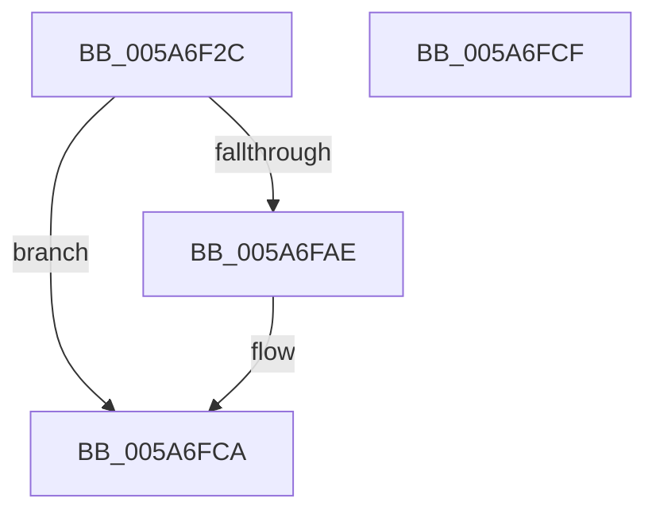

# PnpCompleteSystemStartProcess

- RVA: `0x005A6F2C`–`0x005A6FD0` (길이 `164` bytes)
- VA: `0x00000001405A6F2C`
- 실행 섹션: `.text`
- PDB 이름 있음: `예`; PDB Function 태그: `아니요`
- unwind 정보 RVA: `0x0005D2F4`
- 디코드: `38`개 명령, `164/164` bytes 표시
- 미해석 바이트: `0` (있으면 어셈블리에 `.byte`로 보존)

> 이 문서는 커널 이미지의 기계어와 PDB 기호를 분석해 생성했습니다. 4번과 5번은 함수 원형과 자료형을 바이너리 사용 방식에서 추정한 C 해석이며 원본 소스 복구 결과는 아닙니다.

## 1. Dependencies

- 직접 호출 지점: **10**; 고유 호출 대상: **7**
- 직접 호출자로 확인된 함수: **1**
- RIP 상대 이미지 참조: **9**

### Outgoing calls
- `0x005A6F3C` → [PnpDiagnosticTrace](../26/PnpDiagnosticTrace_function_0026E384.md) (function, `0x0026E384`)
- `0x005A6F4D` → [PnpDiagnosticTrace](../26/PnpDiagnosticTrace_function_0026E384.md) (function, `0x0026E384`)
- `0x005A6F54` → [IopCallDriverReinitializationRoutines](../../page/A8/IopCallDriverReinitializationRoutines_function_00A8E39C.md) (function, `0x00A8E39C`)
- `0x005A6F65` → [PnpDiagnosticTrace](../26/PnpDiagnosticTrace_function_0026E384.md) (function, `0x0026E384`)
- `0x005A6F7D` → [KeSetEvent](../33/KeSetEvent_function_0033F310.md) (function, `0x0033F310`)
- `0x005A6F82` → [PiInitReleaseCachedGroupInformation](../../page/72/PiInitReleaseCachedGroupInformation_function_00723198.md) (function, `0x00723198`)
- `0x005A6F87` → [PpReleaseBootDDB](../../page/72/PpReleaseBootDDB_function_0072E324.md) (function, `0x0072E324`)
- `0x005A6F8C` → [KseShimDatabaseBootRelease](../../page/95/KseShimDatabaseBootRelease_function_00959174.md) (function, `0x00959174`)
- `0x005A6F9D` → [PnpDiagnosticTrace](../26/PnpDiagnosticTrace_function_0026E384.md) (function, `0x0026E384`)
- `0x005A6FC5` → [EtwWriteEndScenario](../../page/A5/EtwWriteEndScenario_function_00A5B7F0.md) (function, `0x00A5B7F0`)

### Direct callers
- [PnpDeviceActionWorker](../47/PnpDeviceActionWorker_function_00478400.md) at `0x00478989`

### Static image references
- `0x005A6F33` → RVA `0x00027210` (`.rdata`; read)
- `0x005A6F44` → RVA `0x00027590` (`.rdata`; read)
- `0x005A6F5C` → RVA `0x000270B0` (`.rdata`; read)
- `0x005A6F6D` → RVA `0x00F8C380` (`.data`; write)
- `0x005A6F76` → RVA `0x00F8CFC0` (`.data`; read)
- `0x005A6F94` → RVA `0x00026F00` (`.rdata`; read)
- `0x005A6FA2` → RVA `0x00E662D8` (`.data`; read)
- `0x005A6FB4` → RVA `0x00E0A9F0` (`.data`; read)
- `0x005A6FBE` → RVA `0x00026C90` (`.rdata`; read)

## 2. Other-region calls and transfers

- 다른 실행 섹션으로 향하는 call: **5**
  - `0x005A6F54` → [IopCallDriverReinitializationRoutines](../../page/A8/IopCallDriverReinitializationRoutines_function_00A8E39C.md) (`.text` → `PAGE`)
  - `0x005A6F82` → [PiInitReleaseCachedGroupInformation](../../page/72/PiInitReleaseCachedGroupInformation_function_00723198.md) (`.text` → `PAGE`)
  - `0x005A6F87` → [PpReleaseBootDDB](../../page/72/PpReleaseBootDDB_function_0072E324.md) (`.text` → `PAGE`)
  - `0x005A6F8C` → [KseShimDatabaseBootRelease](../../page/95/KseShimDatabaseBootRelease_function_00959174.md) (`.text` → `PAGE`)
  - `0x005A6FC5` → [EtwWriteEndScenario](../../page/A5/EtwWriteEndScenario_function_00A5B7F0.md) (`.text` → `PAGE`)
- 별도 외부 분기/꼬리 이동을 확인하지 못했습니다.

## 3. Assembly (complete function range)

```asm
005A6F2C  48 83 EC 38                     sub rsp, 0x38
005A6F30  45 33 C0                        xor r8d, r8d
005A6F33  48 8D 0D D6 02 A8 FF            lea rcx, [rip - 0x57fd2a]
005A6F3A  33 D2                           xor edx, edx
005A6F3C  E8 43 74 CC FF                  call 0x14026e384
005A6F41  45 33 C0                        xor r8d, r8d
005A6F44  48 8D 0D 45 06 A8 FF            lea rcx, [rip - 0x57f9bb]
005A6F4B  33 D2                           xor edx, edx
005A6F4D  E8 32 74 CC FF                  call 0x14026e384
005A6F52  B1 01                           mov cl, 1
005A6F54  E8 43 74 4E 00                  call 0x140a8e39c
005A6F59  45 33 C0                        xor r8d, r8d
005A6F5C  48 8D 0D 4D 01 A8 FF            lea rcx, [rip - 0x57feb3]
005A6F63  33 D2                           xor edx, edx
005A6F65  E8 1A 74 CC FF                  call 0x14026e384
005A6F6A  45 33 C0                        xor r8d, r8d
005A6F6D  C6 05 0C 54 9E 00 01            mov byte ptr [rip + 0x9e540c], 1
005A6F74  33 D2                           xor edx, edx
005A6F76  48 8D 0D 43 60 9E 00            lea rcx, [rip + 0x9e6043]
005A6F7D  E8 8E 83 D9 FF                  call 0x14033f310
005A6F82  E8 11 C2 17 00                  call 0x140723198
005A6F87  E8 98 73 18 00                  call 0x14072e324
005A6F8C  E8 E3 21 3B 00                  call 0x140959174
005A6F91  45 33 C0                        xor r8d, r8d
005A6F94  48 8D 0D 65 FF A7 FF            lea rcx, [rip - 0x58009b]
005A6F9B  33 D2                           xor edx, edx
005A6F9D  E8 E2 73 CC FF                  call 0x14026e384
005A6FA2  48 8B 0D 2F F3 8B 00            mov rcx, qword ptr [rip + 0x8bf32f]
005A6FA9  48 85 C9                        test rcx, rcx
005A6FAC  74 1C                           je 0x1405a6fca
005A6FAE  48 83 64 24 20 00               and qword ptr [rsp + 0x20], 0
005A6FB4  4C 8D 05 35 3A 86 00            lea r8, [rip + 0x863a35]
005A6FBB  45 33 C9                        xor r9d, r9d
005A6FBE  48 8D 15 CB FC A7 FF            lea rdx, [rip - 0x580335]
005A6FC5  E8 26 48 4B 00                  call 0x140a5b7f0
005A6FCA  48 83 C4 38                     add rsp, 0x38
005A6FCE  C3                              ret
005A6FCF  CC                              int3
```

## 4. C-style interpretation (structured pseudocode)

```c
__int64 __fastcall PnpCompleteSystemStartProcess(__int64 a1, int a2, int a3, int a4)
{
    __int64 result;
    __int64 v_rsp;
    unsigned __int64 v_stack_m18;

    v_rsp = (v_rsp) - (56);
    a3 = 0;
    a2 = 0;
    result = PnpDiagnosticTrace(v_rip - 5766442, a2, a3, a4);
    a3 = 0;
    a2 = 0;
    result = PnpDiagnosticTrace(v_rip - 5765563, a2, a3, a4);
    result = IopCallDriverReinitializationRoutines(1, a2, a3, a4);
    a3 = 0;
    a2 = 0;
    result = PnpDiagnosticTrace(v_rip - 5766835, a2, a3, a4);
    a3 = 0;
    *(unsigned __int8 *)(v_rip + 10376204) = 1;
    a2 = 0;
    result = KeSetEvent(v_rip + 10379331, a2, a3, a4);
    result = PiInitReleaseCachedGroupInformation(v_rip + 10379331, a2, a3, a4);
    result = PpReleaseBootDDB(v_rip + 10379331, a2, a3, a4);
    result = KseShimDatabaseBootRelease(v_rip + 10379331, a2, a3, a4);
    a3 = 0;
    a2 = 0;
    result = PnpDiagnosticTrace(v_rip - 5767323, a2, a3, a4);
    if (*(unsigned __int64 *)(v_rip + 9171759) != 0) {
        a3 = v_rip + 8796725;
        a4 = 0;
        a2 = v_rip - 5767989;
        result = EtwWriteEndScenario(*(unsigned __int64 *)(v_rip + 9171759), a2, a3, a4);
    }
    v_rsp = (v_rsp) + (56);
    return result;
}
```

## 5. (Beta) C Style

```c
int64_t PnpCompleteSystemStartProcess(int64_t Arg1, int32_t Arg2, int32_t Arg3, int32_t Arg4)
{
    int64_t result;
    int64_t local_rsp;
    uint64_t v_stack_m18;

    local_rsp = (local_rsp) - (56);
    Arg3 = 0;
    Arg2 = 0;
    result = PnpDiagnosticTrace(v_rip - 5766442, Arg2, Arg3, Arg4);
    Arg3 = 0;
    Arg2 = 0;
    result = PnpDiagnosticTrace(v_rip - 5765563, Arg2, Arg3, Arg4);
    result = IopCallDriverReinitializationRoutines(1, Arg2, Arg3, Arg4);
    Arg3 = 0;
    Arg2 = 0;
    result = PnpDiagnosticTrace(v_rip - 5766835, Arg2, Arg3, Arg4);
    Arg3 = 0;
    *(uint8_t *)(v_rip + 0x9E540C) = 1;
    Arg2 = 0;
    result = KeSetEvent(v_rip + 10379331, Arg2, Arg3, Arg4);
    result = PiInitReleaseCachedGroupInformation(v_rip + 10379331, Arg2, Arg3, Arg4);
    result = PpReleaseBootDDB(v_rip + 10379331, Arg2, Arg3, Arg4);
    result = KseShimDatabaseBootRelease(v_rip + 10379331, Arg2, Arg3, Arg4);
    Arg3 = 0;
    Arg2 = 0;
    result = PnpDiagnosticTrace(v_rip - 5767323, Arg2, Arg3, Arg4);
    if (*(uint64_t *)(v_rip + 0x8BF32F) != 0) {
        Arg3 = v_rip + 8796725;
        Arg4 = 0;
        Arg2 = v_rip - 5767989;
        result = EtwWriteEndScenario(*(uint64_t *)(v_rip + 0x8BF32F), Arg2, Arg3, Arg4);
    }
    local_rsp = (local_rsp) + (56);
    return result;
}
```

## 6. Execution-region graph

[열기: 2D/3D 그래프와 함수 탐색 컨트롤 패널](../../../control-panel.html?section=text&rva=0x005A6F2C&view=graph)

- 2D 그래프는 위에서 아래로 흐르고, 3D 그래프는 빈 공간을 드래그해 회전합니다. Shift+드래그는 이동, 휠은 확대·축소, 함수 노드 선택은 대상 보고서 이동입니다.

### Static fallback


