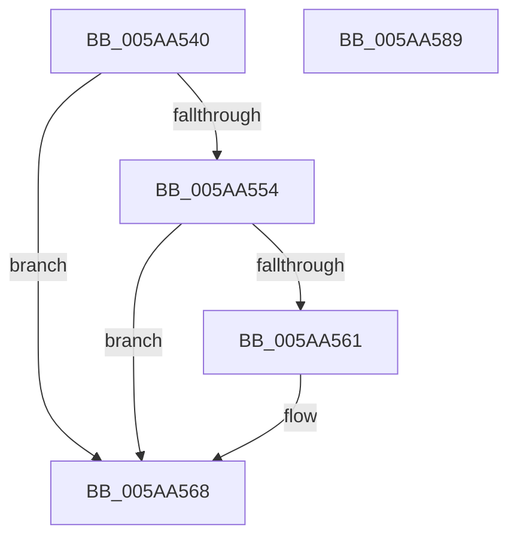

# PnpDiagnosticCompletionRoutine

- RVA: `0x005AA540`–`0x005AA58A` (길이 `74` bytes)
- VA: `0x00000001405AA540`
- 실행 섹션: `.text`
- PDB 이름 있음: `예`; PDB Function 태그: `아니요`
- unwind 정보 RVA: `0x0005CF00`
- 디코드: `24`개 명령, `74/74` bytes 표시
- 미해석 바이트: `0` (있으면 어셈블리에 `.byte`로 보존)

> 이 문서는 커널 이미지의 기계어와 PDB 기호를 분석해 생성했습니다. 4번과 5번은 함수 원형과 자료형을 바이너리 사용 방식에서 추정한 C 해석이며 원본 소스 복구 결과는 아닙니다.

## 1. Dependencies

- 직접 호출 지점: **3**; 고유 호출 대상: **3**
- 직접 호출자로 확인된 함수: **0**
- RIP 상대 이미지 참조: **0**

### Outgoing calls
- `0x005AA557` → [IoFindDeviceThatFailedIrp](../26/IoFindDeviceThatFailedIrp_function_0026E95C.md) (function, `0x0026E95C`)
- `0x005AA56B` → [IoFreeIrp](../24/IoFreeIrp_function_0024DF70.md) (function, `0x0024DF70`)
- `0x005AA579` → [KeSetEvent](../33/KeSetEvent_function_0033F310.md) (function, `0x0033F310`)

### Direct callers
- 이 함수 시작 RVA로 연결되는 직접 call은 확인되지 않았습니다. 간접 호출은 완전히 역산할 수 없습니다.

### Static image references
- 디코드된 RIP-relative 메모리 참조가 없습니다.

## 2. Other-region calls and transfers

- 다른 실행 섹션으로 향하는 call: **0**
- 별도 외부 분기/꼬리 이동을 확인하지 못했습니다.

## 3. Assembly (complete function range)

```asm
005AA540  40 53                           push rbx
005AA542  48 83 EC 20                     sub rsp, 0x20
005AA546  8B 42 30                        mov eax, dword ptr [rdx + 0x30]
005AA549  49 8B D8                        mov rbx, r8
005AA54C  41 89 40 20                     mov dword ptr [r8 + 0x20], eax
005AA550  85 C0                           test eax, eax
005AA552  79 14                           jns 0x1405aa568
005AA554  48 8B CA                        mov rcx, rdx
005AA557  E8 00 44 CC FF                  call 0x14026e95c
005AA55C  48 85 C0                        test rax, rax
005AA55F  74 07                           je 0x1405aa568
005AA561  48 8B 40 08                     mov rax, qword ptr [rax + 8]
005AA565  48 89 03                        mov qword ptr [rbx], rax
005AA568  48 8B CA                        mov rcx, rdx
005AA56B  E8 00 3A CA FF                  call 0x14024df70
005AA570  48 8D 4B 08                     lea rcx, [rbx + 8]
005AA574  45 33 C0                        xor r8d, r8d
005AA577  33 D2                           xor edx, edx
005AA579  E8 92 4D D9 FF                  call 0x14033f310
005AA57E  B8 16 00 00 C0                  mov eax, 0xc0000016
005AA583  48 83 C4 20                     add rsp, 0x20
005AA587  5B                              pop rbx
005AA588  C3                              ret
005AA589  CC                              int3
```

## 4. C-style interpretation (structured pseudocode)

```c
__int64 __fastcall PnpDiagnosticCompletionRoutine(__int64 a1, __int64 a2, __int64 a3)
{
    __int64 result;
    __int64 v_rsp;

    v_rsp = (v_rsp) - (32);
    *(unsigned int *)(a3 + 32) = (unsigned int)((unsigned int)(*(unsigned int *)(a2 + 48)));
    if (!sign_flag) goto loc_005AA568;
    result = IoFindDeviceThatFailedIrp(a2, a2, a3, a4);
    if (result != 0) {
        result = *(unsigned __int64 *)(result + 8);
        *(unsigned __int64 *)(a3) = result;
    }
    result = IoFreeIrp(a2, a2, a3, a4);
    a3 = 0;
    a2 = 0;
    result = KeSetEvent(a3 + 8, a2, a3, a4);
    v_rsp = (v_rsp) + (32);
    return (unsigned int)(0xC0000016ULL);
}
```

## 5. (Beta) C Style

```c
int64_t PnpDiagnosticCompletionRoutine(int64_t Arg1, void *Arg2, void *Arg3)
{
    uint8_t *arg2 = (uint8_t *)Arg2;
    uint8_t *arg3 = (uint8_t *)Arg3;

    int64_t result;
    int64_t local_rsp;

    local_rsp = (local_rsp) - (32);
    *(uint32_t *)(arg3 + 0x20) = (uint32_t)((uint32_t)(*(uint32_t *)(arg2 + 0x30)));
    if (!sign_flag) goto loc_005AA568;
    result = IoFindDeviceThatFailedIrp(Arg2, Arg2, Arg3, a4);
    if (result != 0) {
        result = *(uint64_t *)(result + 0x8);
        *(uint64_t *)(arg3) = result;
    }
    result = IoFreeIrp(Arg2, Arg2, Arg3, a4);
    Arg3 = 0;
    Arg2 = 0;
    result = KeSetEvent(Arg3 + 8, Arg2, Arg3, a4);
    local_rsp = (local_rsp) + (32);
    return (uint32_t)(0xC0000016ULL);
}
```

### 관측된 메모리 오프셋

구조체 형식이 확인되지 않은 접근은 인자 기준의 오프셋으로만 기록했습니다.

| 기준 인자 | 오프셋 표현 | 폭 (bit) | 접근 |
|---|---:|---:|---|
| `Arg2` | `+ 0x30` | `32` | `R` |
| `Arg3` | `+ 0x0` | `64` | `W` |
| `Arg3` | `+ 0x8` | `64` | `R` |
| `Arg3` | `+ 0x20` | `32` | `W` |

## 6. Execution-region graph

[열기: 2D/3D 그래프와 함수 탐색 컨트롤 패널](../../../control-panel.html?section=text&rva=0x005AA540&view=graph)

- 2D 그래프는 위에서 아래로 흐르고, 3D 그래프는 빈 공간을 드래그해 회전합니다. Shift+드래그는 이동, 휠은 확대·축소, 함수 노드 선택은 대상 보고서 이동입니다.

### Static fallback


