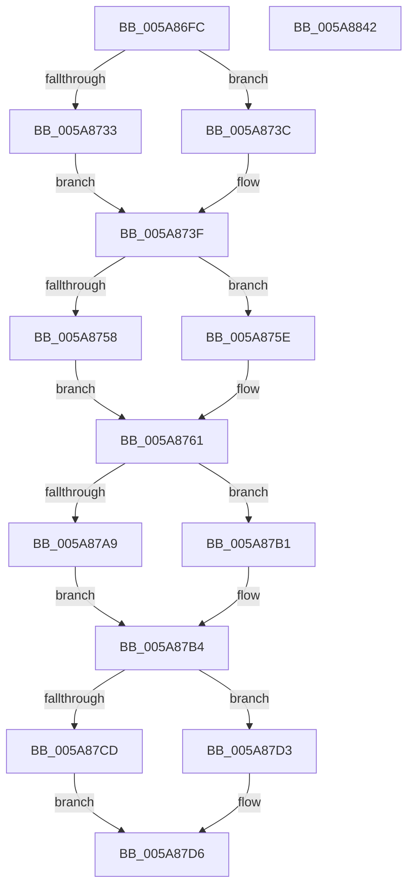

# PnpDiagnosticTraceAppVeto

- RVA: `0x005A86FC`–`0x005A8843` (길이 `327` bytes)
- VA: `0x00000001405A86FC`
- 실행 섹션: `.text`
- PDB 이름 있음: `예`; PDB Function 태그: `아니요`
- unwind 정보 RVA: `0x0006CDB8`
- 디코드: `88`개 명령, `327/327` bytes 표시
- 미해석 바이트: `0` (있으면 어셈블리에 `.byte`로 보존)

> 이 문서는 커널 이미지의 기계어와 PDB 기호를 분석해 생성했습니다. 4번과 5번은 함수 원형과 자료형을 바이너리 사용 방식에서 추정한 C 해석이며 원본 소스 복구 결과는 아닙니다.

## 1. Dependencies

- 직접 호출 지점: **2**; 고유 호출 대상: **2**
- 직접 호출자로 확인된 함수: **1**
- RIP 상대 이미지 참조: **2**

### Outgoing calls
- `0x005A8828` → [PnpDiagnosticTrace](../26/PnpDiagnosticTrace_function_0026E384.md) (function, `0x0026E384`)
- `0x005A8834` → [_security_check_cookie](../6A/_security_check_cookie_function_006AC640.md) (function, `0x006AC640`)

### Direct callers
- [PnpLogVetoInformation](../../page/AB/PnpLogVetoInformation_function_00AB6BE8.md) at `0x00AB6D2C`

### Static image references
- `0x005A870D` → RVA `0x00E0A740` (`.data`; read)
- `0x005A8805` → RVA `0x00027420` (`.rdata`; read)

## 2. Other-region calls and transfers

- 다른 실행 섹션으로 향하는 call: **0**
- 별도 외부 분기/꼬리 이동을 확인하지 못했습니다.

## 3. Assembly (complete function range)

```asm
005A86FC  89 54 24 10                     mov dword ptr [rsp + 0x10], edx
005A8700  55                              push rbp
005A8701  48 8D 6C 24 B9                  lea rbp, [rsp - 0x47]
005A8706  48 81 EC D0 00 00 00            sub rsp, 0xd0
005A870D  48 8B 05 2C 20 86 00            mov rax, qword ptr [rip + 0x86202c]
005A8714  48 33 C4                        xor rax, rsp
005A8717  48 89 45 37                     mov qword ptr [rbp + 0x37], rax
005A871B  45 33 D2                        xor r10d, r10d
005A871E  48 C7 45 AF 04 00 00 00         mov qword ptr [rbp - 0x51], 4
005A8726  48 8D 45 5F                     lea rax, [rbp + 0x5f]
005A872A  48 89 45 A7                     mov qword ptr [rbp - 0x59], rax
005A872E  4D 85 C0                        test r8, r8
005A8731  74 09                           je 0x1405a873c
005A8733  41 0F B7 00                     movzx eax, word ptr [r8]
005A8737  66 D1 E8                        shr ax, 1
005A873A  EB 03                           jmp 0x1405a873f
005A873C  41 8B C2                        mov eax, r10d
005A873F  66 89 45 97                     mov word ptr [rbp - 0x69], ax
005A8743  48 8D 4D 97                     lea rcx, [rbp - 0x69]
005A8747  48 89 4D B7                     mov qword ptr [rbp - 0x49], rcx
005A874B  48 C7 45 BF 02 00 00 00         mov qword ptr [rbp - 0x41], 2
005A8753  4D 85 C0                        test r8, r8
005A8756  74 06                           je 0x1405a875e
005A8758  49 8B 48 08                     mov rcx, qword ptr [r8 + 8]
005A875C  EB 03                           jmp 0x1405a8761
005A875E  49 8B CA                        mov rcx, r10
005A8761  0F B7 C0                        movzx eax, ax
005A8764  03 C0                           add eax, eax
005A8766  48 89 4D C7                     mov qword ptr [rbp - 0x39], rcx
005A876A  89 45 CF                        mov dword ptr [rbp - 0x31], eax
005A876D  41 0F B7 01                     movzx eax, word ptr [r9]
005A8771  66 D1 E8                        shr ax, 1
005A8774  0F B7 C8                        movzx ecx, ax
005A8777  48 8D 45 9B                     lea rax, [rbp - 0x65]
005A877B  66 89 4D 9B                     mov word ptr [rbp - 0x65], cx
005A877F  03 C9                           add ecx, ecx
005A8781  89 4D EF                        mov dword ptr [rbp - 0x11], ecx
005A8784  48 8B 4D 77                     mov rcx, qword ptr [rbp + 0x77]
005A8788  48 89 45 D7                     mov qword ptr [rbp - 0x29], rax
005A878C  49 8B 41 08                     mov rax, qword ptr [r9 + 8]
005A8790  44 89 55 D3                     mov dword ptr [rbp - 0x2d], r10d
005A8794  48 C7 45 DF 02 00 00 00         mov qword ptr [rbp - 0x21], 2
005A879C  48 89 45 E7                     mov qword ptr [rbp - 0x19], rax
005A87A0  44 89 55 F3                     mov dword ptr [rbp - 0xd], r10d
005A87A4  48 85 C9                        test rcx, rcx
005A87A7  74 08                           je 0x1405a87b1
005A87A9  0F B7 01                        movzx eax, word ptr [rcx]
005A87AC  66 D1 E8                        shr ax, 1
005A87AF  EB 03                           jmp 0x1405a87b4
005A87B1  41 8B C2                        mov eax, r10d
005A87B4  66 89 45 9F                     mov word ptr [rbp - 0x61], ax
005A87B8  48 8D 55 9F                     lea rdx, [rbp - 0x61]
005A87BC  48 89 55 F7                     mov qword ptr [rbp - 9], rdx
005A87C0  48 C7 45 FF 02 00 00 00         mov qword ptr [rbp - 1], 2
005A87C8  48 85 C9                        test rcx, rcx
005A87CB  74 06                           je 0x1405a87d3
005A87CD  48 8B 51 08                     mov rdx, qword ptr [rcx + 8]
005A87D1  EB 03                           jmp 0x1405a87d6
005A87D3  49 8B D2                        mov rdx, r10
005A87D6  48 8B 4D 7F                     mov rcx, qword ptr [rbp + 0x7f]
005A87DA  4C 8D 45 A7                     lea r8, [rbp - 0x59]
005A87DE  0F B7 C0                        movzx eax, ax
005A87E1  03 C0                           add eax, eax
005A87E3  48 89 55 07                     mov qword ptr [rbp + 7], rdx
005A87E7  89 45 0F                        mov dword ptr [rbp + 0xf], eax
005A87EA  0F B7 01                        movzx eax, word ptr [rcx]
005A87ED  66 D1 E8                        shr ax, 1
005A87F0  0F B7 D0                        movzx edx, ax
005A87F3  48 8D 45 A3                     lea rax, [rbp - 0x5d]
005A87F7  66 89 55 A3                     mov word ptr [rbp - 0x5d], dx
005A87FB  03 D2                           add edx, edx
005A87FD  48 89 45 17                     mov qword ptr [rbp + 0x17], rax
005A8801  48 8B 41 08                     mov rax, qword ptr [rcx + 8]
005A8805  48 8D 0D 14 EC A7 FF            lea rcx, [rip - 0x5813ec]
005A880C  89 55 2F                        mov dword ptr [rbp + 0x2f], edx
005A880F  BA 09 00 00 00                  mov edx, 9
005A8814  44 89 55 13                     mov dword ptr [rbp + 0x13], r10d
005A8818  48 C7 45 1F 02 00 00 00         mov qword ptr [rbp + 0x1f], 2
005A8820  48 89 45 27                     mov qword ptr [rbp + 0x27], rax
005A8824  44 89 55 33                     mov dword ptr [rbp + 0x33], r10d
005A8828  E8 57 5B CC FF                  call 0x14026e384
005A882D  48 8B 4D 37                     mov rcx, qword ptr [rbp + 0x37]
005A8831  48 33 CC                        xor rcx, rsp
005A8834  E8 07 3E 10 00                  call 0x1406ac640
005A8839  48 81 C4 D0 00 00 00            add rsp, 0xd0
005A8840  5D                              pop rbp
005A8841  C3                              ret
005A8842  CC                              int3
```

## 4. C-style interpretation (structured pseudocode)

```c
__int64 __fastcall PnpDiagnosticTraceAppVeto(__int64 a1, int a2, __int64 a3, __int64 a4, __int64 a5, __int64 a6)
{
    __int64 result;
    __int64 v_r10;
    __int64 v_rsp;
    unsigned __int64 v_stack_m18;
    unsigned int v_stack_m1C;
    unsigned int v_stack_m20;
    unsigned __int64 v_stack_m28;
    unsigned __int64 v_stack_m30;
    unsigned __int64 v_stack_m38;
    unsigned int v_stack_m3C;
    unsigned int v_stack_m40;
    unsigned __int64 v_stack_m48;
    unsigned __int64 v_stack_m4F;
    unsigned __int64 v_stack_m50;
    unsigned __int64 v_stack_m58;
    unsigned int v_stack_m5C;
    unsigned int v_stack_m60;
    unsigned __int64 v_stack_m68;
    unsigned __int64 v_stack_m70;
    unsigned __int64 v_stack_m78;
    unsigned int v_stack_m7C;
    unsigned int v_stack_m80;
    unsigned __int64 v_stack_m88;
    unsigned __int64 v_stack_m90;
    unsigned __int64 v_stack_m98;
    unsigned __int64 v_stack_mA0;
    unsigned __int64 v_stack_mA8;
    unsigned __int64 v_stack_mAC;
    unsigned __int16 v_stack_mB0;
    unsigned __int64 v_stack_mB4;
    unsigned __int16 v_stack_mB8;
    unsigned int v_stack_p10;

    v_stack_p10 = a2;
    v_rsp = (v_rsp) - (208);
    result = (*(unsigned __int64 *)(v_rip + 8790060)) ^ (v_rsp);
    v_stack_m18 = result;
    v_r10 = 0;
    v_stack_mA0 = 4;
    v_stack_mA8 = v_stack_p10;
    if (a3 == 0) goto loc_005A873C;
    result = (unsigned __int16)((*(unsigned __int16 *)(a3)) >> (1));
    goto loc_005A873F;
loc_005A873C:
loc_005A873F:
    v_stack_mB8 = 0;
    v_stack_m98 = v_stack_mB8;
    v_stack_m90 = 2;
    if (a3 == 0) goto loc_005A875E;
    goto loc_005A8761;
loc_005A875E:
loc_005A8761:
    result = (unsigned int)((0) + (0));
    v_stack_m88 = 0;
    v_stack_m80 = (unsigned int)(result);
    result = (unsigned __int16)((*(unsigned __int16 *)(a4)) >> (1));
    v_stack_mB4 = (unsigned __int16)((unsigned __int16)(result));
    a1 = (unsigned int)(((unsigned __int16)(result)) + ((unsigned int)((unsigned __int16)(result))));
    v_stack_m60 = (unsigned int)(a1);
    v_stack_m78 = v_stack_mB4;
    v_stack_m7C = 0;
    v_stack_m70 = 2;
    v_stack_m68 = *(unsigned __int64 *)(a4 + 8);
    v_stack_m5C = 0;
    if (a5 == 0) goto loc_005A87B1;
    result = (unsigned __int16)((*(unsigned __int16 *)(a5)) >> (1));
    goto loc_005A87B4;
loc_005A87B1:
loc_005A87B4:
    v_stack_mB0 = 0;
    v_stack_m58 = v_stack_mB0;
    v_stack_m50 = 2;
    if (a5 == 0) goto loc_005A87D3;
    goto loc_005A87D6;
loc_005A87D3:
loc_005A87D6:
    result = (unsigned int)((0) + (0));
    v_stack_m48 = 0;
    v_stack_m40 = (unsigned int)(result);
    result = (unsigned __int16)((*(unsigned __int16 *)(a6)) >> (1));
    v_stack_mAC = (unsigned __int16)((unsigned __int16)(result));
    a2 = (unsigned int)(((unsigned __int16)(result)) + ((unsigned int)((unsigned __int16)(result))));
    v_stack_m38 = v_stack_mAC;
    v_stack_m20 = a2;
    v_stack_m3C = 0;
    v_stack_m30 = 2;
    v_stack_m28 = *(unsigned __int64 *)(a6 + 8);
    v_stack_m1C = 0;
    result = PnpDiagnosticTrace(v_rip - 5772268, 9, v_stack_mA8, a4);
    a1 = (v_stack_m18) ^ (v_rsp);
    result = _security_check_cookie(a1, 9, v_stack_mA8, a4);
    v_rsp = (v_rsp) + (208);
    return result;
}
```

## 5. (Beta) C Style

```c
int64_t PnpDiagnosticTraceAppVeto(int64_t Arg1, int32_t Arg2, int64_t Arg3, void *Arg4, int64_t Arg5, void *Arg6)
{
    uint8_t *arg4 = (uint8_t *)Arg4;
    uint8_t *arg6 = (uint8_t *)Arg6;

    int64_t result;
    int64_t local_r10;
    int64_t local_rsp;
    uint64_t v_stack_m18;
    uint32_t v_stack_m1C;
    uint32_t v_stack_m20;
    uint64_t v_stack_m28;
    uint64_t v_stack_m30;
    uint64_t v_stack_m38;
    uint32_t v_stack_m3C;
    uint32_t v_stack_m40;
    uint64_t v_stack_m48;
    uint64_t v_stack_m4F;
    uint64_t v_stack_m50;
    uint64_t v_stack_m58;
    uint32_t v_stack_m5C;
    uint32_t v_stack_m60;
    uint64_t v_stack_m68;
    uint64_t v_stack_m70;
    uint64_t v_stack_m78;
    uint32_t v_stack_m7C;
    uint32_t v_stack_m80;
    uint64_t v_stack_m88;
    uint64_t v_stack_m90;
    uint64_t v_stack_m98;
    uint64_t v_stack_mA0;
    uint64_t v_stack_mA8;
    uint64_t v_stack_mAC;
    uint16_t v_stack_mB0;
    uint64_t v_stack_mB4;
    uint16_t v_stack_mB8;
    uint32_t v_stack_p10;

    v_stack_p10 = Arg2;
    local_rsp = (local_rsp) - (208);
    result = (*(uint64_t *)(v_rip + 0x86202C)) ^ (local_rsp);
    v_stack_m18 = result;
    local_r10 = 0;
    v_stack_mA0 = 4;
    v_stack_mA8 = v_stack_p10;
    if (Arg3 == 0) goto loc_005A873C;
    result = (uint16_t)((*(uint16_t *)(Arg3)) >> (1));
    goto loc_005A873F;
loc_005A873C:
loc_005A873F:
    v_stack_mB8 = 0;
    v_stack_m98 = v_stack_mB8;
    v_stack_m90 = 2;
    if (Arg3 == 0) goto loc_005A875E;
    goto loc_005A8761;
loc_005A875E:
loc_005A8761:
    result = (uint32_t)((0) + (0));
    v_stack_m88 = 0;
    v_stack_m80 = (uint32_t)(result);
    result = (uint16_t)((*(uint16_t *)(arg4)) >> (1));
    v_stack_mB4 = (uint16_t)((uint16_t)(result));
    Arg1 = (uint32_t)(((uint16_t)(result)) + ((uint32_t)((uint16_t)(result))));
    v_stack_m60 = (uint32_t)(Arg1);
    v_stack_m78 = v_stack_mB4;
    v_stack_m7C = 0;
    v_stack_m70 = 2;
    v_stack_m68 = *(uint64_t *)(arg4 + 0x8);
    v_stack_m5C = 0;
    if (Arg5 == 0) goto loc_005A87B1;
    result = (uint16_t)((*(uint16_t *)(Arg5)) >> (1));
    goto loc_005A87B4;
loc_005A87B1:
loc_005A87B4:
    v_stack_mB0 = 0;
    v_stack_m58 = v_stack_mB0;
    v_stack_m50 = 2;
    if (Arg5 == 0) goto loc_005A87D3;
    goto loc_005A87D6;
loc_005A87D3:
loc_005A87D6:
    result = (uint32_t)((0) + (0));
    v_stack_m48 = 0;
    v_stack_m40 = (uint32_t)(result);
    result = (uint16_t)((*(uint16_t *)(arg6)) >> (1));
    v_stack_mAC = (uint16_t)((uint16_t)(result));
    Arg2 = (uint32_t)(((uint16_t)(result)) + ((uint32_t)((uint16_t)(result))));
    v_stack_m38 = v_stack_mAC;
    v_stack_m20 = Arg2;
    v_stack_m3C = 0;
    v_stack_m30 = 2;
    v_stack_m28 = *(uint64_t *)(arg6 + 0x8);
    v_stack_m1C = 0;
    result = PnpDiagnosticTrace(v_rip - 5772268, 9, v_stack_mA8, Arg4);
    Arg1 = (v_stack_m18) ^ (local_rsp);
    result = _security_check_cookie(Arg1, 9, v_stack_mA8, Arg4);
    local_rsp = (local_rsp) + (208);
    return result;
}
```

### 관측된 메모리 오프셋

구조체 형식이 확인되지 않은 접근은 인자 기준의 오프셋으로만 기록했습니다.

| 기준 인자 | 오프셋 표현 | 폭 (bit) | 접근 |
|---|---:|---:|---|
| `Arg4` | `+ 0x0` | `16` | `R` |
| `Arg4` | `+ 0x8` | `64` | `R` |
| `Arg6` | `+ 0x0` | `16` | `R` |
| `Arg6` | `+ 0x8` | `64` | `R` |

## 6. Execution-region graph

[열기: 2D/3D 그래프와 함수 탐색 컨트롤 패널](../../../control-panel.html?section=text&rva=0x005A86FC&view=graph)

- 2D 그래프는 위에서 아래로 흐르고, 3D 그래프는 빈 공간을 드래그해 회전합니다. Shift+드래그는 이동, 휠은 확대·축소, 함수 노드 선택은 대상 보고서 이동입니다.

### Static fallback


