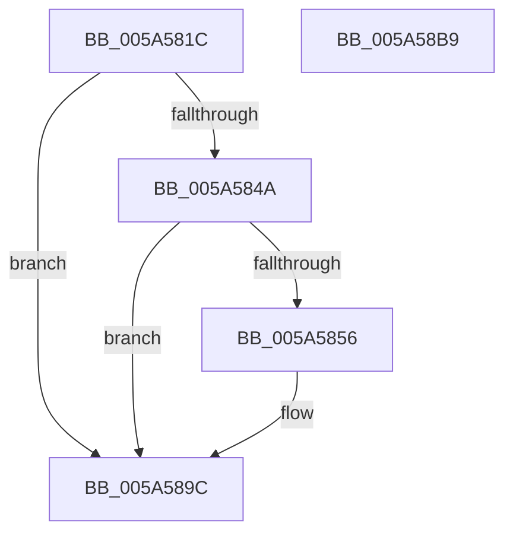

# PnpDiagnosticTraceElamStatus

- RVA: `0x005A581C`–`0x005A58BA` (길이 `158` bytes)
- VA: `0x00000001405A581C`
- 실행 섹션: `.text`
- PDB 이름 있음: `예`; PDB Function 태그: `아니요`
- unwind 정보 RVA: `0x000C8440`
- 디코드: `39`개 명령, `158/158` bytes 표시
- 미해석 바이트: `0` (있으면 어셈블리에 `.byte`로 보존)

> 이 문서는 커널 이미지의 기계어와 PDB 기호를 분석해 생성했습니다. 4번과 5번은 함수 원형과 자료형을 바이너리 사용 방식에서 추정한 C 해석이며 원본 소스 복구 결과는 아닙니다.

## 1. Dependencies

- 직접 호출 지점: **3**; 고유 호출 대상: **3**
- 직접 호출자로 확인된 함수: **1**
- RIP 상대 이미지 참조: **2**

### Outgoing calls
- `0x005A584D` → [EtwEventEnabled](../39/EtwEventEnabled_function_00392450.md) (function, `0x00392450`)
- `0x005A5895` → [EtwWriteEx](../25/EtwWriteEx_function_0025F0D0.md) (function, `0x0025F0D0`)
- `0x005A58A6` → [_security_check_cookie](../6A/_security_check_cookie_function_006AC640.md) (function, `0x006AC640`)

### Direct callers
- [PnpNotifyEarlyLaunchStatusUpdate](../../init/BE/PnpNotifyEarlyLaunchStatusUpdate_function_00BEF120.md) at `0x00BEF140`
- [PnpNotifyEarlyLaunchStatusUpdate](../../init/BE/PnpNotifyEarlyLaunchStatusUpdate_function_00BEF120.md) at `0x00BEF18C`

### Static image references
- `0x005A582A` → RVA `0x00E0A740` (`.data`; read)
- `0x005A583E` → RVA `0x00E662D8` (`.data`; read)

## 2. Other-region calls and transfers

- 다른 실행 섹션으로 향하는 call: **0**
- 별도 외부 분기/꼬리 이동을 확인하지 못했습니다.

## 3. Assembly (complete function range)

```asm
005A581C  48 89 5C 24 18                  mov qword ptr [rsp + 0x18], rbx
005A5821  89 54 24 10                     mov dword ptr [rsp + 0x10], edx
005A5825  57                              push rdi
005A5826  48 83 EC 60                     sub rsp, 0x60
005A582A  48 8B 05 0F 4F 86 00            mov rax, qword ptr [rip + 0x864f0f]
005A5831  48 33 C4                        xor rax, rsp
005A5834  48 89 44 24 50                  mov qword ptr [rsp + 0x50], rax
005A5839  48 8B F9                        mov rdi, rcx
005A583C  33 DB                           xor ebx, ebx
005A583E  48 8B 0D 93 0A 8C 00            mov rcx, qword ptr [rip + 0x8c0a93]
005A5845  48 85 C9                        test rcx, rcx
005A5848  74 52                           je 0x1405a589c
005A584A  48 8B D7                        mov rdx, rdi
005A584D  E8 FE CB DE FF                  call 0x140392450
005A5852  84 C0                           test al, al
005A5854  74 46                           je 0x1405a589c
005A5856  48 8B 0D 7B 0A 8C 00            mov rcx, qword ptr [rip + 0x8c0a7b]
005A585D  48 8D 44 24 78                  lea rax, [rsp + 0x78]
005A5862  48 89 44 24 40                  mov qword ptr [rsp + 0x40], rax
005A5867  45 33 C9                        xor r9d, r9d
005A586A  48 8D 44 24 40                  lea rax, [rsp + 0x40]
005A586F  48 C7 44 24 48 04 00 00 00      mov qword ptr [rsp + 0x48], 4
005A5878  48 89 44 24 38                  mov qword ptr [rsp + 0x38], rax
005A587D  45 33 C0                        xor r8d, r8d
005A5880  C7 44 24 30 01 00 00 00         mov dword ptr [rsp + 0x30], 1
005A5888  48 8B D7                        mov rdx, rdi
005A588B  48 89 5C 24 28                  mov qword ptr [rsp + 0x28], rbx
005A5890  48 89 5C 24 20                  mov qword ptr [rsp + 0x20], rbx
005A5895  E8 36 98 CB FF                  call 0x14025f0d0
005A589A  8B D8                           mov ebx, eax
005A589C  8B C3                           mov eax, ebx
005A589E  48 8B 4C 24 50                  mov rcx, qword ptr [rsp + 0x50]
005A58A3  48 33 CC                        xor rcx, rsp
005A58A6  E8 95 6D 10 00                  call 0x1406ac640
005A58AB  48 8B 9C 24 80 00 00 00         mov rbx, qword ptr [rsp + 0x80]
005A58B3  48 83 C4 60                     add rsp, 0x60
005A58B7  5F                              pop rdi
005A58B8  C3                              ret
005A58B9  CC                              int3
```

## 4. C-style interpretation (structured pseudocode)

```c
__int64 __fastcall PnpDiagnosticTraceElamStatus(__int64 a1, int a2, int a3, int a4)
{
    __int64 result;
    __int64 v_rbx;
    __int64 v_rsp;
    unsigned __int64 v_stack_m18;
    unsigned __int64 v_stack_m20;
    unsigned __int64 v_stack_m28;
    unsigned __int64 v_stack_m30;
    unsigned int v_stack_m38;
    unsigned __int64 v_stack_m40;
    unsigned __int64 v_stack_m48;
    unsigned int v_stack_p10;
    unsigned __int64 v_stack_p18;

    v_stack_p18 = v_rbx;
    v_stack_p10 = a2;
    v_rsp = (v_rsp) - (96);
    result = (*(unsigned __int64 *)(v_rip + 8802063)) ^ (v_rsp);
    v_stack_m18 = result;
    v_rbx = 0;
    if (*(unsigned __int64 *)(v_rip + 9177747) == 0) goto loc_005A589C;
    result = EtwEventEnabled(*(unsigned __int64 *)(v_rip + 9177747), a1, a3, a4);
    if ((unsigned __int8)(result) != 0) {
        a1 = *(unsigned __int64 *)(v_rip + 9177723);
        result = v_stack_p10;
        v_stack_m28 = result;
        a4 = 0;
        result = v_stack_m28;
        v_stack_m20 = 4;
        v_stack_m30 = result;
        a3 = 0;
        v_stack_m38 = 1;
        a2 = a1;
        v_stack_m40 = 0;
        v_stack_m48 = 0;
        result = EtwWriteEx(a1, a2, a3, a4);
        v_rbx = (unsigned int)(result);
    }
    a1 = (v_stack_m18) ^ (v_rsp);
    result = _security_check_cookie(a1, a2, a3, a4);
    v_rsp = (v_rsp) + (96);
    return result;
}
```

## 5. (Beta) C Style

```c
int64_t PnpDiagnosticTraceElamStatus(int64_t Arg1, int32_t Arg2, int32_t Arg3, int32_t Arg4)
{
    int64_t result;
    int64_t local_rbx;
    int64_t local_rsp;
    uint64_t v_stack_m18;
    uint64_t v_stack_m20;
    uint64_t v_stack_m28;
    uint64_t v_stack_m30;
    uint32_t v_stack_m38;
    uint64_t v_stack_m40;
    uint64_t v_stack_m48;
    uint32_t v_stack_p10;
    uint64_t v_stack_p18;

    v_stack_p18 = local_rbx;
    v_stack_p10 = Arg2;
    local_rsp = (local_rsp) - (96);
    result = (*(uint64_t *)(v_rip + 0x864F0F)) ^ (local_rsp);
    v_stack_m18 = result;
    local_rbx = 0;
    if (*(uint64_t *)(v_rip + 0x8C0A93) == 0) goto loc_005A589C;
    result = EtwEventEnabled(*(uint64_t *)(v_rip + 0x8C0A93), Arg1, Arg3, Arg4);
    if ((uint8_t)(result) != 0) {
        Arg1 = *(uint64_t *)(v_rip + 0x8C0A7B);
        result = v_stack_p10;
        v_stack_m28 = result;
        Arg4 = 0;
        result = v_stack_m28;
        v_stack_m20 = 4;
        v_stack_m30 = result;
        Arg3 = 0;
        v_stack_m38 = 1;
        Arg2 = Arg1;
        v_stack_m40 = 0;
        v_stack_m48 = 0;
        result = EtwWriteEx(Arg1, Arg2, Arg3, Arg4);
        local_rbx = (uint32_t)(result);
    }
    Arg1 = (v_stack_m18) ^ (local_rsp);
    result = _security_check_cookie(Arg1, Arg2, Arg3, Arg4);
    local_rsp = (local_rsp) + (96);
    return result;
}
```

## 6. Execution-region graph

[열기: 2D/3D 그래프와 함수 탐색 컨트롤 패널](../../../control-panel.html?section=text&rva=0x005A581C&view=graph)

- 2D 그래프는 위에서 아래로 흐르고, 3D 그래프는 빈 공간을 드래그해 회전합니다. Shift+드래그는 이동, 휠은 확대·축소, 함수 노드 선택은 대상 보고서 이동입니다.

### Static fallback


