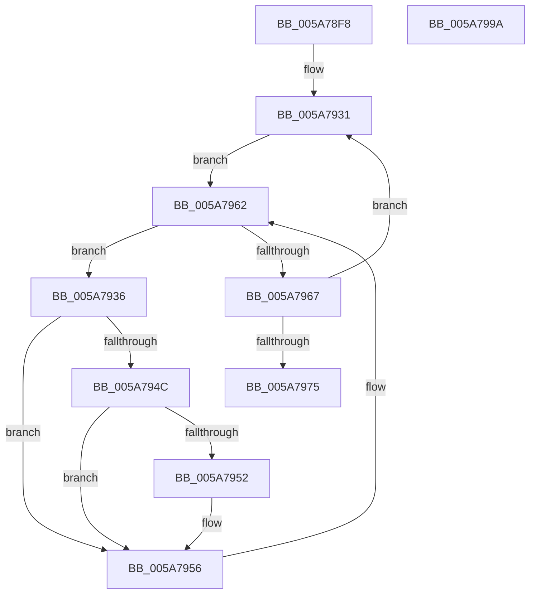

# PnpDisableUserModeNotifications

- RVA: `0x005A78F8`–`0x005A799B` (길이 `163` bytes)
- VA: `0x00000001405A78F8`
- 실행 섹션: `.text`
- PDB 이름 있음: `예`; PDB Function 태그: `아니요`
- unwind 정보 RVA: `0x00060300`
- 디코드: `44`개 명령, `163/163` bytes 표시
- 미해석 바이트: `0` (있으면 어셈블리에 `.byte`로 보존)

> 이 문서는 커널 이미지의 기계어와 PDB 기호를 분석해 생성했습니다. 4번과 5번은 함수 원형과 자료형을 바이너리 사용 방식에서 추정한 C 해석이며 원본 소스 복구 결과는 아닙니다.

## 1. Dependencies

- 직접 호출 지점: **4**; 고유 호출 대상: **2**
- 직접 호출자로 확인된 함수: **1**
- RIP 상대 이미지 참조: **2**

### Outgoing calls
- `0x005A791D` → [ExAcquireFastMutex](../20/ExAcquireFastMutex_function_0020E5A0.md) (function, `0x0020E5A0`)
- `0x005A793A` → [ExAcquireFastMutex](../20/ExAcquireFastMutex_function_0020E5A0.md) (function, `0x0020E5A0`)
- `0x005A795A` → [ExReleaseFastMutex](../25/ExReleaseFastMutex_function_002519C0.md) (function, `0x002519C0`)
- `0x005A797C` → [ExReleaseFastMutex](../25/ExReleaseFastMutex_function_002519C0.md) (function, `0x002519C0`)

### Direct callers
- [IoRevokeHandlesForProcess](../59/IoRevokeHandlesForProcess_function_005981A8.md) at `0x005982EE`

### Static image references
- `0x005A7916` → RVA `0x00F8C760` (`.data`; read)
- `0x005A7922` → RVA `0x00F8C960` (`.data`; read)

## 2. Other-region calls and transfers

- 다른 실행 섹션으로 향하는 call: **0**
- 별도 외부 분기/꼬리 이동을 확인하지 못했습니다.

## 3. Assembly (complete function range)

```asm
005A78F8  48 89 5C 24 08                  mov qword ptr [rsp + 8], rbx
005A78FD  48 89 6C 24 10                  mov qword ptr [rsp + 0x10], rbp
005A7902  48 89 74 24 18                  mov qword ptr [rsp + 0x18], rsi
005A7907  57                              push rdi
005A7908  41 56                           push r14
005A790A  41 57                           push r15
005A790C  48 83 EC 20                     sub rsp, 0x20
005A7910  4C 8B F1                        mov r14, rcx
005A7913  4C 8B FA                        mov r15, rdx
005A7916  48 8D 0D 43 4E 9E 00            lea rcx, [rip + 0x9e4e43]
005A791D  E8 7E 6C C6 FF                  call 0x14020e5a0
005A7922  48 8D 35 37 50 9E 00            lea rsi, [rip + 0x9e5037]
005A7929  BD 0E 00 00 00                  mov ebp, 0xe
005A792E  48 8B FE                        mov rdi, rsi
005A7931  48 8B 1E                        mov rbx, qword ptr [rsi]
005A7934  EB 2C                           jmp 0x1405a7962
005A7936  48 8B 4B 10                     mov rcx, qword ptr [rbx + 0x10]
005A793A  E8 61 6C C6 FF                  call 0x14020e5a0
005A793F  49 8B 87 D0 01 00 00            mov rax, qword ptr [r15 + 0x1d0]
005A7946  48 39 43 30                     cmp qword ptr [rbx + 0x30], rax
005A794A  75 0A                           jne 0x1405a7956
005A794C  4C 39 73 20                     cmp qword ptr [rbx + 0x20], r14
005A7950  75 04                           jne 0x1405a7956
005A7952  C6 43 28 01                     mov byte ptr [rbx + 0x28], 1
005A7956  48 8B 4B 10                     mov rcx, qword ptr [rbx + 0x10]
005A795A  E8 61 A0 CA FF                  call 0x1402519c0
005A795F  48 8B 1B                        mov rbx, qword ptr [rbx]
005A7962  48 3B DF                        cmp rbx, rdi
005A7965  75 CF                           jne 0x1405a7936
005A7967  48 83 C7 10                     add rdi, 0x10
005A796B  48 83 C6 10                     add rsi, 0x10
005A796F  48 83 ED 01                     sub rbp, 1
005A7973  75 BC                           jne 0x1405a7931
005A7975  48 8D 0D E4 4D 9E 00            lea rcx, [rip + 0x9e4de4]
005A797C  E8 3F A0 CA FF                  call 0x1402519c0
005A7981  48 8B 5C 24 40                  mov rbx, qword ptr [rsp + 0x40]
005A7986  48 8B 6C 24 48                  mov rbp, qword ptr [rsp + 0x48]
005A798B  48 8B 74 24 50                  mov rsi, qword ptr [rsp + 0x50]
005A7990  48 83 C4 20                     add rsp, 0x20
005A7994  41 5F                           pop r15
005A7996  41 5E                           pop r14
005A7998  5F                              pop rdi
005A7999  C3                              ret
005A799A  CC                              int3
```

## 4. C-style interpretation (structured pseudocode)

```c
__int64 __fastcall PnpDisableUserModeNotifications(__int64 a1, __int64 a2)
{
    __int64 result;
    __int64 v_rbp;
    __int64 v_rdi;
    __int64 v_rsi;
    __int64 v_rsp;
    unsigned __int64 v_stack_p10;
    unsigned __int64 v_stack_p18;
    unsigned __int64 v_stack_p8;

    v_stack_p8 = v_rbx;
    v_stack_p10 = v_rbp;
    v_stack_p18 = v_rsi;
    v_rsp = (v_rsp) - (32);
    result = ExAcquireFastMutex(v_rip + 10374723, a2, a3, a4);
loc_005A7931:
    goto loc_005A7962;
loc_005A7936:
    result = ExAcquireFastMutex(*(unsigned __int64 *)(*(unsigned __int64 *)(v_rip + 10375223) + 16), a2, a3, a4);
    if ((*(unsigned __int64 *)(*(unsigned __int64 *)(v_rip + 10375223) + 48)) != (*(unsigned __int64 *)(a2 + 464))) goto loc_005A7956;
    if ((*(unsigned __int64 *)(*(unsigned __int64 *)(v_rip + 10375223) + 32)) == a1) {
        *(unsigned __int8 *)(*(unsigned __int64 *)(v_rip + 10375223) + 40) = 1;
    }
    result = ExReleaseFastMutex(*(unsigned __int64 *)(*(unsigned __int64 *)(v_rip + 10375223) + 16), a2, a3, a4);
loc_005A7962:
    if ((*(unsigned __int64 *)(*(unsigned __int64 *)(v_rip + 10375223))) != (v_rip + 10375223)) goto loc_005A7936;
    v_rdi = (v_rip + 10375223) + (16);
    v_rsi = (v_rip + 10375223) + (16);
    v_rbp = (14) - (1);
    if (condition_is_not_equal) goto loc_005A7931;
    result = ExReleaseFastMutex(v_rip + 10374628, a2, a3, a4);
    v_rsp = (v_rsp) + (32);
    return result;
}
```

## 5. (Beta) C Style

```c
int64_t PnpDisableUserModeNotifications(int64_t Arg1, void *Arg2)
{
    uint8_t *arg2 = (uint8_t *)Arg2;

    int64_t result;
    int64_t local_rbp;
    int64_t local_rdi;
    int64_t local_rsi;
    int64_t local_rsp;
    uint64_t v_stack_p10;
    uint64_t v_stack_p18;
    uint64_t v_stack_p8;

    v_stack_p8 = local_rbx;
    v_stack_p10 = local_rbp;
    v_stack_p18 = local_rsi;
    local_rsp = (local_rsp) - (32);
    result = ExAcquireFastMutex(v_rip + 10374723, Arg2, a3, a4);
loc_005A7931:
    goto loc_005A7962;
loc_005A7936:
    result = ExAcquireFastMutex(*(uint64_t *)(*(uint64_t *)(v_rip + 0x9E5037) + 0x10), Arg2, a3, a4);
    if ((*(uint64_t *)(*(uint64_t *)(v_rip + 0x9E5037) + 0x30)) != (*(uint64_t *)(arg2 + 0x1D0))) goto loc_005A7956;
    if ((*(uint64_t *)(*(uint64_t *)(v_rip + 0x9E5037) + 0x20)) == Arg1) {
        *(uint8_t *)(*(uint64_t *)(v_rip + 0x9E5037) + 0x28) = 1;
    }
    result = ExReleaseFastMutex(*(uint64_t *)(*(uint64_t *)(v_rip + 0x9E5037) + 0x10), Arg2, a3, a4);
loc_005A7962:
    if ((*(uint64_t *)(*(uint64_t *)(v_rip + 0x9E5037))) != (v_rip + 10375223)) goto loc_005A7936;
    local_rdi = (v_rip + 10375223) + (16);
    local_rsi = (v_rip + 10375223) + (16);
    local_rbp = (14) - (1);
    if (condition_is_not_equal) goto loc_005A7931;
    result = ExReleaseFastMutex(v_rip + 10374628, Arg2, a3, a4);
    local_rsp = (local_rsp) + (32);
    return result;
}
```

### 관측된 메모리 오프셋

구조체 형식이 확인되지 않은 접근은 인자 기준의 오프셋으로만 기록했습니다.

| 기준 인자 | 오프셋 표현 | 폭 (bit) | 접근 |
|---|---:|---:|---|
| `Arg2` | `+ 0x1D0` | `64` | `R` |

## 6. Execution-region graph

[열기: 2D/3D 그래프와 함수 탐색 컨트롤 패널](../../../control-panel.html?section=text&rva=0x005A78F8&view=graph)

- 2D 그래프는 위에서 아래로 흐르고, 3D 그래프는 빈 공간을 드래그해 회전합니다. Shift+드래그는 이동, 휠은 확대·축소, 함수 노드 선택은 대상 보고서 이동입니다.

### Static fallback


