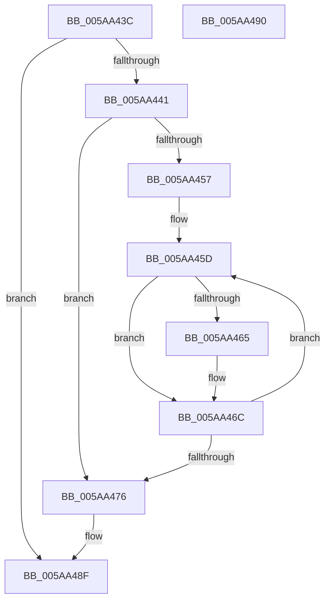

# PnpFreeUnicodeStringList

- RVA: `0x005AA43C`–`0x005AA491` (길이 `85` bytes)
- VA: `0x00000001405AA43C`
- 실행 섹션: `.text`
- PDB 이름 있음: `예`; PDB Function 태그: `아니요`
- unwind 정보 RVA: `0x000ADC24`
- 디코드: `28`개 명령, `85/85` bytes 표시
- 미해석 바이트: `0` (있으면 어셈블리에 `.byte`로 보존)

> 이 문서는 커널 이미지의 기계어와 PDB 기호를 분석해 생성했습니다. 4번과 5번은 함수 원형과 자료형을 바이너리 사용 방식에서 추정한 C 해석이며 원본 소스 복구 결과는 아닙니다.

## 1. Dependencies

- 직접 호출 지점: **2**; 고유 호출 대상: **1**
- 직접 호출자로 확인된 함수: **2**
- RIP 상대 이미지 참조: **0**

### Outgoing calls
- `0x005AA467` → [ExFreePoolWithTag](../../poolcode/B8/ExFreePoolWithTag_function_00B82870.md) (function, `0x00B82870`)
- `0x005AA47B` → [ExFreePoolWithTag](../../poolcode/B8/ExFreePoolWithTag_function_00B82870.md) (function, `0x00B82870`)

### Direct callers
- [PiInitReleaseCachedGroupInformation](../../page/72/PiInitReleaseCachedGroupInformation_function_00723198.md) at `0x007231B3`
- [PnpRegMultiSzToUnicodeStrings](../../init/C3/PnpRegMultiSzToUnicodeStrings_function_00C36360.md) at `0x00C364AA`

### Static image references
- 디코드된 RIP-relative 메모리 참조가 없습니다.

## 2. Other-region calls and transfers

- 다른 실행 섹션으로 향하는 call: **2**
  - `0x005AA467` → [ExFreePoolWithTag](../../poolcode/B8/ExFreePoolWithTag_function_00B82870.md) (`.text` → `POOLCODE`)
  - `0x005AA47B` → [ExFreePoolWithTag](../../poolcode/B8/ExFreePoolWithTag_function_00B82870.md) (`.text` → `POOLCODE`)
- 별도 외부 분기/꼬리 이동을 확인하지 못했습니다.

## 3. Assembly (complete function range)

```asm
005AA43C  48 85 C9                        test rcx, rcx
005AA43F  74 4E                           je 0x1405aa48f
005AA441  48 89 5C 24 08                  mov qword ptr [rsp + 8], rbx
005AA446  48 89 74 24 10                  mov qword ptr [rsp + 0x10], rsi
005AA44B  57                              push rdi
005AA44C  48 83 EC 20                     sub rsp, 0x20
005AA450  48 8B F9                        mov rdi, rcx
005AA453  85 D2                           test edx, edx
005AA455  74 1F                           je 0x1405aa476
005AA457  48 8D 59 08                     lea rbx, [rcx + 8]
005AA45B  8B F2                           mov esi, edx
005AA45D  48 8B 0B                        mov rcx, qword ptr [rbx]
005AA460  48 85 C9                        test rcx, rcx
005AA463  74 07                           je 0x1405aa46c
005AA465  33 D2                           xor edx, edx
005AA467  E8 04 84 5D 00                  call 0x140b82870
005AA46C  48 83 C3 10                     add rbx, 0x10
005AA470  48 83 EE 01                     sub rsi, 1
005AA474  75 E7                           jne 0x1405aa45d
005AA476  33 D2                           xor edx, edx
005AA478  48 8B CF                        mov rcx, rdi
005AA47B  E8 F0 83 5D 00                  call 0x140b82870
005AA480  48 8B 5C 24 30                  mov rbx, qword ptr [rsp + 0x30]
005AA485  48 8B 74 24 38                  mov rsi, qword ptr [rsp + 0x38]
005AA48A  48 83 C4 20                     add rsp, 0x20
005AA48E  5F                              pop rdi
005AA48F  C3                              ret
005AA490  CC                              int3
```

## 4. C-style interpretation (structured pseudocode)

```c
__int64 __fastcall PnpFreeUnicodeStringList(__int64 a1, int a2)
{
    __int64 result;
    __int64 v_rbx;
    __int64 v_rsi;
    __int64 v_rsp;
    unsigned __int64 v_stack_p10;
    unsigned __int64 v_stack_p8;

    if (a1 == 0) goto loc_005AA48F;
    v_stack_p8 = v_rbx;
    v_stack_p10 = v_rsi;
    v_rsp = (v_rsp) - (32);
    if (a2 == 0) goto loc_005AA476;
loc_005AA45D:
    if (*(unsigned __int64 *)(a1 + 8) != 0) {
        a2 = 0;
        result = ExFreePoolWithTag(*(unsigned __int64 *)(a1 + 8), a2, a3, a4);
    }
    v_rbx = (a1 + 8) + (16);
    v_rsi = ((unsigned int)(a2)) - (1);
    if (condition_is_not_equal) goto loc_005AA45D;
loc_005AA476:
    a2 = 0;
    result = ExFreePoolWithTag(a1, a2, a3, a4);
    v_rsp = (v_rsp) + (32);
loc_005AA48F:
    return result;
}
```

## 5. (Beta) C Style

```c
int64_t PnpFreeUnicodeStringList(int64_t Arg1, int32_t Arg2)
{
    int64_t result;
    int64_t local_rbx;
    int64_t local_rsi;
    int64_t local_rsp;
    uint64_t v_stack_p10;
    uint64_t v_stack_p8;

    if (Arg1 == 0) goto loc_005AA48F;
    v_stack_p8 = local_rbx;
    v_stack_p10 = local_rsi;
    local_rsp = (local_rsp) - (32);
    if (Arg2 == 0) goto loc_005AA476;
loc_005AA45D:
    if (*(uint64_t *)(Arg1 + 0x8) != 0) {
        Arg2 = 0;
        result = ExFreePoolWithTag(*(uint64_t *)(Arg1 + 0x8), Arg2, a3, a4);
    }
    local_rbx = (Arg1 + 8) + (16);
    local_rsi = ((uint32_t)(Arg2)) - (1);
    if (condition_is_not_equal) goto loc_005AA45D;
loc_005AA476:
    Arg2 = 0;
    result = ExFreePoolWithTag(Arg1, Arg2, a3, a4);
    local_rsp = (local_rsp) + (32);
loc_005AA48F:
    return result;
}
```

## 6. Execution-region graph

[열기: 2D/3D 그래프와 함수 탐색 컨트롤 패널](../../../control-panel.html?section=text&rva=0x005AA43C&view=graph)

- 2D 그래프는 위에서 아래로 흐르고, 3D 그래프는 빈 공간을 드래그해 회전합니다. Shift+드래그는 이동, 휠은 확대·축소, 함수 노드 선택은 대상 보고서 이동입니다.

### Static fallback


