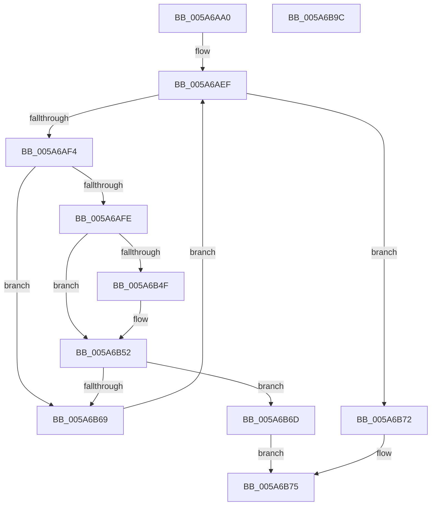

# PnpGetCurrentlyActiveWorkerThread

- RVA: `0x005A6AA0`–`0x005A6B9D` (길이 `253` bytes)
- VA: `0x00000001405A6AA0`
- 실행 섹션: `.text`
- PDB 이름 있음: `예`; PDB Function 태그: `아니요`
- unwind 정보 RVA: `0x000C8710`
- 디코드: `69`개 명령, `253/253` bytes 표시
- 미해석 바이트: `0` (있으면 어셈블리에 `.byte`로 보존)

> 이 문서는 커널 이미지의 기계어와 PDB 기호를 분석해 생성했습니다. 4번과 5번은 함수 원형과 자료형을 바이너리 사용 방식에서 추정한 C 해석이며 원본 소스 복구 결과는 아닙니다.

## 1. Dependencies

- 직접 호출 지점: **4**; 고유 호출 대상: **4**
- 직접 호출자로 확인된 함수: **1**
- RIP 상대 이미지 참조: **6**

### Outgoing calls
- `0x005A6B1E` → [KeAcquireSpinLockRaiseToDpc](../20/KeAcquireSpinLockRaiseToDpc_function_00208470.md) (function, `0x00208470`)
- `0x005A6B45` → [RtlLookupElementGenericTableFullAvl](../3E/RtlLookupElementGenericTableFullAvl_function_003EF460.md) (function, `0x003EF460`)
- `0x005A6B5C` → [KeReleaseSpinLock](../39/KeReleaseSpinLock_function_00392BA0.md) (function, `0x00392BA0`)
- `0x005A6B7D` → [_security_check_cookie](../6A/_security_check_cookie_function_006AC640.md) (function, `0x006AC640`)

### Direct callers
- [PnpBugcheckPowerTimeout](PnpBugcheckPowerTimeout_function_005A6A34.md) at `0x005A6A75`

### Static image references
- `0x005A6AB8` → RVA `0x00E0A740` (`.data`; read)
- `0x005A6AC7` → RVA `0x00F8CB20` (`.data`; read)
- `0x005A6AD7` → RVA `0x00E663B8` (`.data`; read)
- `0x005A6AE4` → RVA `0x00E663B0` (`.data`; read)
- `0x005A6B09` → RVA `0x00F8A900` (`.data`; read)
- `0x005A6B3E` → RVA `0x00F8A920` (`.data`; read)

## 2. Other-region calls and transfers

- 다른 실행 섹션으로 향하는 call: **0**
- 별도 외부 분기/꼬리 이동을 확인하지 못했습니다.

## 3. Assembly (complete function range)

```asm
005A6AA0  4C 8B DC                        mov r11, rsp
005A6AA3  49 89 5B 10                     mov qword ptr [r11 + 0x10], rbx
005A6AA7  49 89 6B 18                     mov qword ptr [r11 + 0x18], rbp
005A6AAB  49 89 73 20                     mov qword ptr [r11 + 0x20], rsi
005A6AAF  57                              push rdi
005A6AB0  41 56                           push r14
005A6AB2  41 57                           push r15
005A6AB4  48 83 EC 60                     sub rsp, 0x60
005A6AB8  48 8B 05 81 3C 86 00            mov rax, qword ptr [rip + 0x863c81]
005A6ABF  48 33 C4                        xor rax, rsp
005A6AC2  48 89 44 24 58                  mov qword ptr [rsp + 0x58], rax
005A6AC7  48 8B 05 52 60 9E 00            mov rax, qword ptr [rip + 0x9e6052]
005A6ACE  33 ED                           xor ebp, ebp
005A6AD0  49 89 43 C8                     mov qword ptr [r11 - 0x38], rax
005A6AD4  4C 8B F1                        mov r14, rcx
005A6AD7  48 8B 05 DA F8 8B 00            mov rax, qword ptr [rip + 0x8bf8da]
005A6ADE  33 DB                           xor ebx, ebx
005A6AE0  49 89 43 D0                     mov qword ptr [r11 - 0x30], rax
005A6AE4  48 8B 05 C5 F8 8B 00            mov rax, qword ptr [rip + 0x8bf8c5]
005A6AEB  49 89 43 D8                     mov qword ptr [r11 - 0x28], rax
005A6AEF  83 FB 03                        cmp ebx, 3
005A6AF2  73 7E                           jae 0x1405a6b72
005A6AF4  48 8B 7C DC 40                  mov rdi, qword ptr [rsp + rbx*8 + 0x40]
005A6AF9  48 85 FF                        test rdi, rdi
005A6AFC  74 6B                           je 0x1405a6b69
005A6AFE  48 85 ED                        test rbp, rbp
005A6B01  48 89 7C 24 38                  mov qword ptr [rsp + 0x38], rdi
005A6B06  48 8B C7                        mov rax, rdi
005A6B09  48 8D 0D F0 3D 9E 00            lea rcx, [rip + 0x9e3df0]
005A6B10  48 0F 45 C5                     cmovne rax, rbp
005A6B14  33 F6                           xor esi, esi
005A6B16  48 21 74 24 30                  and qword ptr [rsp + 0x30], rsi
005A6B1B  48 8B E8                        mov rbp, rax
005A6B1E  E8 4D 19 C6 FF                  call 0x140208470
005A6B23  48 21 74 24 28                  and qword ptr [rsp + 0x28], rsi
005A6B28  4C 8D 4C 24 20                  lea r9, [rsp + 0x20]
005A6B2D  21 74 24 20                     and dword ptr [rsp + 0x20], esi
005A6B31  4C 8D 44 24 28                  lea r8, [rsp + 0x28]
005A6B36  48 8D 54 24 30                  lea rdx, [rsp + 0x30]
005A6B3B  44 8A F8                        mov r15b, al
005A6B3E  48 8D 0D DB 3D 9E 00            lea rcx, [rip + 0x9e3ddb]
005A6B45  E8 16 89 E4 FF                  call 0x1403ef460
005A6B4A  48 85 C0                        test rax, rax
005A6B4D  74 03                           je 0x1405a6b52
005A6B4F  48 8B 30                        mov rsi, qword ptr [rax]
005A6B52  41 8A D7                        mov dl, r15b
005A6B55  48 8D 0D A4 3D 9E 00            lea rcx, [rip + 0x9e3da4]
005A6B5C  E8 3F C0 DE FF                  call 0x140392ba0
005A6B61  49 89 36                        mov qword ptr [r14], rsi
005A6B64  48 85 F6                        test rsi, rsi
005A6B67  75 04                           jne 0x1405a6b6d
005A6B69  FF C3                           inc ebx
005A6B6B  EB 82                           jmp 0x1405a6aef
005A6B6D  48 8B C7                        mov rax, rdi
005A6B70  EB 03                           jmp 0x1405a6b75
005A6B72  48 8B C5                        mov rax, rbp
005A6B75  48 8B 4C 24 58                  mov rcx, qword ptr [rsp + 0x58]
005A6B7A  48 33 CC                        xor rcx, rsp
005A6B7D  E8 BE 5A 10 00                  call 0x1406ac640
005A6B82  4C 8D 5C 24 60                  lea r11, [rsp + 0x60]
005A6B87  49 8B 5B 28                     mov rbx, qword ptr [r11 + 0x28]
005A6B8B  49 8B 6B 30                     mov rbp, qword ptr [r11 + 0x30]
005A6B8F  49 8B 73 38                     mov rsi, qword ptr [r11 + 0x38]
005A6B93  49 8B E3                        mov rsp, r11
005A6B96  41 5F                           pop r15
005A6B98  41 5E                           pop r14
005A6B9A  5F                              pop rdi
005A6B9B  C3                              ret
005A6B9C  CC                              int3
```

## 4. C-style interpretation (structured pseudocode)

```c
__int64 __fastcall PnpGetCurrentlyActiveWorkerThread(__int64 a1)
{
    __int64 result;
    __int64 v_rbp;
    __int64 v_rbx;
    __int64 v_rsi;
    __int64 v_rsp;
    unsigned __int64 v_stack_m18;
    unsigned __int64 v_stack_m20;
    unsigned __int64 v_stack_m40;
    unsigned __int64 v_stack_m48;
    unsigned __int64 v_stack_m50;
    unsigned __int64 v_stack_m58;

    *(unsigned __int64 *)(v_rsp + 16) = v_rbx;
    *(unsigned __int64 *)(v_rsp + 24) = v_rbp;
    *(unsigned __int64 *)(v_rsp + 32) = v_rsi;
    v_rsp = (v_rsp) - (96);
    result = (*(unsigned __int64 *)(v_rip + 8797313)) ^ (v_rsp);
    v_stack_m20 = result;
    v_rbp = 0;
    *(unsigned __int64 *)(v_rsp - 56) = *(unsigned __int64 *)(v_rip + 10379346);
    v_rbx = 0;
    *(unsigned __int64 *)(v_rsp - 48) = *(unsigned __int64 *)(v_rip + 9173210);
    *(unsigned __int64 *)(v_rsp - 40) = *(unsigned __int64 *)(v_rip + 9173189);
loc_005A6AEF:
    if (0 >= 3) goto loc_005A6B72;
    if (*(unsigned __int64 *)(v_rsp + v_rbx * 8 + 64) == 0) goto loc_005A6B69;
    v_stack_m40 = *(unsigned __int64 *)(v_rsp + v_rbx * 8 + 64);
    result = *(unsigned __int64 *)(v_rsp + v_rbx * 8 + 64);
    if (0 != 0) { result = 0; }
    v_rsi = 0;
    result = KeAcquireSpinLockRaiseToDpc(v_rip + 10370544, a2, a3, a4);
    result = RtlLookupElementGenericTableFullAvl(v_rip + 10370523, v_stack_m48, v_stack_m50, v_stack_m58);
    if (result != 0) {
        v_rsi = *(unsigned __int64 *)(result);
    }
    result = KeReleaseSpinLock(v_rip + 10370468, (unsigned __int8)((unsigned __int8)(result)), v_stack_m50, v_stack_m58);
    *(unsigned __int64 *)(a1) = v_rsi;
    if (v_rsi != 0) goto loc_005A6B6D;
loc_005A6B69:
    v_rbx = (unsigned int)((v_rbx) + 1);
    goto loc_005A6AEF;
loc_005A6B6D:
    goto loc_005A6B75;
loc_005A6B72:
loc_005A6B75:
    a1 = (v_stack_m20) ^ (v_rsp);
    result = _security_check_cookie(a1, (unsigned __int8)((unsigned __int8)(result)), v_stack_m50, v_stack_m58);
    return result;
}
```

## 5. (Beta) C Style

```c
int64_t PnpGetCurrentlyActiveWorkerThread(void *Arg1)
{
    uint8_t *arg1 = (uint8_t *)Arg1;

    int64_t result;
    int64_t local_rbp;
    int64_t local_rbx;
    int64_t local_rsi;
    int64_t local_rsp;
    uint64_t v_stack_m18;
    uint64_t v_stack_m20;
    uint64_t v_stack_m40;
    uint64_t v_stack_m48;
    uint64_t v_stack_m50;
    uint64_t v_stack_m58;

    *(uint64_t *)(local_rsp + 0x10) = local_rbx;
    *(uint64_t *)(local_rsp + 0x18) = local_rbp;
    *(uint64_t *)(local_rsp + 0x20) = local_rsi;
    local_rsp = (local_rsp) - (96);
    result = (*(uint64_t *)(v_rip + 0x863C81)) ^ (local_rsp);
    v_stack_m20 = result;
    local_rbp = 0;
    *(uint64_t *)(local_rsp - 0x38) = *(uint64_t *)(v_rip + 0x9E6052);
    local_rbx = 0;
    *(uint64_t *)(local_rsp - 0x30) = *(uint64_t *)(v_rip + 0x8BF8DA);
    *(uint64_t *)(local_rsp - 0x28) = *(uint64_t *)(v_rip + 0x8BF8C5);
loc_005A6AEF:
    if (0 >= 3) goto loc_005A6B72;
    if (*(uint64_t *)(local_rsp + local_rbx * 8 + 0x40) == 0) goto loc_005A6B69;
    v_stack_m40 = *(uint64_t *)(local_rsp + local_rbx * 8 + 0x40);
    result = *(uint64_t *)(local_rsp + local_rbx * 8 + 0x40);
    if (0 != 0) { result = 0; }
    local_rsi = 0;
    result = KeAcquireSpinLockRaiseToDpc(v_rip + 10370544, a2, a3, a4);
    result = RtlLookupElementGenericTableFullAvl(v_rip + 10370523, v_stack_m48, v_stack_m50, v_stack_m58);
    if (result != 0) {
        local_rsi = *(uint64_t *)(result);
    }
    result = KeReleaseSpinLock(v_rip + 10370468, (uint8_t)((uint8_t)(result)), v_stack_m50, v_stack_m58);
    *(uint64_t *)(arg1) = local_rsi;
    if (local_rsi != 0) goto loc_005A6B6D;
loc_005A6B69:
    local_rbx = (uint32_t)((local_rbx) + 1);
    goto loc_005A6AEF;
loc_005A6B6D:
    goto loc_005A6B75;
loc_005A6B72:
loc_005A6B75:
    Arg1 = (v_stack_m20) ^ (local_rsp);
    result = _security_check_cookie(Arg1, (uint8_t)((uint8_t)(result)), v_stack_m50, v_stack_m58);
    return result;
}
```

### 관측된 메모리 오프셋

구조체 형식이 확인되지 않은 접근은 인자 기준의 오프셋으로만 기록했습니다.

| 기준 인자 | 오프셋 표현 | 폭 (bit) | 접근 |
|---|---:|---:|---|
| `Arg1` | `+ 0x0` | `64` | `W` |

## 6. Execution-region graph

[열기: 2D/3D 그래프와 함수 탐색 컨트롤 패널](../../../control-panel.html?section=text&rva=0x005A6AA0&view=graph)

- 2D 그래프는 위에서 아래로 흐르고, 3D 그래프는 빈 공간을 드래그해 회전합니다. Shift+드래그는 이동, 휠은 확대·축소, 함수 노드 선택은 대상 보고서 이동입니다.

### Static fallback


