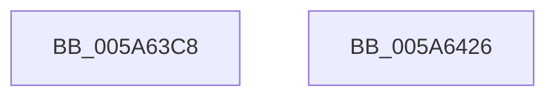

# PnpInitializeTriageBlock

- RVA: `0x005A63C8`–`0x005A6427` (길이 `95` bytes)
- VA: `0x00000001405A63C8`
- 실행 섹션: `.text`
- PDB 이름 있음: `예`; PDB Function 태그: `아니요`
- unwind 정보 RVA: `0x0005CF00`
- 디코드: `22`개 명령, `95/95` bytes 표시
- 미해석 바이트: `0` (있으면 어셈블리에 `.byte`로 보존)

> 이 문서는 커널 이미지의 기계어와 PDB 기호를 분석해 생성했습니다. 4번과 5번은 함수 원형과 자료형을 바이너리 사용 방식에서 추정한 C 해석이며 원본 소스 복구 결과는 아닙니다.

## 1. Dependencies

- 직접 호출 지점: **1**; 고유 호출 대상: **1**
- 직접 호출자로 확인된 함수: **2**
- RIP 상대 이미지 참조: **5**

### Outgoing calls
- `0x005A63D7` → [memset](../6C/memset_function_006C6C40.md) (function, `0x006C6C40`)

### Direct callers
- [IopAddBugcheckTriageDataFromParameters](../59/IopAddBugcheckTriageDataFromParameters_function_00593E54.md) at `0x005940A2`
- [PnpWatchdogBugcheck](PnpWatchdogBugcheck_function_005A6494.md) at `0x005A64F6`

### Static image references
- `0x005A63E9` → RVA `0x00E663B8` (`.data`; read)
- `0x005A63F4` → RVA `0x00E663B0` (`.data`; read)
- `0x005A63FF` → RVA `0x00F8CB20` (`.data`; read)
- `0x005A640A` → RVA `0x00F8C300` (`.data`; read)
- `0x005A6415` → RVA `0x00EFAAB8` (`.data`; read)

## 2. Other-region calls and transfers

- 다른 실행 섹션으로 향하는 call: **0**
- 별도 외부 분기/꼬리 이동을 확인하지 못했습니다.

## 3. Assembly (complete function range)

```asm
005A63C8  40 53                           push rbx
005A63CA  48 83 EC 20                     sub rsp, 0x20
005A63CE  33 D2                           xor edx, edx
005A63D0  48 8B D9                        mov rbx, rcx
005A63D3  44 8D 42 50                     lea r8d, [rdx + 0x50]
005A63D7  E8 64 08 12 00                  call 0x1406c6c40
005A63DC  C7 03 57 50 4E 50               mov dword ptr [rbx], 0x504e5057
005A63E2  C7 43 04 01 00 00 00            mov dword ptr [rbx + 4], 1
005A63E9  48 8B 05 C8 FF 8B 00            mov rax, qword ptr [rip + 0x8bffc8]
005A63F0  48 89 43 10                     mov qword ptr [rbx + 0x10], rax
005A63F4  48 8B 05 B5 FF 8B 00            mov rax, qword ptr [rip + 0x8bffb5]
005A63FB  48 89 43 18                     mov qword ptr [rbx + 0x18], rax
005A63FF  48 8B 05 1A 67 9E 00            mov rax, qword ptr [rip + 0x9e671a]
005A6406  48 89 43 20                     mov qword ptr [rbx + 0x20], rax
005A640A  48 8D 05 EF 5E 9E 00            lea rax, [rip + 0x9e5eef]
005A6411  48 89 43 28                     mov qword ptr [rbx + 0x28], rax
005A6415  48 8B 05 9C 46 95 00            mov rax, qword ptr [rip + 0x95469c]
005A641C  48 89 43 30                     mov qword ptr [rbx + 0x30], rax
005A6420  48 83 C4 20                     add rsp, 0x20
005A6424  5B                              pop rbx
005A6425  C3                              ret
005A6426  CC                              int3
```

## 4. C-style interpretation (structured pseudocode)

```c
__int64 __fastcall PnpInitializeTriageBlock(__int64 a1, int a2)
{
    __int64 result;
    __int64 v_rsp;

    v_rsp = (v_rsp) - (32);
    a2 = 0;
    result = memset(a1, a2, a2 + 80, a4);
    *(unsigned int *)(a1) = 0x504E5057ULL;
    *(unsigned int *)(a1 + 4) = 1;
    *(unsigned __int64 *)(a1 + 16) = *(unsigned __int64 *)(v_rip + 9174984);
    *(unsigned __int64 *)(a1 + 24) = *(unsigned __int64 *)(v_rip + 9174965);
    *(unsigned __int64 *)(a1 + 32) = *(unsigned __int64 *)(v_rip + 10381082);
    *(unsigned __int64 *)(a1 + 40) = v_rip + 10378991;
    *(unsigned __int64 *)(a1 + 48) = *(unsigned __int64 *)(v_rip + 9782940);
    v_rsp = (v_rsp) + (32);
    return *(unsigned __int64 *)(v_rip + 9782940);
}
```

## 5. (Beta) C Style

```c
int64_t PnpInitializeTriageBlock(void *Arg1, int32_t Arg2)
{
    uint8_t *arg1 = (uint8_t *)Arg1;

    int64_t result;
    int64_t local_rsp;

    local_rsp = (local_rsp) - (32);
    Arg2 = 0;
    result = memset(Arg1, Arg2, Arg2 + 80, a4);
    *(uint32_t *)(arg1) = 0x504E5057ULL;
    *(uint32_t *)(arg1 + 0x4) = 1;
    *(uint64_t *)(arg1 + 0x10) = *(uint64_t *)(v_rip + 0x8BFFC8);
    *(uint64_t *)(arg1 + 0x18) = *(uint64_t *)(v_rip + 0x8BFFB5);
    *(uint64_t *)(arg1 + 0x20) = *(uint64_t *)(v_rip + 0x9E671A);
    *(uint64_t *)(arg1 + 0x28) = v_rip + 10378991;
    *(uint64_t *)(arg1 + 0x30) = *(uint64_t *)(v_rip + 0x95469C);
    local_rsp = (local_rsp) + (32);
    return *(uint64_t *)(v_rip + 0x95469C);
}
```

### 관측된 메모리 오프셋

구조체 형식이 확인되지 않은 접근은 인자 기준의 오프셋으로만 기록했습니다.

| 기준 인자 | 오프셋 표현 | 폭 (bit) | 접근 |
|---|---:|---:|---|
| `Arg1` | `+ 0x0` | `32` | `W` |
| `Arg1` | `+ 0x4` | `32` | `W` |
| `Arg1` | `+ 0x10` | `64` | `W` |
| `Arg1` | `+ 0x18` | `64` | `W` |
| `Arg1` | `+ 0x20` | `64` | `W` |
| `Arg1` | `+ 0x28` | `64` | `W` |
| `Arg1` | `+ 0x30` | `64` | `W` |

## 6. Execution-region graph

[열기: 2D/3D 그래프와 함수 탐색 컨트롤 패널](../../../control-panel.html?section=text&rva=0x005A63C8&view=graph)

- 2D 그래프는 위에서 아래로 흐르고, 3D 그래프는 빈 공간을 드래그해 회전합니다. Shift+드래그는 이동, 휠은 확대·축소, 함수 노드 선택은 대상 보고서 이동입니다.

### Static fallback


