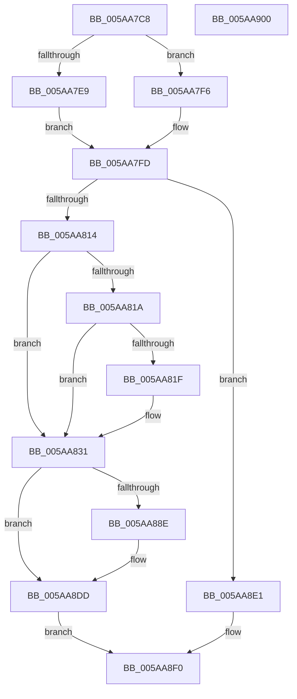

# PnpProcessRebalance

- RVA: `0x005AA7C8`–`0x005AA901` (길이 `313` bytes)
- VA: `0x00000001405AA7C8`
- 실행 섹션: `.text`
- PDB 이름 있음: `예`; PDB Function 태그: `아니요`
- unwind 정보 RVA: `0x000C91A4`
- 디코드: `76`개 명령, `313/313` bytes 표시
- 미해석 바이트: `0` (있으면 어셈블리에 `.byte`로 보존)

> 이 문서는 커널 이미지의 기계어와 PDB 기호를 분석해 생성했습니다. 4번과 5번은 함수 원형과 자료형을 바이너리 사용 방식에서 추정한 C 해석이며 원본 소스 복구 결과는 아닙니다.

## 1. Dependencies

- 직접 호출 지점: **8**; 고유 호출 대상: **8**
- 직접 호출자로 확인된 함수: **1**
- RIP 상대 이미지 참조: **3**

### Outgoing calls
- `0x005AA822` → [PiCollapseRebalanceRequests](PiCollapseRebalanceRequests_function_005AA590.md) (function, `0x005AA590`)
- `0x005AA859` → [KeWaitForSingleObject](../20/KeWaitForSingleObject_function_0020E6B0.md) (function, `0x0020E6B0`)
- `0x005AA869` → [PnpRebalance](../../page/73/PnpRebalance_function_0073F508.md) (function, `0x0073F508`)
- `0x005AA880` → [KeReleaseSemaphore](../39/KeReleaseSemaphore_function_00397080.md) (function, `0x00397080`)
- `0x005AA885` → [KeLeaveCriticalRegion](../25/KeLeaveCriticalRegion_function_0025D8B0.md) (function, `0x0025D8B0`)
- `0x005AA8B0` → [ObfReferenceObjectWithTag](../21/ObfReferenceObjectWithTag_function_00210710.md) (function, `0x00210710`)
- `0x005AA8D6` → [PipProcessDevNodeTree](../../page/8F/PipProcessDevNodeTree_function_008F9068.md) (function, `0x008F9068`)
- `0x005AA8E6` → [ObfDereferenceObjectWithTag](../2F/ObfDereferenceObjectWithTag_function_002F78E0.md) (function, `0x002F78E0`)

### Direct callers
- [PnpDeviceActionWorker](../47/PnpDeviceActionWorker_function_00478400.md) at `0x00478A00`

### Static image references
- `0x005AA7F6` → RVA `0x00F8C438` (`.data`; read)
- `0x005AA83A` → RVA `0x00F8C360` (`.data`; read)
- `0x005AA89A` → RVA `0x00F8C5FA` (`.data`; read)

## 2. Other-region calls and transfers

- 다른 실행 섹션으로 향하는 call: **2**
  - `0x005AA869` → [PnpRebalance](../../page/73/PnpRebalance_function_0073F508.md) (`.text` → `PAGE`)
  - `0x005AA8D6` → [PipProcessDevNodeTree](../../page/8F/PipProcessDevNodeTree_function_008F9068.md) (`.text` → `PAGE`)
- 별도 외부 분기/꼬리 이동을 확인하지 못했습니다.

## 3. Assembly (complete function range)

```asm
005AA7C8  48 89 5C 24 10                  mov qword ptr [rsp + 0x10], rbx
005AA7CD  48 89 74 24 18                  mov qword ptr [rsp + 0x18], rsi
005AA7D2  57                              push rdi
005AA7D3  48 83 EC 40                     sub rsp, 0x40
005AA7D7  48 83 64 24 50 00               and qword ptr [rsp + 0x50], 0
005AA7DD  48 8B F1                        mov rsi, rcx
005AA7E0  48 8B 49 10                     mov rcx, qword ptr [rcx + 0x10]
005AA7E4  48 85 C9                        test rcx, rcx
005AA7E7  74 0D                           je 0x1405aa7f6
005AA7E9  48 8B 81 38 01 00 00            mov rax, qword ptr [rcx + 0x138]
005AA7F0  48 8B 78 28                     mov rdi, qword ptr [rax + 0x28]
005AA7F4  EB 07                           jmp 0x1405aa7fd
005AA7F6  48 8B 3D 3B 1C 9E 00            mov rdi, qword ptr [rip + 0x9e1c3b]
005AA7FD  8B 87 2C 01 00 00               mov eax, dword ptr [rdi + 0x12c]
005AA803  8B 5E 28                        mov ebx, dword ptr [rsi + 0x28]
005AA806  2D 15 03 00 00                  sub eax, 0x315
005AA80B  83 F8 01                        cmp eax, 1
005AA80E  0F 86 CD 00 00 00               jbe 0x1405aa8e1
005AA814  80 7E 1C 00                     cmp byte ptr [rsi + 0x1c], 0
005AA818  75 17                           jne 0x1405aa831
005AA81A  F6 C3 01                        test bl, 1
005AA81D  74 12                           je 0x1405aa831
005AA81F  48 8B CE                        mov rcx, rsi
005AA822  E8 69 FD FF FF                  call 0x1405aa590
005AA827  84 C0                           test al, al
005AA829  48 0F 45 3D 07 1C 9E 00         cmovne rdi, qword ptr [rip + 0x9e1c07]
005AA831  65 48 8B 04 25 88 01 00 00      mov rax, qword ptr gs:[0x188]
005AA83A  48 8D 0D 1F 1B 9E 00            lea rcx, [rip + 0x9e1b1f]
005AA841  48 83 64 24 20 00               and qword ptr [rsp + 0x20], 0
005AA847  45 33 C9                        xor r9d, r9d
005AA84A  45 33 C0                        xor r8d, r8d
005AA84D  66 FF 88 E4 01 00 00            dec word ptr [rax + 0x1e4]
005AA854  90                              nop
005AA855  41 8D 51 04                     lea edx, [r9 + 4]
005AA859  E8 52 3E C6 FF                  call 0x14020e6b0
005AA85E  44 8B CB                        mov r9d, ebx
005AA861  45 33 C0                        xor r8d, r8d
005AA864  33 D2                           xor edx, edx
005AA866  48 8B CF                        mov rcx, rdi
005AA869  E8 9A 4C 19 00                  call 0x14073f508
005AA86E  45 33 C9                        xor r9d, r9d
005AA871  48 8D 0D E8 1A 9E 00            lea rcx, [rip + 0x9e1ae8]
005AA878  33 D2                           xor edx, edx
005AA87A  8B D8                           mov ebx, eax
005AA87C  45 8D 41 01                     lea r8d, [r9 + 1]
005AA880  E8 FB C7 DE FF                  call 0x140397080
005AA885  E8 26 30 CB FF                  call 0x14025d8b0
005AA88A  85 DB                           test ebx, ebx
005AA88C  78 4F                           js 0x1405aa8dd
005AA88E  48 8B 0D A3 1B 9E 00            mov rcx, qword ptr [rip + 0x9e1ba3]
005AA895  BA 44 66 6C 74                  mov edx, 0x746c6644
005AA89A  8A 05 5A 1D 9E 00               mov al, byte ptr [rip + 0x9e1d5a]
005AA8A0  C7 44 24 50 03 00 00 00         mov dword ptr [rsp + 0x50], 3
005AA8A8  88 44 24 54                     mov byte ptr [rsp + 0x54], al
005AA8AC  48 8B 49 20                     mov rcx, qword ptr [rcx + 0x20]
005AA8B0  E8 5B 5E C6 FF                  call 0x140210710
005AA8B5  48 8B 0D 7C 1B 9E 00            mov rcx, qword ptr [rip + 0x9e1b7c]
005AA8BC  4C 8D 44 24 50                  lea r8, [rsp + 0x50]
005AA8C1  C6 44 24 30 00                  mov byte ptr [rsp + 0x30], 0
005AA8C6  45 33 C9                        xor r9d, r9d
005AA8C9  C6 44 24 28 01                  mov byte ptr [rsp + 0x28], 1
005AA8CE  48 8B D6                        mov rdx, rsi
005AA8D1  C6 44 24 20 00                  mov byte ptr [rsp + 0x20], 0
005AA8D6  E8 8D E7 34 00                  call 0x1408f9068
005AA8DB  8B D8                           mov ebx, eax
005AA8DD  8B C3                           mov eax, ebx
005AA8DF  EB 0F                           jmp 0x1405aa8f0
005AA8E1  BA 44 66 6C 74                  mov edx, 0x746c6644
005AA8E6  E8 F5 CF D4 FF                  call 0x1402f78e0
005AA8EB  B8 56 00 00 C0                  mov eax, 0xc0000056
005AA8F0  48 8B 5C 24 58                  mov rbx, qword ptr [rsp + 0x58]
005AA8F5  48 8B 74 24 60                  mov rsi, qword ptr [rsp + 0x60]
005AA8FA  48 83 C4 40                     add rsp, 0x40
005AA8FE  5F                              pop rdi
005AA8FF  C3                              ret
005AA900  CC                              int3
```

## 4. C-style interpretation (structured pseudocode)

```c
__int64 __fastcall PnpProcessRebalance(__int64 a1, __int64 a2, int a3, int a4)
{
    __int64 result;
    __int64 v_rbx;
    __int64 v_rdi;
    __int64 v_rsp;
    unsigned __int8 v_stack_m18;
    unsigned __int8 v_stack_m20;
    unsigned __int64 v_stack_m28;
    unsigned __int64 v_stack_p10;
    unsigned __int64 v_stack_p18;
    unsigned __int64 v_stack_p8;
    unsigned __int8 v_stack_pC;

    v_stack_p10 = v_rbx;
    v_stack_p18 = v_rsi;
    v_rsp = (v_rsp) - (64);
    if (*(unsigned __int64 *)(a1 + 16) == 0) goto loc_005AA7F6;
    goto loc_005AA7FD;
loc_005AA7F6:
loc_005AA7FD:
    result = (unsigned int)(((unsigned int)(*(unsigned int *)(*(unsigned __int64 *)(v_rip + 10361915) + 300))) - (789));
    if (((unsigned int)(result)) <= 1) goto loc_005AA8E1;
    if ((*(unsigned __int8 *)(a1 + 28)) != 0) goto loc_005AA831;
    v_rdi = *(unsigned __int64 *)(v_rip + 10361915);
    if ((((unsigned __int8)((unsigned int)(*(unsigned int *)(a1 + 40)))) & (1)) != 0) {
        a1 = a1;
        result = PiCollapseRebalanceRequests(a1, a2, a3, a4);
        v_rdi = *(unsigned __int64 *)(v_rip + 10361915);
        if ((unsigned __int8)(result) != 0) { v_rdi = *(unsigned __int64 *)(v_rip + 10361863); }
    }
    a4 = 0;
    a3 = 0;
    result = KeWaitForSingleObject(v_rip + 10361631, a4 + 4, a3, a4);
    a3 = 0;
    a2 = 0;
    result = PnpRebalance(v_rdi, a2, a3, (unsigned int)((unsigned int)((unsigned int)(*(unsigned int *)(a1 + 40)))));
    a4 = 0;
    a2 = 0;
    result = KeReleaseSemaphore(v_rip + 10361576, a2, a4 + 1, a4);
    result = KeLeaveCriticalRegion(v_rip + 10361576, a2, a4 + 1, a4);
    v_rbx = (unsigned int)((unsigned int)(result));
    if (!(sign_flag)) {
        a1 = *(unsigned __int64 *)(v_rip + 10361763);
        a2 = 0x746C6644ULL;
        result = *(unsigned __int8 *)(v_rip + 10362202);
        v_stack_p8 = 3;
        v_stack_pC = (unsigned __int8)(result);
        a1 = *(unsigned __int64 *)(a1 + 32);
        result = ObfReferenceObjectWithTag(a1, a2, a4 + 1, a4);
        a1 = *(unsigned __int64 *)(v_rip + 10361724);
        a3 = v_stack_p8;
        v_stack_m18 = 0;
        a4 = 0;
        v_stack_m20 = 1;
        a2 = a1;
        v_stack_m28 = 0;
        result = PipProcessDevNodeTree(a1, a2, a3, a4);
        v_rbx = (unsigned int)(result);
    }
    goto loc_005AA8F0;
loc_005AA8E1:
    result = ObfDereferenceObjectWithTag(a1, (unsigned int)(0x746C6644ULL), a3, a4);
loc_005AA8F0:
    v_rsp = (v_rsp) + (64);
    return (unsigned int)(0xC0000056ULL);
}
```

## 5. (Beta) C Style

```c
int64_t PnpProcessRebalance(void *Arg1, int64_t Arg2, int32_t Arg3, int32_t Arg4)
{
    uint8_t *arg1 = (uint8_t *)Arg1;

    int64_t result;
    int64_t local_rbx;
    int64_t local_rdi;
    int64_t local_rsp;
    uint8_t v_stack_m18;
    uint8_t v_stack_m20;
    uint64_t v_stack_m28;
    uint64_t v_stack_p10;
    uint64_t v_stack_p18;
    uint64_t v_stack_p8;
    uint8_t v_stack_pC;

    v_stack_p10 = local_rbx;
    v_stack_p18 = local_rsi;
    local_rsp = (local_rsp) - (64);
    if (*(uint64_t *)(arg1 + 0x10) == 0) goto loc_005AA7F6;
    goto loc_005AA7FD;
loc_005AA7F6:
loc_005AA7FD:
    result = (uint32_t)(((uint32_t)(*(uint32_t *)(*(uint64_t *)(v_rip + 0x9E1C3B) + 0x12C))) - (789));
    if (((uint32_t)(result)) <= 1) goto loc_005AA8E1;
    if ((*(uint8_t *)(arg1 + 0x1C)) != 0) goto loc_005AA831;
    local_rdi = *(uint64_t *)(v_rip + 0x9E1C3B);
    if ((((uint8_t)((uint32_t)(*(uint32_t *)(arg1 + 0x28)))) & (1)) != 0) {
        Arg1 = Arg1;
        result = PiCollapseRebalanceRequests(Arg1, Arg2, Arg3, Arg4);
        local_rdi = *(uint64_t *)(v_rip + 0x9E1C3B);
        if ((uint8_t)(result) != 0) { local_rdi = *(uint64_t *)(v_rip + 0x9E1C07); }
    }
    Arg4 = 0;
    Arg3 = 0;
    result = KeWaitForSingleObject(v_rip + 10361631, Arg4 + 4, Arg3, Arg4);
    Arg3 = 0;
    Arg2 = 0;
    result = PnpRebalance(local_rdi, Arg2, Arg3, (uint32_t)((uint32_t)((uint32_t)(*(uint32_t *)(arg1 + 0x28)))));
    Arg4 = 0;
    Arg2 = 0;
    result = KeReleaseSemaphore(v_rip + 10361576, Arg2, Arg4 + 1, Arg4);
    result = KeLeaveCriticalRegion(v_rip + 10361576, Arg2, Arg4 + 1, Arg4);
    local_rbx = (uint32_t)((uint32_t)(result));
    if (!(sign_flag)) {
        Arg1 = *(uint64_t *)(v_rip + 0x9E1BA3);
        Arg2 = 0x746C6644ULL;
        result = *(uint8_t *)(v_rip + 0x9E1D5A);
        v_stack_p8 = 3;
        v_stack_pC = (uint8_t)(result);
        Arg1 = *(uint64_t *)(arg1 + 0x20);
        result = ObfReferenceObjectWithTag(Arg1, Arg2, Arg4 + 1, Arg4);
        Arg1 = *(uint64_t *)(v_rip + 0x9E1B7C);
        Arg3 = v_stack_p8;
        v_stack_m18 = 0;
        Arg4 = 0;
        v_stack_m20 = 1;
        Arg2 = Arg1;
        v_stack_m28 = 0;
        result = PipProcessDevNodeTree(Arg1, Arg2, Arg3, Arg4);
        local_rbx = (uint32_t)(result);
    }
    goto loc_005AA8F0;
loc_005AA8E1:
    result = ObfDereferenceObjectWithTag(Arg1, (uint32_t)(0x746C6644ULL), Arg3, Arg4);
loc_005AA8F0:
    local_rsp = (local_rsp) + (64);
    return (uint32_t)(0xC0000056ULL);
}
```

### 관측된 메모리 오프셋

구조체 형식이 확인되지 않은 접근은 인자 기준의 오프셋으로만 기록했습니다.

| 기준 인자 | 오프셋 표현 | 폭 (bit) | 접근 |
|---|---:|---:|---|
| `Arg1` | `+ 0x10` | `64` | `R` |
| `Arg1` | `+ 0x1C` | `8` | `R` |
| `Arg1` | `+ 0x28` | `32` | `R` |

## 6. Execution-region graph

[열기: 2D/3D 그래프와 함수 탐색 컨트롤 패널](../../../control-panel.html?section=text&rva=0x005AA7C8&view=graph)

- 2D 그래프는 위에서 아래로 흐르고, 3D 그래프는 빈 공간을 드래그해 회전합니다. Shift+드래그는 이동, 휠은 확대·축소, 함수 노드 선택은 대상 보고서 이동입니다.

### Static fallback


