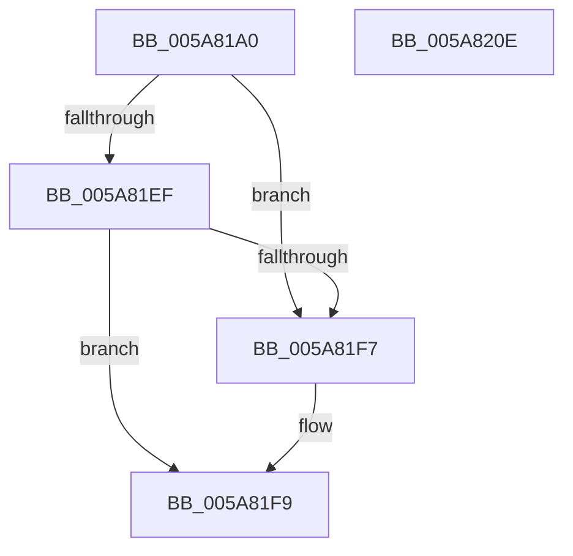

# PnpRegistryValueExists

- RVA: `0x005A81A0`–`0x005A820F` (길이 `111` bytes)
- VA: `0x00000001405A81A0`
- 실행 섹션: `.text`
- PDB 이름 있음: `예`; PDB Function 태그: `아니요`
- unwind 정보 RVA: `0x000A06A8`
- 디코드: `31`개 명령, `111/111` bytes 표시
- 미해석 바이트: `0` (있으면 어셈블리에 `.byte`로 보존)

> 이 문서는 커널 이미지의 기계어와 PDB 기호를 분석해 생성했습니다. 4번과 5번은 함수 원형과 자료형을 바이너리 사용 방식에서 추정한 C 해석이며 원본 소스 복구 결과는 아닙니다.

## 1. Dependencies

- 직접 호출 지점: **2**; 고유 호출 대상: **2**
- 직접 호출자로 확인된 함수: **3**
- RIP 상대 이미지 참조: **1**

### Outgoing calls
- `0x005A81DD` → [ZwQueryValueKey](../6A/ZwQueryValueKey_function_006AD3B0.md) (function, `0x006AD3B0`)
- `0x005A8203` → [_security_check_cookie](../6A/_security_check_cookie_function_006AC640.md) (function, `0x006AC640`)

### Direct callers
- [PiDevCfgMigrateRootDevice](../../page/73/PiDevCfgMigrateRootDevice_function_00733DF0.md) at `0x00733E8B`
- [PiDevCfgQueryDriverNode](../../page/73/PiDevCfgQueryDriverNode_function_0073435C.md) at `0x00734BC6`
- [sub_00B2C5F4](../../page/B2/Unknown_function_00B2C5F4.md) at `0x00B2C6EE`

### Static image references
- `0x005A81A6` → RVA `0x00E0A740` (`.data`; read)

## 2. Other-region calls and transfers

- 다른 실행 섹션으로 향하는 call: **0**
- 별도 외부 분기/꼬리 이동을 확인하지 못했습니다.

## 3. Assembly (complete function range)

```asm
005A81A0  40 53                           push rbx
005A81A2  48 83 EC 50                     sub rsp, 0x50
005A81A6  48 8B 05 93 25 86 00            mov rax, qword ptr [rip + 0x862593]
005A81AD  48 33 C4                        xor rax, rsp
005A81B0  48 89 44 24 48                  mov qword ptr [rsp + 0x48], rax
005A81B5  48 8D 44 24 30                  lea rax, [rsp + 0x30]
005A81BA  0F 57 C0                        xorps xmm0, xmm0
005A81BD  48 89 44 24 28                  mov qword ptr [rsp + 0x28], rax
005A81C2  4C 8D 4C 24 38                  lea r9, [rsp + 0x38]
005A81C7  33 DB                           xor ebx, ebx
005A81C9  C7 44 24 20 10 00 00 00         mov dword ptr [rsp + 0x20], 0x10
005A81D1  45 33 C0                        xor r8d, r8d
005A81D4  89 5C 24 30                     mov dword ptr [rsp + 0x30], ebx
005A81D8  0F 11 44 24 38                  movups xmmword ptr [rsp + 0x38], xmm0
005A81DD  E8 CE 51 10 00                  call 0x1406ad3b0
005A81E2  BA 00 00 00 80                  mov edx, 0x80000000
005A81E7  8B C8                           mov ecx, eax
005A81E9  03 C2                           add eax, edx
005A81EB  85 C2                           test edx, eax
005A81ED  75 08                           jne 0x1405a81f7
005A81EF  81 F9 05 00 00 80               cmp ecx, 0x80000005
005A81F5  75 02                           jne 0x1405a81f9
005A81F7  B3 01                           mov bl, 1
005A81F9  8A C3                           mov al, bl
005A81FB  48 8B 4C 24 48                  mov rcx, qword ptr [rsp + 0x48]
005A8200  48 33 CC                        xor rcx, rsp
005A8203  E8 38 44 10 00                  call 0x1406ac640
005A8208  48 83 C4 50                     add rsp, 0x50
005A820C  5B                              pop rbx
005A820D  C3                              ret
005A820E  CC                              int3
```

## 4. C-style interpretation (structured pseudocode)

```c
__int64 __fastcall PnpRegistryValueExists(__int64 a1, __int64 a2, int a3)
{
    __int64 result;
    __int64 v_rbx;
    __int64 v_rsp;
    unsigned __int64 v_stack_m10;
    unsigned __int64 v_stack_m20;
    unsigned __int64 v_stack_m28;
    unsigned __int64 v_stack_m30;
    unsigned int v_stack_m38;

    v_rsp = (v_rsp) - (80);
    result = (*(unsigned __int64 *)(v_rip + 8791443)) ^ (v_rsp);
    v_stack_m10 = result;
    v_stack_m30 = v_stack_m28;
    v_rbx = 0;
    v_stack_m38 = 16;
    a3 = 0;
    v_stack_m28 = 0;
    v_stack_m20 = v_xmm0;
    result = ZwQueryValueKey(a1, a2, a3, v_stack_m20);
    result = (unsigned int)((result) + ((unsigned int)((unsigned int)(0x80000000ULL))));
    if ((((unsigned int)((unsigned int)(0x80000000ULL))) & ((unsigned int)(result))) != 0) goto loc_005A81F7;
    if (((unsigned int)((unsigned int)((unsigned int)(result)))) == 0x80000005ULL) {
        v_rbx = 1;
    }
    a1 = (v_stack_m10) ^ (v_rsp);
    result = _security_check_cookie(a1, (unsigned int)(0x80000000ULL), a3, v_stack_m20);
    v_rsp = (v_rsp) + (80);
    return result;
}
```

## 5. (Beta) C Style

```c
int64_t PnpRegistryValueExists(int64_t Arg1, int64_t Arg2, int32_t Arg3)
{
    int64_t result;
    int64_t local_rbx;
    int64_t local_rsp;
    uint64_t v_stack_m10;
    uint64_t v_stack_m20;
    uint64_t v_stack_m28;
    uint64_t v_stack_m30;
    uint32_t v_stack_m38;

    local_rsp = (local_rsp) - (80);
    result = (*(uint64_t *)(v_rip + 0x862593)) ^ (local_rsp);
    v_stack_m10 = result;
    v_stack_m30 = v_stack_m28;
    local_rbx = 0;
    v_stack_m38 = 16;
    Arg3 = 0;
    v_stack_m28 = 0;
    v_stack_m20 = v_xmm0;
    result = ZwQueryValueKey(Arg1, Arg2, Arg3, v_stack_m20);
    result = (uint32_t)((result) + ((uint32_t)((uint32_t)(0x80000000ULL))));
    if ((((uint32_t)((uint32_t)(0x80000000ULL))) & ((uint32_t)(result))) != 0) goto loc_005A81F7;
    if (((uint32_t)((uint32_t)((uint32_t)(result)))) == 0x80000005ULL) {
        local_rbx = 1;
    }
    Arg1 = (v_stack_m10) ^ (local_rsp);
    result = _security_check_cookie(Arg1, (uint32_t)(0x80000000ULL), Arg3, v_stack_m20);
    local_rsp = (local_rsp) + (80);
    return result;
}
```

## 6. Execution-region graph

[열기: 2D/3D 그래프와 함수 탐색 컨트롤 패널](../../../control-panel.html?section=text&rva=0x005A81A0&view=graph)

- 2D 그래프는 위에서 아래로 흐르고, 3D 그래프는 빈 공간을 드래그해 회전합니다. Shift+드래그는 이동, 휠은 확대·축소, 함수 노드 선택은 대상 보고서 이동입니다.

### Static fallback


