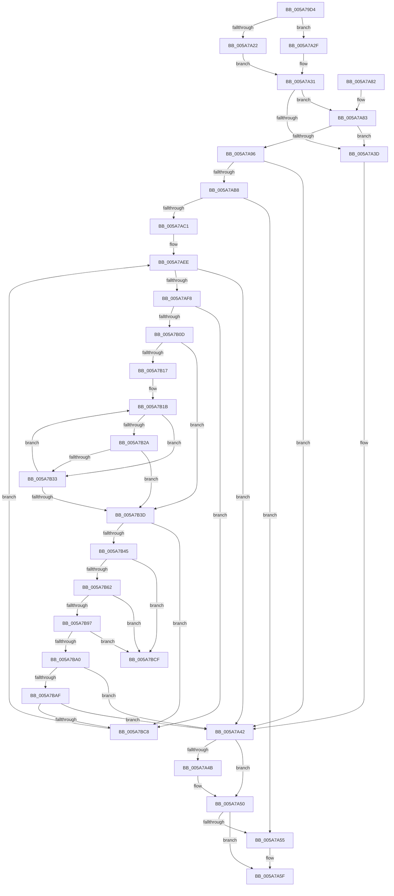

# PnpReleaseBootResourcesForFilteredRequirements

- RVA: `0x005A79D4`–`0x005A7BD6` (길이 `514` bytes)
- VA: `0x00000001405A79D4`
- 실행 섹션: `.text`
- PDB 이름 있음: `예`; PDB Function 태그: `아니요`
- unwind 정보 RVA: `0x000C8884`
- 디코드: `146`개 명령, `514/514` bytes 표시
- 미해석 바이트: `0` (있으면 어셈블리에 `.byte`로 보존)

> 이 문서는 커널 이미지의 기계어와 PDB 기호를 분석해 생성했습니다. 4번과 5번은 함수 원형과 자료형을 바이너리 사용 방식에서 추정한 C 해석이며 원본 소스 복구 결과는 아닙니다.

## 1. Dependencies

- 직접 호출 지점: **8**; 고유 호출 대상: **6**
- 직접 호출자로 확인된 함수: **1**
- RIP 상대 이미지 참조: **0**

### Outgoing calls
- `0x005A7A04` → [memset](../6C/memset_function_006C6C40.md) (function, `0x006C6C40`)
- `0x005A7A15` → [memset](../6C/memset_function_006C6C40.md) (function, `0x006C6C40`)
- `0x005A7A4B` → [IopFreeReqList](../../page/72/IopFreeReqList_function_0072ADAC.md) (function, `0x0072ADAC`)
- `0x005A7A5A` → [ExFreePoolWithTag](../../poolcode/B8/ExFreePoolWithTag_function_00B82870.md) (function, `0x00B82870`)
- `0x005A7A89` → [PnpCmResourcesToIoResources](../../page/73/PnpCmResourcesToIoResources_function_0073D584.md) (function, `0x0073D584`)
- `0x005A7AAD` → [IopResourceRequirementsListToReqList](../../page/A8/IopResourceRequirementsListToReqList_function_00A82954.md) (function, `0x00A82954`)
- `0x005A7B7E` → [IopCallArbiter](../../page/AA/IopCallArbiter_function_00AA5394.md) (function, `0x00AA5394`)
- `0x005A7BB9` → [IopCallArbiter](../../page/AA/IopCallArbiter_function_00AA5394.md) (function, `0x00AA5394`)

### Direct callers
- [IopReleaseFilteredBootResources](../../page/72/IopReleaseFilteredBootResources_function_0072EBF8.md) at `0x0072EC82`

### Static image references
- 디코드된 RIP-relative 메모리 참조가 없습니다.

## 2. Other-region calls and transfers

- 다른 실행 섹션으로 향하는 call: **6**
  - `0x005A7A4B` → [IopFreeReqList](../../page/72/IopFreeReqList_function_0072ADAC.md) (`.text` → `PAGE`)
  - `0x005A7A5A` → [ExFreePoolWithTag](../../poolcode/B8/ExFreePoolWithTag_function_00B82870.md) (`.text` → `POOLCODE`)
  - `0x005A7A89` → [PnpCmResourcesToIoResources](../../page/73/PnpCmResourcesToIoResources_function_0073D584.md) (`.text` → `PAGE`)
  - `0x005A7AAD` → [IopResourceRequirementsListToReqList](../../page/A8/IopResourceRequirementsListToReqList_function_00A82954.md) (`.text` → `PAGE`)
  - `0x005A7B7E` → [IopCallArbiter](../../page/AA/IopCallArbiter_function_00AA5394.md) (`.text` → `PAGE`)
  - `0x005A7BB9` → [IopCallArbiter](../../page/AA/IopCallArbiter_function_00AA5394.md) (`.text` → `PAGE`)
- 별도 외부 분기/꼬리 이동을 확인하지 못했습니다.

## 3. Assembly (complete function range)

```asm
005A79D4  48 8B C4                        mov rax, rsp
005A79D7  48 89 58 08                     mov qword ptr [rax + 8], rbx
005A79DB  48 89 70 10                     mov qword ptr [rax + 0x10], rsi
005A79DF  48 89 78 18                     mov qword ptr [rax + 0x18], rdi
005A79E3  4C 89 68 20                     mov qword ptr [rax + 0x20], r13
005A79E7  55                              push rbp
005A79E8  41 56                           push r14
005A79EA  41 57                           push r15
005A79EC  48 8D 68 A1                     lea rbp, [rax - 0x5f]
005A79F0  48 81 EC D0 00 00 00            sub rsp, 0xd0
005A79F7  33 D2                           xor edx, edx
005A79F9  4C 8B F1                        mov r14, rcx
005A79FC  48 8D 4D A7                     lea rcx, [rbp - 0x59]
005A7A00  44 8D 42 60                     lea r8d, [rdx + 0x60]
005A7A04  E8 37 F2 11 00                  call 0x1406c6c40
005A7A09  33 FF                           xor edi, edi
005A7A0B  48 8D 4D 07                     lea rcx, [rbp + 7]
005A7A0F  33 D2                           xor edx, edx
005A7A11  44 8D 47 40                     lea r8d, [rdi + 0x40]
005A7A15  E8 26 F2 11 00                  call 0x1406c6c40
005A7A1A  49 8B 1E                        mov rbx, qword ptr [r14]
005A7A1D  48 85 DB                        test rbx, rbx
005A7A20  74 0D                           je 0x1405a7a2f
005A7A22  48 8B 83 38 01 00 00            mov rax, qword ptr [rbx + 0x138]
005A7A29  48 8B 70 28                     mov rsi, qword ptr [rax + 0x28]
005A7A2D  EB 02                           jmp 0x1405a7a31
005A7A2F  33 F6                           xor esi, esi
005A7A31  48 8B 96 20 02 00 00            mov rdx, qword ptr [rsi + 0x220]
005A7A38  48 85 D2                        test rdx, rdx
005A7A3B  75 46                           jne 0x1405a7a83
005A7A3D  BB 01 00 00 C0                  mov ebx, 0xc0000001
005A7A42  48 8B 4D 27                     mov rcx, qword ptr [rbp + 0x27]
005A7A46  48 85 C9                        test rcx, rcx
005A7A49  74 05                           je 0x1405a7a50
005A7A4B  E8 5C 33 18 00                  call 0x14072adac
005A7A50  48 85 FF                        test rdi, rdi
005A7A53  74 0A                           je 0x1405a7a5f
005A7A55  33 D2                           xor edx, edx
005A7A57  48 8B CF                        mov rcx, rdi
005A7A5A  E8 11 AE 5D 00                  call 0x140b82870
005A7A5F  4C 8D 9C 24 D0 00 00 00         lea r11, [rsp + 0xd0]
005A7A67  8B C3                           mov eax, ebx
005A7A69  49 8B 5B 20                     mov rbx, qword ptr [r11 + 0x20]
005A7A6D  49 8B 73 28                     mov rsi, qword ptr [r11 + 0x28]
005A7A71  49 8B 7B 30                     mov rdi, qword ptr [r11 + 0x30]
005A7A75  4D 8B 6B 38                     mov r13, qword ptr [r11 + 0x38]
005A7A79  49 8B E3                        mov rsp, r11
005A7A7C  41 5F                           pop r15
005A7A7E  41 5E                           pop r14
005A7A80  5D                              pop rbp
005A7A81  C3                              ret
005A7A82  CC                              int3
005A7A83  41 B8 01 00 00 00               mov r8d, 1
005A7A89  E8 F6 5A 19 00                  call 0x14073d584
005A7A8E  48 8B F8                        mov rdi, rax
005A7A91  48 85 C0                        test rax, rax
005A7A94  74 A7                           je 0x1405a7a3d
005A7A96  48 8D 55 27                     lea rdx, [rbp + 0x27]
005A7A9A  C7 45 13 04 00 00 00            mov dword ptr [rbp + 0x13], 4
005A7AA1  48 8D 4D 07                     lea rcx, [rbp + 7]
005A7AA5  48 89 45 1F                     mov qword ptr [rbp + 0x1f], rax
005A7AA9  48 89 5D 07                     mov qword ptr [rbp + 7], rbx
005A7AAD  E8 A2 AE 4D 00                  call 0x140a82954
005A7AB2  8B D8                           mov ebx, eax
005A7AB4  85 C0                           test eax, eax
005A7AB6  78 8A                           js 0x1405a7a42
005A7AB8  48 8B 45 27                     mov rax, qword ptr [rbp + 0x27]
005A7ABC  48 85 C0                        test rax, rax
005A7ABF  74 94                           je 0x1405a7a55
005A7AC1  4C 8B 78 28                     mov r15, qword ptr [rax + 0x28]
005A7AC5  33 DB                           xor ebx, ebx
005A7AC7  49 8B 46 20                     mov rax, qword ptr [r14 + 0x20]
005A7ACB  48 8B 48 10                     mov rcx, qword ptr [rax + 0x10]
005A7ACF  48 8B 46 20                     mov rax, qword ptr [rsi + 0x20]
005A7AD3  4C 8B 29                        mov r13, qword ptr [rcx]
005A7AD6  21 5D D3                        and dword ptr [rbp - 0x2d], ebx
005A7AD9  48 21 5D D7                     and qword ptr [rbp - 0x29], rbx
005A7ADD  48 21 5D EF                     and qword ptr [rbp - 0x11], rbx
005A7AE1  33 F6                           xor esi, esi
005A7AE3  48 89 45 C7                     mov qword ptr [rbp - 0x39], rax
005A7AE7  C7 45 CF 04 00 00 00            mov dword ptr [rbp - 0x31], 4
005A7AEE  41 3B 77 14                     cmp esi, dword ptr [r15 + 0x14]
005A7AF2  0F 83 4A FF FF FF               jae 0x1405a7a42
005A7AF8  49 8B 4C F7 18                  mov rcx, qword ptr [r15 + rsi*8 + 0x18]
005A7AFD  4C 8B B1 20 01 00 00            mov r14, qword ptr [rcx + 0x120]
005A7B04  4D 85 F6                        test r14, r14
005A7B07  0F 84 BB 00 00 00               je 0x1405a7bc8
005A7B0D  41 8B 55 14                     mov edx, dword ptr [r13 + 0x14]
005A7B11  33 C9                           xor ecx, ecx
005A7B13  85 D2                           test edx, edx
005A7B15  74 26                           je 0x1405a7b3d
005A7B17  4D 8D 45 18                     lea r8, [r13 + 0x18]
005A7B1B  49 8B 00                        mov rax, qword ptr [r8]
005A7B1E  48 8B 80 20 01 00 00            mov rax, qword ptr [rax + 0x120]
005A7B25  48 85 C0                        test rax, rax
005A7B28  74 09                           je 0x1405a7b33
005A7B2A  8A 40 10                        mov al, byte ptr [rax + 0x10]
005A7B2D  41 38 46 10                     cmp byte ptr [r14 + 0x10], al
005A7B31  74 0A                           je 0x1405a7b3d
005A7B33  FF C1                           inc ecx
005A7B35  49 83 C0 08                     add r8, 8
005A7B39  3B CA                           cmp ecx, edx
005A7B3B  72 DE                           jb 0x1405a7b1b
005A7B3D  3B CA                           cmp ecx, edx
005A7B3F  0F 85 83 00 00 00               jne 0x1405a7bc8
005A7B45  48 8D 45 A7                     lea rax, [rbp - 0x59]
005A7B49  48 89 45 AF                     mov qword ptr [rbp - 0x51], rax
005A7B4D  4D 8D 46 28                     lea r8, [r14 + 0x28]
005A7B51  48 8D 45 A7                     lea rax, [rbp - 0x59]
005A7B55  48 89 45 A7                     mov qword ptr [rbp - 0x59], rax
005A7B59  49 8B 40 08                     mov rax, qword ptr [r8 + 8]
005A7B5D  4C 39 00                        cmp qword ptr [rax], r8
005A7B60  75 6D                           jne 0x1405a7bcf
005A7B62  48 89 45 AF                     mov qword ptr [rbp - 0x51], rax
005A7B66  48 8D 4D A7                     lea rcx, [rbp - 0x59]
005A7B6A  4C 89 45 A7                     mov qword ptr [rbp - 0x59], r8
005A7B6E  33 D2                           xor edx, edx
005A7B70  48 89 08                        mov qword ptr [rax], rcx
005A7B73  48 8D 45 A7                     lea rax, [rbp - 0x59]
005A7B77  49 8B CE                        mov rcx, r14
005A7B7A  49 89 40 08                     mov qword ptr [r8 + 8], rax
005A7B7E  E8 11 D8 4F 00                  call 0x140aa5394
005A7B83  48 8B 4D A7                     mov rcx, qword ptr [rbp - 0x59]
005A7B87  48 8D 55 A7                     lea rdx, [rbp - 0x59]
005A7B8B  8B D8                           mov ebx, eax
005A7B8D  48 8B 45 AF                     mov rax, qword ptr [rbp - 0x51]
005A7B91  48 39 51 08                     cmp qword ptr [rcx + 8], rdx
005A7B95  75 38                           jne 0x1405a7bcf
005A7B97  48 8D 55 A7                     lea rdx, [rbp - 0x59]
005A7B9B  48 39 10                        cmp qword ptr [rax], rdx
005A7B9E  75 2F                           jne 0x1405a7bcf
005A7BA0  48 89 08                        mov qword ptr [rax], rcx
005A7BA3  48 89 41 08                     mov qword ptr [rcx + 8], rax
005A7BA7  85 DB                           test ebx, ebx
005A7BA9  0F 88 93 FE FF FF               js 0x1405a7a42
005A7BAF  45 33 C0                        xor r8d, r8d
005A7BB2  49 8B CE                        mov rcx, r14
005A7BB5  41 8D 50 02                     lea edx, [r8 + 2]
005A7BB9  E8 D6 D7 4F 00                  call 0x140aa5394
005A7BBE  8B D8                           mov ebx, eax
005A7BC0  85 C0                           test eax, eax
005A7BC2  0F 88 7A FE FF FF               js 0x1405a7a42
005A7BC8  FF C6                           inc esi
005A7BCA  E9 1F FF FF FF                  jmp 0x1405a7aee
005A7BCF  B9 03 00 00 00                  mov ecx, 3
005A7BD4  CD 29                           int 0x29
```

## 4. C-style interpretation (structured pseudocode)

```c
__int64 __fastcall PnpReleaseBootResourcesForFilteredRequirements(__int64 a1, int a2)
{
    __int64 result;
    __int64 v_rbx;
    __int64 v_rdi;
    __int64 v_rsi;
    __int64 v_rsp;
    unsigned __int64 v_stack_m18;

    *(unsigned __int64 *)(v_rsp + 8) = v_rbx;
    *(unsigned __int64 *)(v_rsp + 16) = v_rsi;
    *(unsigned __int64 *)(v_rsp + 24) = v_rdi;
    *(unsigned __int64 *)(v_rsp + 32) = v_r13;
    v_rsp = (v_rsp) - (208);
    a2 = 0;
    result = memset(v_rsp - 95 - 89, a2, a2 + 96, a4);
    v_rdi = 0;
    a2 = 0;
    result = memset(v_rsp - 95 + 7, a2, v_rdi + 64, a4);
    if (*(unsigned __int64 *)(a1) == 0) goto loc_005A7A2F;
    goto loc_005A7A31;
loc_005A7A2F:
    v_rsi = 0;
loc_005A7A31:
    if (*(unsigned __int64 *)(v_rsi + 544) != 0) goto loc_005A7A83;
loc_005A7A3D:
loc_005A7A42:
    result = *(unsigned __int64 *)(*(unsigned __int64 *)(a1) + 312);
    if (*(unsigned __int64 *)(v_rsp - 95 + 39) != 0) {
        result = IopFreeReqList(*(unsigned __int64 *)(v_rsp - 95 + 39), *(unsigned __int64 *)(v_rsi + 544), v_rdi + 64, a4);
    }
    if (0 != 0) {
        a2 = 0;
        a1 = 0;
        result = ExFreePoolWithTag(a1, a2, v_rdi + 64, a4);
    }
    return (unsigned int)((unsigned int)((unsigned int)(0xC0000001ULL)));
loc_005A7A83:
    result = PnpCmResourcesToIoResources(a1, a2, 1, a4);
    if (result == 0) goto loc_005A7A3D;
    *(unsigned int *)(v_rsp - 95 + 19) = 4;
    *(unsigned __int64 *)(v_rsp - 95 + 31) = result;
    *(unsigned __int64 *)(v_rsp - 95 + 7) = *(unsigned __int64 *)(v_stack_m18 + 32);
    result = IopResourceRequirementsListToReqList(v_rsp - 95 + 7, v_rsp - 95 + 39, 1, a4);
    if (sign_flag) goto loc_005A7A42;
    if (*(unsigned __int64 *)(v_rsp - 95 + 39) == 0) goto loc_005A7A55;
    v_rbx = 0;
    v_rsi = 0;
    *(unsigned __int64 *)(v_rsp - 95 - 57) = *(unsigned __int64 *)(*(unsigned __int64 *)(v_stack_m18 + 40) + 32);
    *(unsigned int *)(v_rsp - 95 - 49) = 4;
loc_005A7AEE:
    if (0 >= (*(unsigned int *)(*(unsigned __int64 *)(*(unsigned __int64 *)(v_rsp - 95 + 39) + 40) + 20))) goto loc_005A7A42;
    if (*(unsigned __int64 *)(*(unsigned __int64 *)(*(unsigned __int64 *)(*(unsigned __int64 *)(v_rsp - 95 + 39) + 40) + v_rsi * 8 + 24) + 288) == 0) goto loc_005A7BC8;
    a1 = 0;
    if ((unsigned int)((unsigned int)(*(unsigned int *)(*(unsigned __int64 *)(*(unsigned __int64 *)(*(unsigned __int64 *)(a1 + 32) + 16)) + 20))) == 0) goto loc_005A7B3D;
loc_005A7B1B:
    if (*(unsigned __int64 *)(*(unsigned __int64 *)(*(unsigned __int64 *)(*(unsigned __int64 *)(*(unsigned __int64 *)(a1 + 32) + 16)) + 24) + 288) == 0) goto loc_005A7B33;
    if ((*(unsigned __int8 *)(*(unsigned __int64 *)(*(unsigned __int64 *)(*(unsigned __int64 *)(*(unsigned __int64 *)(v_rsp - 95 + 39) + 40) + v_rsi * 8 + 24) + 288) + 16)) == ((unsigned __int8)(*(unsigned __int8 *)(*(unsigned __int64 *)(*(unsigned __int64 *)(*(unsigned __int64 *)(*(unsigned __int64 *)(*(unsigned __int64 *)(a1 + 32) + 16)) + 24) + 288) + 16)))) goto loc_005A7B3D;
loc_005A7B33:
    a1 = (unsigned int)((a1) + 1);
    a3 = (*(unsigned __int64 *)(*(unsigned __int64 *)(*(unsigned __int64 *)(a1 + 32) + 16)) + 24) + (8);
    if (((unsigned int)(a1)) < ((unsigned int)((unsigned int)(*(unsigned int *)(*(unsigned __int64 *)(*(unsigned __int64 *)(*(unsigned __int64 *)(a1 + 32) + 16)) + 20))))) goto loc_005A7B1B;
loc_005A7B3D:
    if (((unsigned int)(a1)) != ((unsigned int)((unsigned int)(*(unsigned int *)(*(unsigned __int64 *)(*(unsigned __int64 *)(*(unsigned __int64 *)(a1 + 32) + 16)) + 20))))) goto loc_005A7BC8;
    *(unsigned __int64 *)(v_rsp - 95 - 81) = v_rsp - 95 - 89;
    *(unsigned __int64 *)(v_rsp - 95 - 89) = v_rsp - 95 - 89;
    if ((*(unsigned __int64 *)(*(unsigned __int64 *)(*(unsigned __int64 *)(*(unsigned __int64 *)(*(unsigned __int64 *)(*(unsigned __int64 *)(v_rsp - 95 + 39) + 40) + v_rsi * 8 + 24) + 288) + 40 + 8))) != (*(unsigned __int64 *)(*(unsigned __int64 *)(*(unsigned __int64 *)(*(unsigned __int64 *)(v_rsp - 95 + 39) + 40) + v_rsi * 8 + 24) + 288) + 40)) goto loc_005A7BCF;
    *(unsigned __int64 *)(v_rsp - 95 - 81) = *(unsigned __int64 *)(*(unsigned __int64 *)(*(unsigned __int64 *)(*(unsigned __int64 *)(*(unsigned __int64 *)(v_rsp - 95 + 39) + 40) + v_rsi * 8 + 24) + 288) + 40 + 8);
    *(unsigned __int64 *)(v_rsp - 95 - 89) = *(unsigned __int64 *)(*(unsigned __int64 *)(*(unsigned __int64 *)(*(unsigned __int64 *)(v_rsp - 95 + 39) + 40) + v_rsi * 8 + 24) + 288) + 40;
    a2 = 0;
    *(unsigned __int64 *)(*(unsigned __int64 *)(*(unsigned __int64 *)(*(unsigned __int64 *)(*(unsigned __int64 *)(*(unsigned __int64 *)(v_rsp - 95 + 39) + 40) + v_rsi * 8 + 24) + 288) + 40 + 8)) = v_rsp - 95 - 89;
    *(unsigned __int64 *)(*(unsigned __int64 *)(*(unsigned __int64 *)(*(unsigned __int64 *)(*(unsigned __int64 *)(v_rsp - 95 + 39) + 40) + v_rsi * 8 + 24) + 288) + 40 + 8) = v_rsp - 95 - 89;
    result = IopCallArbiter(*(unsigned __int64 *)(*(unsigned __int64 *)(*(unsigned __int64 *)(*(unsigned __int64 *)(v_rsp - 95 + 39) + 40) + v_rsi * 8 + 24) + 288), a2, *(unsigned __int64 *)(*(unsigned __int64 *)(*(unsigned __int64 *)(*(unsigned __int64 *)(v_rsp - 95 + 39) + 40) + v_rsi * 8 + 24) + 288) + 40, a4);
    if ((*(unsigned __int64 *)(*(unsigned __int64 *)(v_rsp - 95 - 89) + 8)) != (v_rsp - 95 - 89)) goto loc_005A7BCF;
    if ((*(unsigned __int64 *)(*(unsigned __int64 *)(v_rsp - 95 - 81))) != (v_rsp - 95 - 89)) goto loc_005A7BCF;
    *(unsigned __int64 *)(*(unsigned __int64 *)(v_rsp - 95 - 81)) = *(unsigned __int64 *)(v_rsp - 95 - 89);
    *(unsigned __int64 *)(*(unsigned __int64 *)(v_rsp - 95 - 89) + 8) = *(unsigned __int64 *)(v_rsp - 95 - 81);
    if (sign_flag) goto loc_005A7A42;
    a3 = 0;
    result = IopCallArbiter(*(unsigned __int64 *)(*(unsigned __int64 *)(*(unsigned __int64 *)(*(unsigned __int64 *)(v_rsp - 95 + 39) + 40) + v_rsi * 8 + 24) + 288), a3 + 2, a3, a4);
    if (sign_flag) goto loc_005A7A42;
loc_005A7BC8:
    v_rsi = (unsigned int)((v_rsi) + 1);
    goto loc_005A7AEE;
loc_005A7BCF:
    return result;
}
```

## 5. (Beta) C Style

```c
int64_t PnpReleaseBootResourcesForFilteredRequirements(void *Arg1, int32_t Arg2)
{
    uint8_t *arg1 = (uint8_t *)Arg1;

    int64_t result;
    int64_t local_rbx;
    int64_t local_rdi;
    int64_t local_rsi;
    int64_t local_rsp;
    uint64_t v_stack_m18;

    *(uint64_t *)(local_rsp + 0x8) = local_rbx;
    *(uint64_t *)(local_rsp + 0x10) = local_rsi;
    *(uint64_t *)(local_rsp + 0x18) = local_rdi;
    *(uint64_t *)(local_rsp + 0x20) = local_r13;
    local_rsp = (local_rsp) - (208);
    Arg2 = 0;
    result = memset(local_rsp - 95 - 89, Arg2, Arg2 + 96, a4);
    local_rdi = 0;
    Arg2 = 0;
    result = memset(local_rsp - 95 + 7, Arg2, local_rdi + 64, a4);
    if (*(uint64_t *)(arg1) == 0) goto loc_005A7A2F;
    goto loc_005A7A31;
loc_005A7A2F:
    local_rsi = 0;
loc_005A7A31:
    if (*(uint64_t *)(local_rsi + 0x220) != 0) goto loc_005A7A83;
loc_005A7A3D:
loc_005A7A42:
    result = *(uint64_t *)(*(uint64_t *)(arg1) + 0x138);
    if (*(uint64_t *)(local_rsp - 0x5F + 0x27) != 0) {
        result = IopFreeReqList(*(uint64_t *)(local_rsp - 0x5F + 0x27), *(uint64_t *)(local_rsi + 0x220), local_rdi + 64, a4);
    }
    if (0 != 0) {
        Arg2 = 0;
        Arg1 = 0;
        result = ExFreePoolWithTag(Arg1, Arg2, local_rdi + 64, a4);
    }
    return (uint32_t)((uint32_t)((uint32_t)(0xC0000001ULL)));
loc_005A7A83:
    result = PnpCmResourcesToIoResources(Arg1, Arg2, 1, a4);
    if (result == 0) goto loc_005A7A3D;
    *(uint32_t *)(local_rsp - 0x5F + 0x13) = 4;
    *(uint64_t *)(local_rsp - 0x5F + 0x1F) = result;
    *(uint64_t *)(local_rsp - 0x5F + 0x7) = *(uint64_t *)(v_stack_m18 + 0x20);
    result = IopResourceRequirementsListToReqList(local_rsp - 95 + 7, local_rsp - 95 + 39, 1, a4);
    if (sign_flag) goto loc_005A7A42;
    if (*(uint64_t *)(local_rsp - 0x5F + 0x27) == 0) goto loc_005A7A55;
    local_rbx = 0;
    local_rsi = 0;
    *(uint64_t *)(local_rsp - 0x5F - 0x39) = *(uint64_t *)(*(uint64_t *)(v_stack_m18 + 0x28) + 0x20);
    *(uint32_t *)(local_rsp - 0x5F - 0x31) = 4;
loc_005A7AEE:
    if (0 >= (*(uint32_t *)(*(uint64_t *)(*(uint64_t *)(local_rsp - 0x5F + 0x27) + 0x28) + 0x14))) goto loc_005A7A42;
    if (*(uint64_t *)(*(uint64_t *)(*(uint64_t *)(*(uint64_t *)(local_rsp - 0x5F + 0x27) + 0x28) + local_rsi * 8 + 0x18) + 0x120) == 0) goto loc_005A7BC8;
    Arg1 = 0;
    if ((uint32_t)((uint32_t)(*(uint32_t *)(*(uint64_t *)(*(uint64_t *)(*(uint64_t *)(arg1 + 0x20) + 0x10)) + 0x14))) == 0) goto loc_005A7B3D;
loc_005A7B1B:
    if (*(uint64_t *)(*(uint64_t *)(*(uint64_t *)(*(uint64_t *)(*(uint64_t *)(arg1 + 0x20) + 0x10)) + 0x18) + 0x120) == 0) goto loc_005A7B33;
    if ((*(uint8_t *)(*(uint64_t *)(*(uint64_t *)(*(uint64_t *)(*(uint64_t *)(local_rsp - 0x5F + 0x27) + 0x28) + local_rsi * 8 + 0x18) + 0x120) + 0x10)) == ((uint8_t)(*(uint8_t *)(*(uint64_t *)(*(uint64_t *)(*(uint64_t *)(*(uint64_t *)(*(uint64_t *)(arg1 + 0x20) + 0x10)) + 0x18) + 0x120) + 0x10)))) goto loc_005A7B3D;
loc_005A7B33:
    Arg1 = (uint32_t)((Arg1) + 1);
    a3 = (*(uint64_t *)(*(uint64_t *)(*(uint64_t *)(arg1 + 0x20) + 0x10)) + 24) + (8);
    if (((uint32_t)(Arg1)) < ((uint32_t)((uint32_t)(*(uint32_t *)(*(uint64_t *)(*(uint64_t *)(*(uint64_t *)(arg1 + 0x20) + 0x10)) + 0x14))))) goto loc_005A7B1B;
loc_005A7B3D:
    if (((uint32_t)(Arg1)) != ((uint32_t)((uint32_t)(*(uint32_t *)(*(uint64_t *)(*(uint64_t *)(*(uint64_t *)(arg1 + 0x20) + 0x10)) + 0x14))))) goto loc_005A7BC8;
    *(uint64_t *)(local_rsp - 0x5F - 0x51) = local_rsp - 95 - 89;
    *(uint64_t *)(local_rsp - 0x5F - 0x59) = local_rsp - 95 - 89;
    if ((*(uint64_t *)(*(uint64_t *)(*(uint64_t *)(*(uint64_t *)(*(uint64_t *)(*(uint64_t *)(local_rsp - 0x5F + 0x27) + 0x28) + local_rsi * 8 + 0x18) + 0x120) + 0x28 + 0x8))) != (*(uint64_t *)(*(uint64_t *)(*(uint64_t *)(*(uint64_t *)(local_rsp - 0x5F + 0x27) + 0x28) + local_rsi * 8 + 0x18) + 0x120) + 40)) goto loc_005A7BCF;
    *(uint64_t *)(local_rsp - 0x5F - 0x51) = *(uint64_t *)(*(uint64_t *)(*(uint64_t *)(*(uint64_t *)(*(uint64_t *)(local_rsp - 0x5F + 0x27) + 0x28) + local_rsi * 8 + 0x18) + 0x120) + 0x28 + 0x8);
    *(uint64_t *)(local_rsp - 0x5F - 0x59) = *(uint64_t *)(*(uint64_t *)(*(uint64_t *)(*(uint64_t *)(local_rsp - 0x5F + 0x27) + 0x28) + local_rsi * 8 + 0x18) + 0x120) + 40;
    Arg2 = 0;
    *(uint64_t *)(*(uint64_t *)(*(uint64_t *)(*(uint64_t *)(*(uint64_t *)(*(uint64_t *)(local_rsp - 0x5F + 0x27) + 0x28) + local_rsi * 8 + 0x18) + 0x120) + 0x28 + 0x8)) = local_rsp - 95 - 89;
    *(uint64_t *)(*(uint64_t *)(*(uint64_t *)(*(uint64_t *)(*(uint64_t *)(local_rsp - 0x5F + 0x27) + 0x28) + local_rsi * 8 + 0x18) + 0x120) + 0x28 + 0x8) = local_rsp - 95 - 89;
    result = IopCallArbiter(*(uint64_t *)(*(uint64_t *)(*(uint64_t *)(*(uint64_t *)(local_rsp - 0x5F + 0x27) + 0x28) + local_rsi * 8 + 0x18) + 0x120), Arg2, *(uint64_t *)(*(uint64_t *)(*(uint64_t *)(*(uint64_t *)(local_rsp - 0x5F + 0x27) + 0x28) + local_rsi * 8 + 0x18) + 0x120) + 40, a4);
    if ((*(uint64_t *)(*(uint64_t *)(local_rsp - 0x5F - 0x59) + 0x8)) != (local_rsp - 95 - 89)) goto loc_005A7BCF;
    if ((*(uint64_t *)(*(uint64_t *)(local_rsp - 0x5F - 0x51))) != (local_rsp - 95 - 89)) goto loc_005A7BCF;
    *(uint64_t *)(*(uint64_t *)(local_rsp - 0x5F - 0x51)) = *(uint64_t *)(local_rsp - 0x5F - 0x59);
    *(uint64_t *)(*(uint64_t *)(local_rsp - 0x5F - 0x59) + 0x8) = *(uint64_t *)(local_rsp - 0x5F - 0x51);
    if (sign_flag) goto loc_005A7A42;
    a3 = 0;
    result = IopCallArbiter(*(uint64_t *)(*(uint64_t *)(*(uint64_t *)(*(uint64_t *)(local_rsp - 0x5F + 0x27) + 0x28) + local_rsi * 8 + 0x18) + 0x120), a3 + 2, a3, a4);
    if (sign_flag) goto loc_005A7A42;
loc_005A7BC8:
    local_rsi = (uint32_t)((local_rsi) + 1);
    goto loc_005A7AEE;
loc_005A7BCF:
    return result;
}
```

### 관측된 메모리 오프셋

구조체 형식이 확인되지 않은 접근은 인자 기준의 오프셋으로만 기록했습니다.

| 기준 인자 | 오프셋 표현 | 폭 (bit) | 접근 |
|---|---:|---:|---|
| `Arg1` | `+ 0x0` | `64` | `R` |
| `Arg1` | `+ 0x20` | `64` | `R` |

## 6. Execution-region graph

[열기: 2D/3D 그래프와 함수 탐색 컨트롤 패널](../../../control-panel.html?section=text&rva=0x005A79D4&view=graph)

- 2D 그래프는 위에서 아래로 흐르고, 3D 그래프는 빈 공간을 드래그해 회전합니다. Shift+드래그는 이동, 휠은 확대·축소, 함수 노드 선택은 대상 보고서 이동입니다.

### Static fallback


