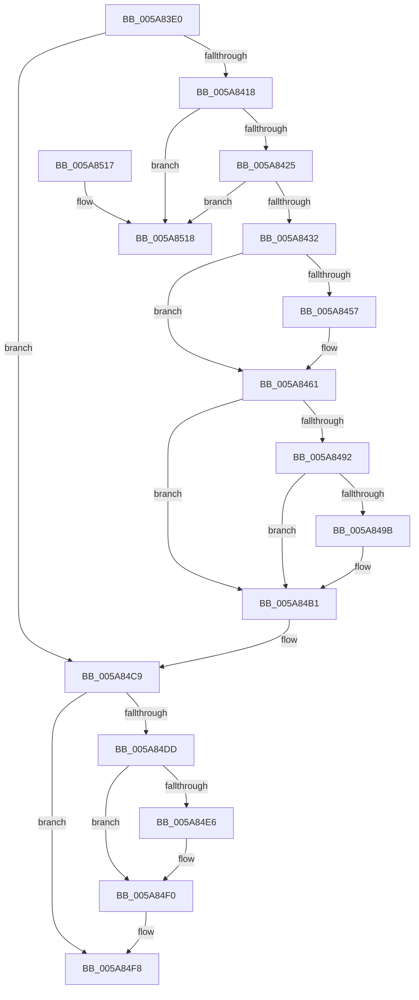

# PnpRemoveDeviceActionRequestFromQueue

- RVA: `0x005A83E0`–`0x005A851F` (길이 `319` bytes)
- VA: `0x00000001405A83E0`
- 실행 섹션: `.text`
- PDB 이름 있음: `예`; PDB Function 태그: `아니요`
- unwind 정보 RVA: `0x0006B020`
- 디코드: `73`개 명령, `319/319` bytes 표시
- 미해석 바이트: `0` (있으면 어셈블리에 `.byte`로 보존)

> 이 문서는 커널 이미지의 기계어와 PDB 기호를 분석해 생성했습니다. 4번과 5번은 함수 원형과 자료형을 바이너리 사용 방식에서 추정한 C 해석이며 원본 소스 복구 결과는 아닙니다.

## 1. Dependencies

- 직접 호출 지점: **9**; 고유 호출 대상: **5**
- 직접 호출자로 확인된 함수: **3**
- RIP 상대 이미지 참조: **10**

### Outgoing calls
- `0x005A8406` → [KeAcquireSpinLockRaiseToDpc](../20/KeAcquireSpinLockRaiseToDpc_function_00208470.md) (function, `0x00208470`)
- `0x005A8446` → [KeAcquireSpinLockRaiseToDpc](../20/KeAcquireSpinLockRaiseToDpc_function_00208470.md) (function, `0x00208470`)
- `0x005A845C` → [PopDirectedDripsClearDisengageReason](../47/PopDirectedDripsClearDisengageReason_function_00477EA4.md) (function, `0x00477EA4`)
- `0x005A846B` → [KeReleaseSpinLock](../39/KeReleaseSpinLock_function_00392BA0.md) (function, `0x00392BA0`)
- `0x005A8477` → [KeAcquireSpinLockRaiseToDpc](../20/KeAcquireSpinLockRaiseToDpc_function_00208470.md) (function, `0x00208470`)
- `0x005A84C4` → [KeReleaseSpinLock](../39/KeReleaseSpinLock_function_00392BA0.md) (function, `0x00392BA0`)
- `0x005A84D3` → [KeReleaseSpinLock](../39/KeReleaseSpinLock_function_00392BA0.md) (function, `0x00392BA0`)
- `0x005A84EB` → [ObfDereferenceObjectWithTag](../2F/ObfDereferenceObjectWithTag_function_002F78E0.md) (function, `0x002F78E0`)
- `0x005A84F3` → [PnpDeleteDeviceActionRequest](../../page/95/PnpDeleteDeviceActionRequest_function_00955284.md) (function, `0x00955284`)

### Direct callers
- [PiQueueDeviceRequest](../../page/AD/PiQueueDeviceRequest_function_00AD1878.md) at `0x00AD1968`
- [sub_00B1D2FE](../../page/B1/Unknown_function_00B1D2FE.md) at `0x00B1D369`
- [sub_00B284C0](../../page/B2/Unknown_function_00B284C0.md) at `0x00B285C4`

### Static image references
- `0x005A83FF` → RVA `0x00F8AD90` (`.data`; read)
- `0x005A843C` → RVA `0x00F0ED00` (`.data`; read)
- `0x005A844B` → RVA `0x00F0ED08` (`.data`; read/write)
- `0x005A8470` → RVA `0x00F07450` (`.data`; read)
- `0x005A8489` → RVA `0x00F07458` (`.data`; read/write)
- `0x005A8492` → RVA `0x00F074D0` (`.data`; read)
- `0x005A849B` → RVA `0x00F074E0` (`.data`; read)
- `0x005A84A2` → RVA `0x00F074D8` (`.data`; read/write)
- `0x005A84A9` → RVA `0x00F074E0` (`.data`; read/write)
- `0x005A84B1` → RVA `0x00F07460` (`.data`; read)

## 2. Other-region calls and transfers

- 다른 실행 섹션으로 향하는 call: **1**
  - `0x005A84F3` → [PnpDeleteDeviceActionRequest](../../page/95/PnpDeleteDeviceActionRequest_function_00955284.md) (`.text` → `PAGE`)
- 별도 외부 분기/꼬리 이동을 확인하지 못했습니다.

## 3. Assembly (complete function range)

```asm
005A83E0  48 8B C4                        mov rax, rsp
005A83E3  48 89 58 08                     mov qword ptr [rax + 8], rbx
005A83E7  48 89 68 10                     mov qword ptr [rax + 0x10], rbp
005A83EB  48 89 70 18                     mov qword ptr [rax + 0x18], rsi
005A83EF  48 89 78 20                     mov qword ptr [rax + 0x20], rdi
005A83F3  41 56                           push r14
005A83F5  48 83 EC 20                     sub rsp, 0x20
005A83F9  48 8B D9                        mov rbx, rcx
005A83FC  40 32 FF                        xor dil, dil
005A83FF  48 8D 0D 8A 29 9E 00            lea rcx, [rip + 0x9e298a]
005A8406  E8 65 00 C6 FF                  call 0x140208470
005A840B  40 8A F0                        mov sil, al
005A840E  40 38 7B 54                     cmp byte ptr [rbx + 0x54], dil
005A8412  0F 85 B1 00 00 00               jne 0x1405a84c9
005A8418  48 8B 13                        mov rdx, qword ptr [rbx]
005A841B  48 39 5A 08                     cmp qword ptr [rdx + 8], rbx
005A841F  0F 85 F3 00 00 00               jne 0x1405a8518
005A8425  48 8B 4B 08                     mov rcx, qword ptr [rbx + 8]
005A8429  48 39 19                        cmp qword ptr [rcx], rbx
005A842C  0F 85 E6 00 00 00               jne 0x1405a8518
005A8432  48 89 11                        mov qword ptr [rcx], rdx
005A8435  40 B7 01                        mov dil, 1
005A8438  48 89 4A 08                     mov qword ptr [rdx + 8], rcx
005A843C  48 8D 0D BD 68 96 00            lea rcx, [rip + 0x9668bd]
005A8443  8B 6B 18                        mov ebp, dword ptr [rbx + 0x18]
005A8446  E8 25 00 C6 FF                  call 0x140208470
005A844B  83 2D B6 68 96 00 01            sub dword ptr [rip + 0x9668b6], 1
005A8452  44 8A F0                        mov r14b, al
005A8455  75 0A                           jne 0x1405a8461
005A8457  B9 04 00 00 00                  mov ecx, 4
005A845C  E8 43 FA EC FF                  call 0x140477ea4
005A8461  41 8A D6                        mov dl, r14b
005A8464  48 8D 0D 95 68 96 00            lea rcx, [rip + 0x966895]
005A846B  E8 30 A7 DE FF                  call 0x140392ba0
005A8470  48 8D 0D D9 EF 95 00            lea rcx, [rip + 0x95efd9]
005A8477  E8 F4 FF C5 FF                  call 0x140208470
005A847C  48 BA 08 00 00 00 80 F7 FF FF   movabs rdx, 0xfffff78000000008
005A8486  48 8B 12                        mov rdx, qword ptr [rdx]
005A8489  83 2D C8 EF 95 00 01            sub dword ptr [rip + 0x95efc8], 1
005A8490  75 1F                           jne 0x1405a84b1
005A8492  80 3D 37 F0 95 00 00            cmp byte ptr [rip + 0x95f037], 0
005A8499  74 16                           je 0x1405a84b1
005A849B  48 2B 15 3E F0 95 00            sub rdx, qword ptr [rip + 0x95f03e]
005A84A2  48 01 15 2F F0 95 00            add qword ptr [rip + 0x95f02f], rdx
005A84A9  48 83 25 2F F0 95 00 00         and qword ptr [rip + 0x95f02f], 0
005A84B1  48 8D 15 A8 EF 95 00            lea rdx, [rip + 0x95efa8]
005A84B8  FF 0C AA                        dec dword ptr [rdx + rbp*4]
005A84BB  48 8D 0D 8E EF 95 00            lea rcx, [rip + 0x95ef8e]
005A84C2  8A D0                           mov dl, al
005A84C4  E8 D7 A6 DE FF                  call 0x140392ba0
005A84C9  40 8A D6                        mov dl, sil
005A84CC  48 8D 0D BD 28 9E 00            lea rcx, [rip + 0x9e28bd]
005A84D3  E8 C8 A6 DE FF                  call 0x140392ba0
005A84D8  40 84 FF                        test dil, dil
005A84DB  74 1B                           je 0x1405a84f8
005A84DD  48 8B 4B 10                     mov rcx, qword ptr [rbx + 0x10]
005A84E1  48 85 C9                        test rcx, rcx
005A84E4  74 0A                           je 0x1405a84f0
005A84E6  BA 44 66 6C 74                  mov edx, 0x746c6644
005A84EB  E8 F0 F3 D4 FF                  call 0x1402f78e0
005A84F0  48 8B CB                        mov rcx, rbx
005A84F3  E8 8C CD 3A 00                  call 0x140955284
005A84F8  48 8B 5C 24 30                  mov rbx, qword ptr [rsp + 0x30]
005A84FD  48 8B 6C 24 38                  mov rbp, qword ptr [rsp + 0x38]
005A8502  48 8B 74 24 40                  mov rsi, qword ptr [rsp + 0x40]
005A8507  40 0F B6 C7                     movzx eax, dil
005A850B  48 8B 7C 24 48                  mov rdi, qword ptr [rsp + 0x48]
005A8510  48 83 C4 20                     add rsp, 0x20
005A8514  41 5E                           pop r14
005A8516  C3                              ret
005A8517  CC                              int3
005A8518  B9 03 00 00 00                  mov ecx, 3
005A851D  CD 29                           int 0x29
```

## 4. C-style interpretation (structured pseudocode)

```c
__int64 __fastcall PnpRemoveDeviceActionRequestFromQueue(__int64 a1)
{
    __int64 result;
    __int64 v_rdi;
    __int64 v_rsp;
    unsigned __int64 v_stack_p10;
    unsigned __int64 v_stack_p18;
    unsigned __int64 v_stack_p20;
    unsigned __int64 v_stack_p8;

    *(unsigned __int64 *)(v_rsp + 8) = v_rbx;
    *(unsigned __int64 *)(v_rsp + 16) = v_rbp;
    *(unsigned __int64 *)(v_rsp + 24) = v_rsi;
    *(unsigned __int64 *)(v_rsp + 32) = v_rdi;
    v_rsp = (v_rsp) - (32);
    v_rdi = 0;
    result = KeAcquireSpinLockRaiseToDpc(v_rip + 10365322, a2, a3, a4);
    if ((*(unsigned __int8 *)(a1 + 84)) != 0) goto loc_005A84C9;
    if ((*(unsigned __int64 *)(*(unsigned __int64 *)(a1) + 8)) != a1) goto loc_005A8518;
    if ((*(unsigned __int64 *)(*(unsigned __int64 *)(a1 + 8))) != a1) goto loc_005A8518;
    *(unsigned __int64 *)(*(unsigned __int64 *)(a1 + 8)) = *(unsigned __int64 *)(a1);
    *(unsigned __int64 *)(*(unsigned __int64 *)(a1) + 8) = *(unsigned __int64 *)(a1 + 8);
    result = KeAcquireSpinLockRaiseToDpc(v_rip + 9857213, *(unsigned __int64 *)(a1), a3, a4);
    if ((*(unsigned __int64 *)(*(unsigned __int64 *)(a1 + 8))) == a1) {
        a1 = 4;
        result = PopDirectedDripsClearDisengageReason(a1, *(unsigned __int64 *)(a1), a3, a4);
    }
    result = KeReleaseSpinLock(v_rip + 9857173, (unsigned __int8)((unsigned __int8)(result)), a3, a4);
    result = KeAcquireSpinLockRaiseToDpc(v_rip + 9826265, (unsigned __int8)((unsigned __int8)(result)), a3, a4);
    if ((*(unsigned __int64 *)(*(unsigned __int64 *)(a1 + 8))) != a1) goto loc_005A84B1;
    if ((*(unsigned __int8 *)(v_rip + 9826359)) != 0) {
        a2 = (*(unsigned __int64 *)((unsigned __int8)((unsigned __int8)(result)))) - (*(unsigned __int64 *)(v_rip + 9826366));
    }
    result = KeReleaseSpinLock(v_rip + 9826190, (unsigned __int8)(result), a3, a4);
loc_005A84C9:
    result = KeReleaseSpinLock(v_rip + 10365117, (unsigned __int8)((unsigned __int8)(result)), a3, a4);
    if (1 == 0) goto loc_005A84F8;
    if (*(unsigned __int64 *)(a1 + 16) != 0) {
        a2 = 0x746C6644ULL;
        result = ObfDereferenceObjectWithTag(*(unsigned __int64 *)(a1 + 16), a2, a3, a4);
    }
    result = PnpDeleteDeviceActionRequest(a1, a2, a3, a4);
loc_005A84F8:
    v_rsp = (v_rsp) + (32);
    return 1;
loc_005A8518:
    return 1;
}
```

## 5. (Beta) C Style

```c
int64_t PnpRemoveDeviceActionRequestFromQueue(void *Arg1)
{
    uint8_t *arg1 = (uint8_t *)Arg1;

    int64_t result;
    int64_t local_rdi;
    int64_t local_rsp;
    uint64_t v_stack_p10;
    uint64_t v_stack_p18;
    uint64_t v_stack_p20;
    uint64_t v_stack_p8;

    *(uint64_t *)(local_rsp + 0x8) = local_rbx;
    *(uint64_t *)(local_rsp + 0x10) = local_rbp;
    *(uint64_t *)(local_rsp + 0x18) = local_rsi;
    *(uint64_t *)(local_rsp + 0x20) = local_rdi;
    local_rsp = (local_rsp) - (32);
    local_rdi = 0;
    result = KeAcquireSpinLockRaiseToDpc(v_rip + 10365322, a2, a3, a4);
    if ((*(uint8_t *)(arg1 + 0x54)) != 0) goto loc_005A84C9;
    if ((*(uint64_t *)(*(uint64_t *)(arg1) + 0x8)) != Arg1) goto loc_005A8518;
    if ((*(uint64_t *)(*(uint64_t *)(arg1 + 0x8))) != Arg1) goto loc_005A8518;
    *(uint64_t *)(*(uint64_t *)(arg1 + 0x8)) = *(uint64_t *)(arg1);
    *(uint64_t *)(*(uint64_t *)(arg1) + 0x8) = *(uint64_t *)(arg1 + 0x8);
    result = KeAcquireSpinLockRaiseToDpc(v_rip + 9857213, *(uint64_t *)(arg1), a3, a4);
    if ((*(uint64_t *)(*(uint64_t *)(arg1 + 0x8))) == Arg1) {
        Arg1 = 4;
        result = PopDirectedDripsClearDisengageReason(Arg1, *(uint64_t *)(arg1), a3, a4);
    }
    result = KeReleaseSpinLock(v_rip + 9857173, (uint8_t)((uint8_t)(result)), a3, a4);
    result = KeAcquireSpinLockRaiseToDpc(v_rip + 9826265, (uint8_t)((uint8_t)(result)), a3, a4);
    if ((*(uint64_t *)(*(uint64_t *)(arg1 + 0x8))) != Arg1) goto loc_005A84B1;
    if ((*(uint8_t *)(v_rip + 0x95F037)) != 0) {
        a2 = (*(uint64_t *)((uint8_t)((uint8_t)(result)))) - (*(uint64_t *)(v_rip + 0x95F03E));
    }
    result = KeReleaseSpinLock(v_rip + 9826190, (uint8_t)(result), a3, a4);
loc_005A84C9:
    result = KeReleaseSpinLock(v_rip + 10365117, (uint8_t)((uint8_t)(result)), a3, a4);
    if (1 == 0) goto loc_005A84F8;
    if (*(uint64_t *)(arg1 + 0x10) != 0) {
        a2 = 0x746C6644ULL;
        result = ObfDereferenceObjectWithTag(*(uint64_t *)(arg1 + 0x10), a2, a3, a4);
    }
    result = PnpDeleteDeviceActionRequest(Arg1, a2, a3, a4);
loc_005A84F8:
    local_rsp = (local_rsp) + (32);
    return 1;
loc_005A8518:
    return 1;
}
```

### 관측된 메모리 오프셋

구조체 형식이 확인되지 않은 접근은 인자 기준의 오프셋으로만 기록했습니다.

| 기준 인자 | 오프셋 표현 | 폭 (bit) | 접근 |
|---|---:|---:|---|
| `Arg1` | `+ 0x0` | `64` | `R` |
| `Arg1` | `+ 0x8` | `64` | `R` |
| `Arg1` | `+ 0x10` | `64` | `R` |
| `Arg1` | `+ 0x18` | `32` | `R` |
| `Arg1` | `+ 0x54` | `8` | `R` |

## 6. Execution-region graph

[열기: 2D/3D 그래프와 함수 탐색 컨트롤 패널](../../../control-panel.html?section=text&rva=0x005A83E0&view=graph)

- 2D 그래프는 위에서 아래로 흐르고, 3D 그래프는 빈 공간을 드래그해 회전합니다. Shift+드래그는 이동, 휠은 확대·축소, 함수 노드 선택은 대상 보고서 이동입니다.

### Static fallback


